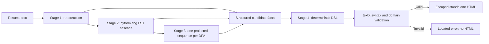

# ResumeLens: shared four-stage architecture

## Data flow

`src/pipeline.py::process_resume` is the orchestration boundary used by the web
API and Streamlit. It returns the extraction, normalization, classification,
candidate metadata and validated document. Core modules do not depend on React,
Streamlit or HTTP. The browser only presents server results.

| Module | Responsibility | Observable contract |
|---|---|---|
| `stage1_regex` | Recognize explicit text fragments and section boundaries | Source mentions, contacts, roles, education, total years |
| `stage2_fst` | CLEAN / ALIAS / EXPERIENCE and FILTER passes | Canonical tokens, original traces, unknown tokens, per-profile order |
| `stage3_classifier` | Execute four deterministic automata | Acceptance, transitions, final state, missing requirements |
| `stage4_grammar` | Serialize, parse, domain-check and render candidate documents | Immutable profile; valid DSL and HTML or a located error |
| `web_api` | Validate transport inputs and expose local JSON endpoints | Catalog, evaluation and DSL validation |
| `frontend`, `ui` | Explain results and offer downloads | React editor/preview; Streamlit trace and formalization views |

## Integration decisions

**Per-profile preparation.** The orchestrator deduplicates normalized evidence,
runs the Stage 2 FILTER passes for each profile, projects onto that alphabet and
calls strict `evaluate_profile`. Unrelated skills remain in `ignored_tokens`.
The direct-token mode skips this preparation to demonstrate word recognition:
order violations and foreign symbols reach the trap state.

**Data ownership.** The Stage 4 adapter copies accepted profile IDs exclusively
from the Stage 3 report. A job-title mention becomes a partial work record, not
proof of a particular employer or period. The DSL permits manual completion.
No dates, institutions or per-job durations are inferred. Exact total years,
including zero, remain distinct from the finite `EXPERIENCE_PRESENT` abstraction.

**Two validation levels.** The grammar checks structure and lexical forms.
textX processors enforce contacts, vocabulary, nonblank values and uniqueness.
Neither operation proves that personal facts are true. Manually editing an
accepted-profile declaration does not rerun or override the original DFA report.

**Output boundary.** HTML can only be obtained through a function that parses
the source first. Text is escaped; contact values are plain text; no scripts or
external assets are needed. CLI validation failure leaves an existing HTML file
untouched. In React, editing invalidates the preview and HTML download immediately;
a revision counter prevents an older asynchronous response from restoring them.

**Local execution.** HTTP binds to `127.0.0.1`. Submitted CVs stay in memory and
request logging does not record them. The extractor's separate JSON persistence
API remains available for explicit use. This demonstration server has no account,
access-control or production deployment features.

## Limits

- Dictionary and regex coverage limit recall; negation, nuanced context and skill
  proficiency are not modeled. A reported skill does not establish real competence.
- Contact validation follows the course patterns, not every international format.
- Fixed section/field order makes generation predictable but constrains manual editing.
- Classification uses project-defined category requirements. A separate instructor
  annex was not available to verify additional thresholds or profile constraints.
- The test suite checks programmed behavior, not recruitment accuracy or fairness.
