# Stage 1 — Resume Information Extraction (Regular Expressions)

> **ResumeLens** · Computación y Estructuras Discretas III · 2026-2
> Stage 1 design document: module design, **formalization** (regular expressions, regular grammars and finite
> automata), and test design.

Stage 1 reads the plain text of a résumé and **finds** the pieces of text that may describe the candidate or their
qualifications: contact data, name, professional experience, academic qualifications, programming languages,
frameworks and libraries, databases and tools. It uses regular expressions only.

Stage 1 deliberately does **not** decide that `JS` and `JavaScript` are the same thing (that is Stage 2, with
finite-state transducers) and does **not** decide whether the candidate satisfies a job profile (that is Stage 3,
with finite automata).

## Contents

0. [Overview](#0-overview)
1. [Design of modules](#1-design-of-modules)
2. [Formal framework](#2-formal-framework) — definitions, theorems and the Python ↔ mathematics dictionary
3. [Formal specification of every regular expression](#3-formal-specification-of-every-regular-expression)
4. [Supporting languages](#4-supporting-languages-sections-and-skill-lists) — sections and skill lists
5. [The extraction algorithm, formalized](#5-the-extraction-algorithm-formalized)
6. [Design of test cases](#6-design-of-test-cases)
7. [Limitations and possible improvements](#7-limitations-and-possible-improvements)
8. [How to run](#8-how-to-run)
9. [References](#9-references)

---

## 0. Overview

### 0.1 Where Stage 1 sits in the pipeline

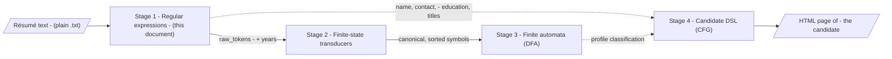

### 0.2 What Stage 1 extracts

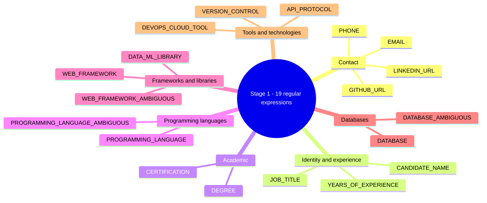

### 0.3 Life of one résumé through Stage 1

The résumé of the assignment (`Wednesday Addams`) is processed as follows. The tables of this section are produced by the
real code, they are not hand-written.

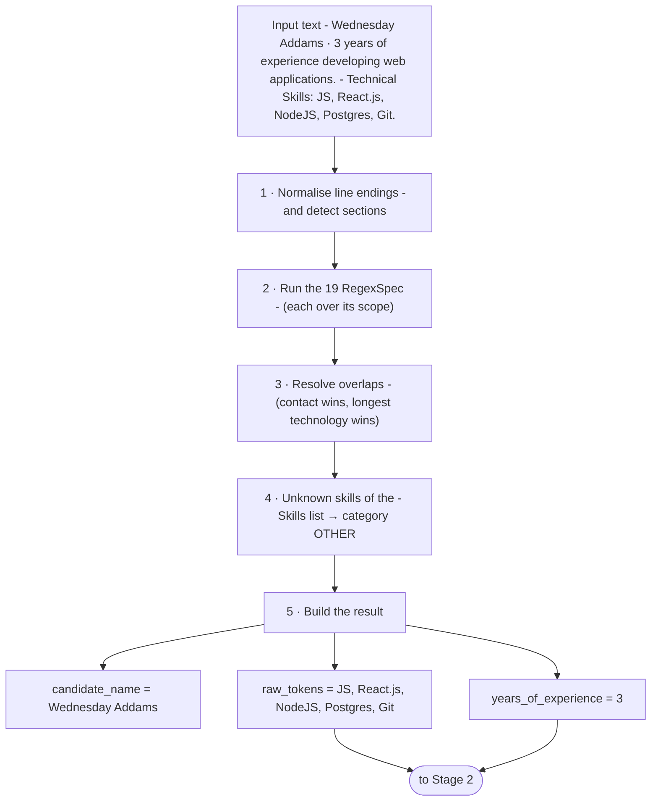

Items found in `tests/data/resumes/wednesday_addams.txt` (real output; spans are offsets in the original text):

| # | Spec | Category | Text | Span |
|---|---|---|---|---|
| 1 | `CANDIDATE_NAME` | IDENTITY | `Wednesday Addams` | [0, 16) |
| 2 | `YEARS_OF_EXPERIENCE` | EXPERIENCE | `3` | [17, 18) |
| 3 | `PROGRAMMING_LANGUAGE` | PROGRAMMING_LANGUAGE | `JS` | [86, 88) |
| 4 | `WEB_FRAMEWORK` | FRAMEWORK_LIBRARY | `React.js` | [90, 98) |
| 5 | `WEB_FRAMEWORK` | FRAMEWORK_LIBRARY | `NodeJS` | [100, 106) |
| 6 | `DATABASE` | DATABASE | `Postgres` | [108, 116) |
| 7 | `VERSION_CONTROL` | TOOL_TECHNOLOGY | `Git` | [118, 121) |

`raw_tokens = ['JS', 'React.js', 'NodeJS', 'Postgres', 'Git']` · `years_of_experience = 3` · `candidate_name = 'Wednesday Addams'`


---

## 1. Design of modules

### 1.1 Files

```
src/stage1_regex/
├── __init__.py        # public API of the stage
├── expressions.py     # THE REGULAR EXPRESSIONS as plain raw strings:  EMAIL_PATTERN = r"..."
├── models.py          # Category, Scope, RegexSpec, ExtractedItem, ExtractionResult
├── patterns.py        # THE CATALOG: wraps each expression in a documented RegexSpec
├── sections.py        # detects headings (Skills, Education ...) and splits skill lists
├── extractor.py       # ResumeExtractor engine + extract_qualifications() entry point
└── storage.py         # save / load an ExtractionResult as JSON
```

The design separates **data** (the regular expressions in `expressions.py`, wrapped and documented in the catalog
`patterns.py`) from **behaviour** (the engine that runs them). Every expression is a plain constant that can be tried
directly with `re`: `re.findall(YEARS_OF_EXPERIENCE_PATTERN, text, re.IGNORECASE)`. Supporting a new type of
information means adding one `RegexSpec` to `DEFAULT_SPECS`; the engine and the tests that check every documented
example pick it up automatically.

### 1.2 Dependencies between modules

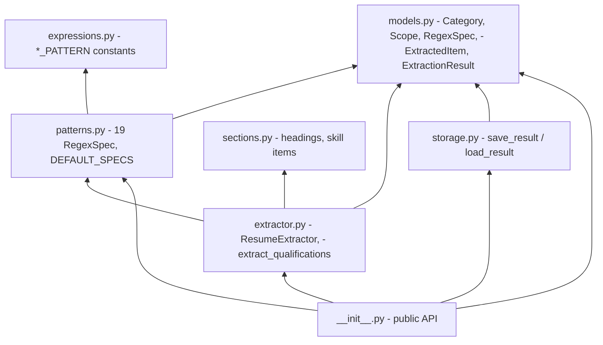

There are no cycles: `expressions.py` knows nothing about the rest, and `models.py` is the only module every other
module may depend on.

### 1.3 Class diagram

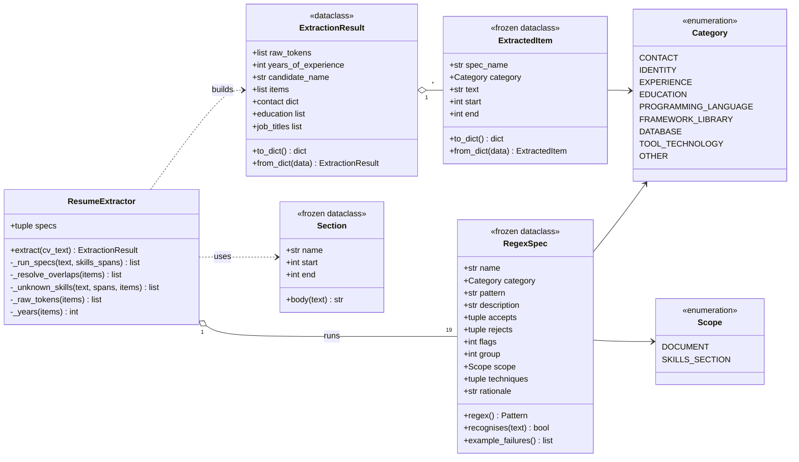

| Type | Role |
|------|------|
| `Category` | Coarse kind of information. The first block follows the list of the assignment. |
| `Scope` | Where a regex may look: `DOCUMENT` (anywhere) or `SKILLS_SECTION` (only inside the Skills section). |
| `RegexSpec` | One regular expression + its documentation: language recognised, strings it must accept and reject, techniques, rationale. |
| `ExtractedItem` | One finding with its category and its position `[start, end)` in the original text. |
| `ExtractionResult` | Everything Stage 1 outputs (see 1.6). |
| `Section` | A section of the résumé: its name and the span of its body. |

### 1.4 Functions

| Function / method | Input | Output |
|---|---|---|
| `extract_qualifications(cv_text)` | `str`: résumé text | `ExtractionResult` (entry point used by the pipeline and the UI) |
| `ResumeExtractor(specs).extract(cv_text)` | résumé text | `ExtractionResult`; `specs` defaults to the whole catalog |
| `split_sections(text)` | résumé text | `list[Section]` (name + span of each heading's body) |
| `section_spans(text, name)` | text, section name | `list[(start, end)]` |
| `split_skill_items(text, start, end)` | text and a span | `list[(item, start, end)]`: items of a skills list, without bullets, labels or trailing dot |
| `RegexSpec.recognises(s)` | `str` | `bool`: does the *whole* string belong to the language of the regex (`fullmatch`)? |
| `RegexSpec.example_failures()` | — | documented examples that the pattern does not honour (must be empty) |
| `save_result(result, path)` / `load_result(path)` | result / path | JSON file / `ExtractionResult` |

### 1.5 Behaviour of `ResumeExtractor.extract`

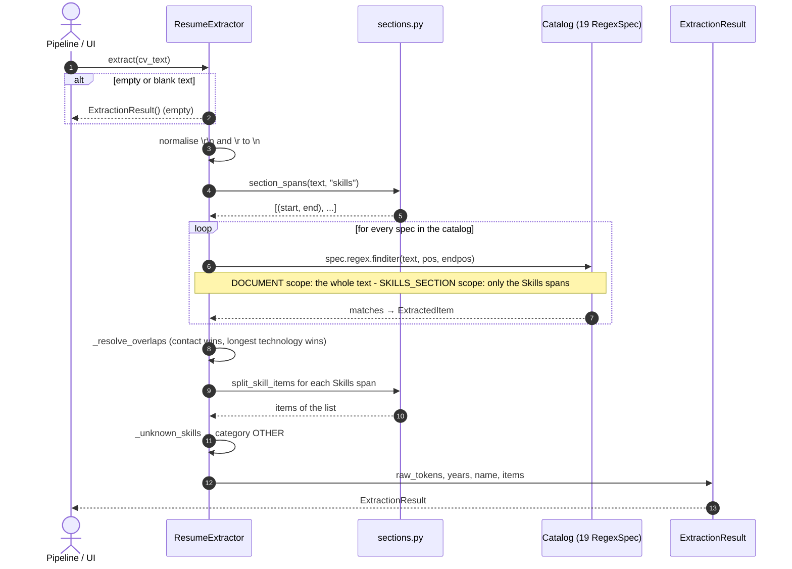

The five steps in prose:

1. **Normalise** line endings (`\r\n` → `\n`) and locate the Skills section(s) with `sections.py`.
2. **Run each `RegexSpec`** over its scope with `finditer(text, pos, endpos)`. Using `pos`/`endpos` instead of
   slicing keeps the look-behinds able to see the characters just before the section.
3. **Resolve overlaps among technologies**: a technology found *inside* a contact item (for example a `git` inside an
   e-mail address) is dropped; among overlapping technologies the **longest** wins (`GitHub Actions` beats `GitHub`).
   Formalized in [section 5](#5-the-extraction-algorithm-formalized).
4. **Unknown skills**: items of the Skills list that no technology pattern explains become category `OTHER`
   (for example `Figma`). Stage 1 keeps them so no information is lost; Stage 2 decides whether it knows them.
5. **Build the result**: `raw_tokens`, `years_of_experience`, `candidate_name` and the full list of `items`.

### 1.6 Output contract (`ExtractionResult`)

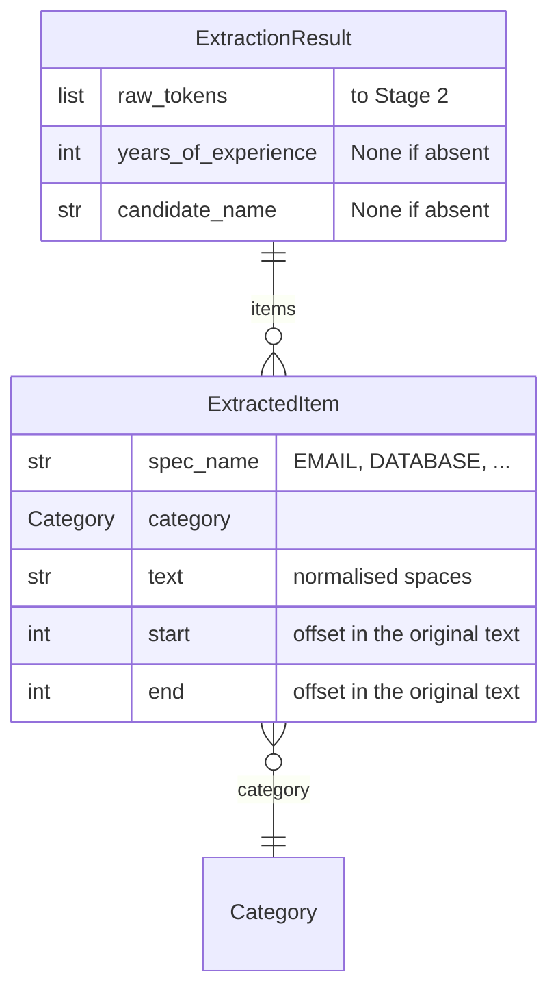

| Field | Type | Meaning |
|---|---|---|
| `raw_tokens` | `list[str]` | **Hand-over to Stage 2.** Qualification strings exactly as the candidate wrote them (`JS`, `React.js`, `Postgres` ...), in order of appearance, de-duplicated case-insensitively. Contains only technologies (including `OTHER`), **never** the years of experience. |
| `years_of_experience` | `int \| None` | Largest quantity of years mentioned (`10+ years` → `10`). |
| `candidate_name` | `str \| None` | Name at the beginning of the résumé. |
| `items` | `list[ExtractedItem]` | Every finding with its category and position. |
| `contact` | `dict` (property) | `email`, `phone`, `linkedin`, `github` lists. |
| `education` / `job_titles` | `list[str]` (properties) | Degrees and certifications / job titles. |
| `to_dict()` / `from_dict()` | — | JSON-friendly representation (used by `storage.py` and useful for Stage 4). |

Years are kept apart from `raw_tokens` on purpose: a number is not a qualification token, and mixing it into the
token stream made the classification stage depend on how many digits a number has. Stage 2 receives the amount of
years separately and is the one that turns it into the symbol `EXPERIENCE_PRESENT`.

### 1.7 Contract with the other stages

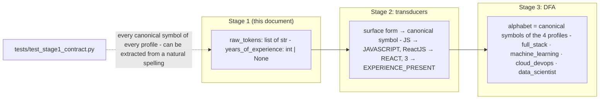
---

## 2. Formal framework

This section fixes the mathematical language used in the rest of the document. The notation follows the course
(*Regular Grammars* and *Regex in Python: Review & Advanced Patterns*): regular expressions are built with union (∪),
concatenation and the Kleene star (\*), and they describe exactly the languages accepted by finite automata and
generated by regular grammars.

### 2.1 Alphabets, strings and languages

| Notation | Meaning |
|---|---|
| Σ | **Alphabet**: a finite, non-empty set of symbols. For Stage 1, Σ is the set of characters of the résumé text (Unicode). |
| w = a₁a₂…aₙ | A **string** over Σ; \|w\| = n is its length. |
| ε | The **empty string** (\|ε\| = 0). |
| Σ\* | The set of **all** strings over Σ (including ε). |
| L ⊆ Σ\* | A **language**: any set of strings. |
| L₁ ∪ L₂ | **Union**: strings in L₁ or in L₂. |
| L₁ · L₂ | **Concatenation**: { uv \| u ∈ L₁, v ∈ L₂ }. |
| L\* | **Kleene star**: L⁰ ∪ L¹ ∪ L² ∪ …, where L⁰ = {ε} and Lⁿ⁺¹ = L · Lⁿ. |
| L⁺ | L · L\* (one or more repetitions). |
| L₁ ∩ L₂ , L₁ ∖ L₂ , L̄ | Intersection, difference and complement (Σ\* ∖ L). |

### 2.2 Regular expressions

**Syntax.** The set of regular expressions over Σ is defined inductively:

1. ∅ is a regular expression (the empty language).
2. ε is a regular expression.
3. Every symbol a ∈ Σ is a regular expression.
4. If r and s are regular expressions, so are **(r ∪ s)**, **(r · s)** (written *rs*) and **(r\*)**.

**Semantics.** The language L(r) described by r is defined by:

| r | L(r) |
|---|---|
| ∅ | ∅ |
| ε | {ε} |
| a | {a} |
| r ∪ s | L(r) ∪ L(s) |
| r s | L(r) · L(s) |
| r\* | L(r)\* |

**Abbreviations** used throughout the document (all of them can be rewritten with the three basic operators):

| Abbreviation | Definition | Python |
|---|---|---|
| r⁺ | r r\* | `r+` |
| r? | r ∪ ε | `r?` |
| rⁿ | r r … r (n times) | `r{n}` |
| r{n,m} | rⁿ ∪ rⁿ⁺¹ ∪ … ∪ rᵐ | `r{n,m}` |
| [a₁a₂…aₖ] | a₁ ∪ a₂ ∪ … ∪ aₖ | `[a₁a₂…aₖ]` |
| [a-z] | the union of every symbol between a and z | `[a-z]` |
| lit(w) | the concatenation of the symbols of w | the characters of `w` (escaped when special) |

A language is **regular** if it is L(r) for some regular expression r.

### 2.3 Dictionary: Python `re` ↔ formal notation

| Python syntax | Formal notation | Example from Stage 1 |
|---|---|---|
| `ab` | a · b | `linkedin\.com` = lit(linkedin.com) |
| `a\|b` | a ∪ b | `Git\|SVN` = git ∪ svn |
| `a*` | a\* | `[a-z]*` |
| `a+` | a⁺ | `[\w.+-]+` = (W ∪ . ∪ + ∪ −)⁺ |
| `a?` | a ∪ ε | `https?` = http (s ∪ ε) |
| `a{2,4}` | a² ∪ a³ ∪ a⁴ | `{1,3}` in `\+\d{1,3}` |
| `(?:…)` | grouping (parentheses of the formal expression) | `(?:Hub\|Lab)` |
| `[abc]` / `[a-z]` | a ∪ b ∪ c / union of the range | `[A-Za-z0-9-]` |
| `\d` | D = {0,…,9} | `\d{4}` |
| `\w` | W = letters ∪ digits ∪ {\_} (Unicode letters included) | `[\w.+-]` |
| `\s` | S = whitespace characters | `Full[\s-]?Stack` |
| `.` between `\ `-escapes | the literal symbol "." | `\.` |
| `(?i:…)` / `re.IGNORECASE` | case-folding substitution φ (section 2.9) | `(?i:GraphQL)` |
| `(?<!X)…` , `(?<=X)…` | **context condition** on the previous character (section 2.8) | `(?<![\w.+-])` |
| `…(?!X)` , `…(?=X)` | **context condition** on the following character (section 2.8) | `(?![\w@-])` |
| `\b` | context condition: word/non-word boundary | `\b` at the end of the years pattern |
| `\A` | context condition: start of the text | `CANDIDATE_NAME` |

### 2.4 Finite automata

**Deterministic finite automaton (DFA).** A DFA is a 5-tuple **M = (Q, Σ, δ, q₀, F)** where

* Q is a finite set of **states**,
* Σ is the input **alphabet**,
* δ : Q × Σ → Q is the **transition function**,
* q₀ ∈ Q is the **initial state**,
* F ⊆ Q is the set of **final (accepting) states**.

The extended function δ\* : Q × Σ\* → Q is defined by δ\*(q, ε) = q and δ\*(q, wa) = δ(δ\*(q, w), a).
The language accepted by M is **L(M) = { w ∈ Σ\* \| δ\*(q₀, w) ∈ F }**.

*Convention used in the diagrams:* the transition function is **partial**. A missing arrow means "go to a dead state
from which no final state can be reached" (the string is rejected). Dead states are not drawn, which is why a
diagram may have fewer arrows than \|Q\|·\|Σ\|. An arrow from a state to `[*]` marks a final state, and the arrow
`[*] → q₀` marks the initial state.

**Non-deterministic automata (NFA / ε-NFA)** allow several (or ε) transitions from the same state; they accept a
string if *some* path leads to a final state. They are the natural target of Thompson's construction.

### 2.5 Regular grammars

A **regular grammar** (right-linear) is a 4-tuple **G = (Σ, N, S, P)** where

* Σ is the alphabet of **terminals**,
* N is a finite set of **non-terminals** (N ∩ Σ = ∅),
* S ∈ N is the **start symbol**,
* P is a finite set of **productions**, each of the form **A → aB**, **A → a** or **A → ε** with A, B ∈ N and a ∈ Σ.

A derivation step is written α ⇒ β, and **L(G) = { w ∈ Σ\* \| S ⇒\* w }**.

*Compact form.* In the sheets of section 3 the right-hand side may contain a **string of terminals** followed by at
most one non-terminal (`A → a₁a₂…aₖ B`), and a terminal may be a **named class** (for example `D` for any digit). This is
shorthand for a finite number of ordinary rules (introduce k−1 intermediate non-terminals; replace the class by
one rule per member), so the grammars remain regular. A few compact grammars also contain *unit productions* `A → B`; they are
eliminated by copying the rules of B into A, which does not change the language.

### 2.6 The equivalence theorems and how they are used here

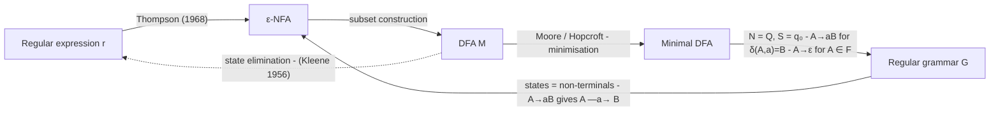

**Theorem (Kleene).** For every language L the following are equivalent: (1) L = L(r) for a regular expression r;
(2) L = L(M) for a DFA M; (3) L = L(M') for an NFA M'; (4) L = L(G) for a regular grammar G.

**Constructions used in this document**

| From → To | Construction | Rule |
|---|---|---|
| Automaton → grammar | states become non-terminals | N = Q, S = q₀, **A → aB** for every δ(A, a) = B, **A → ε** for every A ∈ F |
| Grammar → automaton | non-terminals become states | each **A → aB** is an arrow A —a→ B; **A → a** is an arrow into a new final state; **A → ε** makes A final |
| Expression → automaton | Thompson + subset construction + minimisation | the automata of section 3 are *minimal* DFAs |

**Procedure followed for every sheet of section 3** (it is how the numbers in this document were obtained):

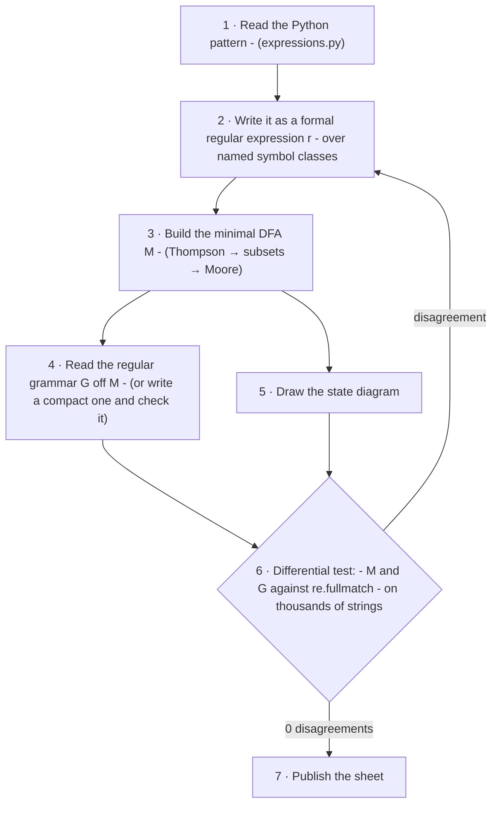

The differential test (step 6) generates random strings and random *mutations* (delete / insert / replace a symbol) of
the documented examples, and compares three things: `re.fullmatch(pattern, s)`, the DFA and the grammar. It is strong
evidence of equivalence, not a proof; the numbers are in section 3.20.

### 2.7 Worked example of the constructions: `Git(?:Hub|Lab)?`

The expression of the version-control tools, restricted to the git family, is

> **r = git (hub ∪ lab ∪ ε)**

Its minimal DFA (after Thompson and the subset construction) is:

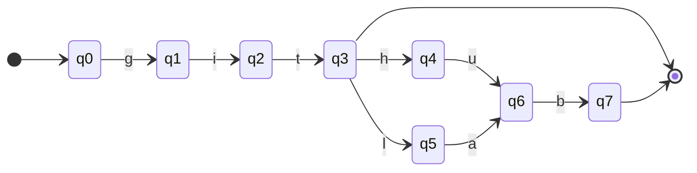

Reading the automaton as a regular grammar (N = Q, S = q₀, every state is a non-terminal):

```text
Q0 → g Q1
Q1 → i Q2
Q2 → t Q3
Q3 → h Q4 | l Q5 | ε
Q4 → u Q6
Q5 → a Q6
Q6 → b Q7
Q7 → ε
```

and a derivation of `github`:

```text
Q0 ⇒ g Q1 ⇒ gi Q2 ⇒ git Q3 ⇒ gith Q4 ⇒ githu Q6 ⇒ github Q7 ⇒ github      (last step: Q7 → ε)

Automaton:  q0 -g→ q1 -i→ q2 -t→ q3 -h→ q4 -u→ q6 -b→ q7  ✓ final
```

### 2.8 Context conditions (the look-arounds)

Python's look-behind `(?<!X)` and look-ahead `(?!X)` do **not** consume characters: they are conditions on the
neighbourhood of the match. Formally, let w be the text, r a regular expression and B, A two sets of
*forbidden neighbours*. A **match** of r in w is a pair (i, j) such that

> **w[i..j) ∈ L(r)** ∧ **(i = 0 ∨ w[i−1] ∉ B)** ∧ **(j = \|w\| ∨ w[j] ∉ A)**

i.e. the string is in the language *and* the character immediately before is not in B *and* the character immediately
after is not in A. Because each condition looks at a bounded window around the match, the set of strings
*c · x · d* accepted by the conditions is still regular (it is the intersection of L(r) with a local —k-testable—
language), so **look-arounds never take us out of the regular languages**; they only make the specification shorter.

Stage 1 uses three standard contexts, defined once in `expressions.py`:

| Name | Python | Condition | Why |
|---|---|---|---|
| `_LB` (left boundary) | `(?<![\w.+#&])` | the previous character is **not** in W ∪ {`.`, `+`, `#`, `&`} | `JS` is not found inside `main.js`, `R` not inside `R&D`, `C#` not inside `F#C#` |
| `_RB` (right boundary) | `(?![\w+#&]\|-\w\|\.\w)` | the next character is **not** in W ∪ {`+`, `#`, `&`}, and is not a hyphen or dot **followed by** a word character | `JS` is not found in `JSON`, `Python` not in `Python-based`, `Node` not in `Node.jsx`; but a final dot (`Git.`) is allowed |
| `_NOT_NAME` | `(?!(?i:technical\|skills\|…)\b)` | the word that starts here is **not** one of the heading/job words | a heading such as `Technical Skills` is not a name; formally the set difference *Word ∖ Heading* of two regular languages (regular) |

The right boundary uses a *two-character* window (`-\w`, `\.\w`), a good example of a local condition that is not a
single forbidden character.

### 2.9 Case-insensitive matching

With `re.IGNORECASE` (or the scoped group `(?i:…)`) each symbol a stands for the **set** φ(a) = { a, a′ } where a′ is its
other case. φ extends to a substitution on languages, φ(L) = { w′ \| w ∈ L, w′ obtained by replacing each aᵢ with a
member of φ(aᵢ) }. Regular languages are **closed under substitution by finite sets**, so **L\_i(r) = φ(L(r))** is regular.
In the sheets this is shown by writing the expression in lower case and noting "fold φ".

Scoped groups matter: in `Bachelor|Master … (?i:of|in) …CAPS` only the keywords are case-insensitive, while the field of
study must still start with a capital letter.

### 2.10 Python's `re` versus the mathematical union

Two behaviours of a real engine that the formal notation does not have, and how the design deals with them:

| Behaviour of `re` | Mathematical union | Consequence in Stage 1 |
|---|---|---|
| **Ordered alternation**: `a\|b` tries `a` first and takes the first alternative that lets the *whole pattern* succeed (leftmost, **not** longest). | `a ∪ b` is a set; there is no order. | Alternatives that share a prefix are written **longest first** (`SQL[\s-]?Server` before `SQL`). The engine then also removes overlaps ([section 5](#5-the-extraction-algorithm-formalized)). |
| **`finditer`** returns non-overlapping, leftmost matches. | L(r) is only a set of strings. | Overlaps between *different* expressions are resolved explicitly by the extractor. |
| **`fullmatch`** vs **`search`** | L(r) always describes whole strings. | The documented *accepts / rejects* lists use `fullmatch`, i.e. they test membership in L(r) exactly as defined in 2.2. |
| **Backtracking** may be exponential for nested quantifiers. | Irrelevant: a DFA reads each symbol once. | The expressions avoid nested unbounded quantifiers over the same symbols; each equals a small DFA (section 3), so matching is linear. |

### 2.11 Symbol classes used in the sheets

| Class | Set | Python |
|---|---|---|
| D | { 0, 1, …, 9 } | `\d` |
| A | ASCII letters and digits | `[A-Za-z0-9]` |
| W | A ∪ non-ASCII letters/digits ∪ { \_ } | `\w` |
| U (in names) | upper-case letters, including Á É Í Ó Ú Ñ | `[A-ZÁÉÍÓÚÑ]` |
| Ll | lower-case letters, including á é í ó ú ñ ü | `[a-záéíóúñü]` |
| S | whitespace | `\s` |
| Sp | blank: space or tab | `[ \t]` |
| Sep | separator: space or hyphen | `[ -]` |
---

## 3. Formal specification of every regular expression

Every sheet has the same structure so that they can be compared:

1. **Python expression** exactly as it appears in `expressions.py`.
2. **Formal regular expression** with ∪, concatenation and \* (section 2.2), and the language in set notation.
3. **Context conditions** (look-arounds, section 2.8).
4. **State diagram** of the minimal DFA (or the NFA read off the grammar when the DFA is too large to draw).
5. **Regular grammar** G = (Σ, N, S, P), with the same behaviour as the automaton.
6. **Traces** of accepted and rejected strings.
7. **Documented examples**, a **real run** of the engine on a sample text, techniques and design rationale.

All the automata and grammars shown were checked against the real Python expression (section 3.20).

| § | Expression | Category | Scope | Language | Model |
|---|---|---|---|---|---|
| 3.1 | [`EMAIL`](#31-email) | CONTACT | DOCUMENT | infinite | DFA over characters |
| 3.2 | [`PHONE`](#32-phone) | CONTACT | DOCUMENT | finite (≈10¹⁰·prefixes) | DFA over characters |
| 3.3 | [`LINKEDIN_URL`](#33-linkedin_url) | CONTACT | DOCUMENT | infinite | DFA over characters |
| 3.4 | [`GITHUB_URL`](#34-github_url) | CONTACT | DOCUMENT | infinite | DFA over characters |
| 3.5 | [`CANDIDATE_NAME`](#35-candidate_name) | IDENTITY | DOCUMENT | infinite | DFA over characters |
| 3.6 | [`YEARS_OF_EXPERIENCE`](#36-years_of_experience) | EXPERIENCE | DOCUMENT | finite | DFA over characters |
| 3.7 | [`JOB_TITLE`](#37-job_title) | EXPERIENCE | DOCUMENT | finite | DFA over word classes |
| 3.8 | [`DEGREE`](#38-degree) | EDUCATION | DOCUMENT | infinite (field words) | DFA over word classes |
| 3.9 | [`CERTIFICATION`](#39-certification) | EDUCATION | DOCUMENT | infinite (title words) | DFA over word classes |
| 3.10 | [`PROGRAMMING_LANGUAGE`](#310-programming_language) | PROGRAMMING_LANGUAGE | DOCUMENT | finite | DFA over characters |
| 3.11 | [`PROGRAMMING_LANGUAGE_AMBIGUOUS`](#311-programming_language_ambiguous) | PROGRAMMING_LANGUAGE | SKILLS_SECTION | finite | DFA over characters |
| 3.12 | [`WEB_FRAMEWORK`](#312-web_framework) | FRAMEWORK_LIBRARY | DOCUMENT | finite | DFA over characters |
| 3.13 | [`WEB_FRAMEWORK_AMBIGUOUS`](#313-web_framework_ambiguous) | FRAMEWORK_LIBRARY | SKILLS_SECTION | finite | DFA over characters |
| 3.14 | [`DATA_ML_LIBRARY`](#314-data_ml_library) | FRAMEWORK_LIBRARY | DOCUMENT | finite | DFA over characters |
| 3.15 | [`DATABASE`](#315-database) | DATABASE | DOCUMENT | finite | DFA over characters |
| 3.16 | [`DATABASE_AMBIGUOUS`](#316-database_ambiguous) | DATABASE | SKILLS_SECTION | finite | DFA over characters |
| 3.17 | [`API_PROTOCOL`](#317-api_protocol) | TOOL_TECHNOLOGY | DOCUMENT | finite | DFA over characters |
| 3.18 | [`VERSION_CONTROL`](#318-version_control) | TOOL_TECHNOLOGY | DOCUMENT | finite | DFA over characters |
| 3.19 | [`DEVOPS_CLOUD_TOOL`](#319-devops_cloud_tool) | TOOL_TECHNOLOGY | DOCUMENT | finite | DFA over characters |

The nineteen expressions fall into three families:

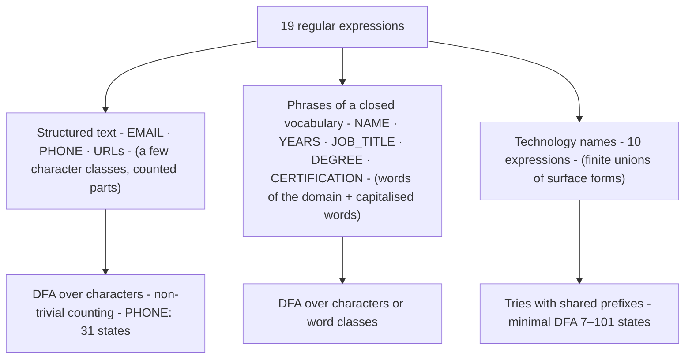

### 3.1 `EMAIL`

| Category | Scope | Flags | Kept group | Verified model |
|---|---|---|---|---|
| `CONTACT` | `DOCUMENT` | `none` | 0 | minimal DFA, 6 states |

**Python expression** (`expressions.py`)

```regex
(?<![\w.+-])[\w.+-]+@[A-Za-z0-9-]+(?:\.[A-Za-z0-9-]+)+(?![\w@-])
```

**Language recognised.** A local part of word characters, dots, plus signs or hyphens, an '@', and a domain made of at least two dot-separated labels of letters, digits or hyphens.

**Formal regular expression**

```text
r = (A ∪ N ∪ {_} ∪ {-} ∪ {.} ∪ {+})⁺ · @ · (A ∪ {-})⁺ · ( . (A ∪ {-})⁺ )⁺
```

**Language (set notation)**

```text
L = { x @ y  |  x ∈ (W ∪ {.,+,-})⁺ ,  y = l₁ . l₂ … . lₖ ,  k ≥ 2 ,  each lᵢ ∈ (A ∪ {-})⁺ }
A = ASCII letters and digits; N = non-ASCII letters/digits; W = A ∪ N ∪ {_} (= `\w`).
```

**Context conditions (look-arounds, section 2.8)**

* Before the match: the previous character ∉ W ∪ {`.`, `+`, `-`}  (`(?<![\w.+-])`).
* After the match: the next character ∉ W ∪ {`@`, `-`}  (`(?![\w@-])`).

**Symbols of the automaton**

| Symbol | Meaning |
|---|---|
| L | W ∪ {. + -}: any local-part character |
| X | A ∪ {-}: character of a domain label |
| At | `@` |
| P | `.` |


**State diagram** (minimal DFA, M = (Q, Σ, δ, q₀, F) with Q = {q₀,…,q₅}, F = {q₅})

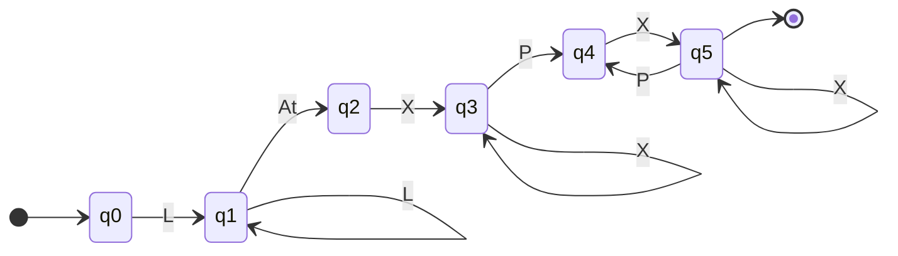

**Regular grammar** G = (Σ, N, S, P) with S = X₀ (compact form, checked against the DFA)

```text
S → L S | L At D1
D1 → X D1 | X D2
D2 → P X D3
D3 → X D3 | P X D3 | ε
```

<details><summary>Grammar induced mechanically by the DFA (N = Q, S = q₀)</summary>

```text
Q0 → A Q1 | H Q1 | N Q1 | P Q1 | Pl Q1 | U Q1
Q1 → A Q1 | At Q2 | H Q1 | N Q1 | P Q1 | Pl Q1 | U Q1
Q2 → A Q3 | H Q3
Q3 → A Q3 | H Q3 | P Q4
Q4 → A Q5 | H Q5
Q5 → A Q5 | H Q5 | P Q4 | ε
```

</details>

**Traces** (δ\* applied to the symbol sequence; ✓ accepted, ✗ rejected)

```text
a.b@c.io                 q0 -A→ q1 -P→ q1 -A→ q1 -At→ q2 -A→ q3 -P→ q4 -A→ q5 -A→ q5  ✓ final
a@b                      q0 -A→ q1 -At→ q2 -A→ q3  ✗ (q3 is not final)
```

**Documented examples** (checked by the test-suite with `fullmatch`)

| Accepted (∈ L) | Rejected (∉ L) |
|---|---|
| `wednesday.addams@example.com` | `user@localhost` |
| `juan_perez+cv@mail.icesi.edu.co` | `@example.com` |
|  | `user@.com` |
|  | `user name@example.com` |

**Matches found in a sample text** (real output of the engine)

* Text: `Write to wednesday.addams@example.com or juan_perez+cv@mail.icesi.edu.co. Not user@localhost.`
* Matches: `wednesday.addams@example.com`, `juan_perez+cv@mail.icesi.edu.co`

**Techniques:** character sets, quantifiers, non-capturing group, negative lookbehind/lookahead.

**Design rationale.** At least one dot in the domain avoids matching '@' mentions such as 'user@localhost'. A trailing sentence dot is not swallowed because a label must contain a letter or digit.

* The automaton has **6 states**: q₀ (nothing yet), q₁ (reading the local part), q₂ (just read `@`), q₃ (first label), q₄ (just read `.`), q₅ (a label after a dot; **final**).
* Requiring at least one dot in the domain (the `(…)⁺` after the first label) is what rejects `user@localhost`.

### 3.2 `PHONE`

| Category | Scope | Flags | Kept group | Verified model |
|---|---|---|---|---|
| `CONTACT` | `DOCUMENT` | `none` | 0 | minimal DFA, 31 states |

**Python expression** (`expressions.py`)

```regex
(?<![\w+])(?:\+\d{1,3}[ -]?)?(?:\(\d{3}\)[ -]?|\d{3}[ -]?)\d{3}[ -]?\d{4}(?!\d)
```

**Language recognised.** A 10-digit phone number written as 3-3-4 digits, optionally separated by spaces or hyphens, optionally with the area code in parentheses and an international prefix '+' followed by 1 to 3 digits.

**Formal regular expression**

```text
r = ( + D{1,3} Sep? )? · ( ( "(" D³ ")" ) Sep? ∪ D³ Sep? ) · D³ · Sep? · D⁴
```

**Language (set notation)**

```text
L = { [+cc] [area] xxx [sep] xxxx }: an optional international prefix `+` followed by 1–3 digits, then **exactly ten digits** grouped 3-3-4, where the first group may be written in parentheses and any group boundary may carry one space or hyphen.
Sep = {space, hyphen};  D = digits.
```

**Context conditions (look-arounds, section 2.8)**

* Before the match: the previous character ∉ W ∪ {`+`}  (`(?<![\w+])`), so a number cannot start in the middle of a longer token.
* After the match: the next character is **not a digit**  (`(?!\d)`), so an 11th digit is not silently dropped.

**Symbols of the automaton**

| Symbol | Meaning |
|---|---|
| D | digit |
| Sep | space or hyphen |
| Plus | `+` |
| Lp / Rp | `(` / `)` |


**Automaton.** The diagram is the NFA read directly off the regular grammar below (non-terminals are states, so it is exactly the grammar → automaton construction of section 2.6). The minimal *deterministic* automaton of the same language has **31 states** (verified below), too many to draw legibly.

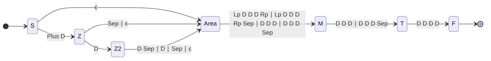

**Regular grammar** (compact form of section 2.5; checked against the minimal DFA)

```text
S → Plus D Z | Area
Z → D Z2 | Sep Area | Area
Z2 → D Sep Area | D Area | Sep Area | Area
Area → Lp D D D Rp M | Lp D D D Rp Sep M | D D D M | D D D Sep M
M → D D D T | D D D Sep T
T → D D D D
```

**Traces** (δ\* applied to the symbol sequence; ✓ accepted, ✗ rejected)

```text
304-555-1234             q0 -D→ q1 -D→ q4 -D→ q7 -Hy→ q12 -D→ q11 -D→ q15 -D→ q17 -Hy→ q20 -D→ q19 -D→ q22 -D→ q24 -D→ q26  ✓ final
555-1234                 q0 -D→ q1 -D→ q4 -D→ q7 -Hy→ q12 -D→ q11 -D→ q15 -D→ q17 -D→ q19  ✗ (q19 is not final)
```

**Documented examples** (checked by the test-suite with `fullmatch`)

| Accepted (∈ L) | Rejected (∉ L) |
|---|---|
| `304-555-1234` | `12345` |
| `(304) 555-1234` | `2019-2023` |
| `+57 300 123 4567` | `555-1234` |
| `3001234567` | `+57 300 123 45` |

**Matches found in a sample text** (real output of the engine)

* Text: `Call (304) 555-1234, +57 300 123 4567 or 304-555-1234. Studied 2019-2023, office 555-1234.`
* Matches: `(304) 555-1234`, `+57 300 123 4567`, `304-555-1234`

**Techniques:** optional groups, bounded quantifiers {n,m}, negative lookbehind/lookahead.

**Design rationale.** Requiring exactly 10 digits keeps year ranges such as '2019-2023' and short numbers out. The negative lookahead (?!\d) prevents matching the first 10 digits of a longer number.

* Every accepted string has 10 digits after the optional prefix; that is why the year ranges `2019-2023` (8 digits) and local numbers `555-1234` (7 digits) are rejected.
* The minimal DFA has **31 states** because it must count digits; the compact grammar below (non-deterministic) has 6 non-terminals and is easier to read.

### 3.3 `LINKEDIN_URL`

| Category | Scope | Flags | Kept group | Verified model |
|---|---|---|---|---|
| `CONTACT` | `DOCUMENT` | `re.IGNORECASE` | 0 | minimal DFA, 31 states |

**Python expression** (`expressions.py`)

```regex
(?<![\w.])(?:https?://)?(?:www\.)?linkedin\.com/in/[\w%-]+/?
```

**Language recognised.** A LinkedIn profile address: optional 'http(s)://' and 'www.', the host 'linkedin.com', the path '/in/' and a user handle of word characters, '%' or hyphens, with an optional final slash.

**Formal regular expression**

```text
r = ( http s? :// )? ( www. )? linkedin.com/in/ · Hd⁺ · /?     (fold φ: case-insensitive)
Hd = W ∪ {%} ∪ {-}
```

**Language (set notation)**

```text
L = { [scheme://] [www.] linkedin.com/in/ handle [/] }  with handle ∈ (W ∪ {%,-})⁺.
```

**Context conditions (look-arounds, section 2.8)**

* Before the match: the previous character ∉ W ∪ {`.`}  (`(?<![\w.])`), so `notlinkedin.com/in/x` is not a profile.

**Symbols of the automaton**

| Symbol | Meaning |
|---|---|
| Hd | handle character: W ∪ {% -} |
| literal text | the characters of the host and the path |


**Automaton.** The diagram is the NFA read directly off the regular grammar below (non-terminals are states, so it is exactly the grammar → automaton construction of section 2.6). The minimal *deterministic* automaton of the same language has **31 states** (verified below), too many to draw legibly.

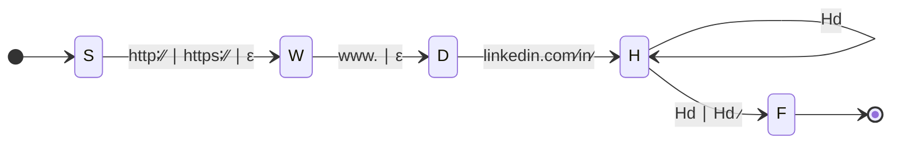

**Regular grammar** (compact form of section 2.5; checked against the minimal DFA)

```text
S → 'http://' W | 'https://' W | W
W → 'www.' D | D
D → 'linkedin.com/in/' H
H → Hd H | Hd | Hd '/'
```

**Traces** (δ\* applied to the symbol sequence; ✓ accepted, ✗ rejected)

```text
https://www.linkedin.com/in/wadd/
    q0 —https://→ q18 —www.→ q12 —linkedin.com/in/→ q28 —wadd→ q29 —/→ q30  ✓ final
linkedin.com/company/x
    q0 —linkedin.com/→ q25 —company/x→ ✗ (rejected: no transition from q25 on c)
```

**Documented examples** (checked by the test-suite with `fullmatch`)

| Accepted (∈ L) | Rejected (∉ L) |
|---|---|
| `linkedin.com/in/wednesday-addams` | `linkedin.com` |
| `https://www.linkedin.com/in/wadd/` | `linkedin.com/company/nevermore` |
|  | `notlinkedin.com/in/x` |

**Matches found in a sample text** (real output of the engine)

* Text: `LinkedIn: https://www.linkedin.com/in/wednesday-addams/ and linkedin.com/in/jmwatson; not linkedin.com/company/nevermore.`
* Matches: `https://www.linkedin.com/in/wednesday-addams/`, `linkedin.com/in/jmwatson`

**Techniques:** optional groups, escaping literals, IGNORECASE flag.

**Design rationale.** 

* The scheme and `www.` are optional, so `linkedin.com/in/wadd` (as written on most résumés) is accepted.
* Only `/in/` profile paths are accepted; company pages (`/company/…`) are not personal profiles.

### 3.4 `GITHUB_URL`

| Category | Scope | Flags | Kept group | Verified model |
|---|---|---|---|---|
| `CONTACT` | `DOCUMENT` | `re.IGNORECASE` | 0 | minimal DFA, 29 states |

**Python expression** (`expressions.py`)

```regex
(?<![\w.])(?:https?://)?(?:www\.)?github\.com/[\w-]+(?:/[\w-]+(?:\.[\w-]+)*)?/?
```

**Language recognised.** A GitHub profile or repository address: optional scheme and 'www.', the host 'github.com', a user name and, optionally, a repository name.

**Formal regular expression**

```text
r = ( http s? :// )? ( www. )? github.com/ · Hg⁺ · ( / Hg⁺ ( . Hg⁺ )* )? · /?     (fold φ)
Hg = W ∪ {-}
```

**Language (set notation)**

```text
L = { [scheme://] [www.] github.com/ user [ / repo ] [/] }  with user ∈ Hg⁺ and repo ∈ Hg⁺ ( . Hg⁺ )*  (repository names may contain dots).
```

**Context conditions (look-arounds, section 2.8)**

* Before the match: the previous character ∉ W ∪ {`.`}  (`(?<![\w.])`).

**Symbols of the automaton**

| Symbol | Meaning |
|---|---|
| Hg | user/repo character: W ∪ {-} |
| literal text | the characters of the host and the separators |


**Automaton.** The diagram is the NFA read directly off the regular grammar below (non-terminals are states, so it is exactly the grammar → automaton construction of section 2.6). The minimal *deterministic* automaton of the same language has **29 states** (verified below), too many to draw legibly.

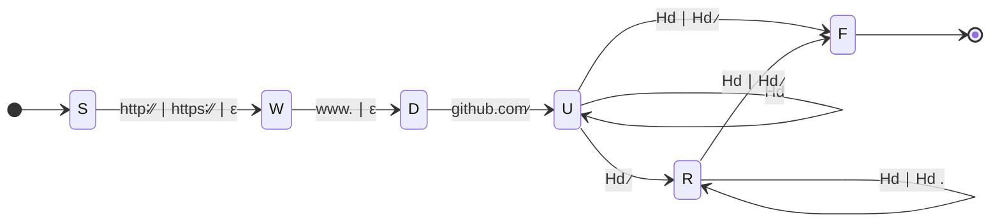

**Regular grammar** (compact form of section 2.5; checked against the minimal DFA)

```text
S → 'http://' W | 'https://' W | W
W → 'www.' D | D
D → 'github.com/' U
U → Hd U | Hd | Hd '/' | Hd '/' R
R → Hd R | Hd | Hd '/' | Hd '.' R
```

**Traces** (δ\* applied to the symbol sequence; ✓ accepted, ✗ rejected)

```text
github.com/wednesday/nevermore.js
    q0 —github.com/→ q23 —wednesday→ q24 —/→ q25 —nevermore→ q26 —.→ q27 —js→ q26  ✓ final
github.com/
    q0 —github.com/→ q23  ✗ (q23 is not final)
```

**Documented examples** (checked by the test-suite with `fullmatch`)

| Accepted (∈ L) | Rejected (∉ L) |
|---|---|
| `github.com/wednesday` | `github.com` |
| `https://github.com/wednesday/nevermore-notes` | `gitlab.com/wednesday` |

**Matches found in a sample text** (real output of the engine)

* Text: `Code: github.com/wednesday and https://github.com/wednesday/nevermore-notes.js, not gitlab.com/wednesday.`
* Matches: `github.com/wednesday`, `https://github.com/wednesday/nevermore-notes.js`

**Techniques:** optional groups, escaping literals, IGNORECASE flag.

**Design rationale.** 

* The same expression accepts a profile (`github.com/user`) and a repository (`github.com/user/repo.js`).

### 3.5 `CANDIDATE_NAME`

| Category | Scope | Flags | Kept group | Verified model |
|---|---|---|---|---|
| `IDENTITY` | `DOCUMENT` | `none` | 1 | minimal DFA, 7 states |

**Python expression** (`expressions.py`)

```regex
\A\s*((?!(?i:technical|skills|experience|education|summary|profile|contact|resume|curriculum|cv|software|web|full|senior|junior|data|machine|cloud|developer|engineer)\b)(?:[A-ZÁÉÍÓÚÑ](?:[a-záéíóúñü]+|['’][A-ZÁÉÍÓÚÑ][a-záéíóúñü]+)(?:['’-][A-ZÁÉÍÓÚÑ]?[a-záéíóúñü]+)*|[A-ZÁÉÍÓÚÑ]{2,})(?:[ \t]+(?!(?i:technical|skills|experience|education|summary|profile|contact|resume|curriculum|cv|software|web|full|senior|junior|data|machine|cloud|developer|engineer)\b)(?:[A-ZÁÉÍÓÚÑ](?:[a-záéíóúñü]+|['’][A-ZÁÉÍÓÚÑ][a-záéíóúñü]+)(?:['’-][A-ZÁÉÍÓÚÑ]?[a-záéíóúñü]+)*|[A-ZÁÉÍÓÚÑ]{2,})){1,3})(?=\s|$)
```

**Language recognised.** The beginning of the document: two to four consecutive words on the same line, each one capitalised (or all upper case), allowing accents, apostrophes and hyphens ('Jean-Luc', "O'Brien"), and not being a typical heading word (Resume, Skills, Developer ...).

**Formal regular expression**

```text
wₙ = ( U ( Ll⁺ ∪ (' ∪ ’) U Ll⁺ ) ( (' ∪ ’ ∪ -) U? Ll⁺ )* ) ∪ ( U U⁺ )          (a name word; U = capital letter, Ll = lower-case letter)
r = \A · S* · [ (wₙ ∖ Heading) ( Sp⁺ (wₙ ∖ Heading) ){1,3} ]          (group 1 is kept)
Heading = { technical, skills, experience, education, summary, profile, contact, resume, curriculum, cv, software, web, full, senior, junior, data, machine, cloud, developer, engineer }   (fold φ)
```

**Language (set notation)**

```text
L = { w₁ w₂ … wₖ  |  2 ≤ k ≤ 4 ,  wᵢ ∈ wₙ ∖ Heading ,  words separated by blanks (space or tab, never a line break) }
Examples of wₙ: `Wednesday`, `Jean-Luc`, `O'Brien`, `PÉREZ`; not `wednesday`, not `JUan`.
```

**Context conditions (look-arounds, section 2.8)**

* The match must start at the beginning of the text, possibly after whitespace  (`\A\s*`).
* After the last word the next character is whitespace or the end of the text  (`(?=\s|$)`).
* Each word must not be a heading word: `(?!(?i:technical|skills|…)\b)`. Formally the set difference *wₙ ∖ Heading*; the difference of two regular languages is regular.

**Symbols of the automaton**

| Symbol | Meaning |
|---|---|
| U | capital letter (with Á É Í Ó Ú Ñ) |
| L | lower-case letter (with á é í ó ú ñ ü) |
| Q | apostrophe ' or ’ |
| H | hyphen - |


**State diagram of one name word** (minimal DFA, 7 states; accepting states have an arrow to `[*]`)

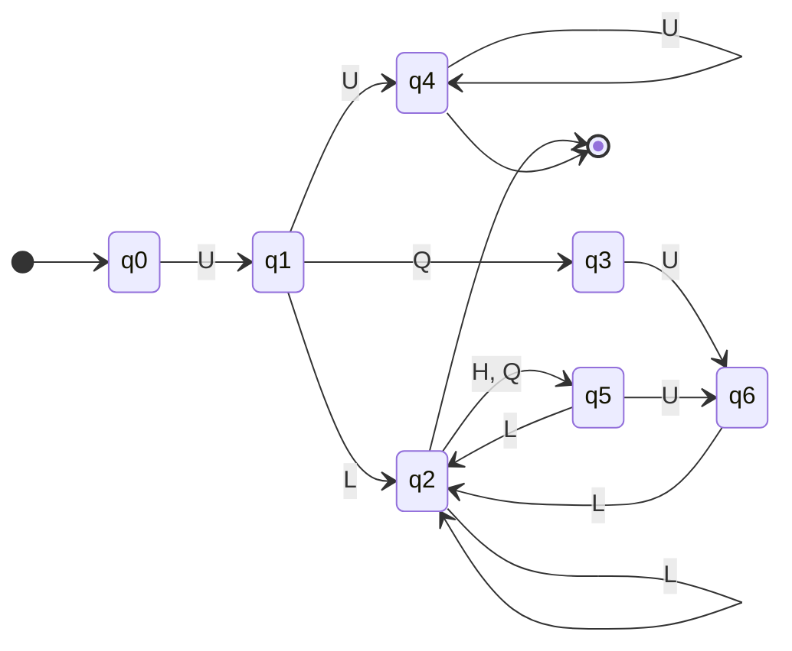

**Chaining 2 to 4 words** (each `word` is the automaton above restricted to *wₙ ∖ Heading*; the name is accepted from W2 on)

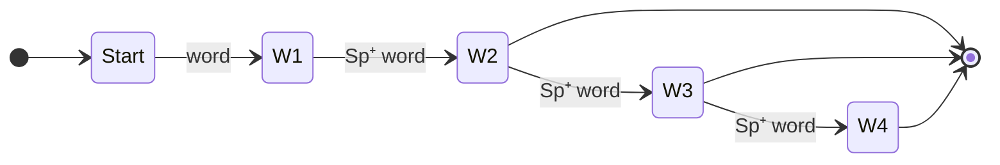

**Regular grammar of one word** (compact form, checked against the DFA)

```text
S → U S1 | U Q U S1 | U S6
S1 → L S3
S3 → L S3 | QH S4 | ε
S4 → L S3 | U S5
S5 → L S3
S6 → U S7
S7 → U S7 | ε
```

**Grammar of a name** (words as terminals; regular by closure under substitution)

```text
N → W₁ Sp⁺ W₂ X
X → ε | Sp⁺ W₃ Y
Y → ε | Sp⁺ W₄
(each Wᵢ derives a word of wₙ ∖ Heading using the grammar above)
```

**Traces** (δ\* applied to the symbol sequence; ✓ accepted, ✗ rejected)

```text
O'Brien      q0 -U→ q1 -Q→ q3 -U→ q6 -L→ q2 -L→ q2 -L→ q2 -L→ q2  ✓ final
wednesday    q0  ✗ (no transition from q0 on L)
PÉREZ        q0 -U→ q1 -U→ q4 -U→ q4 -U→ q4 -U→ q4  ✓ final
```

**Documented examples** (checked by the test-suite with `fullmatch`)

| Accepted (∈ L) | Rejected (∉ L) |
|---|---|
| `Wednesday Addams` | `wednesday addams` |
| `Mary Jane Watson` | `Wednesday` |
| `JUAN PÉREZ` | `Curriculum Vitae` |
| `Jean-Luc Picard` | `Full Stack Developer` |
| `Conan O'Brien` | `Resume` |

**Matches found in a sample text** (real output of the engine)

* Text: `Wednesday Addams↵3 years of experience`
* Matches: `Wednesday Addams`

**Techniques:** anchor \A, capturing group, negative lookahead, scoped flag (?i:...).

**Design rationale.** Resumes start with the candidate name; anchoring at \A avoids guessing names elsewhere. The group keeps only the words, and the lookahead stops the name from swallowing the next heading when the whole resume is written on one line.

* The first diagram is the minimal DFA of **one word**; the second shows how 2–4 words are chained.
* **Found while formalizing:** the first version of the word expression required a lower-case letter right after the initial capital, so `O'Brien` (which the description promised) was *not* in the language. The automaton made it obvious (no arrow from the state after `U` on `'`). The expression now allows an apostrophe directly after the initial capital, and `Conan O'Brien` is one of the documented examples.

### 3.6 `YEARS_OF_EXPERIENCE`

| Category | Scope | Flags | Kept group | Verified model |
|---|---|---|---|---|
| `EXPERIENCE` | `DOCUMENT` | `re.IGNORECASE` | 1 | minimal DFA, 11 states |

**Python expression** (`expressions.py`)

```regex
(?<![\d.])((?:[1-4]\d|0?\d)|one|two|three|four|five|six|seven|eight|nine|ten|eleven|twelve|uno|dos|tres|cuatro|cinco|seis|siete|ocho|nueve|diez|once|doce)\+?[\s-]*(?:years?|yrs?|a[ñn]os?)\b
```

**Language recognised.** A quantity of years: a number from 0 to 49 (digits) or a number word from 'one' to 'twelve' (English) or 'uno' to 'doce' (Spanish), an optional '+', optional spaces or a hyphen, and the unit 'year(s)', 'yr(s)' or the Spanish 'año(s)'. Only the quantity is kept.

**Formal regular expression**

```text
Q = [1-4]D ∪ 0?D = { 0,…,9 } ∪ { 00,…,09 } ∪ { 10,…,49 }          NW = { one, two, …, twelve, uno, dos, …, doce }
Unit = year s? ∪ yr s? ∪ a (ñ ∪ n) o s?
r = ( Q ∪ NW ) · (+)? · ( S ∪ {-} )* · Unit          (fold φ; the group keeps only ( Q ∪ NW ))
```

**Language (set notation)**

```text
L = { q [+] s u |  q ∈ Q ∪ NW ,  s ∈ (S ∪ {-})* ,  u ∈ Unit }
Only the number 0–49 or number word is stored as the amount of years.
```

**Context conditions (look-arounds, section 2.8)**

* Before the match: the previous character ∉ D ∪ {`.`}  (`(?<![\d.])`), so `1.5 years` and `2019 years` do not yield `5` or `19`.
* After the match: a word boundary `\b` (the unit cannot continue as a longer word: `yearbook`).

**Symbols of the automaton**

| Symbol | Meaning |
|---|---|
| Z | the digit 0 |
| O | digits 1–4 |
| R | digits 5–9 |
| Pl | `+` |
| Sep | whitespace or hyphen |
| letters | the unit, lower-cased (fold φ) |


**State diagram** (minimal DFA of the digit branch, runs of letters shown as one arrow; `Sep` = whitespace or hyphen, `Digit` = Z, O or R)

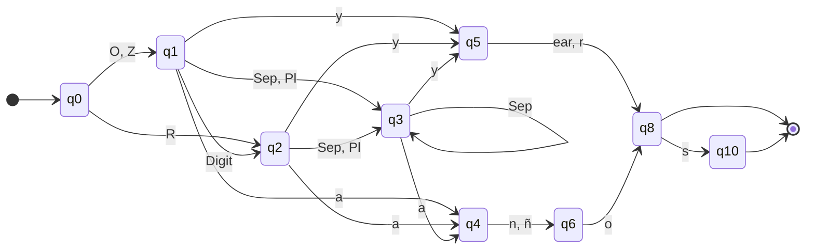

**Regular grammar** read off the (compressed) diagram: terminals are classes or strings

```text
Q0 → O Q1 | Z Q1 | R Q2
Q1 → Digit Q2 | Sep Q3 | Pl Q3 | a Q4 | y Q5
Q2 → Sep Q3 | Pl Q3 | a Q4 | y Q5
Q3 → Sep Q3 | a Q4 | y Q5
Q4 → n Q6 | ñ Q6
Q5 → ear Q8 | r Q8
Q6 → o Q8
Q8 → s Q10 | ε
Q10 → ε
```

**Traces** (δ\* applied to the symbol sequence; ✓ accepted, ✗ rejected)

```text
10+ years                q0 -O→ q1 -Z→ q2 -Pl→ q3 -W→ q3 -y→ q5 -e→ q7 -a→ q9 -r→ q8 -s→ q10  ✓ final
50 years                 q0 -R→ q2  ✗ (no transition from q2 on Z)
```

**Documented examples** (checked by the test-suite with `fullmatch`)

| Accepted (∈ L) | Rejected (∉ L) |
|---|---|
| `3 years` | `50 years` |
| `10+ years` | `years` |
| `5-year` | `2020 years` |
| `two years` | `3 yearbooks` |
| `7 años` |  |
| `cinco años` |  |

**Matches found in a sample text** (real output of the engine)

* Text: `3 years of experience, 10+ years, five years, 5 años, 50 years of silence, 1.5 years.`
* Matches: `3`, `10`, `five`, `5`

**Techniques:** alternation for numeric range, capturing group, optional quantifier, negative lookbehind.

**Design rationale.** The range 0-49 is built by alternation ([1-4]\d | 0?\d), so '10 years' is accepted but '2020 years' or '99 years' are not coherent and are rejected. Decimals ('1.5 years') are intentionally not supported.

* Zero / one / rest-of-digits classes make the range 0–49 explicit in the automaton: after a first digit in {1,…,4} a second digit is allowed; after a first digit in {5,…,9} it is not, so `50 years` is rejected.
* The diagram covers the digit branch (11 states). The number-word branch NW is a finite set of 24 words; it is a trie and adds no new idea.
* The unit alternatives `year`, `years`, `yr`, `yrs`, `año`, `años`, `ano`, `anos` share the prefixes `y` and `a`, which is why the minimal DFA merges them.

### 3.7 `JOB_TITLE`

| Category | Scope | Flags | Kept group | Verified model |
|---|---|---|---|---|
| `EXPERIENCE` | `DOCUMENT` | `re.IGNORECASE` | 0 | minimal DFA, 5 states |

**Python expression** (`expressions.py`)

```regex
(?<!\w)(?:(?:Senior|Junior|Lead|Principal)\s+)?(?:Full[\s-]?Stack|Front[\s-]?End|Back[\s-]?End|Web|Software|Machine\s+Learning|Data|DevOps|Cloud|AI)\s+(?:Application\s+)?(?:Developer|Engineer|Scientist|Analyst)(?!\w)
```

**Language recognised.** A job title: an optional seniority word (Senior, Junior, Lead, Principal), a domain (Full Stack, Front End, Back End, Web, Software, Machine Learning, Data, DevOps, Cloud, AI), an optional 'Application' and a role (Developer, Engineer, Scientist, Analyst).

**Formal regular expression**

```text
Sen = { senior, junior, lead, principal }
Dom = { full(S ∪ -)?stack, front(S ∪ -)?end, back(S ∪ -)?end, web, software, machine S⁺ learning, data, devops, cloud, ai }
Role = { developer, engineer, scientist, analyst }
r = ( Sen S⁺ )? · Dom · S⁺ · ( application S⁺ )? · Role          (fold φ)
```

**Language (set notation)**

```text
L = { [seniority] domain [Application] role }: `Senior Full Stack Developer`, `Machine Learning Engineer`, `Data Scientist`, `Cloud Engineer`.
```

**Context conditions (look-arounds, section 2.8)**

* Before the match: the previous character ∉ W  (`(?<!\w)`).
* After the match: the next character ∉ W  (`(?!\w)`).

**Symbols of the automaton**

| Symbol | Meaning |
|---|---|
| Sen | seniority word |
| Dom | domain (may be several words) |
| App | `application` |
| Role | role word |


**State diagram** (word-level minimal DFA)

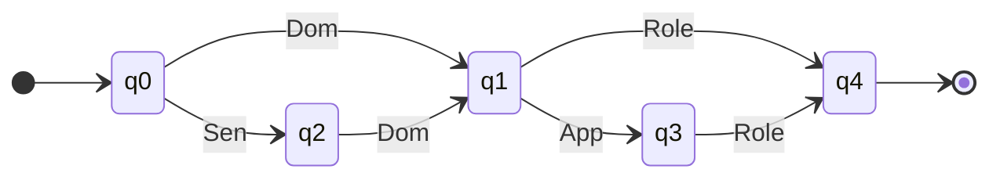

**Regular grammar** induced by the DFA (terminals are word classes)

```text
Q0 → Dom Q1 | Sen Q2
Q1 → App Q3 | Role Q4
Q2 → Dom Q1
Q3 → Role Q4
Q4 → ε
```

**Traces** (δ\* applied to the symbol sequence; ✓ accepted, ✗ rejected)

```text
Senior Full Stack Developer
    q0 -Sen→ q2 -Dom→ q1 -Role→ q4  ✓ final
Senior Developer
    q0 -Sen→ q2  ✗ (no transition from q2 on Role)
Full Stack Application Developer
    q0 -Dom→ q1 -App→ q3 -Role→ q4  ✓ final
```

**Documented examples** (checked by the test-suite with `fullmatch`)

| Accepted (∈ L) | Rejected (∉ L) |
|---|---|
| `Web Application Developer` | `Developer` |
| `Senior Full Stack Developer` | `Web` |
| `Machine Learning Engineer` | `Teacher Assistant` |
| `data scientist` | `Dataset Engineer` |

**Matches found in a sample text** (real output of the engine)

* Text: `Senior Full Stack Developer at Acme; later Machine Learning Engineer and a data scientist.`
* Matches: `Senior Full Stack Developer`, `Machine Learning Engineer`, `data scientist`

**Techniques:** optional groups, alternation, IGNORECASE flag.

**Design rationale.** 

* The automaton is drawn at **word level**: each symbol is a word class, because inside a class the letters form only a trie. The 5 states count the words read so far.

### 3.8 `DEGREE`

| Category | Scope | Flags | Kept group | Verified model |
|---|---|---|---|---|
| `EDUCATION` | `DOCUMENT` | `none` | 0 | minimal DFA, 33 states |

**Python expression** (`expressions.py`)

```regex
(?<!\w)(?:(?i:Bachelor|Master)(?:['’]s)?(?:[ \t]+degree)?[ \t]+(?i:of|in)[ \t]+[A-ZÁÉÍÓÚÑ][\w&-]*(?:[ \t]+(?:(?:de|del|of|and|y|&)[ \t]+)?[A-ZÁÉÍÓÚÑ][\w&-]*){0,3}(?:[ \t]+(?i:in|of)[ \t]+[A-ZÁÉÍÓÚÑ][\w&-]*(?:[ \t]+(?:(?:de|del|of|and|y|&)[ \t]+)?[A-ZÁÉÍÓÚÑ][\w&-]*){0,3})?|(?i:B\.?Sc\.?|M\.?Sc\.?|PhD|Ph\.D\.?|Doctorate|Doctorado|Pregrado)(?:[ \t]+(?i:in|of|en)[ \t]+[A-ZÁÉÍÓÚÑ][\w&-]*(?:[ \t]+(?:(?:de|del|of|and|y|&)[ \t]+)?[A-ZÁÉÍÓÚÑ][\w&-]*){0,3})?|(?i:Ingenier[ií]a|Maestr[ií]a)[ \t]+(?i:de|en)[ \t]+[A-ZÁÉÍÓÚÑ][\w&-]*(?:[ \t]+(?:(?:de|del|of|and|y|&)[ \t]+)?[A-ZÁÉÍÓÚÑ][\w&-]*){0,3})(?!\w)
```

**Language recognised.** An academic degree: 'Bachelor/Master [\'s] [degree] of|in <Field>' (the field being 1-4 capitalised words, optionally followed by a second 'in|of <Field>'), an abbreviation or doctorate (BSc, MSc, PhD, Doctorate ...) optionally followed by its field, or the Spanish 'Ingeniería|Maestría de|en <Field>'.

**Formal regular expression**

```text
Lk = { de, del, of, and, y, & }          Cap = [A-ZÁÉÍÓÚÑ] [\w&-]*          Field = Cap ( ( Lk Sp⁺ )? Cap ){0,3}   with the Sp⁺ between words
A = ( bachelor ∪ master ) ( ' s ∪ ’ s )? ( Sp⁺ degree )? Sp⁺ ( of ∪ in ) Sp⁺ Field ( Sp⁺ ( in ∪ of ) Sp⁺ Field )?
B = ( b.?sc.? ∪ m.?sc.? ∪ phd ∪ ph.d.? ∪ doctorate ∪ doctorado ∪ pregrado ) ( Sp⁺ ( in ∪ of ∪ en ) Sp⁺ Field )?
C = ( ingenier(i ∪ í)a ∪ maestr(i ∪ í)a ) Sp⁺ ( de ∪ en ) Sp⁺ Field
r = A ∪ B ∪ C          (keywords are case-insensitive through the scoped groups `(?i:…)`; the Field words are not)
```

**Language (set notation)**

```text
L = { `Bachelor of Science in Computer Science`, `Master's degree in Data Science`, `BSc`, `MSc in Machine Learning`, `PhD`, `Ingeniería de Sistemas`, `Maestría en Ciencia de Datos`, … }
```

**Context conditions (look-arounds, section 2.8)**

* Before the match: the previous character ∉ W  (`(?<!\w)`).
* After the match: the next character ∉ W  (`(?!\w)`).

**Symbols of the automaton**

| Symbol | Meaning |
|---|---|
| Bm | bachelor / master (with optional 's) |
| Dg | degree |
| Ab | abbreviation or doctorate: BSc, MSc, PhD, Doctorate, Pregrado … |
| Im | Ingeniería / Maestría |
| Of, In, En, De, Del, And, Y, Amp | the words `of`, `in`, `en`, `de`, `del`, `and`, `y` and the symbol `&` |
| OI | Of ∪ In |
| OIE | Of ∪ In ∪ En |
| DE | De ∪ En |
| Link | De ∪ Del ∪ Of ∪ And ∪ Y ∪ Amp (a connector inside a field of study) |
| C | a capitalised word of the field of study |


**Automaton.** The diagram is the NFA read directly off the regular grammar below (non-terminals are states, so it is exactly the grammar → automaton construction of section 2.6). The minimal *deterministic* automaton of the same language has **33 states** (verified below), too many to draw legibly.

```mermaid
stateDiagram-v2
    direction LR
    [*] --> S
    S --> Pre : Bm
    S --> F : Ab
    S --> E : Ab OIE ∣ Im DE
    Pre --> P : OI ∣ Dg OI
    P --> P3 : C
    P3 --> Q : ε
    P3 --> P2 : C ∣ Link C
    P2 --> Q : ε
    P2 --> P1 : C ∣ Link C
    P1 --> Q : ε
    P1 --> P0 : C ∣ Link C
    P0 --> Q : ε
    Q --> E : OI
    E --> E3 : C
    E3 --> E2 : C ∣ Link C
    E2 --> E1 : C ∣ Link C
    E1 --> E0 : C ∣ Link C
    E0 --> [*]
    E1 --> [*]
    E2 --> [*]
    E3 --> [*]
    F --> [*]
    Q --> [*]
```

**Regular grammar** (compact form of section 2.5; checked against the minimal DFA)

```text
S → Bm Pre | Ab | Ab OIE E | Im DE E
Pre → OI P | Dg OI P
P → C P3
P3 → Q | C P2 | Link C P2
P2 → Q | C P1 | Link C P1
P1 → Q | C P0 | Link C P0
P0 → Q
Q → ε | OI E
E → C E3
E3 → ε | C E2 | Link C E2
E2 → ε | C E1 | Link C E1
E1 → ε | C E0 | Link C E0
E0 → ε
```

**Traces** (δ\* applied to the symbol sequence; ✓ accepted, ✗ rejected)

```text
Master's degree in Data Science
    q0 -Bm→ q2 -Dg→ q5 -In→ q6 -C→ q8 -C→ q12  ✓ final
MSc
    q0 -Ab→ q1  ✓ final
Master Science
    q0 -Bm→ q2  ✗ (no transition from q2 on C)
```

**Documented examples** (checked by the test-suite with `fullmatch`)

| Accepted (∈ L) | Rejected (∉ L) |
|---|---|
| `Bachelor of Science in Computer Science` | `Scrum Master` |
| `Master's in Data Science` | `Master the art` |
| `PhD in Physics` | `bachelor party` |
| `B.Sc. in Software Engineering` | `Doctor` |
| `Ingeniería de Sistemas` |  |
| `Maestría en Ciencia de Datos` |  |

**Matches found in a sample text** (real output of the engine)

* Text: `Bachelor of Science in Computer Science; Master's in Data Science; PhD; Ingeniería de Sistemas. Certified Scrum Master.`
* Matches: `Bachelor of Science in Computer Science`, `Master's in Data Science`, `PhD`, `Ingeniería de Sistemas`

**Techniques:** scoped flag (?i:...), alternation, optional groups, bounded quantifier {0,3}, negative lookbehind/lookahead.

**Design rationale.** Words like 'Master' are ambiguous ('Scrum Master'), so Bachelor/Master are only accepted when followed by 'of' or 'in'. Scoped flags make the keywords case-insensitive while the field of study still has to start with a capital letter.

* `Bachelor`/`Master` **must** be followed by `of` or `in`: that is the formal reason why `Scrum Master` is rejected (the word `Master` alone is not in L).
* The Field is 1–4 capitalised words joined by blanks and, optionally, a lower-case connector (`Ciencia de Datos`).
* Word-level model: its classes are disjoint (keywords written in lower case, field words capitalised). A keyword written with a capital letter (`Master`) is also a valid *Cap* word in the real expression, which makes the real language slightly **larger** than the model in those positions; it never makes it smaller.

### 3.9 `CERTIFICATION`

| Category | Scope | Flags | Kept group | Verified model |
|---|---|---|---|---|
| `EDUCATION` | `DOCUMENT` | `none` | 0 | minimal DFA, 15 states |

**Python expression** (`expressions.py`)

```regex
(?<!\w)(?:(?:AWS|Azure|GCP|Google[ \t]+Cloud)[ \t]+Certified[ \t]+[A-ZÁÉÍÓÚÑ][\w&-]*(?:[ \t]+(?:(?:de|del|of|and|y|&)[ \t]+)?[A-ZÁÉÍÓÚÑ][\w&-]*){0,3}|Certified[ \t]+[A-ZÁÉÍÓÚÑ][\w&-]*(?:[ \t]+[A-ZÁÉÍÓÚÑ][\w&-]*){1,3})(?!\w)
```

**Language recognised.** A professional certification: either '<AWS|Azure|GCP|Google Cloud> Certified <Title>' or 'Certified <Title>', where the title is a sequence of capitalised words on the same line.

**Formal regular expression**

```text
Cap = [A-ZÁÉÍÓÚÑ] [\w&-]*          Caps = Cap ( ( Lk Sp⁺ )? Cap ){0,3}
Prov = AWS ∪ Azure ∪ GCP ∪ Google Sp⁺ Cloud
r = ( Prov Sp⁺ Certified Sp⁺ Caps )  ∪  ( Certified Sp⁺ Cap ( Sp⁺ Cap ){1,3} )          (case-sensitive)
```

**Language (set notation)**

```text
L = { `AWS Certified Solutions Architect`, `Google Cloud Certified Professional Data Engineer`, `Certified Kubernetes Administrator`, … }
```

**Context conditions (look-arounds, section 2.8)**

* Before the match: the previous character ∉ W  (`(?<!\w)`).
* After the match: the next character ∉ W  (`(?!\w)`).

**Symbols of the automaton**

| Symbol | Meaning |
|---|---|
| Aw | AWS, Azure, GCP |
| Go, Cl | `Google`, `Cloud` |
| Ce | `Certified` |
| Lk | connector: de, del, of, and, y, & |
| C | any other capitalised word |
| Cap | C ∪ Aw ∪ Go ∪ Cl ∪ Ce: any capitalised word |


**Automaton.** The diagram is the NFA read directly off the regular grammar below (non-terminals are states, so it is exactly the grammar → automaton construction of section 2.6). The minimal *deterministic* automaton of the same language has **15 states** (verified below), too many to draw legibly.

```mermaid
stateDiagram-v2
    direction LR
    [*] --> S
    S --> H : Aw Ce ∣ Go Cl Ce
    S --> K : Ce Cap Cap
    H --> H3 : Cap
    H3 --> H2 : Cap ∣ Lk Cap
    H2 --> H1 : Cap ∣ Lk Cap
    H1 --> H0 : Cap ∣ Lk Cap
    K --> K2 : Cap
    K2 --> F : Cap
    F --> [*]
    H0 --> [*]
    H1 --> [*]
    H2 --> [*]
    H3 --> [*]
    K --> [*]
    K2 --> [*]
```

**Regular grammar** (compact form of section 2.5; checked against the minimal DFA)

```text
S → Aw Ce H | Go Cl Ce H | Ce Cap Cap K
H → Cap H3
H3 → ε | Cap H2 | Lk Cap H2
H2 → ε | Cap H1 | Lk Cap H1
H1 → ε | Cap H0 | Lk Cap H0
H0 → ε
K → ε | Cap K2
K2 → ε | Cap
```

**Traces** (δ\* applied to the symbol sequence; ✓ accepted, ✗ rejected)

```text
AWS Certified Solutions Architect
    q0 -Aw→ q1 -Ce→ q4 -C→ q6 -C→ q8  ✓ final
Certified Kubernetes
    q0 -Ce→ q2 -C→ q5  ✗ (q5 is not final)
Google Cloud Certified Architect
    q0 -Go→ q3 -Cl→ q1 -Ce→ q4 -C→ q6  ✓ final
```

**Documented examples** (checked by the test-suite with `fullmatch`)

| Accepted (∈ L) | Rejected (∉ L) |
|---|---|
| `AWS Certified Solutions Architect` | `Certified` |
| `Certified Kubernetes Administrator` | `certified developer` |
|  | `Certified engineer` |

**Matches found in a sample text** (real output of the engine)

* Text: `AWS Certified Solutions Architect; Google Cloud Certified Professional Data Engineer; Certified Kubernetes Administrator; certified plumber.`
* Matches: `AWS Certified Solutions Architect`, `Google Cloud Certified Professional Data Engineer`, `Certified Kubernetes Administrator`

**Techniques:** alternation, bounded quantifier {n,m}, horizontal whitespace only.

**Design rationale.** 

* Both branches require the literal word `Certified`. The first branch is introduced by a cloud provider and the title may contain connectors; the second branch is a bare `Certified <Title>` with 2–4 capitalised words after it.

### 3.10 `PROGRAMMING_LANGUAGE`

| Category | Scope | Flags | Kept group | Verified model |
|---|---|---|---|---|
| `PROGRAMMING_LANGUAGE` | `DOCUMENT` | `re.IGNORECASE` | 0 | minimal DFA, 46 states |

**Python expression** (`expressions.py`; `_LB` and `_RB` are the boundaries of section 2.8)

```regex
(?<![\w.+#&])(?:Java[\s]?Script|JS|Type[\s]?Script|TS|Python3?|Java(?!\s?Script)|C#|C\+\+|PHP|Kotlin|HTML5?|CSS3?|Bash|PowerShell)(?![\w+#&]|-\w|\.\w)
```

**Language recognised.** Unambiguous names of programming, markup and scripting languages and their usual abbreviations: JavaScript/JS, TypeScript/TS, Python, Java, C#, C++, PHP, Kotlin, HTML, CSS, Bash, PowerShell (any capitalisation, with or without the space in 'Java Script').

**Formal regular expression.** The core language is the union of the alternatives (fold φ: case-insensitive; `S` is a whitespace character):

| # | Python alternative | Formal expression |
|---|---|---|
| 1 | `Java[\s]?Script` | java S? script |
| 2 | `JS` | js |
| 3 | `Type[\s]?Script` | type S? script |
| 4 | `TS` | ts |
| 5 | `Python3?` | python 3? |
| 6 | `Java(?!\s?Script)` | java ε |
| 7 | `C#` | c# |
| 8 | `C\+\+` | c++ |
| 9 | `PHP` | php |
| 10 | `Kotlin` | kotlin |
| 11 | `HTML5?` | html 5? |
| 12 | `CSS3?` | css 3? |
| 13 | `Bash` | bash |
| 14 | `PowerShell` | powershell |

r = r1 ∪ r2 ∪ r3 ∪ r4 ∪ r5 ∪ r6 ∪ r7 ∪ r8 ∪ r9 ∪ r10 ∪ r11 ∪ r12 ∪ r13 ∪ r14

The language has 19 word forms (`S` stands for a separator; lower-cased when folded).

<details><summary>All the words of L(r)</summary>

`bash`, `c#`, `c++`, `css`, `css3`, `html`, `html5`, `java`, `java script`, `javascript`, `js`, `kotlin`, `php`, `powershell`, `python`, `python3`, `ts`, `type script`, `typescript`

</details>

**Context conditions**

* Before the match (`_LB`): the previous character ∉ W ∪ {`.`, `+`, `#`, `&`}.
* After the match (`_RB`): the next character ∉ W ∪ {`+`, `#`, `&`}, and is not `-` or `.` followed by a word character.
* Inside alternative 6 the look-ahead `(?!\s?Script)` keeps `Java` from matching the beginning of `Java Script`; as a language it is the difference *java ∖ java(S?)script*, which is already handled by listing `JavaScript` first.


**State diagram** (minimal DFA with 46 states; a chain of states with a single exit is drawn as one arrow labelled with the literal text; `␣` is a whitespace character)

```mermaid
stateDiagram-v2
    direction LR
    [*] --> q0
    q0 --> q2 : c
    q0 --> q4 : j
    q0 --> q6 : p
    q0 --> q7 : t
    q0 --> q9 : bash, kotlin
    q0 --> q27 : html
    q2 --> q9 : ♯, ++
    q2 --> q20 : ss
    q4 --> q9 : s
    q4 --> q28 : ava
    q6 --> q9 : hp, owershell
    q6 --> q20 : ython
    q7 --> q9 : s
    q7 --> q32 : ype
    q20 --> q9 : 3
    q27 --> q9 : 5
    q28 --> q33 : s
    q28 --> q34 : ␣
    q32 --> q33 : s
    q32 --> q34 : ␣
    q33 --> q9 : cript
    q34 --> q33 : s
    q9 --> [*]
    q20 --> [*]
    q27 --> [*]
    q28 --> [*]
```

**Regular grammar** read off the diagram (terminals are strings; every non-terminal is a state of the DFA)

```text
Q0 → c Q2 | j Q4 | p Q6 | t Q7 | bash Q9 | kotlin Q9 | html Q27
Q2 → ♯ Q9 | ++ Q9 | ss Q20
Q4 → s Q9 | ava Q28
Q6 → hp Q9 | owershell Q9 | ython Q20
Q7 → s Q9 | ype Q32
Q9 → ε
Q20 → 3 Q9 | ε
Q27 → 5 Q9 | ε
Q28 → s Q33 | ␣ Q34 | ε
Q32 → s Q33 | ␣ Q34
Q33 → cript Q9
Q34 → s Q33
```

**Traces**

```text
type script          q0 -t→ q7 -y→ q18 -p→ q26 -e→ q32 -␣→ q34 -s→ q33 -c→ q38 -r→ q40 -i→ q42 -p→ q44 -t→ q9  ✓ final
javas                q0 -j→ q4 -a→ q13 -v→ q22 -a→ q28 -s→ q33  ✗ (q33 is not final)
```

**Documented examples** (checked by the test-suite with `fullmatch`)

| Accepted (∈ L) | Rejected (∉ L) |
|---|---|
| `JavaScript` | `Javascripting` |
| `Javascript` | `JSON` |
| `javascript` | `Pythonic` |
| `Java Script` | `Jazz` |
| `JS` | `TSLA` |
| `TypeScript` |  |
| `Python` |  |
| `Python3` |  |
| `Java` |  |
| `C#` |  |
| `C++` |  |
| `HTML5` |  |

**Matches found in a sample text** (real output of the engine)

* Text: `Skills: JS, Typescript, Java, Python3, C++; wrote main.js and JSON by hand.`
* Matches: `JS`, `Typescript`, `Java`, `Python3`, `C++`

**Techniques:** alternation (ordered), negative lookahead Java(?!Script), word boundaries via lookaround, IGNORECASE flag.

**Design rationale.** 'Java(?!\s?Script)' makes Java and JavaScript mutually exclusive. The right boundary rejects 'JSON' and 'Pythonic' so abbreviations such as JS or TS are not found inside other words.

* In the diagram, `♯` stands for the character `#` (of `C#`), because `#` has a special meaning inside Mermaid labels.
* `Java` comes after `JavaScript`: with ordered alternation the longer form must be tried first; the look-ahead `(?!\s?Script)` is a second guard.
* `JS`, `TS` are case-insensitive (`js`, `Js`) but protected by the boundaries: `JSON`, `main.js` and `TSX` are not matched.

### 3.11 `PROGRAMMING_LANGUAGE_AMBIGUOUS`

| Category | Scope | Flags | Kept group | Verified model |
|---|---|---|---|---|
| `PROGRAMMING_LANGUAGE` | `SKILLS_SECTION` | `none` | 0 | minimal DFA, 11 states |

**Python expression** (`expressions.py`; `_LB` and `_RB` are the boundaries of section 2.8)

```regex
(?<![\w.+#&])(?:R|Go|Rust|Julia|Ruby)(?![\w+#&]|-\w|\.\w)
```

**Language recognised.** Language names that are also ordinary words or first names: R, Go, Rust, Julia, Ruby. They are case-sensitive and only recognised inside the Skills section.

**Formal regular expression.** The core language is the union of the alternatives (case-sensitive; `S` is a whitespace character):

| # | Python alternative | Formal expression |
|---|---|---|
| 1 | `R` | R |
| 2 | `Go` | Go |
| 3 | `Rust` | Rust |
| 4 | `Julia` | Julia |
| 5 | `Ruby` | Ruby |

r = r1 ∪ r2 ∪ r3 ∪ r4 ∪ r5

The language has 5 word forms (`S` stands for a separator; lower-cased when folded).

<details><summary>All the words of L(r)</summary>

`Go`, `Julia`, `R`, `Ruby`, `Rust`

</details>

**Context conditions**

* Before the match (`_LB`): the previous character ∉ W ∪ {`.`, `+`, `#`, `&`}.
* After the match (`_RB`): the next character ∉ W ∪ {`+`, `#`, `&`}, and is not `-` or `.` followed by a word character.
* Scope: the engine only runs this expression **inside the Skills section** (section 4), because these words are also ordinary English words or first names.


**State diagram** (minimal DFA with 11 states; a chain of states with a single exit is drawn as one arrow labelled with the literal text; `␣` is a whitespace character)

```mermaid
stateDiagram-v2
    direction LR
    [*] --> q0
    q0 --> q3 : R
    q0 --> q4 : Go, Julia
    q3 --> q6 : u
    q6 --> q4 : by, st
    q3 --> [*]
    q4 --> [*]
```

**Regular grammar** read off the diagram (terminals are strings; every non-terminal is a state of the DFA)

```text
Q0 → R Q3 | Go Q4 | Julia Q4
Q3 → u Q6 | ε
Q4 → ε
Q6 → by Q4 | st Q4
```

**Traces**

```text
Go                   q0 -G→ q1 -o→ q4  ✓ final
go                   q0  ✗ (no transition from q0 on g)
```

**Matches found in a sample text** (real output of the whole engine, because this expression only runs inside the Skills section)

* Text: `Technical Skills:↵Go, Rust, R↵↵We go to market. R&D team.`
* Matches: `Go`, `Rust`, `R`

**Documented examples** (checked by the test-suite with `fullmatch`)

| Accepted (∈ L) | Rejected (∉ L) |
|---|---|
| `R` | `r` |
| `Go` | `go` |
| `Rust` | `Gopher` |
| `Julia` | `R&D` |
| `Ruby` | `Python` |

**Techniques:** scope restriction (Skills section), case-sensitive match, word boundaries via lookaround.

**Design rationale.** 'Go to the office' or a candidate called Julia must not produce a programming language. Inside 'Skills: Python, R, Go' there is no such ambiguity.

* Case-sensitive on purpose: `Go`, `R`, `Ruby` are only taken as languages when capitalised **and** inside the Skills section.
* Without the scope condition, `Go` in `Go to market` or `R` in `R&D` would be false positives.

### 3.12 `WEB_FRAMEWORK`

| Category | Scope | Flags | Kept group | Verified model |
|---|---|---|---|---|
| `FRAMEWORK_LIBRARY` | `DOCUMENT` | `re.IGNORECASE` | 0 | minimal DFA, 56 states |

**Python expression** (`expressions.py`; `_LB` and `_RB` are the boundaries of section 2.8)

```regex
(?<![\w.+#&])(?:React\.?js|Angular(?:\.?js)?|Vue(?:\.?js)?|Svelte|Next\.?js|Node\.?js|Express\.?js|Django|Flask|Spring[\s-]?Boot|FastAPI|Nest\.?js)(?![\w+#&]|-\w|\.\w)
```

**Language recognised.** Web front-end and back-end frameworks written in an unambiguous way: React.js/ReactJS, Angular/AngularJS, Vue/Vue.js, Svelte, Next.js, Node.js/NodeJS, Express.js, Django, Flask, Spring Boot, FastAPI, Nest.js (dot and capitalisation optional).

**Formal regular expression.** The core language is the union of the alternatives (fold φ: case-insensitive; `S` is a whitespace character):

| # | Python alternative | Formal expression |
|---|---|---|
| 1 | `React\.?js` | react .? js |
| 2 | `Angular(?:\.?js)?` | angular (.? js)? |
| 3 | `Vue(?:\.?js)?` | vue (.? js)? |
| 4 | `Svelte` | svelte |
| 5 | `Next\.?js` | next .? js |
| 6 | `Node\.?js` | node .? js |
| 7 | `Express\.?js` | express .? js |
| 8 | `Django` | django |
| 9 | `Flask` | flask |
| 10 | `Spring[\s-]?Boot` | spring (S ∪ -)? boot |
| 11 | `FastAPI` | fastapi |
| 12 | `Nest\.?js` | nest .? js |

r = r1 ∪ r2 ∪ r3 ∪ r4 ∪ r5 ∪ r6 ∪ r7 ∪ r8 ∪ r9 ∪ r10 ∪ r11 ∪ r12

The language has 23 word forms (`S` stands for a separator; lower-cased when folded).

<details><summary>All the words of L(r)</summary>

`angular`, `angular.js`, `angularjs`, `django`, `express.js`, `expressjs`, `fastapi`, `flask`, `nest.js`, `nestjs`, `next.js`, `nextjs`, `node.js`, `nodejs`, `react.js`, `reactjs`, `spring boot`, `spring-boot`, `springboot`, `svelte`, `vue`, `vue.js`, `vuejs`

</details>

**Context conditions**

* Before the match (`_LB`): the previous character ∉ W ∪ {`.`, `+`, `#`, `&`}.
* After the match (`_RB`): the next character ∉ W ∪ {`+`, `#`, `&`}, and is not `-` or `.` followed by a word character.


**State diagram** (minimal DFA with 56 states; a chain of states with a single exit is drawn as one arrow labelled with the literal text; `␣` is a whitespace character)

```mermaid
stateDiagram-v2
    direction LR
    [*] --> q0
    q0 --> q4 : f
    q0 --> q5 : n
    q0 --> q7 : s
    q0 --> q25 : reac
    q0 --> q30 : angular, vue
    q0 --> q36 : express
    q0 --> q45 : django
    q4 --> q45 : astapi, lask
    q5 --> q14 : e
    q5 --> q36 : ode
    q7 --> q45 : velte
    q7 --> q51 : pring
    q14 --> q25 : s, x
    q25 --> q36 : t
    q30 --> q39 : '.'
    q30 --> q40 : j
    q36 --> q39 : '.'
    q36 --> q40 : j
    q39 --> q40 : j
    q40 --> q45 : s
    q51 --> q52 : -, ␣
    q51 --> q53 : b
    q52 --> q53 : b
    q53 --> q45 : oot
    q30 --> [*]
    q45 --> [*]
```

**Regular grammar** read off the diagram (terminals are strings; every non-terminal is a state of the DFA)

```text
Q0 → f Q4 | n Q5 | s Q7 | reac Q25 | angular Q30 | vue Q30 | express Q36 | django Q45
Q4 → astapi Q45 | lask Q45
Q5 → e Q14 | ode Q36
Q7 → velte Q45 | pring Q51
Q14 → s Q25 | x Q25
Q25 → t Q36
Q30 → '.' Q39 | j Q40 | ε
Q36 → '.' Q39 | j Q40
Q39 → j Q40
Q40 → s Q45
Q45 → ε
Q51 → - Q52 | ␣ Q52 | b Q53
Q52 → b Q53
Q53 → oot Q45
```

**Traces**

```text
next.js              q0 -n→ q5 -e→ q14 -x→ q25 -t→ q36 -.→ q39 -j→ q40 -s→ q45  ✓ final
next                 q0 -n→ q5 -e→ q14 -x→ q25 -t→ q36  ✗ (q36 is not final)
```

**Documented examples** (checked by the test-suite with `fullmatch`)

| Accepted (∈ L) | Rejected (∉ L) |
|---|---|
| `React.js` | `React` |
| `ReactJS` | `Node` |
| `NodeJS` | `Express` |
| `Node.js` | `Reactive` |
| `Angular` | `Nodes` |
| `Vue.js` | `Spring` |
| `Spring Boot` |  |
| `Express.js` |  |
| `Django` |  |
| `FastAPI` |  |

**Matches found in a sample text** (real output of the engine)

* Text: `React.js, ReactJS, Node.js, Spring Boot, Django and Node.jsx.`
* Matches: `React.js`, `ReactJS`, `Node.js`, `Spring Boot`, `Django`

**Techniques:** optional groups (?:\.?js), ordered alternation, IGNORECASE flag.

**Design rationale.** The optional '\.?' captures the usual spelling variants (React.js, ReactJS) without deciding that they are the same technology; that is Stage 2's job.

* `React\.?js`: the dot is optional, so `React.js`, `ReactJS` and `Reactjs` are all surface forms of the same framework (Stage 2 unifies them).
* The bare words (`React`, `Node`, `Next`) are **not** here; they are in the ambiguous expression.

### 3.13 `WEB_FRAMEWORK_AMBIGUOUS`

| Category | Scope | Flags | Kept group | Verified model |
|---|---|---|---|---|
| `FRAMEWORK_LIBRARY` | `SKILLS_SECTION` | `none` | 0 | minimal DFA, 21 states |

**Python expression** (`expressions.py`; `_LB` and `_RB` are the boundaries of section 2.8)

```regex
(?<![\w.+#&])(?:React|Node|Express|Next|Spring|Nest)(?![\w+#&]|-\w|\.\w)
```

**Language recognised.** Short framework names that are also English words: React, Node, Express, Next, Spring, Nest. Case-sensitive and only recognised inside the Skills section.

**Formal regular expression.** The core language is the union of the alternatives (case-sensitive; `S` is a whitespace character):

| # | Python alternative | Formal expression |
|---|---|---|
| 1 | `React` | React |
| 2 | `Node` | Node |
| 3 | `Express` | Express |
| 4 | `Next` | Next |
| 5 | `Spring` | Spring |
| 6 | `Nest` | Nest |

r = r1 ∪ r2 ∪ r3 ∪ r4 ∪ r5 ∪ r6

The language has 6 word forms (`S` stands for a separator; lower-cased when folded).

<details><summary>All the words of L(r)</summary>

`Express`, `Nest`, `Next`, `Node`, `React`, `Spring`

</details>

**Context conditions**

* Before the match (`_LB`): the previous character ∉ W ∪ {`.`, `+`, `#`, `&`}.
* After the match (`_RB`): the next character ∉ W ∪ {`+`, `#`, `&`}, and is not `-` or `.` followed by a word character.
* Scope: the engine only runs this expression **inside the Skills section** (section 4), because these words are also ordinary English words or first names.


**State diagram** (minimal DFA with 21 states; a chain of states with a single exit is drawn as one arrow labelled with the literal text; `␣` is a whitespace character)

```mermaid
stateDiagram-v2
    direction LR
    [*] --> q0
    q0 --> q2 : N
    q0 --> q11 : Reac
    q0 --> q16 : Express, Spring
    q2 --> q6 : e
    q2 --> q16 : ode
    q6 --> q11 : s, x
    q11 --> q16 : t
    q16 --> [*]
```

**Regular grammar** read off the diagram (terminals are strings; every non-terminal is a state of the DFA)

```text
Q0 → N Q2 | Reac Q11 | Express Q16 | Spring Q16
Q2 → e Q6 | ode Q16
Q6 → s Q11 | x Q11
Q11 → t Q16
Q16 → ε
```

**Traces**

```text
Node                 q0 -N→ q2 -o→ q7 -d→ q12 -e→ q16  ✓ final
Nodes                q0 -N→ q2 -o→ q7 -d→ q12 -e→ q16  ✗ (no transition from q16 on s)
```

**Matches found in a sample text** (real output of the whole engine, because this expression only runs inside the Skills section)

* Text: `Technical Skills:↵React, Node, Express↵↵Next step: express delivery.`
* Matches: `React`, `Node`, `Express`

**Documented examples** (checked by the test-suite with `fullmatch`)

| Accepted (∈ L) | Rejected (∉ L) |
|---|---|
| `React` | `react` |
| `Node` | `express` |
| `Express` | `Reaction` |
| `Next` | `Nodes` |
| `Spring` | `Spring Boot` |
| `Nest` |  |

**Techniques:** scope restriction (Skills section), case-sensitive match, word boundaries via lookaround.

**Design rationale.** 'We react quickly' or 'express interest' must not become frameworks.

* Same idea as the ambiguous languages: the short names are valid only inside the Skills section and with a capital letter.

### 3.14 `DATA_ML_LIBRARY`

| Category | Scope | Flags | Kept group | Verified model |
|---|---|---|---|---|
| `FRAMEWORK_LIBRARY` | `DOCUMENT` | `re.IGNORECASE` | 0 | minimal DFA, 89 states |

**Python expression** (`expressions.py`; `_LB` and `_RB` are the boundaries of section 2.8)

```regex
(?<![\w.+#&])(?:Pandas|NumPy|SciPy|Scikit[-_\s]?learn|sk[-_\s]?learn|Tensor[\s-]?Flow|Py[\s-]?Torch|Keras|XGBoost|LightGBM|CatBoost|Statsmodels|Matplotlib|Seaborn|Plotly|Tableau|Power[\s-]?BI)(?![\w+#&]|-\w|\.\w)
```

**Language recognised.** Data-analysis, machine-learning and visualisation libraries and tools: Pandas, NumPy, SciPy, scikit-learn (and its variants 'scikit learn', 'sklearn'), TensorFlow ('Tensor Flow'), PyTorch ('Py Torch'), Keras, XGBoost, LightGBM, CatBoost, Statsmodels, Matplotlib, Seaborn, Plotly, Tableau, Power BI.

**Formal regular expression.** The core language is the union of the alternatives (fold φ: case-insensitive; `S` is a whitespace character):

| # | Python alternative | Formal expression |
|---|---|---|
| 1 | `Pandas` | pandas |
| 2 | `NumPy` | numpy |
| 3 | `SciPy` | scipy |
| 4 | `Scikit[-_\s]?learn` | scikit (- ∪ _ ∪ S)? learn |
| 5 | `sk[-_\s]?learn` | sk (- ∪ _ ∪ S)? learn |
| 6 | `Tensor[\s-]?Flow` | tensor (S ∪ -)? flow |
| 7 | `Py[\s-]?Torch` | py (S ∪ -)? torch |
| 8 | `Keras` | keras |
| 9 | `XGBoost` | xgboost |
| 10 | `LightGBM` | lightgbm |
| 11 | `CatBoost` | catboost |
| 12 | `Statsmodels` | statsmodels |
| 13 | `Matplotlib` | matplotlib |
| 14 | `Seaborn` | seaborn |
| 15 | `Plotly` | plotly |
| 16 | `Tableau` | tableau |
| 17 | `Power[\s-]?BI` | power (S ∪ -)? bi |

r = r1 ∪ r2 ∪ r3 ∪ r4 ∪ r5 ∪ r6 ∪ r7 ∪ r8 ∪ r9 ∪ r10 ∪ r11 ∪ r12 ∪ r13 ∪ r14 ∪ r15 ∪ r16 ∪ r17

The language has 29 word forms (`S` stands for a separator; lower-cased when folded).

<details><summary>All the words of L(r)</summary>

`catboost`, `keras`, `lightgbm`, `matplotlib`, `numpy`, `pandas`, `plotly`, `power bi`, `power-bi`, `powerbi`, `py torch`, `py-torch`, `pytorch`, `scikit learn`, `scikit-learn`, `scikit_learn`, `scikitlearn`, `scipy`, `seaborn`, `sk learn`, `sk-learn`, `sk_learn`, `sklearn`, `statsmodels`, `tableau`, `tensor flow`, `tensor-flow`, `tensorflow`, `xgboost`

</details>

**Context conditions**

* Before the match (`_LB`): the previous character ∉ W ∪ {`.`, `+`, `#`, `&`}.
* After the match (`_RB`): the next character ∉ W ∪ {`+`, `#`, `&`}, and is not `-` or `.` followed by a word character.


**State diagram** (minimal DFA with 89 states; a chain of states with a single exit is drawn as one arrow labelled with the literal text; `␣` is a whitespace character)

```mermaid
stateDiagram-v2
    direction LR
    [*] --> q0
    q0 --> q6 : p
    q0 --> q7 : s
    q0 --> q8 : t
    q0 --> q25 : cat, xg
    q0 --> q26 : ker
    q0 --> q46 : nump
    q0 --> q57 : lightgbm, matplotlib
    q6 --> q18 : y
    q6 --> q26 : and
    q6 --> q46 : lotl
    q6 --> q60 : ower
    q7 --> q21 : k
    q7 --> q35 : ci
    q7 --> q43 : tatsmodel
    q7 --> q63 : eabo
    q8 --> q57 : ableau
    q8 --> q76 : ensor
    q18 --> q33 : -, ␣
    q18 --> q34 : t
    q21 --> q37 : -, '_', ␣
    q21 --> q38 : l
    q25 --> q57 : boost
    q26 --> q43 : a
    q33 --> q34 : t
    q34 --> q57 : orch
    q35 --> q21 : kit
    q35 --> q46 : p
    q37 --> q38 : l
    q38 --> q63 : ea
    q43 --> q57 : s
    q46 --> q57 : y
    q60 --> q70 : -, ␣
    q60 --> q71 : b
    q63 --> q57 : rn
    q70 --> q71 : b
    q71 --> q57 : i
    q76 --> q81 : -, ␣
    q76 --> q82 : f
    q81 --> q82 : f
    q82 --> q57 : low
    q57 --> [*]
```

**Regular grammar** read off the diagram (terminals are strings; every non-terminal is a state of the DFA)

```text
Q0 → p Q6 | s Q7 | t Q8 | cat Q25 | xg Q25 | ker Q26 | nump Q46 | lightgbm Q57 | matplotlib Q57
Q6 → y Q18 | and Q26 | lotl Q46 | ower Q60
Q7 → k Q21 | ci Q35 | tatsmodel Q43 | eabo Q63
Q8 → ableau Q57 | ensor Q76
Q18 → - Q33 | ␣ Q33 | t Q34
Q21 → - Q37 | '_' Q37 | ␣ Q37 | l Q38
Q25 → boost Q57
Q26 → a Q43
Q33 → t Q34
Q34 → orch Q57
Q35 → kit Q21 | p Q46
Q37 → l Q38
Q38 → ea Q63
Q43 → s Q57
Q46 → y Q57
Q57 → ε
Q60 → - Q70 | ␣ Q70 | b Q71
Q63 → rn Q57
Q70 → b Q71
Q71 → i Q57
Q76 → - Q81 | ␣ Q81 | f Q82
Q81 → f Q82
Q82 → low Q57
```

**Traces**

```text
scikit-learn         q0 -s→ q7 -c→ q19 -i→ q35 -k→ q50 -i→ q62 -t→ q21 --→ q37 -l→ q38 -e→ q52 -a→ q63 -r→ q73 -n→ q57  ✓ final
numpyy               q0 -n→ q5 -u→ q14 -m→ q29 -p→ q46 -y→ q57  ✗ (no transition from q57 on y)
```

**Documented examples** (checked by the test-suite with `fullmatch`)

| Accepted (∈ L) | Rejected (∉ L) |
|---|---|
| `Pandas` | `Panda` |
| `NumPy` | `Tensor` |
| `Scikit-learn` | `Torch` |
| `scikit learn` | `Numeric` |
| `sklearn` |  |
| `Tensor Flow` |  |
| `TensorFlow` |  |
| `Py Torch` |  |
| `PyTorch` |  |
| `Power BI` |  |

**Matches found in a sample text** (real output of the engine)

* Text: `Pandas, NumPy, scikit-learn, sklearn, TensorFlow, Py Torch, Power BI.`
* Matches: `Pandas`, `NumPy`, `scikit-learn`, `sklearn`, `TensorFlow`, `Py Torch`, `Power BI`

**Techniques:** character sets [-_\s], optional quantifier, ordered alternation, IGNORECASE flag.

**Design rationale.** Variants with hyphen, underscore, space or no separator are all surface forms of one library.

* Variants such as `scikit-learn`, `scikit learn`, `Scikit_learn`, `sklearn` come from the class `[-_\s]?`; `TensorFlow`/`Tensor Flow`, `PyTorch`/`Py Torch` from `[\s-]?`.
* Each separator class is a union of three symbols (hyphen, underscore, whitespace) or two: that is why the automaton has an arrow with a list of labels.

### 3.15 `DATABASE`

| Category | Scope | Flags | Kept group | Verified model |
|---|---|---|---|---|
| `DATABASE` | `DOCUMENT` | `re.IGNORECASE` | 0 | minimal DFA, 64 states |

**Python expression** (`expressions.py`; `_LB` and `_RB` are the boundaries of section 2.8)

```regex
(?<![\w.+#&])(?:Postgre(?:s|SQL)?|MySQL|MariaDB|SQLite|SQL[\s-]?Server|Mongo(?:DB)?|Redis|Firebase|Cassandra|Elasticsearch|SQL)(?![\w+#&]|-\w|\.\w)
```

**Language recognised.** Database systems and the SQL language: Postgres/PostgreSQL, MySQL, MariaDB, SQLite, SQL Server, Mongo/MongoDB, Redis, Firebase, Cassandra, Elasticsearch and plain SQL.

**Formal regular expression.** The core language is the union of the alternatives (fold φ: case-insensitive; `S` is a whitespace character):

| # | Python alternative | Formal expression |
|---|---|---|
| 1 | `Postgre(?:s\|SQL)?` | postgre (s ∪ sql)? |
| 2 | `MySQL` | mysql |
| 3 | `MariaDB` | mariadb |
| 4 | `SQLite` | sqlite |
| 5 | `SQL[\s-]?Server` | sql (S ∪ -)? server |
| 6 | `Mongo(?:DB)?` | mongo (db)? |
| 7 | `Redis` | redis |
| 8 | `Firebase` | firebase |
| 9 | `Cassandra` | cassandra |
| 10 | `Elasticsearch` | elasticsearch |
| 11 | `SQL` | sql |

r = r1 ∪ r2 ∪ r3 ∪ r4 ∪ r5 ∪ r6 ∪ r7 ∪ r8 ∪ r9 ∪ r10 ∪ r11

The language has 16 word forms (`S` stands for a separator; lower-cased when folded).

<details><summary>All the words of L(r)</summary>

`cassandra`, `elasticsearch`, `firebase`, `mariadb`, `mongo`, `mongodb`, `mysql`, `postgre`, `postgres`, `postgresql`, `redis`, `sql`, `sql server`, `sql-server`, `sqlite`, `sqlserver`

</details>

**Context conditions**

* Before the match (`_LB`): the previous character ∉ W ∪ {`.`, `+`, `#`, `&`}.
* After the match (`_RB`): the next character ∉ W ∪ {`+`, `#`, `&`}, and is not `-` or `.` followed by a word character.


**State diagram** (minimal DFA with 64 states; a chain of states with a single exit is drawn as one arrow labelled with the literal text; `␣` is a whitespace character)

```mermaid
stateDiagram-v2
    direction LR
    [*] --> q0
    q0 --> q4 : m
    q0 --> q25 : sql
    q0 --> q42 : cassandra, elasticsearch, redis
    q0 --> q44 : firebas
    q0 --> q54 : postgre
    q4 --> q31 : ysq
    q4 --> q41 : ongo
    q4 --> q49 : ariad
    q25 --> q34 : -, ␣
    q25 --> q36 : s
    q25 --> q44 : it
    q31 --> q42 : l
    q34 --> q36 : s
    q36 --> q42 : erver
    q41 --> q49 : d
    q44 --> q42 : e
    q49 --> q42 : b
    q54 --> q58 : s
    q58 --> q31 : q
    q25 --> [*]
    q41 --> [*]
    q42 --> [*]
    q54 --> [*]
    q58 --> [*]
```

**Regular grammar** read off the diagram (terminals are strings; every non-terminal is a state of the DFA)

```text
Q0 → m Q4 | sql Q25 | cassandra Q42 | elasticsearch Q42 | redis Q42 | firebas Q44 | postgre Q54
Q4 → ysq Q31 | ongo Q41 | ariad Q49
Q25 → - Q34 | ␣ Q34 | s Q36 | it Q44 | ε
Q31 → l Q42
Q34 → s Q36
Q36 → erver Q42
Q41 → d Q49 | ε
Q42 → ε
Q44 → e Q42
Q49 → b Q42
Q54 → s Q58 | ε
Q58 → q Q31 | ε
```

**Traces**

```text
sql server           q0 -s→ q7 -q→ q16 -l→ q25 -␣→ q34 -s→ q36 -e→ q45 -r→ q51 -v→ q55 -e→ q59 -r→ q42  ✓ final
sqls                 q0 -s→ q7 -q→ q16 -l→ q25 -s→ q36  ✗ (q36 is not final)
```

**Documented examples** (checked by the test-suite with `fullmatch`)

| Accepted (∈ L) | Rejected (∉ L) |
|---|---|
| `Postgres` | `NoSQL` |
| `PostgreSQL` | `SQLAlchemy` |
| `MySQL` | `Reddish` |
| `SQLite` | `Postgresql-based` |
| `SQL Server` |  |
| `MongoDB` |  |
| `Mongo` |  |
| `Redis` |  |
| `SQL` |  |

**Matches found in a sample text** (real output of the engine)

* Text: `PostgreSQL, Postgres, MySQL, SQL Server, SQLite, MongoDB and SQL.`
* Matches: `PostgreSQL`, `Postgres`, `MySQL`, `SQL Server`, `SQLite`, `MongoDB`, `SQL`

**Techniques:** ordered alternation (compound forms first), optional group, IGNORECASE flag.

**Design rationale.** 'SQL Server' must come before 'SQL', otherwise the shorter form would win.

* `Postgre(?:s|SQL)?` covers `Postgre`, `Postgres` and `PostgreSQL`; `Mongo(?:DB)?` covers `Mongo` and `MongoDB`.
* `SQL[\s-]?Server` must come **before** plain `SQL`: the right boundary allows a blank after `SQL`, so with the order reversed `SQL` would match the first word of `SQL Server` and the longer form would never be tried (the extractor's longest-wins rule is a second safety net).

### 3.16 `DATABASE_AMBIGUOUS`

| Category | Scope | Flags | Kept group | Verified model |
|---|---|---|---|---|
| `DATABASE` | `SKILLS_SECTION` | `none` | 0 | minimal DFA, 7 states |

**Python expression** (`expressions.py`; `_LB` and `_RB` are the boundaries of section 2.8)

```regex
(?<![\w.+#&])(?:Oracle)(?![\w+#&]|-\w|\.\w)
```

**Language recognised.** The word 'Oracle' (database or company). Case-sensitive, only inside the Skills section.

**Formal regular expression.** The core language is the union of the alternatives (case-sensitive; `S` is a whitespace character):

| # | Python alternative | Formal expression |
|---|---|---|
| 1 | `Oracle` | Oracle |

r = r1

The language has 1 word forms (`S` stands for a separator; lower-cased when folded).

<details><summary>All the words of L(r)</summary>

`Oracle`

</details>

**Context conditions**

* Before the match (`_LB`): the previous character ∉ W ∪ {`.`, `+`, `#`, `&`}.
* After the match (`_RB`): the next character ∉ W ∪ {`+`, `#`, `&`}, and is not `-` or `.` followed by a word character.
* Scope: the engine only runs this expression **inside the Skills section** (section 4), because these words are also ordinary English words or first names.


**State diagram** (minimal DFA with 7 states; a chain of states with a single exit is drawn as one arrow labelled with the literal text; `␣` is a whitespace character)

```mermaid
stateDiagram-v2
    direction LR
    [*] --> q0
    q0 --> q6 : Oracle
    q6 --> [*]
```

**Regular grammar** read off the diagram (terminals are strings; every non-terminal is a state of the DFA)

```text
Q0 → Oracle Q6
Q6 → ε
```

**Traces**

```text
Oracle               q0 -O→ q1 -r→ q2 -a→ q3 -c→ q4 -l→ q5 -e→ q6  ✓ final
oracle               q0  ✗ (no transition from q0 on o)
```

**Matches found in a sample text** (real output of the whole engine, because this expression only runs inside the Skills section)

* Text: `Technical Skills:↵Oracle, MySQL↵↵I worked for Oracle.`
* Matches: `Oracle`

**Documented examples** (checked by the test-suite with `fullmatch`)

| Accepted (∈ L) | Rejected (∉ L) |
|---|---|
| `Oracle` | `oracle` |
|  | `Oracles` |

**Techniques:** scope restriction (Skills section), case-sensitive match.

**Design rationale.** 'Worked at Oracle' names a company, not a skill.

* `Oracle` is a database and a company; it is case-sensitive and limited to the Skills section.

### 3.17 `API_PROTOCOL`

| Category | Scope | Flags | Kept group | Verified model |
|---|---|---|---|---|
| `TOOL_TECHNOLOGY` | `DOCUMENT` | `none` | 0 | minimal DFA, 35 states |

**Python expression** (`expressions.py`; `_LB` and `_RB` are the boundaries of section 2.8)

```regex
(?<![\w.+#&])(?:REST(?:ful)?(?:\s?APIs?)?|Rest(?:ful)?\s?APIs?|(?i:GraphQL|Web[\s-]?Sockets?))(?![\w+#&]|-\w|\.\w)
```

**Language recognised.** API styles and protocols: REST/RESTful (upper case, optionally followed by API/APIs), 'Rest API' in title case, GraphQL and WebSocket(s) (any capitalisation).

**Formal regular expression.** The core language is the union of the alternatives (case-sensitive; `S` is a whitespace character):

| # | Python alternative | Formal expression |
|---|---|---|
| 1 | `REST(?:ful)?(?:\s?APIs?)?` | REST (ful)? (S? API s?)? |
| 2 | `Rest(?:ful)?\s?APIs?` | Rest (ful)? S? API s? |
| 3 | `(?i:GraphQL\|Web[\s-]?Sockets?)` | (((g ∪ G) (r ∪ R) (a ∪ A) (p ∪ P) (h ∪ H) (q ∪ Q) (l ∪ L)) ∪ ((w ∪ W) (e ∪ E) (b ∪ B) (S ∪ -)? (s ∪ S) (o ∪ O) (c ∪ C) (k ∪ K) (e ∪ E) (t ∪ T) (s ∪ S)?)) |

r = r1 ∪ r2 ∪ r3

The language has 1000 word forms (`S` stands for a separator; lower-cased when folded).

<details><summary>All the words of L(r)</summary>

`weB SOCKET`, `weB SOCKETS`, `weB SOCKETs`, `weB SOCKEt`, `weB SOCKEtS`, `weB SOCKEts`, `weB SOCKeT`, `weB SOCKeTS`, `weB SOCKeTs`, `weB SOCKet`, `weB SOCKetS`, `weB SOCKets`, `weB SOCkET`, `weB SOCkETS`, `weB SOCkETs`, `weB SOCkEt`, `weB SOCkEtS`, `weB SOCkEts`, `weB SOCkeT`, `weB SOCkeTS`, `weB SOCkeTs`, `weB SOCket`, `weB SOCketS`, `weB SOCkets`, `weB SOcKET`, `weB SOcKETS`, `weB SOcKETs`, `weB SOcKEt`, `weB SOcKEtS`, `weB SOcKEts`, `weB SOcKeT`, `weB SOcKeTS`, `weB SOcKeTs`, `weB SOcKet`, `weB SOcKetS`, `weB SOcKets`, `weB SOckET`, `weB SOckETS`, `weB SOckETs`, `weB SOckEt`, `weB SOckEtS`, `weB SOckEts`, `weB SOckeT`, `weB SOckeTS`, `weB SOckeTs`, `weB SOcket`, `weB SOcketS`, `weB SOckets`, `weB SoCKET`, `weB SoCKETS`, `weB SoCKETs`, `weB SoCKEt`, `weB SoCKEtS`, `weB SoCKEts`, `weB SoCKeT`, `weB SoCKeTS`, `weB SoCKeTs`, `weB SoCKet`, `weB SoCKetS`, `weB SoCKets`, `weB SoCkET`, `weB SoCkETS`, `weB SoCkETs`, `weB SoCkEt`, `weB SoCkEtS`, `weB SoCkEts`, `weB SoCkeT`, `weB SoCkeTS`, `weB SoCkeTs`, `weB SoCket`, `weB SoCketS`, `weB SoCkets`, `weB SocKET`, `weB SocKETS`, `weB SocKETs`, `weB SocKEt`, `weB SocKEtS`, `weB SocKEts`, `weB SocKeT`, `weB SocKeTS`, `weB SocKeTs`, `weB SocKet`, `weB SocKetS`, `weB SocKets`, `weB SockET`, `weB SockETS`, `weB SockETs`, `weB SockEt`, `weB SockEtS`, `weB SockEts`, `weB SockeT`, `weB SockeTS`, `weB SockeTs`, `weB Socket`, `weB SocketS`, `weB Sockets`, `weB sOCKET`, `weB sOCKETS`, `weB sOCKETs`, `weB sOCKEt`, `weB sOCKEtS`, `weB sOCKEts`, `weB sOCKeT`, `weB sOCKeTS`, `weB sOCKeTs`, `weB sOCKet`, `weB sOCKetS`, `weB sOCKets`, `weB sOCkET`, `weB sOCkETS`, `weB sOCkETs`, `weB sOCkEt`, `weB sOCkEtS`, `weB sOCkEts`, `weB sOCkeT`, `weB sOCkeTS`, `weB sOCkeTs`, `weB sOCket`, `weB sOCketS`, `weB sOCkets`, `weB sOcKET`, `weB sOcKETS`, `weB sOcKETs`, `weB sOcKEt`, `weB sOcKEtS`, `weB sOcKEts`, `weB sOcKeT`, `weB sOcKeTS`, `weB sOcKeTs`, `weB sOcKet`, `weB sOcKetS`, `weB sOcKets`, `weB sOckET`, `weB sOckETS`, `weB sOckETs`, `weB sOckEt`, `weB sOckEtS`, `weB sOckEts`, `weB sOckeT`, `weB sOckeTS`, `weB sOckeTs`, `weB sOcket`, `weB sOcketS`, `weB sOckets`, `weB soCKET`, `weB soCKETS`, `weB soCKETs`, `weB soCKEt`, `weB soCKEtS`, `weB soCKEts`, `weB soCKeT`, `weB soCKeTS`, `weB soCKeTs`, `weB soCKet`, `weB soCKetS`, `weB soCKets`, `weB soCkET`, `weB soCkETS`, `weB soCkETs`, `weB soCkEt`, `weB soCkEtS`, `weB soCkEts`, `weB soCkeT`, `weB soCkeTS`, `weB soCkeTs`, `weB soCket`, `weB soCketS`, `weB soCkets`, `weB socKET`, `weB socKETS`, `weB socKETs`, `weB socKEt`, `weB socKEtS`, `weB socKEts`, `weB socKeT`, `weB socKeTS`, `weB socKeTs`, `weB socKet`, `weB socKetS`, `weB socKets`, `weB sockET`, `weB sockETS`, `weB sockETs`, `weB sockEt`, `weB sockEtS`, `weB sockEts`, `weB sockeT`, `weB sockeTS`, `weB sockeTs`, `weB socket`, `weB socketS`, `weB sockets`, `weB-soCKeT`, `weB-soCKet`, `weB-soCKetS`, `weB-soCKets`, `weB-soCkET`, `weB-soCkETS`, `weB-soCkETs`, `weB-soCkEt`, `weB-soCkEtS`, `weB-soCkEts`, `weB-soCkeT`, `weB-soCkeTS`, `weB-soCkeTs`, `weB-soCket`, `weB-soCketS`, `weB-soCkets`, `weB-socKET`, `weB-socKETS`, `weB-socKETs`, `weB-socKEt`, `weB-socKEtS`, `weB-socKEts`, `weB-socKeT`, `weB-socKeTS`, `weB-socKeTs`, `weB-socKet`, `weB-socKetS`, `weB-socKets`, `weB-sockET`, `weB-sockETS`, `weB-sockETs`, `weB-sockEt`, `weB-sockEtS`, `weB-sockEts`, `weB-sockeT`, `weB-sockeTS`, `weB-sockeTs`, `weB-socket`, `weB-socketS`, `weB-sockets`, `weBSOCKET`, `weBSOCKETS`, `weBSOCKETs`, `weBSOCKEt`, `weBSOCKEtS`, `weBSOCKEts`, `weBSOCKeT`, `weBSOCKeTS`, `weBSOCKeTs`, `weBSOCKet`, `weBSOCKetS`, `weBSOCKets`, `weBSOCkET`, `weBSOCkETS`, `weBSOCkETs`, `weBSOCkEt`, `weBSOCkEtS`, `weBSOCkEts`, `weBSOCkeT`, `weBSOCkeTS`, `weBSOCkeTs`, `weBSOCket`, `weBSOCketS`, `weBSOCkets`, `weBSOcKET`, `weBSOcKETS`, `weBSOcKETs`, `weBSOcKEt`, `weBSOcKEtS`, `weBSOcKEts`, `weBSOcKeT`, `weBSOcKeTS`, `weBSOcKeTs`, `weBSOcKet`, `weBSOcKetS`, `weBSOcKets`, `weBSOckET`, `weBSOckETS`, `weBSOckETs`, `weBSOckEt`, `weBSOckEtS`, `weBSOckEts`, `weBSOckeT`, `weBSOckeTS`, `weBSOckeTs`, `weBSOcket`, `weBSOcketS`, `weBSOckets`, `weBSoCKET`, `weBSoCKETS`, `weBSoCKETs`, `weBSoCKEt`, `weBSoCKEtS`, `weBSoCKEts`, `weBSoCKeT`, `weBSoCKeTS`, `weBSoCKeTs`, `weBSoCKet`, `weBSoCKetS`, `weBSoCKets`, `weBSoCkET`, `weBSoCkETS`, `weBSoCkETs`, `weBSoCkEt`, `weBSoCkEtS`, `weBSoCkEts`, `weBSoCkeT`, `weBSoCkeTS`, `weBSoCkeTs`, `weBSoCket`, `weBSoCketS`, `weBSoCkets`, `weBSocKET`, `weBSocKETS`, `weBSocKETs`, `weBSocKEt`, `weBSocKEtS`, `weBSocKEts`, `weBSocKeT`, `weBSocKeTS`, `weBSocKeTs`, `weBSocKet`, `weBSocKetS`, `weBSocKets`, `weBSockET`, `weBSockETS`, `weBSockETs`, `weBSockEt`, `weBSockEtS`, `weBSockEts`, `weBSockeT`, `weBSockeTS`, `weBSockeTs`, `weBSocket`, `weBSocketS`, `weBSockets`, `weBsOCKET`, `weBsOCKETS`, `weBsOCKETs`, `weBsOCKEt`, `weBsOCKEtS`, `weBsOCKEts`, `weBsOCKeT`, `weBsOCKeTS`, `weBsOCKeTs`, `weBsOCKet`, `weBsOCKetS`, `weBsOCKets`, `weBsOCkET`, `weBsOCkETS`, `weBsOCkETs`, `weBsOCkEt`, `weBsOCkEtS`, `weBsOCkEts`, `weBsOCkeT`, `weBsOCkeTS`, `weBsOCkeTs`, `weBsOCket`, `weBsOCketS`, `weBsOCkets`, `weBsOcKET`, `weBsOcKETS`, `weBsOcKETs`, `weBsOcKEt`, `weBsOcKEtS`, `weBsOcKEts`, `weBsOcKeT`, `weBsOcKeTS`, `weBsOcKeTs`, `weBsOcKet`, `weBsOcKetS`, `weBsOcKets`, `weBsOckET`, `weBsOckETS`, `weBsOckETs`, `weBsOckEt`, `weBsOckEtS`, `weBsOckEts`, `weBsOckeT`, `weBsOckeTS`, `weBsOckeTs`, `weBsOcket`, `weBsOcketS`, `weBsOckets`, `weBsoCKET`, `weBsoCKETS`, `weBsoCKETs`, `weBsoCKEt`, `weBsoCKEtS`, `weBsoCKEts`, `weBsoCKeT`, `weBsoCKeTS`, `weBsoCKeTs`, `weBsoCKet`, `weBsoCKetS`, `weBsoCKets`, `weBsoCkET`, `weBsoCkETS`, `weBsoCkETs`, `weBsoCkEt`, `weBsoCkEtS`, `weBsoCkEts`, `weBsoCkeT`, `weBsoCkeTS`, `weBsoCkeTs`, `weBsoCket`, `weBsoCketS`, `weBsoCkets`, `weBsocKET`, `weBsocKETS`, `weBsocKETs`, `weBsocKEt`, `weBsocKEtS`, `weBsocKEts`, `weBsocKeT`, `weBsocKeTS`, `weBsocKeTs`, `weBsocKet`, `weBsocKetS`, `weBsocKets`, `weBsockET`, `weBsockETS`, `weBsockETs`, `weBsockEt`, `weBsockEtS`, `weBsockEts`, `weBsockeT`, `weBsockeTS`, `weBsockeTs`, `weBsocket`, `weBsocketS`, `weBsockets`, `web SOCKET`, `web SOCKETS`, `web SOCKETs`, `web SOCKEt`, `web SOCKEtS`, `web SOCKEts`, `web SOCKeT`, `web SOCKeTS`, `web SOCKeTs`, `web SOCKet`, `web SOCKetS`, `web SOCKets`, `web SOCkET`, `web SOCkETS`, `web SOCkETs`, `web SOCkEt`, `web SOCkEtS`, `web SOCkEts`, `web SOCkeT`, `web SOCkeTS`, `web SOCkeTs`, `web SOCket`, `web SOCketS`, `web SOCkets`, `web SOcKET`, `web SOcKETS`, `web SOcKETs`, `web SOcKEt`, `web SOcKEtS`, `web SOcKEts`, `web SOcKeT`, `web SOcKeTS`, `web SOcKeTs`, `web SOcKet`, `web SOcKetS`, `web SOcKets`, `web SOckET`, `web SOckETS`, `web SOckETs`, `web SOckEt`, `web SOckEtS`, `web SOckEts`, `web SOckeT`, `web SOckeTS`, `web SOckeTs`, `web SOcket`, `web SOcketS`, `web SOckets`, `web SoCKET`, `web SoCKETS`, `web SoCKETs`, `web SoCKEt`, `web SoCKEtS`, `web SoCKEts`, `web SoCKeT`, `web SoCKeTS`, `web SoCKeTs`, `web SoCKet`, `web SoCKetS`, `web SoCKets`, `web SoCkET`, `web SoCkETS`, `web SoCkETs`, `web SoCkEt`, `web SoCkEtS`, `web SoCkEts`, `web SoCkeT`, `web SoCkeTS`, `web SoCkeTs`, `web SoCket`, `web SoCketS`, `web SoCkets`, `web SocKET`, `web SocKETS`, `web SocKETs`, `web SocKEt`, `web SocKEtS`, `web SocKEts`, `web SocKeT`, `web SocKeTS`, `web SocKeTs`, `web SocKet`, `web SocKetS`, `web SocKets`, `web SockET`, `web SockETS`, `web SockETs`, `web SockEt`, `web SockEtS`, `web SockEts`, `web SockeT`, `web SockeTS`, `web SockeTs`, `web Socket`, `web SocketS`, `web Sockets`, `web sOCKET`, `web sOCKETS`, `web sOCKETs`, `web sOCKEt`, `web sOCKEtS`, `web sOCKEts`, `web sOCKeT`, `web sOCKeTS`, `web sOCKeTs`, `web sOCKet`, `web sOCKetS`, `web sOCKets`, `web sOCkET`, `web sOCkETS`, `web sOCkETs`, `web sOCkEt`, `web sOCkEtS`, `web sOCkEts`, `web sOCkeT`, `web sOCkeTS`, `web sOCkeTs`, `web sOCket`, `web sOCketS`, `web sOCkets`, `web sOcKET`, `web sOcKETS`, `web sOcKETs`, `web sOcKEt`, `web sOcKEtS`, `web sOcKEts`, `web sOcKeT`, `web sOcKeTS`, `web sOcKeTs`, `web sOcKet`, `web sOcKetS`, `web sOcKets`, `web sOckET`, `web sOckETS`, `web sOckETs`, `web sOckEt`, `web sOckEtS`, `web sOckEts`, `web sOckeT`, `web sOckeTS`, `web sOckeTs`, `web sOcket`, `web sOcketS`, `web sOckets`, `web soCKET`, `web soCKETS`, `web soCKETs`, `web soCKEt`, `web soCKEtS`, `web soCKEts`, `web soCKeT`, `web soCKeTS`, `web soCKeTs`, `web soCKet`, `web soCKetS`, `web soCKets`, `web soCkET`, `web soCkETS`, `web soCkETs`, `web soCkEt`, `web soCkEtS`, `web soCkEts`, `web soCkeT`, `web soCkeTS`, `web soCkeTs`, `web soCket`, `web soCketS`, `web soCkets`, `web socKET`, `web socKETS`, `web socKETs`, `web socKEt`, `web socKEtS`, `web socKEts`, `web socKeT`, `web socKeTS`, `web socKeTs`, `web socKet`, `web socKetS`, `web socKets`, `web sockET`, `web sockETS`, `web sockETs`, `web sockEt`, `web sockEtS`, `web sockEts`, `web sockeT`, `web sockeTS`, `web sockeTs`, `web socket`, `web socketS`, `web sockets`, `web-SOCKET`, `web-SOCKETS`, `web-SOCKETs`, `web-SOCKEt`, `web-SOCKEtS`, `web-SOCKEts`, `web-SOCKeT`, `web-SOCKeTS`, `web-SOCKeTs`, `web-SOCKet`, `web-SOCKetS`, `web-SOCKets`, `web-SOCkET`, `web-SOCkETS`, `web-SOCkETs`, `web-SOCkEt`, `web-SOCkEtS`, `web-SOCkEts`, `web-SOCkeT`, `web-SOCkeTS`, `web-SOCkeTs`, `web-SOCket`, `web-SOCketS`, `web-SOCkets`, `web-SOcKET`, `web-SOcKETS`, `web-SOcKETs`, `web-SOcKEt`, `web-SOcKEtS`, `web-SOcKEts`, `web-SOcKeT`, `web-SOcKeTS`, `web-SOcKeTs`, `web-SOcKet`, `web-SOcKetS`, `web-SOcKets`, `web-SOckET`, `web-SOckETS`, `web-SOckETs`, `web-SOckEt`, `web-SOckEtS`, `web-SOckEts`, `web-SOckeT`, `web-SOckeTS`, `web-SOckeTs`, `web-SOcket`, `web-SOcketS`, `web-SOckets`, `web-SoCKET`, `web-SoCKETS`, `web-SoCKETs`, `web-SoCKEt`, `web-SoCKEtS`, `web-SoCKEts`, `web-SoCKeT`, `web-SoCKeTS`, `web-SoCKeTs`, `web-SoCKet`, `web-SoCKetS`, `web-SoCKets`, `web-SoCkET`, `web-SoCkETS`, `web-SoCkETs`, `web-SoCkEt`, `web-SoCkEtS`, `web-SoCkEts`, `web-SoCkeT`, `web-SoCkeTS`, `web-SoCkeTs`, `web-SoCket`, `web-SoCketS`, `web-SoCkets`, `web-SocKET`, `web-SocKETS`, `web-SocKETs`, `web-SocKEt`, `web-SocKEtS`, `web-SocKEts`, `web-SocKeT`, `web-SocKeTS`, `web-SocKeTs`, `web-SocKet`, `web-SocKetS`, `web-SocKets`, `web-SockET`, `web-SockETS`, `web-SockETs`, `web-SockEt`, `web-SockEtS`, `web-SockEts`, `web-SockeT`, `web-SockeTS`, `web-SockeTs`, `web-Socket`, `web-SocketS`, `web-Sockets`, `web-sOCKET`, `web-sOCKETS`, `web-sOCKETs`, `web-sOCKEt`, `web-sOCKEtS`, `web-sOCKEts`, `web-sOCKeT`, `web-sOCKeTS`, `web-sOCKeTs`, `web-sOCKet`, `web-sOCKetS`, `web-sOCKets`, `web-sOCkET`, `web-sOCkETS`, `web-sOCkETs`, `web-sOCkEt`, `web-sOCkEtS`, `web-sOCkEts`, `web-sOCkeT`, `web-sOCkeTS`, `web-sOCkeTs`, `web-sOCket`, `web-sOCketS`, `web-sOCkets`, `web-sOcKET`, `web-sOcKETS`, `web-sOcKETs`, `web-sOcKEt`, `web-sOcKEtS`, `web-sOcKEts`, `web-sOcKeT`, `web-sOcKeTS`, `web-sOcKeTs`, `web-sOcKet`, `web-sOcKetS`, `web-sOcKets`, `web-sOckET`, `web-sOckETS`, `web-sOckETs`, `web-sOckEt`, `web-sOckEtS`, `web-sOckEts`, `web-sOckeT`, `web-sOckeTS`, `web-sOckeTs`, `web-sOcket`, `web-sOcketS`, `web-sOckets`, `web-soCKET`, `web-soCKETS`, `web-soCKETs`, `web-soCKEt`, `web-soCKEtS`, `web-soCKEts`, `web-soCKeT`, `web-soCKeTS`, `web-soCKeTs`, `web-soCKet`, `web-soCKetS`, `web-soCKets`, `web-soCkET`, `web-soCkETS`, `web-soCkETs`, `web-soCkEt`, `web-soCkEtS`, `web-soCkEts`, `web-soCkeT`, `web-soCkeTS`, `web-soCkeTs`, `web-soCket`, `web-soCketS`, `web-soCkets`, `web-socKET`, `web-socKETS`, `web-socKETs`, `web-socKEt`, `web-socKEtS`, `web-socKEts`, `web-socKeT`, `web-socKeTS`, `web-socKeTs`, `web-socKet`, `web-socKetS`, `web-socKets`, `web-sockET`, `web-sockETS`, `web-sockETs`, `web-sockEt`, `web-sockEtS`, `web-sockEts`, `web-sockeT`, `web-sockeTS`, `web-sockeTs`, `web-socket`, `web-socketS`, `web-sockets`, `webSOCKET`, `webSOCKETS`, `webSOCKETs`, `webSOCKEt`, `webSOCKEtS`, `webSOCKEts`, `webSOCKeT`, `webSOCKeTS`, `webSOCKeTs`, `webSOCKet`, `webSOCKetS`, `webSOCKets`, `webSOCkET`, `webSOCkETS`, `webSOCkETs`, `webSOCkEt`, `webSOCkEtS`, `webSOCkEts`, `webSOCkeT`, `webSOCkeTS`, `webSOCkeTs`, `webSOCket`, `webSOCketS`, `webSOCkets`, `webSOcKET`, `webSOcKETS`, `webSOcKETs`, `webSOcKEt`, `webSOcKEtS`, `webSOcKEts`, `webSOcKeT`, `webSOcKeTS`, `webSOcKeTs`, `webSOcKet`, `webSOcKetS`, `webSOcKets`, `webSOckET`, `webSOckETS`, `webSOckETs`, `webSOckEt`, `webSOckEtS`, `webSOckEts`, `webSOckeT`, `webSOckeTS`, `webSOckeTs`, `webSOcket`, `webSOcketS`, `webSOckets`, `webSoCKET`, `webSoCKETS`, `webSoCKETs`, `webSoCKEt`, `webSoCKEtS`, `webSoCKEts`, `webSoCKeT`, `webSoCKeTS`, `webSoCKeTs`, `webSoCKet`, `webSoCKetS`, `webSoCKets`, `webSoCkET`, `webSoCkETS`, `webSoCkETs`, `webSoCkEt`, `webSoCkEtS`, `webSoCkEts`, `webSoCkeT`, `webSoCkeTS`, `webSoCkeTs`, `webSoCket`, `webSoCketS`, `webSoCkets`, `webSocKET`, `webSocKETS`, `webSocKETs`, `webSocKEt`, `webSocKEtS`, `webSocKEts`, `webSocKeT`, `webSocKeTS`, `webSocKeTs`, `webSocKet`, `webSocKetS`, `webSocKets`, `webSockET`, `webSockETS`, `webSockETs`, `webSockEt`, `webSockEtS`, `webSockEts`, `webSockeT`, `webSockeTS`, `webSockeTs`, `webSocket`, `webSocketS`, `webSockets`, `websOCKET`, `websOCKETS`, `websOCKETs`, `websOCKEt`, `websOCKEtS`, `websOCKEts`, `websOCKeT`, `websOCKeTS`, `websOCKeTs`, `websOCKet`, `websOCKetS`, `websOCKets`, `websOCkET`, `websOCkETS`, `websOCkETs`, `websOCkEt`, `websOCkEtS`, `websOCkEts`, `websOCkeT`, `websOCkeTS`, `websOCkeTs`, `websOCket`, `websOCketS`, `websOCkets`, `websOcKET`, `websOcKETS`, `websOcKETs`, `websOcKEt`, `websOcKEtS`, `websOcKEts`, `websOcKeT`, `websOcKeTS`, `websOcKeTs`, `websOcKet`, `websOcKetS`, `websOcKets`, `websOckET`, `websOckETS`, `websOckETs`, `websOckEt`, `websOckEtS`, `websOckEts`, `websOckeT`, `websOckeTS`, `websOckeTs`, `websOcket`, `websOcketS`, `websOckets`, `websoCKET`, `websoCKETS`, `websoCKETs`, `websoCKEt`, `websoCKEtS`, `websoCKEts`, `websoCKeT`, `websoCKeTS`, `websoCKeTs`, `websoCKet`, `websoCKetS`, `websoCKets`, `websoCkET`, `websoCkETS`, `websoCkETs`, `websoCkEt`, `websoCkEtS`, `websoCkEts`, `websoCkeT`, `websoCkeTS`, `websoCkeTs`, `websoCket`, `websoCketS`, `websoCkets`, `websocKET`, `websocKETS`, `websocKETs`, `websocKEt`, `websocKEtS`, `websocKEts`, `websocKeT`, `websocKeTS`, `websocKeTs`, `websocKet`, `websocKetS`, `websocKets`, `websockET`, `websockETS`, `websockETs`, `websockEt`, `websockEtS`, `websockEts`, `websockeT`, `websockeTS`, `websockeTs`, `websocket`, `websocketS`, `websockets`

</details>

**Context conditions**

* Before the match (`_LB`): the previous character ∉ W ∪ {`.`, `+`, `#`, `&`}.
* After the match (`_RB`): the next character ∉ W ∪ {`+`, `#`, `&`}, and is not `-` or `.` followed by a word character.


**State diagram** (minimal DFA with 35 states; a chain of states with a single exit is drawn as one arrow labelled with the literal text; `␣` is a whitespace character)

```mermaid
stateDiagram-v2
    direction LR
    [*] --> q0
    q0 --> q1 : G, g
    q0 --> q2 : R
    q0 --> q3 : W, w
    q1 --> q4 : R, r
    q2 --> q13 : EST
    q2 --> q14 : est
    q3 --> q7 : E, e
    q4 --> q8 : A, a
    q7 --> q11 : B, b
    q8 --> q12 : P, p
    q11 --> q15 : -, ␣
    q11 --> q16 : S, s
    q12 --> q17 : H, h
    q13 --> q18 : A
    q13 --> q20 : ␣
    q13 --> q30 : ful
    q14 --> q18 : A
    q14 --> q20 : ␣
    q14 --> q31 : ful
    q15 --> q16 : S, s
    q16 --> q22 : O, o
    q17 --> q23 : Q, q
    q18 --> q29 : PI
    q20 --> q18 : A
    q22 --> q27 : C, c
    q23 --> q28 : L, l
    q27 --> q32 : K, k
    q29 --> q28 : s
    q30 --> q18 : A
    q30 --> q20 : ␣
    q31 --> q18 : A
    q31 --> q20 : ␣
    q32 --> q33 : E, e
    q33 --> q34 : T, t
    q34 --> q28 : S, s
    q13 --> [*]
    q28 --> [*]
    q29 --> [*]
    q30 --> [*]
    q34 --> [*]
```

**Regular grammar** read off the diagram (terminals are strings; every non-terminal is a state of the DFA)

```text
Q0 → G Q1 | g Q1 | R Q2 | W Q3 | w Q3
Q1 → R Q4 | r Q4
Q2 → EST Q13 | est Q14
Q3 → E Q7 | e Q7
Q4 → A Q8 | a Q8
Q7 → B Q11 | b Q11
Q8 → P Q12 | p Q12
Q11 → - Q15 | ␣ Q15 | S Q16 | s Q16
Q12 → H Q17 | h Q17
Q13 → A Q18 | ␣ Q20 | ful Q30 | ε
Q14 → A Q18 | ␣ Q20 | ful Q31
Q15 → S Q16 | s Q16
Q16 → O Q22 | o Q22
Q17 → Q Q23 | q Q23
Q18 → PI Q29
Q20 → A Q18
Q22 → C Q27 | c Q27
Q23 → L Q28 | l Q28
Q27 → K Q32 | k Q32
Q28 → ε
Q29 → s Q28 | ε
Q30 → A Q18 | ␣ Q20 | ε
Q31 → A Q18 | ␣ Q20
Q32 → E Q33 | e Q33
Q33 → T Q34 | t Q34
Q34 → S Q28 | s Q28 | ε
```

**Traces**

```text
RESTful APIs         q0 -R→ q2 -E→ q5 -S→ q9 -T→ q13 -f→ q19 -u→ q25 -l→ q30 -␣→ q20 -A→ q18 -P→ q24 -I→ q29 -s→ q28  ✓ final
rest                 q0  ✗ (no transition from q0 on r)
```

**Documented examples** (checked by the test-suite with `fullmatch`)

| Accepted (∈ L) | Rejected (∉ L) |
|---|---|
| `REST` | `rest` |
| `RESTful` | `Rest` |
| `REST API` | `Restaurant` |
| `RESTful APIs` | `Rest of` |
| `Rest API` |  |
| `GraphQL` |  |
| `graphql` |  |
| `WebSockets` |  |

**Matches found in a sample text** (real output of the engine)

* Text: `RESTful APIs, REST, Rest API, GraphQL, WebSockets; take a rest.`
* Matches: `RESTful APIs`, `REST`, `Rest API`, `GraphQL`, `WebSockets`

**Techniques:** case-sensitive alternation, scoped flag (?i:...), optional groups.

**Design rationale.** 'rest' is a very common English word, so REST is case-sensitive; title-case 'Rest' is only accepted when followed by API.

* The only expression that mixes case regimes: `REST`/`RESTful` must be upper case (so the English word `rest` is never matched), `Rest API` needs the word `API`, and `GraphQL`/`WebSocket(s)` are written in any case through the scoped group `(?i:…)`.
* In the automaton the upper-case branch (`REST…`) and the title-case branch (`Rest…`) diverge after the first letter, while the folded part has an upper/lower pair of arrows for each letter.

### 3.18 `VERSION_CONTROL`

| Category | Scope | Flags | Kept group | Verified model |
|---|---|---|---|---|
| `TOOL_TECHNOLOGY` | `DOCUMENT` | `re.IGNORECASE` | 0 | minimal DFA, 25 states |

**Python expression** (`expressions.py`; `_LB` and `_RB` are the boundaries of section 2.8)

```regex
(?<![\w.+#&])(?:Git(?:Hub|Lab)?|Bitbucket|SVN|Subversion)(?![\w+#&]|-\w|\.\w)
```

**Language recognised.** Version-control tools and hosting services: Git, GitHub, GitLab, Bitbucket, SVN, Subversion.

**Formal regular expression.** The core language is the union of the alternatives (fold φ: case-insensitive; `S` is a whitespace character):

| # | Python alternative | Formal expression |
|---|---|---|
| 1 | `Git(?:Hub\|Lab)?` | git (hub ∪ lab)? |
| 2 | `Bitbucket` | bitbucket |
| 3 | `SVN` | svn |
| 4 | `Subversion` | subversion |

r = r1 ∪ r2 ∪ r3 ∪ r4

The language has 6 word forms (`S` stands for a separator; lower-cased when folded).

<details><summary>All the words of L(r)</summary>

`bitbucket`, `git`, `github`, `gitlab`, `subversion`, `svn`

</details>

**Context conditions**

* Before the match (`_LB`): the previous character ∉ W ∪ {`.`, `+`, `#`, `&`}.
* After the match (`_RB`): the next character ∉ W ∪ {`+`, `#`, `&`}, and is not `-` or `.` followed by a word character.


**State diagram** (minimal DFA with 25 states; a chain of states with a single exit is drawn as one arrow labelled with the literal text; `␣` is a whitespace character)

```mermaid
stateDiagram-v2
    direction LR
    [*] --> q0
    q0 --> q3 : s
    q0 --> q9 : git
    q0 --> q11 : bitbucket
    q3 --> q7 : ubversio, v
    q7 --> q11 : n
    q9 --> q17 : hu, la
    q17 --> q11 : b
    q9 --> [*]
    q11 --> [*]
```

**Regular grammar** read off the diagram (terminals are strings; every non-terminal is a state of the DFA)

```text
Q0 → s Q3 | git Q9 | bitbucket Q11
Q3 → ubversio Q7 | v Q7
Q7 → n Q11
Q9 → hu Q17 | la Q17 | ε
Q11 → ε
Q17 → b Q11
```

**Traces**

```text
github               q0 -g→ q2 -i→ q5 -t→ q9 -h→ q13 -u→ q17 -b→ q11  ✓ final
gitx                 q0 -g→ q2 -i→ q5 -t→ q9  ✗ (no transition from q9 on x)
```

**Documented examples** (checked by the test-suite with `fullmatch`)

| Accepted (∈ L) | Rejected (∉ L) |
|---|---|
| `Git` | `Gitea` |
| `GitHub` | `Digit` |
| `GitLab` | `Github.com` |
| `git` | `GitOps` |
| `Bitbucket` |  |
| `SVN` |  |

**Matches found in a sample text** (real output of the engine)

* Text: `Git, GitHub, GitLab, Bitbucket, SVN.`
* Matches: `Git`, `GitHub`, `GitLab`, `Bitbucket`, `SVN`

**Techniques:** optional group (?:Hub|Lab), word boundaries via lookaround, IGNORECASE flag.

**Design rationale.** 'Digit' and 'GitOps' are rejected by the left and right boundaries.

* The smallest automaton of the catalog: `git` plus an optional `hub`/`lab` suffix, and three other words.

### 3.19 `DEVOPS_CLOUD_TOOL`

| Category | Scope | Flags | Kept group | Verified model |
|---|---|---|---|---|
| `TOOL_TECHNOLOGY` | `DOCUMENT` | `re.IGNORECASE` | 0 | minimal DFA, 101 states |

**Python expression** (`expressions.py`; `_LB` and `_RB` are the boundaries of section 2.8)

```regex
(?<![\w.+#&])(?:GitHub[\s-]?Actions|GitLab[\s-]?CI(?:/CD)?|Jenkins|Argo[\s-]?CD|Docker|Kubernetes|K8s|Podman|Helm|Terraform|Ansible|AWS|Amazon\s+Web\s+Services|Azure|GCP|Google\s+Cloud(?:\s+Platform)?|Linux)(?![\w+#&]|-\w|\.\w)
```

**Language recognised.** CI/CD, container, infrastructure-as-code, cloud and operating-system tools: GitHub Actions, GitLab CI(/CD), Jenkins, Argo CD, Docker, Kubernetes/K8s, Podman, Helm, Terraform, Ansible, AWS/Amazon Web Services, Azure, GCP/Google Cloud (Platform) and Linux.

**Formal regular expression.** The core language is the union of the alternatives (fold φ: case-insensitive; `S` is a whitespace character):

| # | Python alternative | Formal expression |
|---|---|---|
| 1 | `GitHub[\s-]?Actions` | github (S ∪ -)? actions |
| 2 | `GitLab[\s-]?CI(?:/CD)?` | gitlab (S ∪ -)? ci (/cd)? |
| 3 | `Jenkins` | jenkins |
| 4 | `Argo[\s-]?CD` | argo (S ∪ -)? cd |
| 5 | `Docker` | docker |
| 6 | `Kubernetes` | kubernetes |
| 7 | `K8s` | k8s |
| 8 | `Podman` | podman |
| 9 | `Helm` | helm |
| 10 | `Terraform` | terraform |
| 11 | `Ansible` | ansible |
| 12 | `AWS` | aws |
| 13 | `Amazon\s+Web\s+Services` | amazon (S (S)*) web (S (S)*) services |
| 14 | `Azure` | azure |
| 15 | `GCP` | gcp |
| 16 | `Google\s+Cloud(?:\s+Platform)?` | google (S (S)*) cloud ((S (S)*) platform)? |
| 17 | `Linux` | linux |

r = r1 ∪ r2 ∪ r3 ∪ r4 ∪ r5 ∪ r6 ∪ r7 ∪ r8 ∪ r9 ∪ r10 ∪ r11 ∪ r12 ∪ r13 ∪ r14 ∪ r15 ∪ r16 ∪ r17

The language is **infinite** (a run of blanks of any length is allowed in `\s+`); 27 forms are listed, with at most one blank per gap (`S` stands for a separator; lower-cased when folded).

<details><summary>All the words of L(r)</summary>

`amazon web services`, `ansible`, `argo cd`, `argo-cd`, `argocd`, `aws`, `azure`, `docker`, `gcp`, `github actions`, `github-actions`, `githubactions`, `gitlab ci`, `gitlab ci/cd`, `gitlab-ci`, `gitlab-ci/cd`, `gitlabci`, `gitlabci/cd`, `google cloud`, `google cloud platform`, `helm`, `jenkins`, `k8s`, `kubernetes`, `linux`, `podman`, `terraform`

</details>

**Context conditions**

* Before the match (`_LB`): the previous character ∉ W ∪ {`.`, `+`, `#`, `&`}.
* After the match (`_RB`): the next character ∉ W ∪ {`+`, `#`, `&`}, and is not `-` or `.` followed by a word character.


**State diagram** (minimal DFA with 101 states; a chain of states with a single exit is drawn as one arrow labelled with the literal text; `␣` is a whitespace character)

```mermaid
stateDiagram-v2
    direction LR
    [*] --> q0
    q0 --> q1 : a
    q0 --> q3 : g
    q0 --> q6 : k
    q0 --> q28 : docker, linux, podman
    q0 --> q33 : hel
    q0 --> q60 : jenki
    q0 --> q63 : terra
    q1 --> q13 : w
    q1 --> q41 : rgo
    q1 --> q42 : nsibl, zur
    q1 --> q70 : mazon␣
    q3 --> q28 : cp
    q3 --> q31 : it
    q3 --> q75 : oogle␣
    q6 --> q13 : 8
    q6 --> q82 : ubernet
    q13 --> q28 : s
    q31 --> q65 : hub
    q31 --> q66 : lab
    q33 --> q28 : m
    q41 --> q54 : -, ␣
    q41 --> q55 : c
    q42 --> q28 : e
    q54 --> q55 : c
    q55 --> q28 : d
    q60 --> q13 : n
    q63 --> q33 : for
    q65 --> q71 : -, ␣
    q65 --> q72 : a
    q66 --> q73 : -, ␣
    q66 --> q74 : c
    q70 --> q70 : ␣
    q70 --> q89 : web␣
    q71 --> q72 : a
    q72 --> q60 : ctio
    q73 --> q74 : c
    q74 --> q80 : i
    q75 --> q75 : ␣
    q75 --> q92 : cloud
    q80 --> q54 : '/'
    q82 --> q13 : e
    q89 --> q82 : servic
    q89 --> q89 : ␣
    q92 --> q94 : ␣
    q94 --> q63 : plat
    q94 --> q94 : ␣
    q28 --> [*]
    q80 --> [*]
    q92 --> [*]
```

**Regular grammar** read off the diagram (terminals are strings; every non-terminal is a state of the DFA)

```text
Q0 → a Q1 | g Q3 | k Q6 | docker Q28 | linux Q28 | podman Q28 | hel Q33 | jenki Q60 | terra Q63
Q1 → w Q13 | rgo Q41 | nsibl Q42 | zur Q42 | mazon␣ Q70
Q3 → cp Q28 | it Q31 | oogle␣ Q75
Q6 → 8 Q13 | ubernet Q82
Q13 → s Q28
Q28 → ε
Q31 → hub Q65 | lab Q66
Q33 → m Q28
Q41 → - Q54 | ␣ Q54 | c Q55
Q42 → e Q28
Q54 → c Q55
Q55 → d Q28
Q60 → n Q13
Q63 → for Q33
Q65 → - Q71 | ␣ Q71 | a Q72
Q66 → - Q73 | ␣ Q73 | c Q74
Q70 → ␣ Q70 | web␣ Q89
Q71 → a Q72
Q72 → ctio Q60
Q73 → c Q74
Q74 → i Q80
Q75 → ␣ Q75 | cloud Q92
Q80 → '/' Q54 | ε
Q82 → e Q13
Q89 → servic Q82 | ␣ Q89
Q92 → ␣ Q94 | ε
Q94 → plat Q63 | ␣ Q94
```

**Traces**

```text
k8s                  q0 -k→ q6 -8→ q13 -s→ q28  ✓ final
dockers              q0 -d→ q2 -o→ q15 -c→ q30 -k→ q43 -e→ q56 -r→ q28  ✗ (no transition from q28 on s)
```

**Documented examples** (checked by the test-suite with `fullmatch`)

| Accepted (∈ L) | Rejected (∉ L) |
|---|---|
| `Docker` | `Dockerfile` |
| `Kubernetes` | `Dockers` |
| `K8s` | `AWSome` |
| `AWS` | `Google` |
| `Amazon Web Services` |  |
| `Google Cloud Platform` |  |
| `GitHub Actions` |  |
| `GitLab CI/CD` |  |
| `Terraform` |  |
| `Linux` |  |

**Matches found in a sample text** (real output of the engine)

* Text: `Docker, Kubernetes, K8s, AWS, Azure, GitHub Actions, Jenkins, Terraform, Linux.`
* Matches: `Docker`, `Kubernetes`, `K8s`, `AWS`, `Azure`, `GitHub Actions`, `Jenkins`, `Terraform`, `Linux`

**Techniques:** ordered alternation, optional groups, IGNORECASE flag.

**Design rationale.** 'GitHub Actions' is longer than the 'GitHub' match of VERSION_CONTROL; the extractor keeps the longest overlapping technology, so the CI tool wins.

* The largest alternation: 17 tools and abbreviations. `GitHub Actions`, `GitLab CI/CD` and `Google Cloud Platform` are compound names that start like `GitHub`, `GitLab` and `Google Cloud`; the extractor keeps the longest.

### 3.20 Verification summary

Each automaton was compared with `re.fullmatch` of the **real** pattern (`expressions.py`) on random strings and on random mutations of the documented examples. The expressions with look-arounds are compared on their *core language* (the look-arounds are conditions on the neighbourhood, section 2.8, and are tested separately in `test_stage1_patterns.py`).

| Expression | Model | States of the minimal DFA | Strings compared (accepted / rejected) | Disagreements |
|---|---|---|---|---|
| `EMAIL` | characters | 6 | 66 / 5635 | 0 |
| `PHONE` | characters | 31 | 147 / 5589 | 0 |
| `LINKEDIN_URL` | characters | 31 | 22 / 5785 | 0 |
| `GITHUB_URL` | characters | 29 | 46 / 5778 | 0 |
| `CANDIDATE_NAME` | characters (one word) | 7 | 117 / 5700 | 0 |
| `YEARS_OF_EXPERIENCE` | characters (digit branch) | 11 | 30 / 5561 | 0 |
| `JOB_TITLE` | word classes | 5 | 8 / 3370 | 0 |
| `DEGREE` | word classes | 33 | 22 / 11492 | 0 |
| `CERTIFICATION` | word classes | 15 | 372 / 6514 | 0 |
| `PROGRAMMING_LANGUAGE` | characters (core language) | 46 | 20 / 3645 | 0 |
| `PROGRAMMING_LANGUAGE_AMBIGUOUS` | characters (core language) | 11 | 5 / 2939 | 0 |
| `WEB_FRAMEWORK` | characters (core language) | 56 | 23 / 3985 | 0 |
| `WEB_FRAMEWORK_AMBIGUOUS` | characters (core language) | 21 | 6 / 3064 | 0 |
| `DATA_ML_LIBRARY` | characters (core language) | 89 | 29 / 4328 | 0 |
| `DATABASE` | characters (core language) | 64 | 16 / 3578 | 0 |
| `DATABASE_AMBIGUOUS` | characters (core language) | 7 | 1 / 2785 | 0 |
| `API_PROTOCOL` | characters (core language) | 35 | 300 / 13920 | 0 |
| `VERSION_CONTROL` | characters (core language) | 25 | 6 / 3023 | 0 |
| `DEVOPS_CLOUD_TOOL` | characters (core language) | 101 | 97 / 8067 | 0 |

The compact grammars of the sheets were compared with the DFAs (every word accepted by the DFA up to a length bound is derivable, and random and mutated strings agree):

| Grammar | Strings compared (accepted / rejected) | Disagreements |
|---|---|---|
| `EMAIL` | 1500 / 6811 | 0 |
| `PHONE` | 180 / 7530 | 0 |
| `LINKEDIN_URL` | 1500 / 8180 | 0 |
| `GITHUB_URL` | 1500 / 7313 | 0 |
| `NAME_WORD` | 1500 / 6459 | 0 |
| `DEGREE` | 1500 / 6525 | 0 |
| `CERTIFICATION` | 1500 / 4733 | 0 |

---

## 4. Supporting languages: sections and skill lists

Résumés are semi-structured. Besides the 19 catalog expressions, Stage 1 uses a few smaller regular languages
(in `sections.py` and in the engine) to find *where* things are written and to recover skills that no catalog
expression knows. They are specified here with the same notation.

### 4.1 Headings

A **heading** is one of eight families of words (English and Spanish). Let H = H₁ ∪ … ∪ H₈ be their union, a
finite language (fold φ). `sections.py` defines it as:

| Section | Heading words (Python alternation inside `_HEADINGS`) |
|---|---|
| `skills` | `(?<!soft\s)(?:technical\s+skills\|skills\|tech(?:nical)?\s+stack\|technologies\|habilidades(?:\s+t[eé]cnicas)?\|tecnolog[ií]as)` |
| `education` | `education\|academic\s+(?:background\|qualifications)\|educaci[oó]n\|formaci[oó]n(?:\s+acad[eé]mica)?` |
| `experience` | `(?:work\s+\|professional\s+)?experience\|experiencia(?:\s+(?:laboral\|profesional))?` |
| `projects` | `projects\|proyectos` |
| `summary` | `(?:professional\s+)?(?:summary\|profile)\|about\s+me\|perfil(?:\s+profesional)?` |
| `certifications` | `certifications?\|certificaciones` |
| `languages` | `languages\|idiomas` |
| `contact` | `contact(?:\s+(?:info(?:rmation)?\|details))?\|contacto` |

Two shapes of heading are recognised:

| Shape | Formal expression | Python |
|---|---|---|
| **Heading alone on a line** | r_line = ^ · Sp\* · H · Sp\* · (:)? · Sp\* · $   (the line anchors ^ and $, with `re.MULTILINE`) | `^[ \t]*(?:H)[ \t]*:?[ \t]*$` |
| **Inline heading** (single-line résumé) | r_inline = H · Sp\* · : | `\b(?:H)[ \t]*:` |

The Skills family has one context condition: the heading is not preceded by the word `soft` (`(?<!soft\s)`), so
*Soft skills* is not taken as the technical Skills section. The body of a section runs until the next heading; the
body of the Skills section also ends at the first blank line.

### 4.2 Sections as a state machine

```mermaid
stateDiagram-v2
    direction LR
    [*] --> Outside
    Outside --> InSkills : Skills heading (line or inline)
    Outside --> InOther : any other heading
    InOther --> InSkills : Skills heading
    InSkills --> Outside : blank line
    InSkills --> InOther : another heading
    InOther --> InOther : another heading
    InSkills --> [*] : end of text
    InOther --> [*] : end of text
    Outside --> [*] : end of text
```

### 4.3 End of the skills list: the blank line

A blank line is a newline, any number of blanks and another newline: **r = n · Sp\* · n**. Its minimal DFA (3 states):

```mermaid
stateDiagram-v2
    direction LR
    [*] --> q0
    q0 --> q1 : newline
    q1 --> q1 : blank
    q1 --> q2 : newline
    q2 --> [*]
```

```text
Q0 → n Q1
Q1 → b Q1 | n Q2
Q2 → ε
```

(`n` = newline, `b` = space or tab.) Verified against `\n[ \t]*\n` on 2787 strings.

### 4.4 Items of a skills list

The text of a Skills section is cut into **items** with the separator class **Σₛ = { `,` `;` `•` `·` `|` newline }**:
the items are the maximal substrings of the complement alphabet, `[^,;•·|\n]+`. Each item is then cleaned by
three regular rewritings:

```mermaid
flowchart LR
    A["raw item - '  - Frontend: React.js. '"] --> B["remove leading bullets - ^[\s\-*•·▪>]+"]
    B --> C["remove a category label - ^[A-Za-z][A-Za-z &/]{1,30}:\s*"]
    C --> D["remove trailing dots - and blanks"]
    D --> E["'React.js'"]
```

### 4.5 Unknown skills (category `OTHER`)

An item of the Skills list that overlaps no technology found by the catalog is a candidate for `OTHER` (for example
`Figma`). It is kept only if, after removing a parenthetical comment `\s*\(.*?\)` (`React (3 years)` → `React`), it is at most
30 characters long and belongs to the **plausible-skill language**

> **r = Lt · (Lt ∪ Ot)\* · ( Sp (Lt ∪ Ot)⁺ ){0,2}**          with Lt = ASCII letters, Ot = other word characters and `. + # / -`

that is, one to three technology-like "words" starting with a letter (no sentences). Minimal DFA (6 states):

```mermaid
stateDiagram-v2
    direction LR
    [*] --> q0
    q0 --> q1 : Lt
    q1 --> q1 : Lt, Ot
    q1 --> q2 : Space
    q2 --> q3 : Lt, Ot
    q3 --> q3 : Lt, Ot
    q3 --> q4 : Space
    q4 --> q5 : Lt, Ot
    q5 --> q5 : Lt, Ot
    q1 --> [*]
    q3 --> [*]
    q5 --> [*]
```

```text
Q0 → Lt Q1
Q1 → Lt Q1 | Ot Q1 | Sp Q2 | ε
Q2 → Lt Q3 | Ot Q3
Q3 → Lt Q3 | Ot Q3 | Sp Q4 | ε
Q4 → Lt Q5 | Ot Q5
Q5 → Lt Q5 | Ot Q5 | ε
```

Verified against `[A-Za-z][\w.+#/-]*(?:[ ][\w.+#/-]+){0,2}` on 5332 strings. The length bound (≤ 30) is another
regular condition: L ∩ Σ^{≤30}, a finite intersection.

```mermaid
flowchart TD
    I["item of the Skills list"] --> K{"overlaps a known technology?"}
    K -->|yes| X["skip: already extracted"]
    K -->|no| C["remove bullets, label, (comment)"]
    C --> L{"1 ≤ length ≤ 30 - and in the plausible-skill language?"}
    L -->|no| X2["discard (probably a sentence)"]
    L -->|yes| O["new item - category OTHER, spec UNKNOWN_SKILL"]
```
---

## 5. The extraction algorithm, formalized

### 5.1 Definitions

Let w ∈ Σ\* be the text of a résumé and let the catalog be 𝒞 = {s₁,…,s₁₉}. Each spec sᵢ has a regular expression rᵢ,
a context (Bᵢ, Aᵢ) and a **scope** 𝓡(sᵢ), the set of regions of w where it may look:

* 𝓡(sᵢ) = { [0, \|w\|) } when the scope is `DOCUMENT`;
* 𝓡(sᵢ) = Skills(w) when the scope is `SKILLS_SECTION`, where Skills(w) is the set of spans of the Skills sections (section 4).

The **candidate items** of a spec are the matches found by `finditer` inside each region, an item being a triple
(spec, text, [i, j)). The look-behinds may look **outside** the region (this is why the engine passes `pos`/`endpos` instead of slicing).

> **I = ⋃ᵢ { (sᵢ, w[a..b), [a,b)) \| [a,b) found by rᵢ in a region of 𝓡(sᵢ) }**

### 5.2 Overlap resolution

Let C = ⋃ { [a,b) \| item ∈ I of category `CONTACT` } and let T ⊆ I be the technology items (the categories in `TECH_CATEGORIES`).

1. **Contact wins:** T′ = { t ∈ T \| t.span ∩ C = ∅ }.
2. **Leftmost, then longest:** sort T′ by (start ascending, length descending) and scan once, keeping an item when its start is ≥ the end of the last kept item.

```mermaid
flowchart TD
    S["T′ sorted by (start ↑, length ↓)"] --> L["last_end = −1; kept = []"]
    L --> N{"next item t?"}
    N -->|no| Z["return the non-technology items + kept"]
    N -->|yes| Q{"t.start ≥ last_end?"}
    Q -->|yes| K["kept ← kept + t - last_end ← t.end"]
    Q -->|no| D["drop t (overlaps a kept item)"]
    K --> N
    D --> N
```

This greedy rule is the classical **interval scheduling by earliest start**: it returns a set of pairwise-disjoint
spans, and when two candidates start at the same place the longer one wins (`GitHub Actions` over `GitHub`).
Real run on `Jane Doe↵Technical Skills:↵GitHub Actions, Git, JS, Figma↵↵Contact: git@acme.io`:

| Spec | Text | Span | Result |
|---|---|---|---|
| `CANDIDATE_NAME` | `Jane Doe` | [0, 8) | kept |
| `DEVOPS_CLOUD_TOOL` | `GitHub Actions` | [27, 41) | kept |
| `VERSION_CONTROL` | `GitHub` | [27, 33) | dropped — overlaps a longer/earlier technology |
| `VERSION_CONTROL` | `Git` | [43, 46) | kept |
| `PROGRAMMING_LANGUAGE` | `JS` | [48, 50) | kept |
| `EMAIL` | `git@acme.io` | [68, 79) | kept |
| `VERSION_CONTROL` | `git` | [68, 71) | dropped — inside a contact item |

### 5.3 The output

* **`raw_tokens`** = the texts of the items whose category is in `SKILL_CATEGORIES` (technologies and `OTHER`), in order of appearance, without duplicates up to case
  (`casefold`), keeping the first spelling. Years are *not* in this list.
* **`years_of_experience`** = max { value(t) \| t is a `YEARS_OF_EXPERIENCE` item }, where value maps a digit string to its integer and a number word to
  1…12 (English or Spanish); `None` when there is no such item.
* **`candidate_name`** = the text of the first `CANDIDATE_NAME` item (there is at most one because the expression is anchored at `\A`).

### 5.4 Pseudo-code

```text
extract(text):
    if text is blank: return empty result
    w ← normalise line endings of text
    skills ← section_spans(w, "skills")
    I ← ∅
    for each spec s in catalog:
        for each region in (whole text if s.scope = DOCUMENT else skills):
            for each match m of s.regex in region (pos, endpos):
                I ← I ∪ { item(s, m.group(s.group), span) }
    I ← resolve_overlaps(I)                      # section 5.2
    I ← I ∪ unknown_skills(w, skills, I)          # section 4.5
    return (raw_tokens(I), years(I), name(I), sort(I by position))
```

### 5.5 Properties (checked by the tests)

| Property | Where it is tested |
|---|---|
| Every documented *accepts* string is in L(r) and every *rejects* string is not | `test_stage1_patterns.py` |
| The longest technology wins over an overlapping one; technologies inside e-mails or other words are not reported | `test_stage1_extractor.py` |
| `raw_tokens` has no duplicates (up to case) and no year | `test_stage1_extractor.py`, `test_pipeline_contract.py` |
| The extraction of an empty or blank text is empty | `test_stage1_extractor.py` |
| Positions of the items point to the original text; Windows line endings (`\r\n`) give the same result | `test_stage1_extractor.py` |
| Every canonical symbol of every profile of Stage 3 can be extracted from a natural spelling | `test_stage1_contract.py` |

### 5.6 Cost

Each expression of the catalog is equivalent to a small DFA (section 3), so a pattern is matched in time O(|w|) per region
(the real engine may backtrack, but none of the patterns nests unbounded quantifiers over overlapping symbols). With 19
patterns the scanning cost is O(19·|w|); the overlap resolution sorts the n candidate items, O(n log n).
---

## 6. Design of test cases

All tests live in `tests/` and run with `python -m pytest tests/test_stage1_*.py -v`.

```mermaid
flowchart BT
    U["Unit level: patterns 66 tests, sections 10 tests, storage 2 tests"]
    E["Engine level: extractor 32 tests on whole resumes"]
    C["Contract level: contract 68 tests, Stage 1 can produce every symbol Stage 3 needs"]
    P["Pipeline level: pipeline contract tests, Stage 1 to 2 to 3"]
    U --> E
    E --> C
    C --> P
```

| Test file | What it checks | Scenarios |
|---|---|---|
| `test_stage1_patterns.py` | The catalog itself | Unique names; every spec documented; **every `accepts` string is accepted and every `rejects` string rejected**; the kept group exists; ambiguous specs are scoped to the Skills section; look-around behaviour (`JS` vs `JSON`/`main.js`, `Java` vs `JavaScript`, `SQL Server` vs `SQL`, `REST` vs `rest`, phones vs year ranges, the 0–49 range of years). |
| `test_stage1_sections.py` | Section detection | Heading alone on a line; inline heading in a one-line résumé; skills on the line after the heading; end at blank line or at next heading; `Soft skills` ignored; Spanish headings; no headings; bullets, labels, trailing dots and positions of skill items. |
| `test_stage1_extractor.py` | The engine on whole résumés | The two résumés of the assignment (multi-line and single-line); years `10`, `12+`, `two`, `5 años`, maximum of several, `0`, and incoherent values (`99`, `2020`) not reported; a rich résumé (contact, name, titles, education, technologies by category); longest technology wins; Spanish résumé; ambiguous words in prose vs in Skills; technologies not found inside e-mails/other words; unknown skills → `OTHER`; empty input; de-duplication; Windows line endings; positions; custom catalog. |
| `test_stage1_storage.py` | JSON persistence | Save/load round trip; UTF-8 not escaped. |
| `test_stage1_contract.py` | Contract with Stages 2 and 3 | **Every canonical token of the four profiles in `profiles.py` can be extracted** from at least one natural spelling (`EXPERIENCE_PRESENT` is excluded: Stage 2 creates it from the years). If somebody adds a skill to a profile, this test fails until Stage 1 can extract it. |
| `test_pipeline_contract.py` | Stages 1 → 2 → 3 end to end | Wednesday Addams and Mary Jane Watson traverse the whole pipeline. |

### 6.1 Test-case design techniques applied

| Technique | Where it appears |
|---|---|
| **Equivalence classes / boundary values** | Years: `9`, `10`, `49`, `07` accepted; `50`, `99`, `1.5 years`, `2020 years` not reported; number words, Spanish unit, maximum of several quantities, `0 years`. |
| **Negative testing** (strings that *must not* match) | The `rejects` list of every spec: `user@localhost`, `Scrum Master`, `JSON`, `Reactive`, `rest`, `R&D`, `2019-2023`, `Dockerfile`, `Gitea`. |
| **Context (look-around) testing** | The same word inside and outside a longer token: `JS`/`JSON`/`main.js`, `Java`/`JavaScript`, `SQL Server`/`SQL`, `Go`/`Go to market` (prose) vs the Skills section, technologies inside e-mails. |
| **Round trip** | `save_result` → `load_result` returns the same object. |
| **Contract testing** | Every symbol of every profile is extractable from a natural spelling. |
| **Differential testing against a model** | The formal automata of this document are compared with the real patterns (section 3.20): thousands of random and mutated strings with zero disagreements. |

Fixtures are in `tests/data/resumes/` (`wednesday_addams.txt`, `mary_jane_watson.txt`, `rich_resume.txt`,
`spanish_resume.txt`).

### 6.2 Traceability: requirement → expression → test

| Requirement of the assignment | Expressions | Main tests |
|---|---|---|
| Contact information | `EMAIL`, `PHONE`, `LINKEDIN_URL`, `GITHUB_URL` | `test_stage1_patterns.py` (accepts/rejects), `test_stage1_extractor.py` (rich résumé) |
| Programming languages | `PROGRAMMING_LANGUAGE`, `…_AMBIGUOUS` | patterns (boundaries), extractor (ambiguous words in prose vs Skills) |
| Frameworks and libraries | `WEB_FRAMEWORK`, `…_AMBIGUOUS`, `DATA_ML_LIBRARY` | patterns, contract |
| Databases | `DATABASE`, `DATABASE_AMBIGUOUS` | patterns (`SQL Server` vs `SQL`), contract |
| Academic qualifications | `DEGREE`, `CERTIFICATION` | patterns (`Scrum Master`), extractor (Spanish résumé) |
| Professional experience | `YEARS_OF_EXPERIENCE`, `JOB_TITLE` | patterns (0–49), extractor (10, 12+, two, 5 años) |
| Tools and technologies | `API_PROTOCOL`, `VERSION_CONTROL`, `DEVOPS_CLOUD_TOOL` | patterns, contract |
| Identity (needed by the DSL of Stage 4) | `CANDIDATE_NAME` | extractor (names with accents, apostrophes, hyphens) |

---

## 7. Limitations and possible improvements

* **Names** are only recognised at the beginning of the document, as two to four capitalised words. Names with
  lower-case particles (`Juan de la Cruz`) or a title before the name are not captured.
* **Years of experience** are taken from phrases (`3 years`, `5 años`). Decimals (`1.5 years`) and date ranges
  (`2019–2023`) are not interpreted: computing a duration from dates is arithmetic, not a regular language
  (it needs to *compare* two numbers, which a finite automaton cannot do for unbounded values).
* **Phone numbers** are limited to 10-digit numbers (3-3-4 digits) with an optional international prefix.
* **Job titles, degrees and certifications** use a closed vocabulary of the target domain.
* **Precision vs recall** for ambiguous words: `Go`, `R`, `Node`... are only found inside the Skills section.
* **Free text** such as the location, the professional summary or the descriptions of the experience bullets
  is not extracted; Stage 4 can receive it as data written directly in the DSL.
* **Languages**: English and Spanish headings and number words.
* Input must already be **plain text** (extracting text from PDF/Word is out of scope).
* **Why not a context-free grammar here?** Everything Stage 1 needs is a regular language. Balanced structures (nested
  parentheses, matching tags) would need a stack and belong to Stage 4 (textX / context-free grammar).

Possible improvements: a configurable vocabulary loaded from a file, locale-specific phone formats, and a
score-free report of the evidence found for each profile.

---

## 8. How to run

```bash
python -m pytest tests/test_stage1_*.py -v        # Stage 1 tests
```

```python
from src.stage1_regex import extract_qualifications

result = extract_qualifications(open("resume.txt", encoding="utf-8").read())
result.raw_tokens            # ['JS', 'React.js', 'NodeJS', 'Postgres', 'Git']   -> Stage 2
result.years_of_experience   # 3
result.contact["email"]      # ['wednesday.addams@example.com']
```

Using one expression directly, as in class:

```python
import re
from src.stage1_regex.expressions import EMAIL_PATTERN, YEARS_OF_EXPERIENCE_PATTERN

re.findall(EMAIL_PATTERN, "write to wednesday.addams@example.com")                  # ['wednesday.addams@example.com']
re.findall(YEARS_OF_EXPERIENCE_PATTERN, "3 years and 10+ years", re.IGNORECASE)    # ['3', '10']
```

## 9. References

* Kleene, S. C. (1956). *Representation of events in nerve nets and finite automata.* In *Automata Studies*, Princeton University Press.
* Thompson, K. (1968). *Regular expression search algorithm.* Communications of the ACM, 11(6), 419–422.
* Hopcroft, J. E., Motwani, R., Ullman, J. D. (2006). *Introduction to Automata Theory, Languages, and Computation* (3rd ed.). Pearson. (DFA/NFA, regular expressions, regular grammars, minimisation.)
* Sipser, M. (2012). *Introduction to the Theory of Computation* (3rd ed.). Cengage. (Regular languages and closure properties.)
* Friedl, J. E. F. (2006). *Mastering Regular Expressions* (3rd ed.). O'Reilly. (Ordered alternation, backtracking, look-around.)
* Jurafsky, D., Martin, J. H. *Speech and Language Processing*, chapter “Regular Expressions, Text Normalization, Edit Distance”.
* Python documentation: `re` — Regular expression operations, and the Regular Expression HOWTO.
* Mermaid documentation: state, flow, sequence, class, entity-relationship and mind-map diagrams.
* Course material: *Regular Grammars* and *Regex in Python: Review & Advanced Patterns* (Caicedo Mejía, Bedoya; ICESI, 2026).
