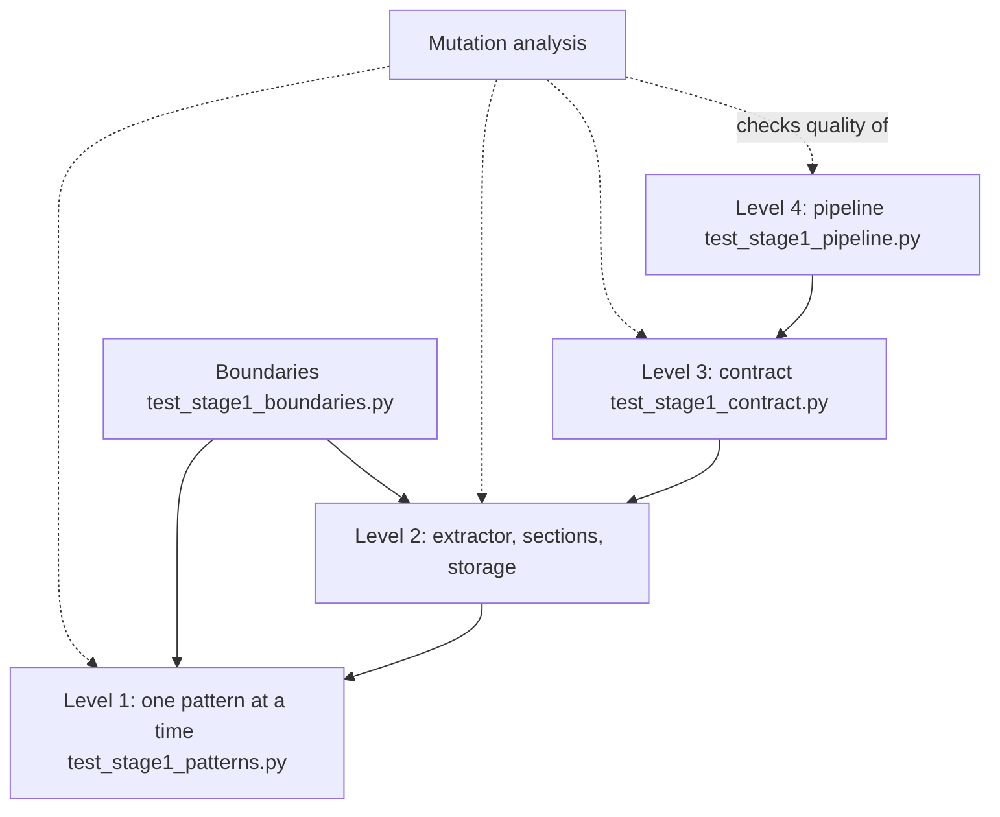
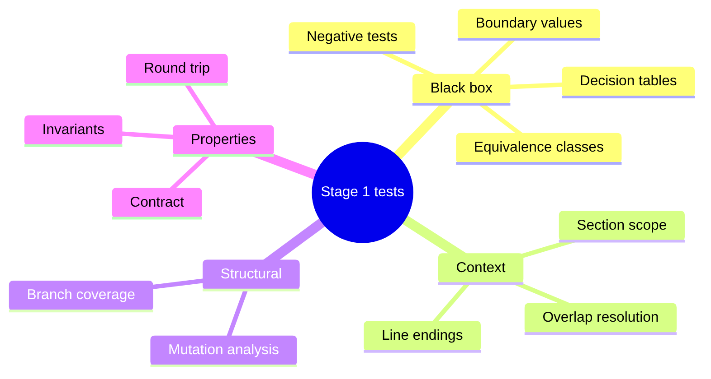
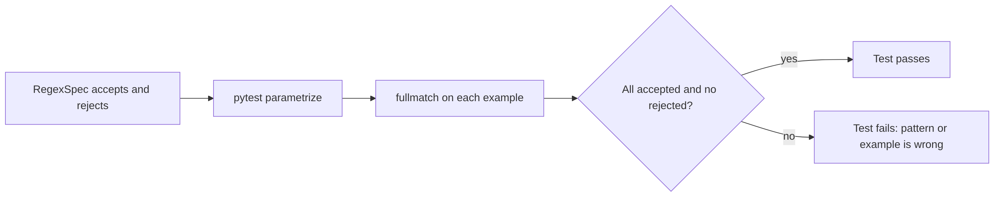
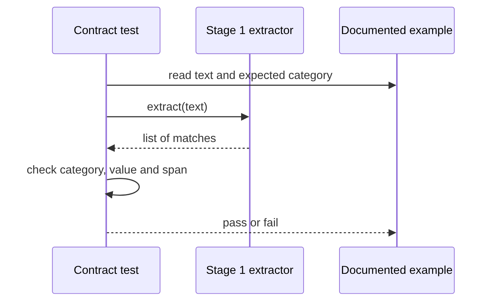
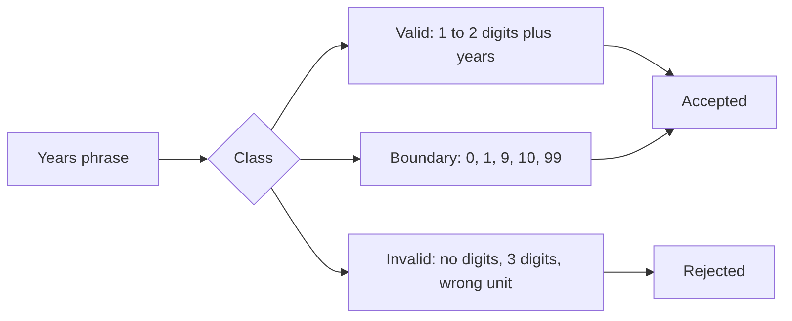
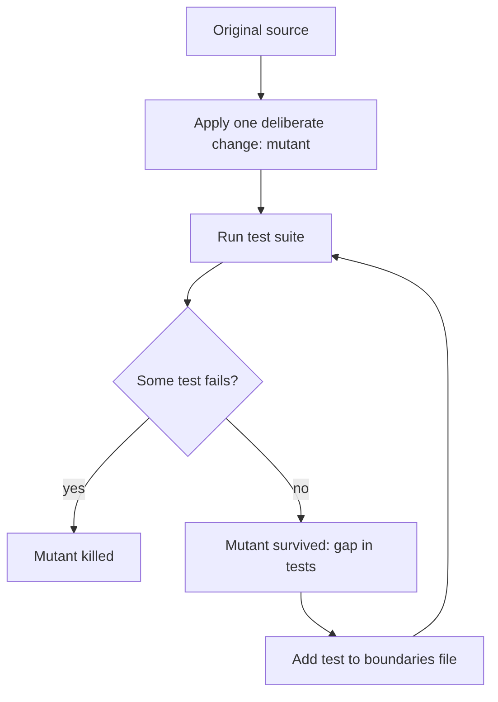

# Stage 1 — Design of Test Cases

> **ResumeLens** · Computación y Estructuras Discretas III · 2026-2
> Requirement of the assignment: **"Design of test cases, including scenarios"**, for Stage 1 (regular expressions).
> Companion of [`stage1_regex.md`](stage1_regex.md) (module design and formalization).

This document explains **what is tested, why, with which data and what result is expected** for Stage 1, and how
good the tests are (coverage and mutation analysis). Every scenario below corresponds to a real test of the repository;
the numbers were obtained by running the suite, and the tables of examples were produced by running the real code.

## Contents

1. [Test strategy](#1-test-strategy)
2. [Test techniques applied](#2-test-techniques-applied)
3. [Test data](#3-test-data)
4. [Catalog of test cases and scenarios](#4-catalog-of-test-cases-and-scenarios)
5. [Equivalence classes and boundary analysis](#5-equivalence-classes-and-boundary-analysis)
6. [How good are the tests? Coverage and mutation analysis](#6-how-good-are-the-tests-coverage-and-mutation-analysis)
7. [Traceability: requirement → expression → test](#7-traceability-requirement--expression--test)
8. [Defects found and how the tests changed](#8-defects-found-and-how-the-tests-changed)
9. [How to run](#9-how-to-run)
10. [Limitations and future tests](#10-limitations-and-future-tests)
11. [References](#11-references)

---

## 1. Test strategy

### 1.1 What must be true (test objectives)

| # | Objective | Why it matters |
|---|---|---|
| O1 | Each of the 19 regular expressions accepts what it documents and rejects what it must not | They are the core of Stage 1 and are specified formally in `stage1_regex.md` |
| O2 | Technologies are recognised **as whole words** and ambiguous words only in the right context | A false positive (`R` in `R&D`) changes the classification of a candidate |
| O3 | The engine combines the expressions correctly (overlaps, sections, unknown skills, years, de-duplication) | Individually correct expressions can still produce a wrong result together |
| O4 | The two résumés of the assignment give exactly the expected result | They are the acceptance examples of the whole project |
| O5 | Stage 1 can produce **every** skill that Stage 3 can accept | Otherwise some candidates could never be classified |
| O6 | Stage 1 → 2 → 3 work together | The final result depends on the three stages |
| O7 | Results can be saved and read back without loss | Stage 4 and the UI consume them |
| O8 | Edge cases do not crash or invent data (empty input, other line endings, other language) | Real résumés are messy |

### 1.2 Test levels



| Level | File | Tests | What it checks |
|---|---|---|---|
| Unit — catalog | `test_stage1_patterns.py` | 66 | each expression and its look-around behaviour |
| Unit — sections | `test_stage1_sections.py` | 10 | heading detection and skill-list splitting |
| Unit — persistence | `test_stage1_storage.py` | 2 | JSON save / load |
| Engine | `test_stage1_extractor.py` | 32 | the extractor on whole résumés |
| Boundary and negative | `test_stage1_boundaries.py` | 31 | cases found by the mutation analysis (section 6) |
| Contract | `test_stage1_contract.py` | 68 | Stage 1 can extract every canonical skill of Stage 3 |
| Pipeline | `test_pipeline_contract.py` | 3 | Stage 1 → 2 → 3 end to end |
| **Total of Stage 1** | | **212** | `212 passed in 0.39s` |

The whole repository (including the tests of Stage 3 and the web API written by the teammate) runs as `255 passed in 1.16s`.

### 1.3 Tools and conventions

* **pytest** with `@pytest.mark.parametrize` (one test function, many cases; the case id appears in the report, e.g. `[EMAIL]`).
* **Fixtures** are plain text files in `tests/data/resumes/` and `tmp_path` for files written by the tests.
* Every test is **deterministic** (no randomness, no network, no clock) and independent of the others.
* **coverage.py** with branch coverage and an offline **mutation analysis** to measure the quality of the suite (section 6).
* Names follow the pattern `test_<what>_<expected behaviour>`; each test checks one idea.

---

## 2. Test techniques applied



| Technique | Idea | Where it is used | Example |
|---|---|---|---|
| **Example-based (golden) testing** | complete inputs with a known correct output | the résumés of the assignment, `rich_resume`, `spanish_resume` | Wednesday Addams → `[JS, React.js, NodeJS, Postgres, Git]` |
| **Equivalence partitioning** | one representative per class of inputs that should behave alike | years, phones, spellings of a technology, layouts, languages | `3 years`, `7 años`, `two years` are three classes of the same amount |
| **Boundary value analysis** | test at and next to the limits | years 0, 49, 50; name of 4 words; skill of 30 characters; empty text | `49 years` accepted, `50 years` rejected |
| **Negative testing** | strings that must **not** match | the *rejects* list of each spec | `user@localhost`, `Scrum Master`, `JSON`, `Dockerfile` |
| **Context (look-around) testing** | the same text inside and outside a longer token | technologies vs words, e-mails and URLs | `JS` in `JS, React` vs in `JSON` and `main.js` |
| **Decision table** | combinations of conditions → outcome | ambiguous words × (Skills list / sentence) × (capitalised / lower case) | `Go` is a language in `Skills: Go` and not in `we go home` |
| **State-based testing** | transitions of a small state machine | section detection: outside → in Skills → end (blank line or next heading) | `Skills:` … blank line … paragraph |
| **Invariant (property) testing** | a property that must hold for every result | positions of the items point into the original text | `text[start:end] == item.text` |
| **Round trip** | write and read back | JSON persistence | `load(save(x)) == x` |
| **Contract testing** | a dependency between modules written as a test | every skill of Stage 3 can be extracted by Stage 1 | 67 parametrized cases |
| **End-to-end (integration) testing** | the whole pipeline | `test_pipeline_contract.py` | Stage 1 → 2 → 3 |
| **Regression testing** | a defect that was found must never come back | `O'Brien`, years apart from tokens | `test_name_with_apostrophe` |
| **Mutation analysis** | change the code on purpose and check that some test fails | section 6 | 29 mutants |



---

## 3. Test data

### 3.1 Résumé fixtures (`tests/data/resumes/`)

| File | Content (summary) | Purpose | Expected result |
|---|---|---|---|
| `wednesday_addams.txt` | 4 lines: name, `3 years of experience…`, `Technical Skills:` and the list on the next line | résumé 1 of the assignment, multi-line layout | name `Wednesday Addams`; 3 years; `[JS, React.js, NodeJS, Postgres, Git]` |
| `mary_jane_watson.txt` | name, blank line, `2 years of experience…`, `Technical Skills:` + list | résumé 2 of the assignment (Machine Learning) | name `Mary Jane Watson`; 2 years; `[Python, Pandas, NumPy, Scikit-learn, TensorFlow, SQL, Git]` |
| `rich_resume.txt` | all kinds of information: name in capitals, e-mail, phone, LinkedIn, GitHub, summary with ambiguous words (`react`, `go`, `Oracle`), experience, education, certification, skills with labels, bullets and unknown skills (`Figma`, `Notion`) | complete résumé; traps for the context rules | name `WEDNESDAY ADDAMS`; 10 years; contact data; `GitHub Actions` not `GitHub`; `Oracle` in the summary ignored |
| `spanish_resume.txt` | résumé in Spanish: `Perfil`, `cinco años`, `Educación`, `Habilidades:` | language equivalence class | name `Juan Pérez Gómez`; 5 years; two degrees; `[Python, SQL, Git, Pandas, Scikit-learn]` |

### 3.2 Inline data

Short strings written in the tests themselves for one idea each (`"Skills: Python, python, PYTHON, Git, git"`, `"99 years of experience"`, …).
The tables of section 4 show them next to the expected result.

### 3.3 Documented examples of every expression

Each `RegexSpec` carries its own *accepts* and *rejects* strings. They are tests as well: the catalog tests run all of them
with `fullmatch` (3 test functions × 19 specs = 57 cases). The complete list:

| Spec | Accepted (∈ L) | Rejected (∉ L) |
|---|---|---|
| `EMAIL` | `wednesday.addams@example.com`<br>`juan_perez+cv@mail.icesi.edu.co` | `user@localhost`<br>`@example.com`<br>`user@.com`<br>`user name@example.com` |
| `PHONE` | `304-555-1234`<br>`(304) 555-1234`<br>`+57 300 123 4567`<br>`3001234567` | `12345`<br>`2019-2023`<br>`555-1234`<br>`+57 300 123 45` |
| `LINKEDIN_URL` | `linkedin.com/in/wednesday-addams`<br>`https://www.linkedin.com/in/wadd/` | `linkedin.com`<br>`linkedin.com/company/nevermore`<br>`notlinkedin.com/in/x` |
| `GITHUB_URL` | `github.com/wednesday`<br>`https://github.com/wednesday/nevermore-notes` | `github.com`<br>`gitlab.com/wednesday` |
| `CANDIDATE_NAME` | `Wednesday Addams`<br>`Mary Jane Watson`<br>`JUAN PÉREZ`<br>`Jean-Luc Picard`<br>`Conan O'Brien` | `wednesday addams`<br>`Wednesday`<br>`Curriculum Vitae`<br>`Full Stack Developer`<br>`Resume` |
| `YEARS_OF_EXPERIENCE` | `3 years`<br>`10+ years`<br>`5-year`<br>`two years`<br>`7 años`<br>`cinco años` | `50 years`<br>`years`<br>`2020 years`<br>`3 yearbooks` |
| `JOB_TITLE` | `Web Application Developer`<br>`Senior Full Stack Developer`<br>`Machine Learning Engineer`<br>`data scientist` | `Developer`<br>`Web`<br>`Teacher Assistant`<br>`Dataset Engineer` |
| `DEGREE` | `Bachelor of Science in Computer Science`<br>`Master's in Data Science`<br>`PhD in Physics`<br>`B.Sc. in Software Engineering`<br>`Ingeniería de Sistemas`<br>`Maestría en Ciencia de Datos` | `Scrum Master`<br>`Master the art`<br>`bachelor party`<br>`Doctor` |
| `CERTIFICATION` | `AWS Certified Solutions Architect`<br>`Certified Kubernetes Administrator` | `Certified`<br>`certified developer`<br>`Certified engineer` |
| `PROGRAMMING_LANGUAGE` | `JavaScript`<br>`Javascript`<br>`javascript`<br>`Java Script`<br>`JS`<br>`TypeScript`<br>`Python`<br>`Python3`<br>`Java`<br>`C#`<br>`C++`<br>`HTML5` | `Javascripting`<br>`JSON`<br>`Pythonic`<br>`Jazz`<br>`TSLA` |
| `PROGRAMMING_LANGUAGE_AMBIGUOUS` | `R`<br>`Go`<br>`Rust`<br>`Julia`<br>`Ruby` | `r`<br>`go`<br>`Gopher`<br>`R&D`<br>`Python` |
| `WEB_FRAMEWORK` | `React.js`<br>`ReactJS`<br>`NodeJS`<br>`Node.js`<br>`Angular`<br>`Vue.js`<br>`Spring Boot`<br>`Express.js`<br>`Django`<br>`FastAPI` | `React`<br>`Node`<br>`Express`<br>`Reactive`<br>`Nodes`<br>`Spring` |
| `WEB_FRAMEWORK_AMBIGUOUS` | `React`<br>`Node`<br>`Express`<br>`Next`<br>`Spring`<br>`Nest` | `react`<br>`express`<br>`Reaction`<br>`Nodes`<br>`Spring Boot` |
| `DATA_ML_LIBRARY` | `Pandas`<br>`NumPy`<br>`Scikit-learn`<br>`scikit learn`<br>`sklearn`<br>`Tensor Flow`<br>`TensorFlow`<br>`Py Torch`<br>`PyTorch`<br>`Power BI` | `Panda`<br>`Tensor`<br>`Torch`<br>`Numeric` |
| `DATABASE` | `Postgres`<br>`PostgreSQL`<br>`MySQL`<br>`SQLite`<br>`SQL Server`<br>`MongoDB`<br>`Mongo`<br>`Redis`<br>`SQL` | `NoSQL`<br>`SQLAlchemy`<br>`Reddish`<br>`Postgresql-based` |
| `DATABASE_AMBIGUOUS` | `Oracle` | `oracle`<br>`Oracles` |
| `API_PROTOCOL` | `REST`<br>`RESTful`<br>`REST API`<br>`RESTful APIs`<br>`Rest API`<br>`GraphQL`<br>`graphql`<br>`WebSockets` | `rest`<br>`Rest`<br>`Restaurant`<br>`Rest of` |
| `VERSION_CONTROL` | `Git`<br>`GitHub`<br>`GitLab`<br>`git`<br>`Bitbucket`<br>`SVN` | `Gitea`<br>`Digit`<br>`Github.com`<br>`GitOps` |
| `DEVOPS_CLOUD_TOOL` | `Docker`<br>`Kubernetes`<br>`K8s`<br>`AWS`<br>`Amazon Web Services`<br>`Google Cloud Platform`<br>`GitHub Actions`<br>`GitLab CI/CD`<br>`Terraform`<br>`Linux` | `Dockerfile`<br>`Dockers`<br>`AWSome`<br>`Google` |

---

## 4. Catalog of test cases and scenarios

Reading guide: **Cases** is the number of parametrized cases of the function; **Technique** refers to section 2.
The IDs (`TC-…`) are stable references used by the traceability matrix and by the commit messages.

### 4.1 Catalog of expressions — `test_stage1_patterns.py` (66 cases)

| ID | Test function | Cases | Scenario | Input | Expected result | Technique |
|---|---|---|---|---|---|---|
| TC-CAT-01 | `test_catalog_has_unique_names` | 1 | The catalog has no two specs with the same name | the 19 spec names | no duplicates | Structural check |
| TC-CAT-02 | `test_spec_is_fully_documented` | 19 | Every spec documents itself (needed for the formal documentation) | each `RegexSpec` | non-empty description, at least one *accepts* and one *rejects* example, techniques listed | Structural check |
| TC-CAT-03 | `test_spec_compiles_and_honours_its_examples` | 19 | Every expression compiles and agrees with its own documented examples | the *accepts* and *rejects* strings of each spec, tested with `fullmatch` | every accepted string matches completely and no rejected string does | Equivalence classes + negative testing |
| TC-CAT-04 | `test_group_exists_in_pattern` | 19 | The group that the engine keeps really exists in the pattern | `spec.group` | `group ≤ number of groups of the pattern` | Structural check |
| TC-CAT-05 | `test_ambiguous_specs_are_restricted_to_the_skills_section` | 1 | Context-sensitive words are only searched in the Skills section | specs whose name ends in `_AMBIGUOUS` | all have `Scope.SKILLS_SECTION` | Decision table (word × location) |
| TC-CAT-06 | `test_every_extraction_category_of_the_assignment_is_covered` | 1 | Every kind of information required by the assignment has at least one expression | the categories contact, languages, frameworks, databases, education, experience, tools | all of them are present in the catalog | Requirements coverage |
| TC-CAT-07 | `test_js_is_not_found_inside_other_words` | 1 | `JS` is a technology only as a whole word | `JSON, main.js, JSX` / `JS, React` | no match / the match `JS` | Context (look-around) testing |
| TC-CAT-08 | `test_java_and_javascript_are_mutually_exclusive` | 1 | `Java` and `JavaScript` are not confused | `Java Script and Java and JavaScript` | exactly three matches, in order: `Java Script`, `Java`, `JavaScript` | Ordered alternation / negative look-ahead |
| TC-CAT-09 | `test_sql_server_wins_over_sql` | 1 | A compound name beats its prefix | `MS SQL Server` | the match is `SQL Server`, not `SQL` | Ordered alternation |
| TC-CAT-10 | `test_rest_is_case_sensitive_but_graphql_is_not` | 1 | The English word *rest* is not the protocol REST, but `graphql` in lower case is GraphQL | `the rest of the team`, `REST APIs`, `graphql` | no match, `REST APIs`, `graphql` | Scoped flag `(?i:…)` / negative testing |
| TC-CAT-11 | `test_phone_ignores_year_ranges_and_long_digit_runs` | 1 | Digits that are not a phone number are not reported | `Studied 2019-2023`, `id 123456789012345` | no match | Negative testing |
| TC-CAT-12 | `test_years_range_alternation` | 1 | The range 0–49 is exact at its boundaries | accepted: `9`, `10`, `49`, `07` years; rejected: `50`, `99`, `1.5` years | the first group is the quantity / no match | Boundary value analysis |

### 4.2 Sections and skill lists — `test_stage1_sections.py` (10 cases)

| ID | Test function | Cases | Scenario | Input | Expected result | Technique |
|---|---|---|---|---|---|---|
| TC-SEC-01 | `test_heading_on_its_own_line` | 1 | Headings alone on a line split the résumé into sections | `Skills` and `Education` headings in a multi-line résumé | sections `[skills, education]` | Equivalence class: heading alone on a line |
| TC-SEC-02 | `test_inline_heading_in_a_one_line_resume` | 1 | A résumé written on a single line still has a Skills section | `… applications. Technical Skills: JS, React.js, Git.` | body of the section is `JS, React.js, Git.` | Equivalence class: inline heading |
| TC-SEC-03 | `test_skills_on_the_line_after_the_heading` | 1 | Skills written on the line after `Technical Skills:` | `Name\nTechnical Skills:\nJS, React.js, NodeJS, Postgres, Git.` | the body is the list on the second line | Equivalence class: heading + list on the next line |
| TC-SEC-04 | `test_skills_section_stops_at_blank_line` | 1 | A blank line ends the skills list | `Skills:\nPython, Git\n\nThis is a paragraph, not skills.` | the section is `Python, Git` | State-based: end-of-section transition |
| TC-SEC-05 | `test_skills_section_stops_at_next_heading` | 1 | The next heading ends the skills list (single-line résumé) | `Technical Skills: Python, Git Education: BSc in Physics` | the section is `Python, Git` | State-based: end-of-section transition |
| TC-SEC-06 | `test_soft_skills_is_not_a_skills_section` | 1 | *Soft skills* is not the technical Skills section | `Soft skills: communication, teamwork` | no Skills section | Negative look-behind |
| TC-SEC-07 | `test_spanish_headings` | 1 | Spanish headings are recognised | `Habilidades:` / `Educación` | sections `[skills, education]` | Equivalence class: language |
| TC-SEC-08 | `test_no_headings` | 1 | A text without headings has no sections | `Just a paragraph with no headings at all.` | empty list | Negative testing |
| TC-SEC-09 | `test_split_skill_items_handles_bullets_labels_and_trailing_dot` | 1 | A skills list is cleaned item by item | `Frontend: JavaScript, React\n- Docker (2 years); Linux, Notion.` | `JavaScript, React, Docker (2 years), Linux, Notion` | Equivalence classes of separators (`,` `;` newline), bullet, label, trailing dot |
| TC-SEC-10 | `test_split_skill_items_positions_point_into_the_text` | 1 | Positions of the items are exact | `Skills: Python, Git` | `text[start:end] == item` for every item | Invariant (property) check |

### 4.3 Extraction engine — `test_stage1_extractor.py` (32 cases)

| ID | Test function | Cases | Scenario | Input | Expected result | Technique |
|---|---|---|---|---|---|---|
| TC-EXT-01 | `test_wednesday_addams_from_the_assignment` | 1 | The first résumé of the assignment, multi-line | `wednesday_addams.txt` | `raw_tokens = [JS, React.js, NodeJS, Postgres, Git]`, name `Wednesday Addams`, 3 years | Golden example (acceptance) |
| TC-EXT-02 | `test_wednesday_addams_written_on_a_single_line` | 1 | The same résumé written on one line | the one-line text of the assignment | the same result as the multi-line version | Equivalence class: layout |
| TC-EXT-03 | `test_mary_jane_watson_from_the_assignment` | 1 | The second résumé of the assignment | `mary_jane_watson.txt` | `[Python, Pandas, NumPy, Scikit-learn, TensorFlow, SQL, Git]`, name `Mary Jane Watson`, 2 years | Golden example (acceptance) |
| TC-EXT-04 | `test_years_are_not_mixed_with_the_raw_tokens` | 1 | Years of experience are not a qualification token | `wednesday_addams.txt` | `"3"` is not in `raw_tokens` | Contract check (with Stage 2) |
| TC-EXT-05 | `test_years_of_experience_values` | 6 | Quantity of years in several spellings | `10 years`, `12+ years`, `two years`, `5 años`, `2 years … 7 years`, `0 years` | 10, 12, 2, 5, 7 (the maximum), 0 | Equivalence classes + boundary value (0) |
| TC-EXT-06 | `test_incoherent_or_missing_years_are_not_reported` | 4 | Incoherent or missing quantities give `None` | `99 years`, `2020 years`, `years of experience`, `I like to travel` | `years_of_experience is None` | Boundary value (out of range) + negative testing |
| TC-EXT-07 | `test_rich_resume_contact_information` | 1 | All contact data of a complete résumé | `rich_resume.txt` | e-mail, phone `+57 300 123 4567`, LinkedIn and GitHub | Golden example |
| TC-EXT-08 | `test_rich_resume_identity_experience_and_education` | 1 | Name in capitals, years, job titles, degree and certification | `rich_resume.txt` | `WEDNESDAY ADDAMS`, 10 (from `10+ years`, not the `3 years` line), two job titles, degree and certification | Golden example |
| TC-EXT-09 | `test_rich_resume_technologies_by_category` | 1 | Technologies grouped by category | `rich_resume.txt` | languages `[JavaScript, Go]`, database `[PostgreSQL]`, frameworks and tools present | Golden example |
| TC-EXT-10 | `test_longest_technology_wins_over_overlapping_one` | 1 | `GitHub Actions` is not reported as `GitHub` | `rich_resume.txt` | `GitHub Actions` found, `GitHub` not found | Overlap resolution |
| TC-EXT-11 | `test_spanish_resume` | 1 | A résumé written in Spanish | `spanish_resume.txt` | name `Juan Pérez Gómez`, 5 years (`cinco`), e-mail, phone, two degrees, tokens `[Python, SQL, Git, Pandas, Scikit-learn]` | Equivalence class: language |
| TC-EXT-12 | `test_ambiguous_words_in_prose_are_not_technologies` | 1 | Ambiguous words in ordinary sentences are ignored | `We react quickly, express interest and go the extra mile. Worked at Oracle with the rest of the team.` | `raw_tokens == []` | Decision table (word × location) |
| TC-EXT-13 | `test_ambiguous_words_inside_the_skills_section_are_technologies` | 1 | The same words are technologies inside Skills | `Skills: Python, R, Go, Rust, Julia, React, Node, Express, Oracle` | all nine are extracted, in order | Decision table (word × location) |
| TC-EXT-14 | `test_technologies_are_not_found_inside_other_words_or_emails` | 1 | A technology inside an e-mail or a longer word is ignored | `Contact: dev.git@example.com. Knows JSON, main.js and Dockerfile.` | no tokens; the e-mail is still extracted | Context testing |
| TC-EXT-15 | `test_unknown_skills_in_the_skills_section_become_other` | 1 | A skill that no pattern knows is kept as `OTHER` | `Skills: Python, Figma, Notion (2 years), Git` | tokens `[Python, Figma, Notion, Git]`; `Figma` and `Notion` have category `OTHER` | Equivalence class: unknown skill |
| TC-EXT-16 | `test_no_skills_section_means_no_unknown_skills_are_guessed` | 1 | Without a Skills section nothing is guessed | `I enjoy painting and cooking. Python is my favourite language.` | `[Python]` only | Negative testing |
| TC-EXT-17 | `test_sentences_in_the_skills_section_are_not_unknown_skills` | 1 | A sentence inside Skills is not a skill | `Skills: Python, passionate about building scalable distributed systems` | `[Python]` only | Negative testing |
| TC-EXT-18 | `test_empty_resume` | 3 | Empty or blank input | `""`, `"   "`, `"\n\n"` | no tokens, no years, no name, no items | Boundary value (empty input) |
| TC-EXT-19 | `test_tokens_are_deduplicated_case_insensitively_keeping_the_first_spelling` | 1 | Repeated skills appear once | `Skills: Python, python, PYTHON, Git, git` | `[Python, Git]` | Equivalence class: duplicates |
| TC-EXT-20 | `test_windows_line_endings` | 1 | `\r\n` line endings | `wednesday_addams.txt` with `\r\n` | the same tokens as with `\n` | Equivalence class: line ending |
| TC-EXT-21 | `test_item_positions_point_to_the_original_text` | 1 | Every item points to its place in the original text | `rich_resume.txt` | `text[start:end]` (spaces normalised) equals `item.text` for all items | Invariant (property) check |
| TC-EXT-22 | `test_extractor_runs_a_custom_catalog` | 1 | The engine is generic: it runs any catalog | a catalog with only `EMAIL`; text `Python dev, mail: a@b.co` | no tokens, e-mail found | Configuration variation |

### 4.4 Persistence — `test_stage1_storage.py` (2 cases)

| ID | Test function | Cases | Scenario | Input | Expected result | Technique |
|---|---|---|---|---|---|---|
| TC-STO-01 | `test_save_and_load_roundtrip` | 1 | Persist and read back a result | extraction of `rich_resume.txt` saved in a nested folder | the loaded object equals the original | Round trip |
| TC-STO-02 | `test_json_file_is_human_readable_utf8` | 1 | The JSON file is readable and keeps accents | `Juan Pérez` / `Habilidades: Python, Git` | `candidate_name` is `Juan Pérez`; the file contains `Pérez` unescaped | Equivalence class: non-ASCII characters |

### 4.5 Boundary and negative cases — `test_stage1_boundaries.py` (31 cases)

| ID | Test function | Cases | Scenario | Input | Expected result | Technique |
|---|---|---|---|---|---|---|
| TC-BND-01 | `test_technology_followed_by_hyphen_or_dot_and_a_word_is_not_a_technology` | 5 | A technology that continues as a hyphenated or dotted word is not the technology | `a Python-based tool`, `built with Node.jsx`, `SQL-like syntax`, `Docker-compose files`, `see Docker.com` | no match | Boundary value on the right boundary `_RB` |
| TC-BND-02 | `test_technology_followed_by_sentence_punctuation_is_still_found` | 3 | A final dot, comma or parenthesis does not hide the technology | `Knows Git.`, `Knows Git, Docker`, `Knows (Git)` | `Git` is found | Boundary value on the right boundary `_RB` (accepting side) |
| TC-BND-03 | `test_technology_that_is_part_of_an_email_is_not_a_technology` | 1 | A technology inside a contact item is dropped (contact wins) | `Contact: git@acme.io` | e-mail found, `raw_tokens == []` | Overlap resolution |
| TC-BND-04 | `test_master_without_of_or_in_is_not_a_degree` | 1 | `Master` is a degree only before `of`/`in` | `Certified Scrum Master Training and Master Thesis` | no `DEGREE` item | Negative testing (false positive) |
| TC-BND-05 | `test_doctorates_and_abbreviations_are_degrees` | 4 | Abbreviations and doctorates, with or without a field | `Ph.D. in Physics`, `PhD`, `Doctorate in Chemistry`, `MSc in Machine Learning` | each text is one `DEGREE` item | Equivalence classes of spellings |
| TC-BND-06 | `test_certifications_of_every_provider` | 3 | Certifications of each provider and the bare `Certified …` form | `GCP Certified Professional`, `Azure Certified Administrator`, `Certified Kubernetes Administrator` | each text is one `CERTIFICATION` item | Equivalence classes of providers |
| TC-BND-07 | `test_job_titles_with_every_seniority_word` | 4 | Job titles with each seniority word and without one | `Principal Data Engineer`, `Lead Machine Learning Engineer`, `Junior Web Developer`, `Cloud Engineer` | one job title equal to the input | Equivalence classes |
| TC-BND-08 | `test_a_name_has_at_most_four_words` | 1 | A name is limited to four words | `Anna Maria Louise Jane Smith` | name is the first four words | Boundary value (4 words) |
| TC-BND-09 | `test_a_heading_word_is_not_the_first_word_of_a_name` | 1 | A heading word at the start is not a name | `Technical Writer` | `candidate_name is None` | Negative testing |
| TC-BND-10 | `test_name_with_apostrophe` | 1 | Names with an apostrophe | `Conan O'Brien` | `Conan O'Brien` | Regression test (defect found by the formal model) |
| TC-BND-11 | `test_api_protocol_spellings` | 5 | Singular and plural, spaced and compact spellings of protocols | `WebSocket`, `websockets`, `Web Sockets`, `GraphQL`, `RESTful APIs` | the whole text is matched | Equivalence classes of spellings |
| TC-BND-12 | `test_long_unknown_skills_are_not_guessed` | 1 | A very long word is not an unknown skill | `Skills: Python, Supercalifragilisticexpialidocious Pneumonoultramicroscopic` | `[Python]` only | Boundary value (length > 30) |
| TC-BND-13 | `test_skills_section_is_found_and_ends_at_a_blank_line_with_windows_line_endings` | 1 | Sections work with `\r\n` as well | `Skills\r\nPython, Figma\r\n\r\nNotion\r\n` | `[Python, Figma]` (Notion is after the blank line); same as with `\n` | Equivalence class: line ending |

### 4.6 Contract with Stage 3 — `test_stage1_contract.py` (68 cases)



| ID | Test function | Cases | Scenario | Input | Expected result | Technique |
|---|---|---|---|---|---|---|
| TC-CON-01 | `test_every_canonical_skill_has_a_documented_surface_form` | 1 | Every canonical skill of the four profiles has a written form in the contract table | `PROFILES_REGISTRY` of Stage 3 | no canonical skill is missing from `SURFACE_FORMS` | Contract check (completeness) |
| TC-CON-02 | `test_stage1_can_extract_a_surface_form_of_every_canonical_skill` | 67 | Stage 1 can produce every skill that Stage 3 can accept | `Technical Skills: <form>` for each of the 67 canonical skills | `raw_tokens == [<form>]` | Contract testing (parametrized) |

The 67 pairs *(canonical symbol, written form)* that the contract test uses (the symbol `EXPERIENCE_PRESENT` is created by Stage 2 from the years and is not written in the résumé):

| Canonical symbol (Stage 3) | Written form tested | Canonical symbol | Written form tested |
|---|---|---|---|
| `ANGULAR` | `Angular` | `MYSQL` | `MySQL` |
| `ANSIBLE` | `Ansible` | `NESTJS` | `NestJS` |
| `ARGO_CD` | `Argo CD` | `NEXTJS` | `Next.js` |
| `AWS` | `Amazon Web Services` | `NODE_JS` | `NodeJS` |
| `AZURE` | `Azure` | `NUMPY` | `NumPy` |
| `BASH` | `Bash` | `ORACLE` | `Oracle` |
| `CATBOOST` | `CatBoost` | `PANDAS` | `Pandas` |
| `CSHARP` | `C#` | `PLOTLY` | `Plotly` |
| `CSS` | `CSS3` | `PODMAN` | `Podman` |
| `DJANGO` | `Django` | `POSTGRESQL` | `Postgres` |
| `DOCKER` | `Docker` | `POWERSHELL` | `PowerShell` |
| `EXPRESS` | `Express.js` | `POWER_BI` | `Power BI` |
| `FASTAPI` | `FastAPI` | `PYTHON` | `Python` |
| `FIREBASE` | `Firebase` | `PYTORCH` | `Py Torch` |
| `GCP` | `GCP` | `R` | `R` |
| `GIT` | `Git` | `REACT` | `React.js` |
| `GITHUB` | `GitHub` | `REDIS` | `Redis` |
| `GITHUB_ACTIONS` | `GitHub Actions` | `REST` | `REST API` |
| `GITLAB` | `GitLab` | `SCIKIT_LEARN` | `Scikit-learn` |
| `GITLAB_CI` | `GitLab CI` | `SCIPY` | `SciPy` |
| `GO` | `Go` | `SEABORN` | `Seaborn` |
| `GRAPHQL` | `GraphQL` | `SPRING_BOOT` | `Spring Boot` |
| `HELM` | `Helm` | `SQL` | `SQL` |
| `HTML` | `HTML5` | `SQLITE` | `SQLite` |
| `JAVA` | `Java` | `STATSMODELS` | `Statsmodels` |
| `JAVASCRIPT` | `JavaScript` | `SVELTE` | `Svelte` |
| `JENKINS` | `Jenkins` | `TABLEAU` | `Tableau` |
| `JULIA` | `Julia` | `TENSORFLOW` | `Tensor Flow` |
| `KERAS` | `Keras` | `TERRAFORM` | `Terraform` |
| `KUBERNETES` | `K8s` | `TYPESCRIPT` | `TypeScript` |
| `LIGHTGBM` | `LightGBM` | `VUE` | `Vue.js` |
| `LINUX` | `Linux` | `WEBSOCKET` | `WebSockets` |
| `MATPLOTLIB` | `Matplotlib` | `XGBOOST` | `XGBoost` |
| `MONGODB` | `MongoDB` |  | |

### 4.7 End to end — `test_pipeline_contract.py` (3 cases)

| ID | Test function | Cases | Scenario | Input | Expected result | Technique |
|---|---|---|---|---|---|---|
| TC-PIP-01 | `test_wednesday_addams_end_to_end_pipeline` | 1 | Stages 1 → 2 → 3 for the first résumé | the one-line résumé | Stage 1: 3 years, tokens; Stage 2: `JAVASCRIPT, REACT, NODE_JS, POSTGRESQL, GIT`; Stage 3: Full Stack accepted in `q_version_control` | End-to-end (integration) |
| TC-PIP-02 | `test_stage3_rejects_raw_tokens_without_stage2` | 1 | Stage 3 needs Stage 2 | `[JS, React.js, NodeJS, Postgres, Git]` sent directly to Stage 3 | rejected in `q_trap`: the tokens are not in the alphabet | Negative integration test |
| TC-PIP-03 | `test_mary_jane_watson_ml_engineer_pipeline` | 1 | Stages 1 → 2 → 3 for the second résumé | Mary Jane Watson's text | `SCIKIT_LEARN` and `TENSORFLOW` after Stage 2; Machine Learning profile accepted | End-to-end (integration) |

---

## 5. Equivalence classes and boundary analysis

The tables below were produced by running the real engine on each representative input (nothing is typed by hand).

### 5.1 Years of experience



| Class | Representative input | Reported years | Why |
|---|---|---|---|
| Digits 0–9 | `7 years of experience` | `7` | single digit |
| Digit 0 (lower boundary) | `0 years` | `0` | boundary: the lowest value is kept |
| Leading zero | `07 years` | `7` | `0?\d` |
| Digits 10–49 | `10 years of experience` | `10` | `[1-4]\d` |
| Upper boundary | `49 years` | `49` | the highest accepted value |
| Just above the boundary | `50 years` | `None` | outside 0–49: not a coherent amount of years |
| A year, not a quantity | `2020 years` | `None` | four digits are not an amount of years |
| Plus sign | `12+ years building APIs` | `12` | `\+?` |
| Hyphen / compound | `5-year plan` | `5` | `[\s-]*` |
| Number word (English) | `two years of experience` | `2` | `one … twelve` |
| Number word (Spanish) | `cinco años de experiencia` | `5` | `uno … doce`, unit `años` |
| Abbreviated unit | `3 yrs` | `3` | `yrs?` |
| Several quantities | `2 years at A and 7 years at B` | `7` | the maximum is reported |
| Decimal | `1.5 years` | `None` | the look-behind rejects a digit preceded by a dot |
| Unit is a longer word | `3 yearbooks` | `None` | `\b` after the unit |
| No quantity | `years of experience` | `None` | nothing to report |

### 5.2 Phone numbers

| Class | Input | Matches |
|---|---|---|
| 10 digits, plain | `3001234567` | `3001234567` |
| Hyphens | `304-555-1234` | `304-555-1234` |
| Spaces | `304 555 1234` | `304 555 1234` |
| Area code in parentheses | `(304) 555-1234` | `(304) 555-1234` |
| International prefix | `+57 300 123 4567` | `+57 300 123 4567` |
| Too short (7 digits) | `555-1234` | *no match* |
| Year range (8 digits) | `2019-2023` | *no match* |
| Too long (15 digits) | `123456789012345` | *no match* |
| Digits inside a word | `id3001234567x` | *no match* |

### 5.3 Left and right boundary of a technology (`Git` as example)

A technology must not be glued to other word characters (section 2.8 of `stage1_regex.md`).
The accepting side (final dot, comma, parenthesis) is as important as the rejecting side.

| Text | Result | Reason |
|---|---|---|
| `Git` | `Git` | the whole text |
| `Knows Git.` | `Git` | a final dot is allowed |
| `Git, Docker` | `Git` | a comma is allowed |
| `(Git)` | `Git` | parentheses are allowed |
| `GitHub` | `GitHub` | longer name, also a technology (`Git(?:Hub|Lab)?`) |
| `Gitea` | *no match* | letters continue the word |
| `GitOps` | *no match* | letters continue the word |
| `Digit` | *no match* | glued to a previous letter |
| `main.git` | *no match* | preceded by a dot |
| `git-flow` | *no match* | hyphen + word |
| `git.io` | *no match* | dot + word |
| `git+ssh` | *no match* | followed by `+` |
| `git@acme.io` | `git` | followed by `@`: found by the expression; the engine drops it because it is inside an e-mail |

### 5.4 Decision table of the ambiguous words

An ambiguous word is a technology only **inside the Skills list and written with a capital letter**.

| Word | In the Skills list, capitalised | In the Skills list, lower case | In a sentence |
|---|---|---|---|
| `Go` | recognised | recognised | ignored (`We go to market and Go is fun`) |
| `R` | recognised | recognised | ignored (`R&D team`) |
| `Rust` | recognised | recognised | ignored (`Rust never sleeps`) |
| `Ruby` | recognised | recognised | ignored (`a ruby ring`) |
| `Julia` | recognised | recognised | ignored (`Julia called me`) |
| `React` | recognised | recognised | ignored (`We react quickly`) |
| `Node` | recognised | recognised | ignored (`A node in a graph`) |
| `Express` | recognised | recognised | ignored (`express interest`) |
| `Next` | recognised | recognised | ignored (`Next step`) |
| `Spring` | recognised | recognised | ignored (`In spring`) |
| `Oracle` | recognised | recognised | ignored (`Worked at Oracle`) |

### 5.5 Headings and sections

| Heading form | Text | Sections found |
|---|---|---|
| Alone on a line, with colon | `Technical Skills:↵Python` | ['skills'] |
| Alone on a line, no colon | `Skills↵Python` | ['skills'] |
| Inline with colon | `CV. Technical Skills: Python, Git` | ['skills'] |
| Inline without colon | `My skills are Python` | *none* |
| Spanish | `Habilidades:↵Python` | ['skills'] |
| Spanish, accents | `Educación↵Ingeniería` | ['education'] |
| Soft skills | `Soft skills: teamwork` | *none* |
| Tech stack | `Tech stack: Python` | ['skills'] |
| Education | `Education↵BSc` | ['education'] |
| Two headings on one line | `Skills: Python Education: BSc` | ['skills', 'education'] |

---

## 6. How good are the tests? Coverage and mutation analysis

### 6.1 Coverage (statements and branches) of `src/stage1_regex`

| Module | Statements | Missed | Branches | Partial | Coverage |
|---|---|---|---|---|---|
| `__init__.py` | 5 | 0 | 0 | 0 | 100% |
| `expressions.py` | 29 | 0 | 0 | 0 | 100% |
| `extractor.py` | 85 | 1 | 32 | 1 | 98% |
| `models.py` | 85 | 0 | 6 | 0 | 100% |
| `patterns.py` | 27 | 0 | 0 | 0 | 100% |
| `sections.py` | 68 | 1 | 26 | 3 | 96% |
| `storage.py` | 13 | 0 | 0 | 0 | 100% |
| **Total** | 312 | 2 | 64 | 4 | **98%** |

Not covered: three defensive branches — `extractor.py:95` (`continue` when the kept group did not take part in the match; no spec has an
optional kept group), `sections.py:102` (`find_section` returns `None` when the section does not exist), and two loop-exit branches of
`sections.py`. They do not change any result today.

Coverage only says that lines were executed, not that a wrong result would be noticed. That is what the next analysis measures.

### 6.2 Mutation analysis



**Method.** 29 *mutants* were created by changing, one at a time, a regular expression or a line of the engine on purpose (for example
widening the range `[1-4]\d` to `[1-5]\d`, removing a look-behind, or taking the minimum instead of the maximum of the years).
For each mutant the whole Stage 1 suite was run. If a test fails, the mutant is **killed** (the suite noticed the change);
if every test passes, it **survived** (a behaviour that nobody checks).

**Result.** The first version of the suite killed **17 of 29** mutants (59 %). The survivors were real gaps, for example
`Python-based`, `Node.jsx`, `Master` without `of|in`, `Principal`, `GCP Certified`, `Ph.D.`, the limit of four words of a name, the
length limit of unknown skills and Windows line endings in the section detection. They were closed with
the tests of `test_stage1_boundaries.py` (section 4.5). With them the suite kills **29 of 29**.

| ID | Deliberate change (mutant) | Original suite | Killed by (after adding the boundary tests) |
|---|---|---|---|
| M01 | left boundary no longer forbids a preceding dot (main.js) | killed | `test_js_is_not_found_inside_other_words` |
| M02 | right boundary no longer forbids '-' + word (Python-based) | **survived** | `test_technology_followed_by_hyphen_or_dot_and_a_word_is_not_a_technology` |
| M03 | right boundary no longer forbids '.' + word (Node.jsx) | **survived** | `test_technology_followed_by_hyphen_or_dot_and_a_word_is_not_a_technology` |
| M04 | e-mail domain may have a single label (user@localhost) | killed | `test_spec_compiles_and_honours_its_examples` |
| M05 | phone loses its trailing (?!\d) check | killed | `test_phone_ignores_year_ranges_and_long_digit_runs` |
| M06 | years range 0-49 widened to 0-59 | killed | `test_spec_compiles_and_honours_its_examples` |
| M07 | years loses its look-behind (1.5 years -> 5) | killed | `test_years_range_alternation` |
| M08 | Bachelor/Master no longer need 'of|in' (Scrum Master) | **survived** | `test_master_without_of_or_in_is_not_a_degree` |
| M09 | name no longer excludes the heading word 'Technical' | **survived** | `test_a_heading_word_is_not_the_first_word_of_a_name` |
| M11 | name may have up to 6 words | **survived** | `test_a_name_has_at_most_four_words` |
| M12 | WebSocket singular no longer accepted | **survived** | `test_api_protocol_spellings` |
| M13 | REST becomes case-insensitive | killed | `test_spec_compiles_and_honours_its_examples` |
| M14 | ambiguous specs run on the whole document | killed | `test_ambiguous_specs_are_restricted_to_the_skills_section` |
| M15 | shortest technology wins instead of longest | killed | `test_rich_resume_technologies_by_category` |
| M16 | years: minimum instead of maximum | killed | `test_years_of_experience_values` |
| M17 | de-duplication becomes case-sensitive | killed | `test_tokens_are_deduplicated_case_insensitively_keeping_the_first_spelling` |
| M18 | technologies inside contact items are no longer dropped | **survived** | `test_technology_that_is_part_of_an_email_is_not_a_technology` |
| M19 | 'Soft skills' is taken as a Skills section | killed | `test_soft_skills_is_not_a_skills_section` |
| M20 | Skills list no longer ends at a blank line | killed | `test_skills_section_stops_at_blank_line` |
| M21 | line endings are not normalised | **survived** | `test_skills_section_is_found_and_ends_at_a_blank_line_with_windows_line_endings` |
| M22 | length limit of unknown skills removed | **survived** | `test_long_unknown_skills_are_not_guessed` |
| M23 | unknown skills (OTHER) are never created | killed | `test_unknown_skills_in_the_skills_section_become_other` |
| M24 | raw_tokens includes every category (names, e-mails ...) | killed | `test_wednesday_addams_from_the_assignment` |
| M25 | trailing dot of the last skill is kept | killed | `test_split_skill_items_handles_bullets_labels_and_trailing_dot` |
| M26 | job title: 'Principal' no longer a seniority word | **survived** | `test_job_titles_with_every_seniority_word` |
| M27 | 'Python3' no longer recognised | killed | `test_spec_compiles_and_honours_its_examples` |
| M28 | 'PostgreSQL' no longer recognised as such | killed | `test_spec_compiles_and_honours_its_examples` |
| M29 | certification: 'GCP Certified ...' no longer recognised | **survived** | `test_certifications_of_every_provider` |
| M30 | degree: 'Ph.D.' spelling lost | **survived** | `test_doctorates_and_abbreviations_are_degrees` |

*Note:* a mutant that survives is not always a defect (it can be an equivalent change). Here each survivor was examined and
corresponded to a behaviour that had no test.

---

## 7. Traceability: requirement → expression → test

| Requirement of the assignment (Stage 1) | Expressions | Main tests |
|---|---|---|
| Contact information | `EMAIL`, `PHONE`, `LINKEDIN_URL`, `GITHUB_URL` | `test_spec_compiles_and_honours_its_examples`, `test_phone_ignores_year_ranges_and_long_digit_runs`, `test_rich_resume_contact_information`, `test_technology_that_is_part_of_an_email_is_not_a_technology` |
| Programming languages | `PROGRAMMING_LANGUAGE`, `…_AMBIGUOUS` | `test_js_is_not_found_inside_other_words`, `test_java_and_javascript_are_mutually_exclusive`, `test_ambiguous_words_in_prose_are_not_technologies`, `test_ambiguous_words_inside_the_skills_section_are_technologies` |
| Frameworks and libraries | `WEB_FRAMEWORK`, `…_AMBIGUOUS`, `DATA_ML_LIBRARY` | `test_stage1_can_extract_a_surface_form_of_every_canonical_skill`, `test_technology_followed_by_hyphen_or_dot_and_a_word_is_not_a_technology` |
| Databases | `DATABASE`, `DATABASE_AMBIGUOUS` | `test_sql_server_wins_over_sql`, `test_rich_resume_technologies_by_category` |
| Academic qualifications | `DEGREE`, `CERTIFICATION` | `test_rich_resume_identity_experience_and_education`, `test_master_without_of_or_in_is_not_a_degree`, `test_doctorates_and_abbreviations_are_degrees`, `test_certifications_of_every_provider`, `test_spanish_resume` |
| Professional experience | `YEARS_OF_EXPERIENCE`, `JOB_TITLE` | `test_years_range_alternation`, `test_years_of_experience_values`, `test_incoherent_or_missing_years_are_not_reported`, `test_job_titles_with_every_seniority_word` |
| Tools and technologies | `API_PROTOCOL`, `VERSION_CONTROL`, `DEVOPS_CLOUD_TOOL` | `test_rest_is_case_sensitive_but_graphql_is_not`, `test_api_protocol_spellings`, `test_longest_technology_wins_over_overlapping_one` |
| Identity (needed by the DSL of Stage 4) | `CANDIDATE_NAME` | `test_a_name_has_at_most_four_words`, `test_a_heading_word_is_not_the_first_word_of_a_name`, `test_name_with_apostrophe` |
| Unknown technologies (`OTHER`) | engine | `test_unknown_skills_in_the_skills_section_become_other`, `test_sentences_in_the_skills_section_are_not_unknown_skills`, `test_long_unknown_skills_are_not_guessed` |
| Hand-over to Stage 2 (`raw_tokens`, years apart) | engine | `test_years_are_not_mixed_with_the_raw_tokens`, `test_tokens_are_deduplicated_case_insensitively_keeping_the_first_spelling` |
| Compatibility with Stage 3 | all | `test_stage1_can_extract_a_surface_form_of_every_canonical_skill`, `test_wednesday_addams_end_to_end_pipeline`, `test_mary_jane_watson_ml_engineer_pipeline` |
| Robustness | engine | `test_empty_resume`, `test_windows_line_endings`, `test_item_positions_point_to_the_original_text` |

---

## 8. Defects found and how the tests changed

| # | What happened | How it was found | Fix and test |
|---|---|---|---|
| 1 | The name expression required a lower-case letter right after the initial capital, so `O'Brien` (promised by its description) was **not** accepted | building the automaton of the expression for `stage1_regex.md`: the state after the capital had no arrow for `'` | `_NAME_WORD` allows an apostrophe after the initial; `Conan O'Brien` added to the examples and `test_name_with_apostrophe` |
| 2 | After the teammate's change the years travel apart from the tokens: two tests failed (one asserted that `"3"` was in `raw_tokens`; the contract table did not know the symbol `EXPERIENCE_PRESENT`) | running the merged repository | tests updated: `raw_tokens` must **not** contain the years; `EXPERIENCE_PRESENT` is excluded from the contract because Stage 2 creates it |
| 3 | The first version of the suite let 12 of 29 deliberate changes pass | mutation analysis (section 6) | 31 new tests in `test_stage1_boundaries.py` |
| 4 | The documentation test (`test_stage1_docs.py`) was judged unnecessary for this stage | review by the team | removed together with the generator of the documentation |

---

## 9. How to run

```bash
python -m pytest tests/test_stage1_*.py tests/test_pipeline_contract.py -v     # Stage 1 and the pipeline
python -m pytest tests -q                                                      # the whole repository
python -m pytest tests/test_stage1_patterns.py -k "EMAIL" -v                   # one expression
```

Coverage (optional, needs `pip install coverage`):

```bash
python -m coverage run --branch --source=src/stage1_regex -m pytest tests
python -m coverage report -m
```

Expected result: `212 passed in 0.39s` (Stage 1 and pipeline) and `255 passed in 1.16s` (whole repository).

---

## 10. Limitations and future tests

* The tests use **text** résumés in English and Spanish. PDF or Word extraction is out of scope.
* There is no performance test: the expressions are small and equivalent to small automata, and the fixtures are short.
* The mutation analysis was run offline with a list of 29 hand-made mutants; it is a quality estimate, not a proof that no defect remains.
* The formal automata of `stage1_regex.md` (section 3.20) were compared with the real expressions by a differential test (thousands of random and
  mutated strings, zero disagreements) run offline; that script is not part of the suite.
* Possible additions: property-based tests (random strings) for the invariants of the engine, more résumé fixtures (two columns, bullets with symbols), and a
  fixture in a third language to document the limitation.

## 11. References

* Myers, G. J., Sandler, C., Badgett, T. (2011). *The Art of Software Testing* (3rd ed.). Wiley. (equivalence partitioning, boundary value analysis)
* ISTQB. *Foundation Level Syllabus* — test design techniques (black-box: equivalence partitioning, boundary values, decision tables, state transition).
* Beizer, B. (1990). *Software Testing Techniques* (2nd ed.). Van Nostrand Reinhold.
* Jia, Y., Harman, M. (2011). *An analysis and survey of the development of mutation testing.* IEEE Transactions on Software Engineering, 37(5).
* pytest documentation: parametrization, fixtures (`tmp_path`).
* coverage.py documentation: branch coverage.
