# Stage 2 — Qualification Normalization with Finite-State Transducers

> **ResumeLens** · Computación y Estructuras Discretas III · 2026-2
> Stage 2 of the pipeline: *raw tokens* (Stage 1) → *canonical tokens, in canonical order* (Stage 3).
> Companion of [`stage1_regex.md`](stage1_regex.md), [`stage2_tests.md`](stage2_tests.md) and [`stage3_formalization.md`](stage3_formalization.md).

This document defines **every transducer of Stage 2** as a complete 7-tuple **M = (Q, Σ, Γ, δ, ω, q₀, F)**, with its diagram, its
transition and output tables, its language and the arguments that justify it. It is generated from the same objects that the program runs
(`src/stage2_fst/transducers.py`), so the tuples printed here are the ones executed by pyformlang.

## Contents

0. [Summary](#0-summary)
1. [Role of Stage 2 in the pipeline](#1-role-of-stage-2-in-the-pipeline)
2. [Formal background and notation](#2-formal-background-and-notation)
3. [Catalog of all the transducers](#3-catalog-of-all-the-transducers)
4. [Cleaning and experience transducers](#4-cleaning-and-experience-transducers)
5. [The alias transducer](#5-the-alias-transducer)
6. [One sheet for each canonical token (79 sheets)](#6-one-sheet-for-each-canonical-token)
7. [The sorting transducers](#7-the-sorting-transducers)
8. [Worked examples with complete traces](#8-worked-examples-with-complete-traces)
9. [Properties and proofs](#9-properties-and-proofs)
10. [Implementation with pyformlang](#10-implementation-with-pyformlang)
11. [Verification](#11-verification)
12. [Design decisions and limitations](#12-design-decisions-and-limitations)
13. [References](#13-references)
- [Appendix A — Complete transition table of the alias transducer](#appendix-a--complete-transition-table-of-the-alias-transducer)

---

## 0. Summary

| Item | Value |
|---|---|
| Input | `raw_tokens: List[str]` (Stage 1, **without** the years) and `years_of_experience: int` (Stage 1) |
| Output | `NormalizationResult(normalized_tokens, transformations_applied, unrecognized_tokens, traces)` |
| Formal model | deterministic finite-state transducers, 7-tuples M = (Q, Σ, Γ, δ, ω, q₀, F), executed with `pyformlang.fst.FST` |
| Transducers defined | CLEAN, EXPERIENCE, **79** alias transducers (one per canonical token), **6** family transducers, the whole-vocabulary ALIAS, and **25** FILTER transducers (one per category of each profile) plus FILTER_REST |
| Vocabulary | 79 canonical tokens, 144 spellings, ALIAS with 503 states and 616 transitions |
| Sorting | k + 1 passes of FILTER transducers whose outputs are concatenated (section 7) |

---

## 1. Role of Stage 2 in the pipeline

The same qualification is written in many ways (`JS`, `Javascript`, `React.js`, `ReactJS`, `Postgres`, `scikit learn`). Stage 3 only accepts the **canonical tokens**
of the profiles (`JAVASCRIPT`, `REACT`, `POSTGRESQL`, `SCIKIT_LEARN`). Stage 2 therefore has two jobs:

1. **Normalize** — translate every raw token to its canonical token, with finite-state transducers.
2. **Sort** — arrange the canonical tokens in the category order of the selected profile, so the result does not depend on the order the candidate wrote them.

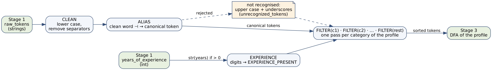

### 1.1 Contracts

| Boundary | Contract |
|---|---|
| Stage 1 → Stage 2 | `raw_tokens` contains technology names only. The years are an **`int`** in `years_of_experience` and are **not** in `raw_tokens`. |
| Stage 2 → Stage 3 | `normalized_tokens` contains only canonical tokens (and the upper-cased form of unknown skills), sorted for the profile. Every skill of every profile of `profiles.py` can be produced (tested). |
| Public API | `normalize_qualifications(raw_tokens, years_of_experience=None)`, `sort_to_canonical_order(tokens, profile_id)`, `normalize_and_sort(raw_tokens, profile_id, years_of_experience=None)`, `normalize_token(raw)` |

### 1.2 Data flow for one résumé

1. Each raw token goes through **CLEAN** (lower case, separators removed) and then **ALIAS** (clean word → canonical token). A token that is rejected becomes an upper-case fallback token and is reported as *unrecognised*.
2. If `years_of_experience > 0`, its decimal representation goes through **EXPERIENCE** and produces `EXPERIENCE_PRESENT`.
3. The list of canonical tokens goes through the **FILTER** passes of the selected profile; the concatenated outputs are the sorted sequence.

---

## 2. Formal background and notation

### 2.1 Deterministic finite-state transducer

A **deterministic finite-state transducer (FST)** is a 7-tuple **M = (Q, Σ, Γ, δ, ω, q₀, F)** where

1. Q is the finite set of states,
2. Σ is the finite input alphabet,
3. Γ is the finite output alphabet,
4. δ : Q × (Σ ∪ {λ}) → Q is the transition function,
5. ω : Q × (Σ ∪ {λ}) → Γ ∪ {λ} is the output function,
6. q₀ ∈ Q is the start state,
7. ∅ ≠ F ⊆ Q is the set of accepting states.

An edge labelled `u : v` from p to q means δ(p, u) = q and ω(p, u) = v: *read u, write v*. λ is the empty string.

### 2.2 Extended functions and language

δ\* and ω\* extend δ and ω to words: δ\*(q, ε) = q, ω\*(q, ε) = ε and, for a ∈ Σ and x ∈ Σ\*,
δ\*(q, ax) = δ\*(δ(q, a), x) and ω\*(q, ax) = ω(q, a) · ω\*(δ(q, a), x).

The **language** of M is the set of pairs

&emsp;**L(M) = { (x, y) ∈ Σ\* × Γ\* | δ\*(q₀, x) ∈ F and ω\*(q₀, x) = y }**

A word x for which a transition is missing (δ undefined) is **rejected**: it has no translation. Since M is deterministic, L(M) is a partial function.

### 2.3 Regular (rational) relations and expressions

A relation R ⊆ Σ\* × Γ\* is **rational** when it can be built from the pairs (a : b) with a ∈ Σ ∪ {λ}, b ∈ Γ ∪ {λ}, the empty relation ∅, and the operations
union R ∪ S, concatenation R · S and star R\*. Every FST computes a rational relation and every rational relation is computed by a (possibly non-deterministic) FST.
In this document `(a : b)` is written `a:b`, and for a word u we write `u : λ` for the pair (u, ε). Two facts are used:

* the **composition** of rational relations is rational (this is why the cascade CLEAN → ALIAS is itself a transducer);
* the **image** of a regular language under a rational relation is regular (this is used in 7.2 to show that sorting is not one transducer).

### 2.4 Conventions of this project

| Convention | Meaning |
|---|---|
| Symbols | In CLEAN, ALIAS and EXPERIENCE a symbol is one character. In FILTER a symbol is a whole token (`JAVASCRIPT`), as in the `llor`/`ar` example of the course. |
| One output per edge | ω(q, a) ∈ Γ ∪ {λ}: every transition writes at most one symbol. |
| Determinism | δ and ω are single-valued and have the same domain; there are no λ-input transitions. `Transducer.validate()` checks it. |
| End marker `⊣` | A symbol appended to the clean word before ALIAS reads it; it tells ALIAS that the word is complete (section 5.1). Formally the wrapper is CLEAN · (λ : ⊣). |
| Missing transition | pyformlang returns no translation, which the code reads as *rejected*. |
| State names | `q0`, `q1`, … in creation order; `qf` is the accepting state of ALIAS. For tries, the diagram shows the **prefix** read so far. |

### 2.5 Notation used in the sheets

| Symbol | Meaning |
|---|---|
| W | finite set of clean words accepted by an alias transducer |
| c(w) | canonical token of the word w ∈ W |
| Pref(W) | set of prefixes of the words of W (including ε and W itself) |
| Σ_P | alphabet of a profile P (union of the skills of its categories) |
| cat(t) | category of the token t in a profile |

---

## 3. Catalog of all the transducers

| # | Transducer | Defined in | Reads | Writes | States | Transitions |
|---|---|---|---|---|---|---|
| 1 | **CLEAN** | 4.1 | characters of a raw token | lower-case letters, no separators | 1 | 69 |
| 2 | **EXPERIENCE** | 4.2 | digits | `EXPERIENCE_PRESENT` | 2 | 20 |
| 3 | **ALIAS_LANGUAGES** | 5.4 | clean word + `⊣` | canonical token | 86 | 110 |
| 4 | **ALIAS_WEB** | 5.4 | clean word + `⊣` | canonical token | 109 | 136 |
| 5 | **ALIAS_DATA** | 5.4 | clean word + `⊣` | canonical token | 120 | 136 |
| 6 | **ALIAS_DATABASES** | 5.4 | clean word + `⊣` | canonical token | 92 | 106 |
| 7 | **ALIAS_VERSION_CONTROL** | 5.4 | clean word + `⊣` | canonical token | 32 | 36 |
| 8 | **ALIAS_DEVOPS_CLOUD** | 5.4 | clean word + `⊣` | canonical token | 125 | 143 |
| 9 | **ALIAS** (all families) | 5.5 | clean word + `⊣` | canonical token | 503 | 616 |
| 10–88 | **ALIAS_s**, one per canonical token s | 6 | clean word + `⊣` | s | see each sheet | see each sheet |
| 89–113 | **FILTER_c** for each category c of each profile | 7.3 | tokens | tokens of c | 1 | one per token |
| 114 | **FILTER_REST** | 7.3 | tokens | tokens outside the profile | 1 | one per token |

The ALIAS transducer of the pipeline is the prefix-merged union of the family transducers, which in turn are the prefix-merged unions of the per-token transducers ALIAS_s. All of them are built by the same function `build_alias_transducer`.

---

## 4. Cleaning and experience transducers

### 4.1 CLEAN — case folding and separator removal

**Purpose.** Make the vocabulary independent of capitalisation and punctuation: `Node.js`, `NodeJS`, `node-js` and `NODE JS` all become `nodejs`.

**Rational expression.** Let Σ_keep = {a–z, 0–9, #, +}, Σ_up = {A–Z} and Σ_sep = {␣, ., -, _, /}. Then

&emsp;**CLEAN = ( ⋃_{a∈Σ_keep} a:a  ∪  ⋃_{A∈Σ_up} A:lower(A)  ∪  ⋃_{s∈Σ_sep} s:λ )\***

**Formal definition M_CLEAN = (Q, Σ, Γ, δ, ω, q₀, F)**

* Q = {q0}
* Σ = `a b c d e f g h i j k l m n o p q r s t u v w x y z A B C D E F G H I J K L M N O P Q R S T U V W X Y Z 0 1 2 3 4 5 6 7 8 9 # +   . - _ /`
* Γ = `a b c d e f g h i j k l m n o p q r s t u v w x y z 0 1 2 3 4 5 6 7 8 9 # +`
* δ(q0, a) = q0 for every a ∈ Σ (69 transitions)
* ω(q0, a) = a for a ∈ Σ_keep;  ω(q0, A) = lower(A) for A ∈ Σ_up;  ω(q0, s) = λ for s ∈ Σ_sep
* q₀ = q0
* F = {q0}

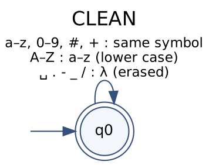

**Language.** L(CLEAN) = { (x, h(x)) | x ∈ Σ\* } where h is the homomorphism that erases separators and lower-cases letters. CLEAN is a *letter-to-letter-or-empty* transducer, so the output is never longer than the input.

**Examples**

| Input x | Output h(x) |
|---|---|
| `Node.js` | `nodejs` |
| `NODE JS` | `nodejs` |
| `node-js` | `nodejs` |
| `Scikit-learn` | `scikitlearn` |
| `scikit_learn` | `scikitlearn` |
| `GitLab CI/CD` | `gitlabcicd` |
| `C#` | `c#` |
| `C++` | `c++` |
| `Power BI` | `powerbi` |
| `HTML5` | `html5` |
| `R&D`, `Café`, `日本` | rejected: `&`, `é` and `日` are not in Σ |

**Trace of `React.js`**

| Step | State | Reads | Writes | Next state |
|---|---|---|---|---|
| 1 | q0 | R | r | q0 |
| 2 | q0 | e | e | q0 |
| 3 | q0 | a | a | q0 |
| 4 | q0 | c | c | q0 |
| 5 | q0 | t | t | q0 |
| 6 | q0 | . | λ | q0 |
| 7 | q0 | j | j | q0 |
| 8 | q0 | s | s | q0 |
| | final state **q0** | | | accepting |

### 4.2 EXPERIENCE — years → `EXPERIENCE_PRESENT`

**Purpose.** Stage 1 returns the years as an **integer**. Stage 3 only needs to know that experience was reported (Full Stack, category `EXPERIENCE`, no threshold), so any positive number is abstracted into one symbol.

**Rational expression.** &emsp;**EXPERIENCE = ( ⋃_{d∈D} d:EXPERIENCE_PRESENT ) · ( ⋃_{d∈D} d:λ )\***  with D = {0, …, 9}

**Formal definition M_EXP**

* Q = {q0, q1}
* Σ = {0, 1, …, 9}
* Γ = {EXPERIENCE_PRESENT}
* δ(q0, d) = q1 and ω(q0, d) = EXPERIENCE_PRESENT for every digit d
* δ(q1, d) = q1 and ω(q1, d) = λ for every digit d
* q₀ = q0
* F = {q1}

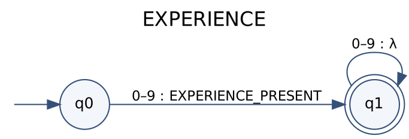

**Language.** L(EXPERIENCE) = { (d₁…dₙ, EXPERIENCE_PRESENT) | n ≥ 1, dᵢ ∈ D }. The empty word is rejected because q0 ∉ F; `3a`, `-3` and `3.5` are rejected because they contain a symbol outside Σ.

`normalize_qualifications` feeds `str(years_of_experience)` to this transducer **only when the integer is positive**.

**Trace of `10`**

| Step | State | Reads | Writes | Next state |
|---|---|---|---|---|
| 1 | q0 | 1 | EXPERIENCE_PRESENT | q1 |
| 2 | q1 | 0 | λ | q1 |
| | final state **q1** | | | accepting |

---

## 5. The alias transducer

### 5.1 Why a trie with an end marker

ALIAS maps a clean word to the canonical token of the skill. It is a **trie**: one path per word, shared prefixes share states. A trie is the natural deterministic FST for a finite dictionary.

The output is written on the edge that reads the **end marker ⊣**, not on the last letter. Otherwise `git`, which is a prefix of `github` and `gitlab`, would write `GIT` and then keep reading and write `GITHUB`. With the marker the state `git` has three outgoing edges: `h`, `l` and `⊣ : GIT`.

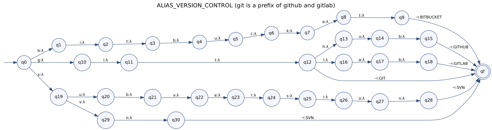

### 5.2 General definition

Let W be a finite set of clean words and c : W → Γ the function that gives the canonical token of each word. The alias transducer **A(W, c) = (Q, Σ, Γ, δ, ω, q₀, F)** is

* Q = Pref(W) ∪ {q_f}  (q₀ is the empty prefix ε)
* Σ = the characters that occur in the words of W, plus ⊣
* Γ = { c(w) | w ∈ W }
* δ(p, a) = p·a for a ∈ Σ \ {⊣} such that p·a ∈ Pref(W);  δ(w, ⊣) = q_f for every w ∈ W
* ω(p, a) = λ for a ≠ ⊣;  ω(w, ⊣) = c(w)
* q₀ = ε,  F = {q_f}

**Rational expression.** &emsp;**A(W, c) = ⋃_{w∈W} (w : λ) · (⊣ : c(w))**

**Language.** L(A(W, c)) = { (w⊣, c(w)) | w ∈ W } (proved in 9.2). The transducer is deterministic provided c is a function, i.e. two different canonical tokens never share a clean word. The builder `clean_aliases` **raises an error** when that happens, so an ambiguous vocabulary cannot be compiled.

### 5.3 How the vocabulary is turned into W and c

Each canonical token has a list of *spellings* (section 6). Every spelling, and the canonical token itself, is passed through **CLEAN**, which gives the clean word. For example `Node.js` and `NodeJS` give the same word `nodejs`; the spellings `Node`, `Node.js`, `NodeJS` and `NODE_JS` give the words `node` and `nodejs`.

### 5.4 The six family transducers

To keep the diagrams readable the vocabulary is split in six families, each with its own alias transducer.

| Family | States | Transitions | Σ | Γ (canonical tokens) | Spellings |
|---|---|---|---|---|---|
| `LANGUAGES` | 86 | 110 | 26 | 17 | 30 |
| `WEB` | 109 | 136 | 24 | 15 | 43 |
| `DATA` | 120 | 136 | 23 | 16 | 24 |
| `DATABASES` | 92 | 106 | 21 | 12 | 18 |
| `VERSION_CONTROL` | 32 | 36 | 17 | 5 | 6 |
| `DEVOPS_CLOUD` | 125 | 143 | 26 | 14 | 23 |

#### 5.4.1 ALIAS_LANGUAGES

* Q: 86 states (`q0` … and `qf`); q₀ = q0; F = {qf}
* Σ = `# + 3 5 a b c e g h i j k l m n o p r s t u v w y ⊣`
* Γ = {BASH, CPP, CSHARP, CSS, GO, HTML, JAVA, JAVASCRIPT, JULIA, KOTLIN, PHP, POWERSHELL, PYTHON, R, RUBY, RUST, TYPESCRIPT}
* Transitions: 110 (see Appendix A for the merged table and the sheets of section 6 for each token)

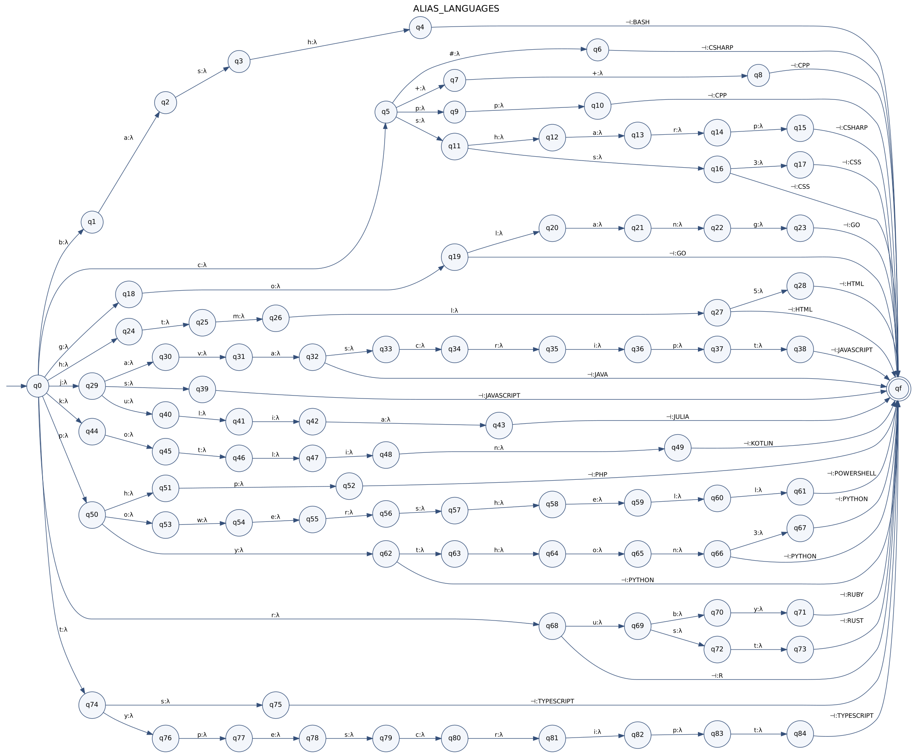

#### 5.4.2 ALIAS_WEB

* Q: 109 states (`q0` … and `qf`); q₀ = q0; F = {qf}
* Σ = `a b c d e f g h i j k l n o p q r s t u v w x ⊣`
* Γ = {ANGULAR, DJANGO, EXPRESS, FASTAPI, FLASK, GRAPHQL, NESTJS, NEXTJS, NODE_JS, REACT, REST, SPRING_BOOT, SVELTE, VUE, WEBSOCKET}
* Transitions: 136 (see Appendix A for the merged table and the sheets of section 6 for each token)

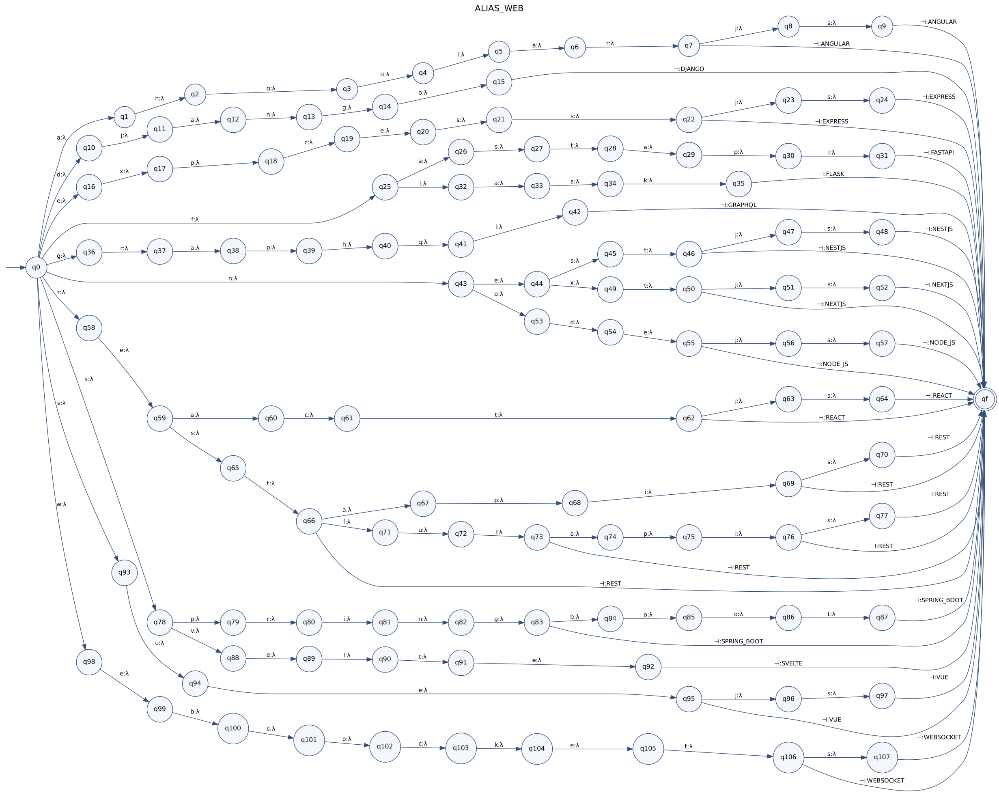

#### 5.4.3 ALIAS_DATA

* Q: 120 states (`q0` … and `qf`); q₀ = q0; F = {qf}
* Σ = `a b c d e f g h i k l m n o p r s t u w x y ⊣`
* Γ = {CATBOOST, KERAS, LIGHTGBM, MATPLOTLIB, NUMPY, PANDAS, PLOTLY, POWER_BI, PYTORCH, SCIKIT_LEARN, SCIPY, SEABORN, STATSMODELS, TABLEAU, TENSORFLOW, XGBOOST}
* Transitions: 136 (see Appendix A for the merged table and the sheets of section 6 for each token)

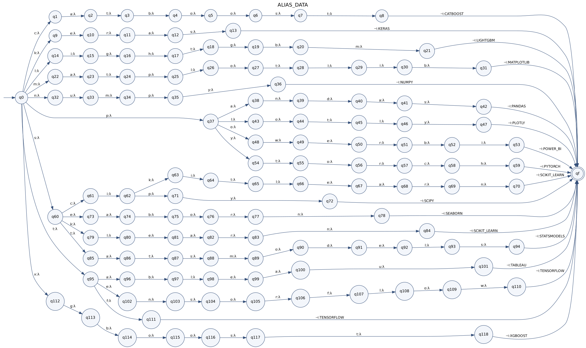

#### 5.4.4 ALIAS_DATABASES

* Q: 92 states (`q0` … and `qf`); q₀ = q0; F = {qf}
* Σ = `a b c d e f g h i l m n o p q r s t v y ⊣`
* Γ = {CASSANDRA, ELASTICSEARCH, FIREBASE, MARIADB, MONGODB, MYSQL, ORACLE, POSTGRESQL, REDIS, SQL, SQLITE, SQL_SERVER}
* Transitions: 106 (see Appendix A for the merged table and the sheets of section 6 for each token)

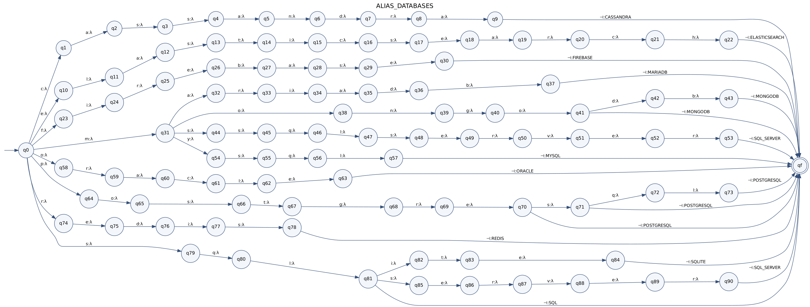

#### 5.4.5 ALIAS_VERSION_CONTROL

* Q: 32 states (`q0` … and `qf`); q₀ = q0; F = {qf}
* Σ = `a b c e g h i k l n o r s t u v ⊣`
* Γ = {BITBUCKET, GIT, GITHUB, GITLAB, SVN}
* Transitions: 36 (see Appendix A for the merged table and the sheets of section 6 for each token)

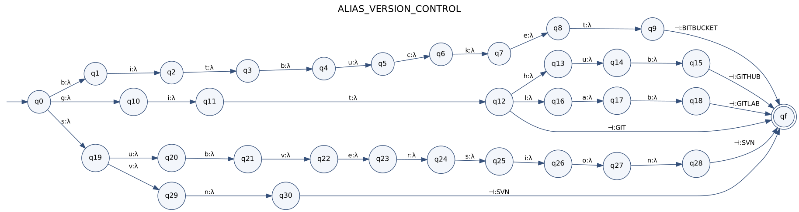

#### 5.4.6 ALIAS_DEVOPS_CLOUD

* Q: 125 states (`q0` … and `qf`); q₀ = q0; F = {qf}
* Σ = `8 a b c d e f g h i j k l m n o p r s t u v w x z ⊣`
* Γ = {ANSIBLE, ARGO_CD, AWS, AZURE, DOCKER, GCP, GITHUB_ACTIONS, GITLAB_CI, HELM, JENKINS, KUBERNETES, LINUX, PODMAN, TERRAFORM}
* Transitions: 143 (see Appendix A for the merged table and the sheets of section 6 for each token)

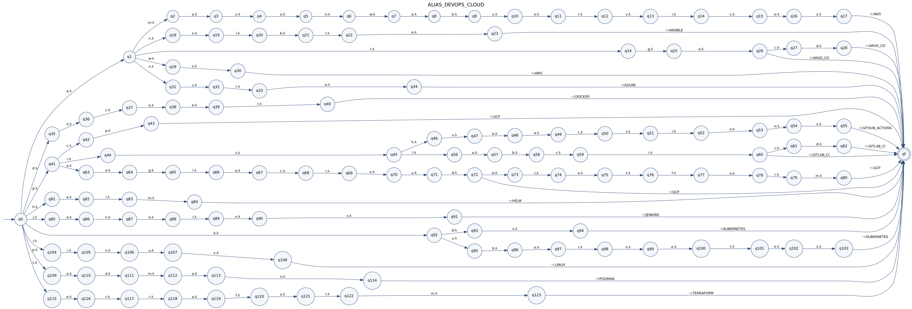

### 5.5 The whole-vocabulary transducer ALIAS

ALIAS = A(W, c) with W the clean words of all the families. It has **503 states**, **616 transitions**, |Σ| = 32 (letters, digits, `#`, `+`, `⊣`) and |Γ| = 79 canonical tokens.
Because the families use different words, ALIAS is the union of the six family transducers with the start state `q0` and the final state `qf` identified and the common prefixes merged. Its complete transition table is in Appendix A.

**Cascade.** For a raw token x the program computes

&emsp;**T(x) = ALIAS( CLEAN(x) · ⊣ )**

which is the composition of two rational relations and is therefore rational. If CLEAN or ALIAS rejects the word, the token is *unrecognised* (section 12).

---

## 6. One sheet for each canonical token

Each of the 79 canonical tokens has its own alias transducer **ALIAS_s = A(W_s, s)**, where W_s is the set of clean words of the spellings of s. Each sheet gives the spellings, the complete 7-tuple, the transition and output tables, the diagram and an example run. The family transducers and ALIAS are the prefix-merged unions of these sheets.

### Family `LANGUAGES`

#### 6.1 `JAVASCRIPT`

**Spellings:** `JavaScript`, `JS`, `Java Script`  
**Clean words W:** `javascript`, `js`

**Rational expression:** &emsp;ALIAS_JAVASCRIPT = (`javascript` : λ)(⊣ : JAVASCRIPT) ∪ (`js` : λ)(⊣ : JAVASCRIPT)

**M = (Q, Σ, Γ, δ, ω, q₀, F)**

* Q = {q0, q1, q2, q3, q4, q5, q6, q7, q8, q9, q10, q11, qf}  (13 states; state label = prefix read: q1=`j`, q2=`ja`, q3=`jav`, q4=`java`, q5=`javas`, q6=`javasc`, q7=`javascr`, q8=`javascri`, q9=`javascrip`, q10=`javascript`, q11=`js`)
* Σ = {a, c, i, j, p, r, s, t, v, ⊣}
* Γ = {JAVASCRIPT}
* q₀ = q0
* F = {qf}

**Language:** L = { (`javascript⊣`, JAVASCRIPT), (`js⊣`, JAVASCRIPT) }

| δ(q, a) = q′ | ω(q, a) |
|---|---|
| δ(q0, j) = q1 | λ |
| δ(q1, a) = q2 | λ |
| δ(q1, s) = q11 | λ |
| δ(q2, v) = q3 | λ |
| δ(q3, a) = q4 | λ |
| δ(q4, s) = q5 | λ |
| δ(q5, c) = q6 | λ |
| δ(q6, r) = q7 | λ |
| δ(q7, i) = q8 | λ |
| δ(q8, p) = q9 | λ |
| δ(q9, t) = q10 | λ |
| δ(q10, ⊣) = qf | JAVASCRIPT |
| δ(q11, ⊣) = qf | JAVASCRIPT |

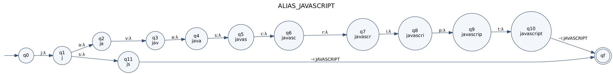

**Example run** (`javascript⊣`):

| Step | State | Reads | Writes | Next state |
|---|---|---|---|---|
| 1 | q0 | j | λ | q1 |
| 2 | q1 | a | λ | q2 |
| 3 | q2 | v | λ | q3 |
| 4 | q3 | a | λ | q4 |
| 5 | q4 | s | λ | q5 |
| 6 | q5 | c | λ | q6 |
| 7 | q6 | r | λ | q7 |
| 8 | q7 | i | λ | q8 |
| 9 | q8 | p | λ | q9 |
| 10 | q9 | t | λ | q10 |
| 11 | q10 | ⊣ | JAVASCRIPT | qf |
| | final state **qf** | | | accepting |

#### 6.2 `TYPESCRIPT`

**Spellings:** `TypeScript`, `TS`, `Type Script`  
**Clean words W:** `ts`, `typescript`

**Rational expression:** &emsp;ALIAS_TYPESCRIPT = (`ts` : λ)(⊣ : TYPESCRIPT) ∪ (`typescript` : λ)(⊣ : TYPESCRIPT)

**M = (Q, Σ, Γ, δ, ω, q₀, F)**

* Q = {q0, q1, q2, q3, q4, q5, q6, q7, q8, q9, q10, q11, qf}  (13 states; state label = prefix read: q1=`t`, q2=`ts`, q3=`ty`, q4=`typ`, q5=`type`, q6=`types`, q7=`typesc`, q8=`typescr`, q9=`typescri`, q10=`typescrip`, q11=`typescript`)
* Σ = {c, e, i, p, r, s, t, y, ⊣}
* Γ = {TYPESCRIPT}
* q₀ = q0
* F = {qf}

**Language:** L = { (`ts⊣`, TYPESCRIPT), (`typescript⊣`, TYPESCRIPT) }

| δ(q, a) = q′ | ω(q, a) |
|---|---|
| δ(q0, t) = q1 | λ |
| δ(q1, s) = q2 | λ |
| δ(q1, y) = q3 | λ |
| δ(q2, ⊣) = qf | TYPESCRIPT |
| δ(q3, p) = q4 | λ |
| δ(q4, e) = q5 | λ |
| δ(q5, s) = q6 | λ |
| δ(q6, c) = q7 | λ |
| δ(q7, r) = q8 | λ |
| δ(q8, i) = q9 | λ |
| δ(q9, p) = q10 | λ |
| δ(q10, t) = q11 | λ |
| δ(q11, ⊣) = qf | TYPESCRIPT |

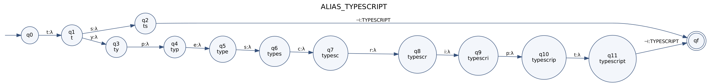

**Example run** (`ts⊣`):

| Step | State | Reads | Writes | Next state |
|---|---|---|---|---|
| 1 | q0 | t | λ | q1 |
| 2 | q1 | s | λ | q2 |
| 3 | q2 | ⊣ | TYPESCRIPT | qf |
| | final state **qf** | | | accepting |

#### 6.3 `PYTHON`

**Spellings:** `Python`, `Python3`, `Py`  
**Clean words W:** `py`, `python`, `python3`

**Rational expression:** &emsp;ALIAS_PYTHON = (`py` : λ)(⊣ : PYTHON) ∪ (`python` : λ)(⊣ : PYTHON) ∪ (`python3` : λ)(⊣ : PYTHON)

**M = (Q, Σ, Γ, δ, ω, q₀, F)**

* Q = {q0, q1, q2, q3, q4, q5, q6, q7, qf}  (9 states; state label = prefix read: q1=`p`, q2=`py`, q3=`pyt`, q4=`pyth`, q5=`pytho`, q6=`python`, q7=`python3`)
* Σ = {3, h, n, o, p, t, y, ⊣}
* Γ = {PYTHON}
* q₀ = q0
* F = {qf}

**Language:** L = { (`py⊣`, PYTHON), (`python⊣`, PYTHON), (`python3⊣`, PYTHON) }

| δ(q, a) = q′ | ω(q, a) |
|---|---|
| δ(q0, p) = q1 | λ |
| δ(q1, y) = q2 | λ |
| δ(q2, t) = q3 | λ |
| δ(q2, ⊣) = qf | PYTHON |
| δ(q3, h) = q4 | λ |
| δ(q4, o) = q5 | λ |
| δ(q5, n) = q6 | λ |
| δ(q6, 3) = q7 | λ |
| δ(q6, ⊣) = qf | PYTHON |
| δ(q7, ⊣) = qf | PYTHON |

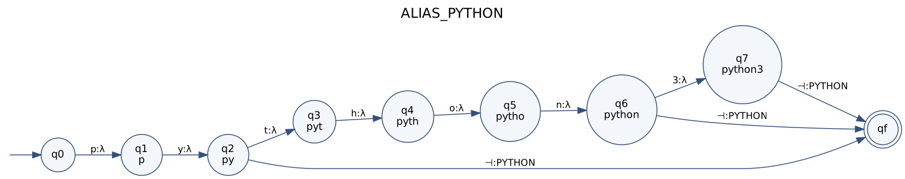

**Example run** (`py⊣`):

| Step | State | Reads | Writes | Next state |
|---|---|---|---|---|
| 1 | q0 | p | λ | q1 |
| 2 | q1 | y | λ | q2 |
| 3 | q2 | ⊣ | PYTHON | qf |
| | final state **qf** | | | accepting |

#### 6.4 `JAVA`

**Spellings:** `Java`  
**Clean words W:** `java`

**Rational expression:** &emsp;ALIAS_JAVA = (`java` : λ)(⊣ : JAVA)

**M = (Q, Σ, Γ, δ, ω, q₀, F)**

* Q = {q0, q1, q2, q3, q4, qf}  (6 states; state label = prefix read: q1=`j`, q2=`ja`, q3=`jav`, q4=`java`)
* Σ = {a, j, v, ⊣}
* Γ = {JAVA}
* q₀ = q0
* F = {qf}

**Language:** L = { (`java⊣`, JAVA) }

| δ(q, a) = q′ | ω(q, a) |
|---|---|
| δ(q0, j) = q1 | λ |
| δ(q1, a) = q2 | λ |
| δ(q2, v) = q3 | λ |
| δ(q3, a) = q4 | λ |
| δ(q4, ⊣) = qf | JAVA |

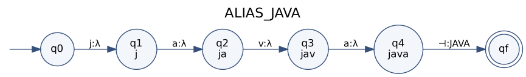

**Example run** (`java⊣`):

| Step | State | Reads | Writes | Next state |
|---|---|---|---|---|
| 1 | q0 | j | λ | q1 |
| 2 | q1 | a | λ | q2 |
| 3 | q2 | v | λ | q3 |
| 4 | q3 | a | λ | q4 |
| 5 | q4 | ⊣ | JAVA | qf |
| | final state **qf** | | | accepting |

#### 6.5 `CSHARP`

**Spellings:** `C#`, `CSharp`, `C Sharp`  
**Clean words W:** `c#`, `csharp`

**Rational expression:** &emsp;ALIAS_CSHARP = (`c#` : λ)(⊣ : CSHARP) ∪ (`csharp` : λ)(⊣ : CSHARP)

**M = (Q, Σ, Γ, δ, ω, q₀, F)**

* Q = {q0, q1, q2, q3, q4, q5, q6, q7, qf}  (9 states; state label = prefix read: q1=`c`, q2=`c#`, q3=`cs`, q4=`csh`, q5=`csha`, q6=`cshar`, q7=`csharp`)
* Σ = {#, a, c, h, p, r, s, ⊣}
* Γ = {CSHARP}
* q₀ = q0
* F = {qf}

**Language:** L = { (`c#⊣`, CSHARP), (`csharp⊣`, CSHARP) }

| δ(q, a) = q′ | ω(q, a) |
|---|---|
| δ(q0, c) = q1 | λ |
| δ(q1, #) = q2 | λ |
| δ(q1, s) = q3 | λ |
| δ(q2, ⊣) = qf | CSHARP |
| δ(q3, h) = q4 | λ |
| δ(q4, a) = q5 | λ |
| δ(q5, r) = q6 | λ |
| δ(q6, p) = q7 | λ |
| δ(q7, ⊣) = qf | CSHARP |

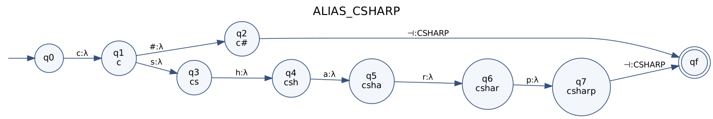

**Example run** (`c#⊣`):

| Step | State | Reads | Writes | Next state |
|---|---|---|---|---|
| 1 | q0 | c | λ | q1 |
| 2 | q1 | # | λ | q2 |
| 3 | q2 | ⊣ | CSHARP | qf |
| | final state **qf** | | | accepting |

#### 6.6 `CPP`

**Spellings:** `C++`, `CPP`  
**Clean words W:** `c++`, `cpp`

**Rational expression:** &emsp;ALIAS_CPP = (`c++` : λ)(⊣ : CPP) ∪ (`cpp` : λ)(⊣ : CPP)

**M = (Q, Σ, Γ, δ, ω, q₀, F)**

* Q = {q0, q1, q2, q3, q4, q5, qf}  (7 states; state label = prefix read: q1=`c`, q2=`c+`, q3=`c++`, q4=`cp`, q5=`cpp`)
* Σ = {+, c, p, ⊣}
* Γ = {CPP}
* q₀ = q0
* F = {qf}

**Language:** L = { (`c++⊣`, CPP), (`cpp⊣`, CPP) }

| δ(q, a) = q′ | ω(q, a) |
|---|---|
| δ(q0, c) = q1 | λ |
| δ(q1, +) = q2 | λ |
| δ(q1, p) = q4 | λ |
| δ(q2, +) = q3 | λ |
| δ(q3, ⊣) = qf | CPP |
| δ(q4, p) = q5 | λ |
| δ(q5, ⊣) = qf | CPP |

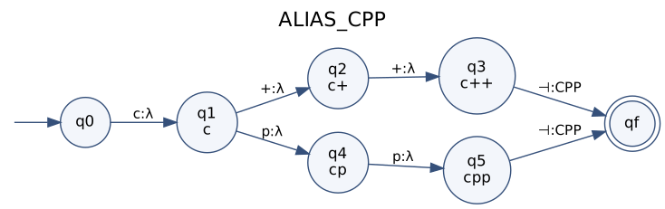

**Example run** (`c++⊣`):

| Step | State | Reads | Writes | Next state |
|---|---|---|---|---|
| 1 | q0 | c | λ | q1 |
| 2 | q1 | + | λ | q2 |
| 3 | q2 | + | λ | q3 |
| 4 | q3 | ⊣ | CPP | qf |
| | final state **qf** | | | accepting |

#### 6.7 `GO`

**Spellings:** `Go`, `Golang`  
**Clean words W:** `go`, `golang`

**Rational expression:** &emsp;ALIAS_GO = (`go` : λ)(⊣ : GO) ∪ (`golang` : λ)(⊣ : GO)

**M = (Q, Σ, Γ, δ, ω, q₀, F)**

* Q = {q0, q1, q2, q3, q4, q5, q6, qf}  (8 states; state label = prefix read: q1=`g`, q2=`go`, q3=`gol`, q4=`gola`, q5=`golan`, q6=`golang`)
* Σ = {a, g, l, n, o, ⊣}
* Γ = {GO}
* q₀ = q0
* F = {qf}

**Language:** L = { (`go⊣`, GO), (`golang⊣`, GO) }

| δ(q, a) = q′ | ω(q, a) |
|---|---|
| δ(q0, g) = q1 | λ |
| δ(q1, o) = q2 | λ |
| δ(q2, l) = q3 | λ |
| δ(q2, ⊣) = qf | GO |
| δ(q3, a) = q4 | λ |
| δ(q4, n) = q5 | λ |
| δ(q5, g) = q6 | λ |
| δ(q6, ⊣) = qf | GO |

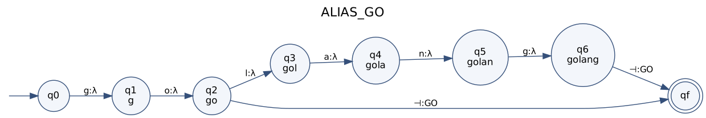

**Example run** (`go⊣`):

| Step | State | Reads | Writes | Next state |
|---|---|---|---|---|
| 1 | q0 | g | λ | q1 |
| 2 | q1 | o | λ | q2 |
| 3 | q2 | ⊣ | GO | qf |
| | final state **qf** | | | accepting |

#### 6.8 `RUST`

**Spellings:** `Rust`  
**Clean words W:** `rust`

**Rational expression:** &emsp;ALIAS_RUST = (`rust` : λ)(⊣ : RUST)

**M = (Q, Σ, Γ, δ, ω, q₀, F)**

* Q = {q0, q1, q2, q3, q4, qf}  (6 states; state label = prefix read: q1=`r`, q2=`ru`, q3=`rus`, q4=`rust`)
* Σ = {r, s, t, u, ⊣}
* Γ = {RUST}
* q₀ = q0
* F = {qf}

**Language:** L = { (`rust⊣`, RUST) }

| δ(q, a) = q′ | ω(q, a) |
|---|---|
| δ(q0, r) = q1 | λ |
| δ(q1, u) = q2 | λ |
| δ(q2, s) = q3 | λ |
| δ(q3, t) = q4 | λ |
| δ(q4, ⊣) = qf | RUST |

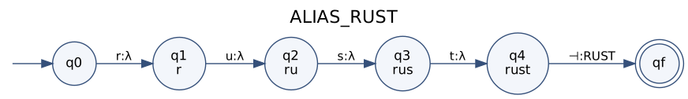

**Example run** (`rust⊣`):

| Step | State | Reads | Writes | Next state |
|---|---|---|---|---|
| 1 | q0 | r | λ | q1 |
| 2 | q1 | u | λ | q2 |
| 3 | q2 | s | λ | q3 |
| 4 | q3 | t | λ | q4 |
| 5 | q4 | ⊣ | RUST | qf |
| | final state **qf** | | | accepting |

#### 6.9 `RUBY`

**Spellings:** `Ruby`  
**Clean words W:** `ruby`

**Rational expression:** &emsp;ALIAS_RUBY = (`ruby` : λ)(⊣ : RUBY)

**M = (Q, Σ, Γ, δ, ω, q₀, F)**

* Q = {q0, q1, q2, q3, q4, qf}  (6 states; state label = prefix read: q1=`r`, q2=`ru`, q3=`rub`, q4=`ruby`)
* Σ = {b, r, u, y, ⊣}
* Γ = {RUBY}
* q₀ = q0
* F = {qf}

**Language:** L = { (`ruby⊣`, RUBY) }

| δ(q, a) = q′ | ω(q, a) |
|---|---|
| δ(q0, r) = q1 | λ |
| δ(q1, u) = q2 | λ |
| δ(q2, b) = q3 | λ |
| δ(q3, y) = q4 | λ |
| δ(q4, ⊣) = qf | RUBY |

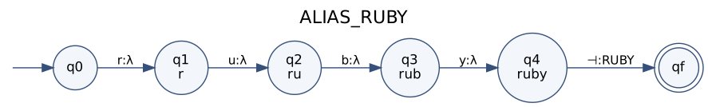

**Example run** (`ruby⊣`):

| Step | State | Reads | Writes | Next state |
|---|---|---|---|---|
| 1 | q0 | r | λ | q1 |
| 2 | q1 | u | λ | q2 |
| 3 | q2 | b | λ | q3 |
| 4 | q3 | y | λ | q4 |
| 5 | q4 | ⊣ | RUBY | qf |
| | final state **qf** | | | accepting |

#### 6.10 `JULIA`

**Spellings:** `Julia`  
**Clean words W:** `julia`

**Rational expression:** &emsp;ALIAS_JULIA = (`julia` : λ)(⊣ : JULIA)

**M = (Q, Σ, Γ, δ, ω, q₀, F)**

* Q = {q0, q1, q2, q3, q4, q5, qf}  (7 states; state label = prefix read: q1=`j`, q2=`ju`, q3=`jul`, q4=`juli`, q5=`julia`)
* Σ = {a, i, j, l, u, ⊣}
* Γ = {JULIA}
* q₀ = q0
* F = {qf}

**Language:** L = { (`julia⊣`, JULIA) }

| δ(q, a) = q′ | ω(q, a) |
|---|---|
| δ(q0, j) = q1 | λ |
| δ(q1, u) = q2 | λ |
| δ(q2, l) = q3 | λ |
| δ(q3, i) = q4 | λ |
| δ(q4, a) = q5 | λ |
| δ(q5, ⊣) = qf | JULIA |

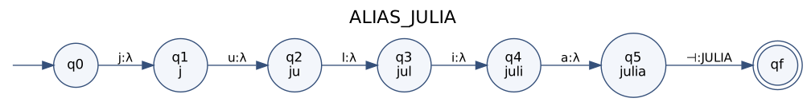

**Example run** (`julia⊣`):

| Step | State | Reads | Writes | Next state |
|---|---|---|---|---|
| 1 | q0 | j | λ | q1 |
| 2 | q1 | u | λ | q2 |
| 3 | q2 | l | λ | q3 |
| 4 | q3 | i | λ | q4 |
| 5 | q4 | a | λ | q5 |
| 6 | q5 | ⊣ | JULIA | qf |
| | final state **qf** | | | accepting |

#### 6.11 `R`

**Spellings:** `R`  
**Clean words W:** `r`

**Rational expression:** &emsp;ALIAS_R = (`r` : λ)(⊣ : R)

**M = (Q, Σ, Γ, δ, ω, q₀, F)**

* Q = {q0, q1, qf}  (3 states; state label = prefix read: q1=`r`)
* Σ = {r, ⊣}
* Γ = {R}
* q₀ = q0
* F = {qf}

**Language:** L = { (`r⊣`, R) }

| δ(q, a) = q′ | ω(q, a) |
|---|---|
| δ(q0, r) = q1 | λ |
| δ(q1, ⊣) = qf | R |

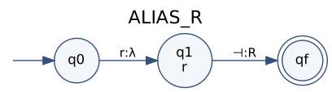

**Example run** (`r⊣`):

| Step | State | Reads | Writes | Next state |
|---|---|---|---|---|
| 1 | q0 | r | λ | q1 |
| 2 | q1 | ⊣ | R | qf |
| | final state **qf** | | | accepting |

#### 6.12 `PHP`

**Spellings:** `PHP`  
**Clean words W:** `php`

**Rational expression:** &emsp;ALIAS_PHP = (`php` : λ)(⊣ : PHP)

**M = (Q, Σ, Γ, δ, ω, q₀, F)**

* Q = {q0, q1, q2, q3, qf}  (5 states; state label = prefix read: q1=`p`, q2=`ph`, q3=`php`)
* Σ = {h, p, ⊣}
* Γ = {PHP}
* q₀ = q0
* F = {qf}

**Language:** L = { (`php⊣`, PHP) }

| δ(q, a) = q′ | ω(q, a) |
|---|---|
| δ(q0, p) = q1 | λ |
| δ(q1, h) = q2 | λ |
| δ(q2, p) = q3 | λ |
| δ(q3, ⊣) = qf | PHP |

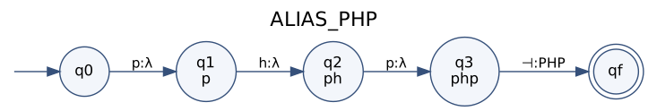

**Example run** (`php⊣`):

| Step | State | Reads | Writes | Next state |
|---|---|---|---|---|
| 1 | q0 | p | λ | q1 |
| 2 | q1 | h | λ | q2 |
| 3 | q2 | p | λ | q3 |
| 4 | q3 | ⊣ | PHP | qf |
| | final state **qf** | | | accepting |

#### 6.13 `KOTLIN`

**Spellings:** `Kotlin`  
**Clean words W:** `kotlin`

**Rational expression:** &emsp;ALIAS_KOTLIN = (`kotlin` : λ)(⊣ : KOTLIN)

**M = (Q, Σ, Γ, δ, ω, q₀, F)**

* Q = {q0, q1, q2, q3, q4, q5, q6, qf}  (8 states; state label = prefix read: q1=`k`, q2=`ko`, q3=`kot`, q4=`kotl`, q5=`kotli`, q6=`kotlin`)
* Σ = {i, k, l, n, o, t, ⊣}
* Γ = {KOTLIN}
* q₀ = q0
* F = {qf}

**Language:** L = { (`kotlin⊣`, KOTLIN) }

| δ(q, a) = q′ | ω(q, a) |
|---|---|
| δ(q0, k) = q1 | λ |
| δ(q1, o) = q2 | λ |
| δ(q2, t) = q3 | λ |
| δ(q3, l) = q4 | λ |
| δ(q4, i) = q5 | λ |
| δ(q5, n) = q6 | λ |
| δ(q6, ⊣) = qf | KOTLIN |

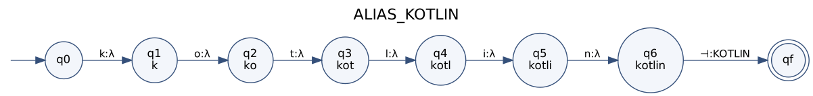

**Example run** (`kotlin⊣`):

| Step | State | Reads | Writes | Next state |
|---|---|---|---|---|
| 1 | q0 | k | λ | q1 |
| 2 | q1 | o | λ | q2 |
| 3 | q2 | t | λ | q3 |
| 4 | q3 | l | λ | q4 |
| 5 | q4 | i | λ | q5 |
| 6 | q5 | n | λ | q6 |
| 7 | q6 | ⊣ | KOTLIN | qf |
| | final state **qf** | | | accepting |

#### 6.14 `HTML`

**Spellings:** `HTML`, `HTML5`  
**Clean words W:** `html`, `html5`

**Rational expression:** &emsp;ALIAS_HTML = (`html` : λ)(⊣ : HTML) ∪ (`html5` : λ)(⊣ : HTML)

**M = (Q, Σ, Γ, δ, ω, q₀, F)**

* Q = {q0, q1, q2, q3, q4, q5, qf}  (7 states; state label = prefix read: q1=`h`, q2=`ht`, q3=`htm`, q4=`html`, q5=`html5`)
* Σ = {5, h, l, m, t, ⊣}
* Γ = {HTML}
* q₀ = q0
* F = {qf}

**Language:** L = { (`html⊣`, HTML), (`html5⊣`, HTML) }

| δ(q, a) = q′ | ω(q, a) |
|---|---|
| δ(q0, h) = q1 | λ |
| δ(q1, t) = q2 | λ |
| δ(q2, m) = q3 | λ |
| δ(q3, l) = q4 | λ |
| δ(q4, 5) = q5 | λ |
| δ(q4, ⊣) = qf | HTML |
| δ(q5, ⊣) = qf | HTML |

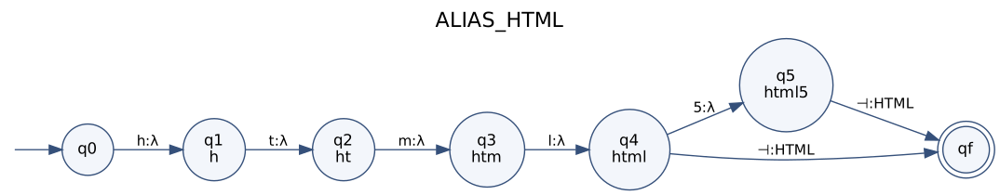

**Example run** (`html⊣`):

| Step | State | Reads | Writes | Next state |
|---|---|---|---|---|
| 1 | q0 | h | λ | q1 |
| 2 | q1 | t | λ | q2 |
| 3 | q2 | m | λ | q3 |
| 4 | q3 | l | λ | q4 |
| 5 | q4 | ⊣ | HTML | qf |
| | final state **qf** | | | accepting |

#### 6.15 `CSS`

**Spellings:** `CSS`, `CSS3`  
**Clean words W:** `css`, `css3`

**Rational expression:** &emsp;ALIAS_CSS = (`css` : λ)(⊣ : CSS) ∪ (`css3` : λ)(⊣ : CSS)

**M = (Q, Σ, Γ, δ, ω, q₀, F)**

* Q = {q0, q1, q2, q3, q4, qf}  (6 states; state label = prefix read: q1=`c`, q2=`cs`, q3=`css`, q4=`css3`)
* Σ = {3, c, s, ⊣}
* Γ = {CSS}
* q₀ = q0
* F = {qf}

**Language:** L = { (`css⊣`, CSS), (`css3⊣`, CSS) }

| δ(q, a) = q′ | ω(q, a) |
|---|---|
| δ(q0, c) = q1 | λ |
| δ(q1, s) = q2 | λ |
| δ(q2, s) = q3 | λ |
| δ(q3, 3) = q4 | λ |
| δ(q3, ⊣) = qf | CSS |
| δ(q4, ⊣) = qf | CSS |

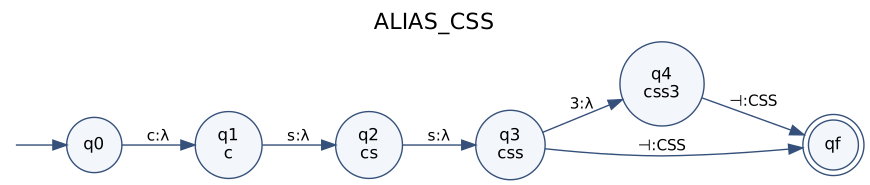

**Example run** (`css⊣`):

| Step | State | Reads | Writes | Next state |
|---|---|---|---|---|
| 1 | q0 | c | λ | q1 |
| 2 | q1 | s | λ | q2 |
| 3 | q2 | s | λ | q3 |
| 4 | q3 | ⊣ | CSS | qf |
| | final state **qf** | | | accepting |

#### 6.16 `BASH`

**Spellings:** `Bash`  
**Clean words W:** `bash`

**Rational expression:** &emsp;ALIAS_BASH = (`bash` : λ)(⊣ : BASH)

**M = (Q, Σ, Γ, δ, ω, q₀, F)**

* Q = {q0, q1, q2, q3, q4, qf}  (6 states; state label = prefix read: q1=`b`, q2=`ba`, q3=`bas`, q4=`bash`)
* Σ = {a, b, h, s, ⊣}
* Γ = {BASH}
* q₀ = q0
* F = {qf}

**Language:** L = { (`bash⊣`, BASH) }

| δ(q, a) = q′ | ω(q, a) |
|---|---|
| δ(q0, b) = q1 | λ |
| δ(q1, a) = q2 | λ |
| δ(q2, s) = q3 | λ |
| δ(q3, h) = q4 | λ |
| δ(q4, ⊣) = qf | BASH |

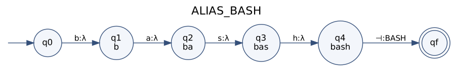

**Example run** (`bash⊣`):

| Step | State | Reads | Writes | Next state |
|---|---|---|---|---|
| 1 | q0 | b | λ | q1 |
| 2 | q1 | a | λ | q2 |
| 3 | q2 | s | λ | q3 |
| 4 | q3 | h | λ | q4 |
| 5 | q4 | ⊣ | BASH | qf |
| | final state **qf** | | | accepting |

#### 6.17 `POWERSHELL`

**Spellings:** `PowerShell`, `Power Shell`  
**Clean words W:** `powershell`

**Rational expression:** &emsp;ALIAS_POWERSHELL = (`powershell` : λ)(⊣ : POWERSHELL)

**M = (Q, Σ, Γ, δ, ω, q₀, F)**

* Q = {q0, q1, q2, q3, q4, q5, q6, q7, q8, q9, q10, qf}  (12 states; state label = prefix read: q1=`p`, q2=`po`, q3=`pow`, q4=`powe`, q5=`power`, q6=`powers`, q7=`powersh`, q8=`powershe`, q9=`powershel`, q10=`powershell`)
* Σ = {e, h, l, o, p, r, s, w, ⊣}
* Γ = {POWERSHELL}
* q₀ = q0
* F = {qf}

**Language:** L = { (`powershell⊣`, POWERSHELL) }

| δ(q, a) = q′ | ω(q, a) |
|---|---|
| δ(q0, p) = q1 | λ |
| δ(q1, o) = q2 | λ |
| δ(q2, w) = q3 | λ |
| δ(q3, e) = q4 | λ |
| δ(q4, r) = q5 | λ |
| δ(q5, s) = q6 | λ |
| δ(q6, h) = q7 | λ |
| δ(q7, e) = q8 | λ |
| δ(q8, l) = q9 | λ |
| δ(q9, l) = q10 | λ |
| δ(q10, ⊣) = qf | POWERSHELL |

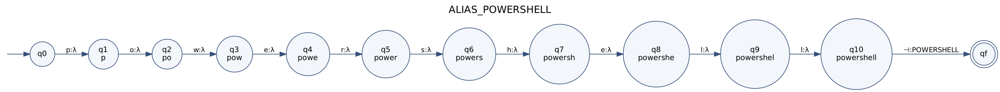

**Example run** (`powershell⊣`):

| Step | State | Reads | Writes | Next state |
|---|---|---|---|---|
| 1 | q0 | p | λ | q1 |
| 2 | q1 | o | λ | q2 |
| 3 | q2 | w | λ | q3 |
| 4 | q3 | e | λ | q4 |
| 5 | q4 | r | λ | q5 |
| 6 | q5 | s | λ | q6 |
| 7 | q6 | h | λ | q7 |
| 8 | q7 | e | λ | q8 |
| 9 | q8 | l | λ | q9 |
| 10 | q9 | l | λ | q10 |
| 11 | q10 | ⊣ | POWERSHELL | qf |
| | final state **qf** | | | accepting |

### Family `WEB`

#### 6.18 `REACT`

**Spellings:** `React`, `React.js`, `ReactJS`  
**Clean words W:** `react`, `reactjs`

**Rational expression:** &emsp;ALIAS_REACT = (`react` : λ)(⊣ : REACT) ∪ (`reactjs` : λ)(⊣ : REACT)

**M = (Q, Σ, Γ, δ, ω, q₀, F)**

* Q = {q0, q1, q2, q3, q4, q5, q6, q7, qf}  (9 states; state label = prefix read: q1=`r`, q2=`re`, q3=`rea`, q4=`reac`, q5=`react`, q6=`reactj`, q7=`reactjs`)
* Σ = {a, c, e, j, r, s, t, ⊣}
* Γ = {REACT}
* q₀ = q0
* F = {qf}

**Language:** L = { (`react⊣`, REACT), (`reactjs⊣`, REACT) }

| δ(q, a) = q′ | ω(q, a) |
|---|---|
| δ(q0, r) = q1 | λ |
| δ(q1, e) = q2 | λ |
| δ(q2, a) = q3 | λ |
| δ(q3, c) = q4 | λ |
| δ(q4, t) = q5 | λ |
| δ(q5, j) = q6 | λ |
| δ(q5, ⊣) = qf | REACT |
| δ(q6, s) = q7 | λ |
| δ(q7, ⊣) = qf | REACT |

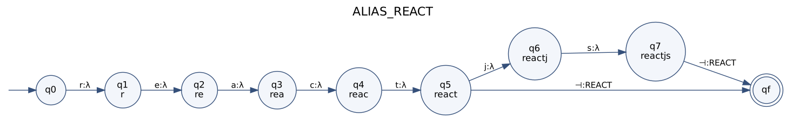

**Example run** (`react⊣`):

| Step | State | Reads | Writes | Next state |
|---|---|---|---|---|
| 1 | q0 | r | λ | q1 |
| 2 | q1 | e | λ | q2 |
| 3 | q2 | a | λ | q3 |
| 4 | q3 | c | λ | q4 |
| 5 | q4 | t | λ | q5 |
| 6 | q5 | ⊣ | REACT | qf |
| | final state **qf** | | | accepting |

#### 6.19 `ANGULAR`

**Spellings:** `Angular`, `Angular.js`, `AngularJS`  
**Clean words W:** `angular`, `angularjs`

**Rational expression:** &emsp;ALIAS_ANGULAR = (`angular` : λ)(⊣ : ANGULAR) ∪ (`angularjs` : λ)(⊣ : ANGULAR)

**M = (Q, Σ, Γ, δ, ω, q₀, F)**

* Q = {q0, q1, q2, q3, q4, q5, q6, q7, q8, q9, qf}  (11 states; state label = prefix read: q1=`a`, q2=`an`, q3=`ang`, q4=`angu`, q5=`angul`, q6=`angula`, q7=`angular`, q8=`angularj`, q9=`angularjs`)
* Σ = {a, g, j, l, n, r, s, u, ⊣}
* Γ = {ANGULAR}
* q₀ = q0
* F = {qf}

**Language:** L = { (`angular⊣`, ANGULAR), (`angularjs⊣`, ANGULAR) }

| δ(q, a) = q′ | ω(q, a) |
|---|---|
| δ(q0, a) = q1 | λ |
| δ(q1, n) = q2 | λ |
| δ(q2, g) = q3 | λ |
| δ(q3, u) = q4 | λ |
| δ(q4, l) = q5 | λ |
| δ(q5, a) = q6 | λ |
| δ(q6, r) = q7 | λ |
| δ(q7, j) = q8 | λ |
| δ(q7, ⊣) = qf | ANGULAR |
| δ(q8, s) = q9 | λ |
| δ(q9, ⊣) = qf | ANGULAR |

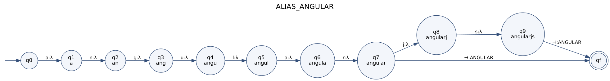

**Example run** (`angular⊣`):

| Step | State | Reads | Writes | Next state |
|---|---|---|---|---|
| 1 | q0 | a | λ | q1 |
| 2 | q1 | n | λ | q2 |
| 3 | q2 | g | λ | q3 |
| 4 | q3 | u | λ | q4 |
| 5 | q4 | l | λ | q5 |
| 6 | q5 | a | λ | q6 |
| 7 | q6 | r | λ | q7 |
| 8 | q7 | ⊣ | ANGULAR | qf |
| | final state **qf** | | | accepting |

#### 6.20 `VUE`

**Spellings:** `Vue`, `Vue.js`, `VueJS`  
**Clean words W:** `vue`, `vuejs`

**Rational expression:** &emsp;ALIAS_VUE = (`vue` : λ)(⊣ : VUE) ∪ (`vuejs` : λ)(⊣ : VUE)

**M = (Q, Σ, Γ, δ, ω, q₀, F)**

* Q = {q0, q1, q2, q3, q4, q5, qf}  (7 states; state label = prefix read: q1=`v`, q2=`vu`, q3=`vue`, q4=`vuej`, q5=`vuejs`)
* Σ = {e, j, s, u, v, ⊣}
* Γ = {VUE}
* q₀ = q0
* F = {qf}

**Language:** L = { (`vue⊣`, VUE), (`vuejs⊣`, VUE) }

| δ(q, a) = q′ | ω(q, a) |
|---|---|
| δ(q0, v) = q1 | λ |
| δ(q1, u) = q2 | λ |
| δ(q2, e) = q3 | λ |
| δ(q3, j) = q4 | λ |
| δ(q3, ⊣) = qf | VUE |
| δ(q4, s) = q5 | λ |
| δ(q5, ⊣) = qf | VUE |

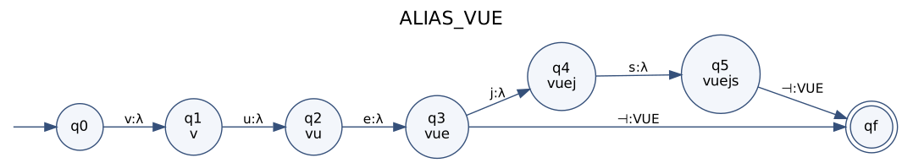

**Example run** (`vue⊣`):

| Step | State | Reads | Writes | Next state |
|---|---|---|---|---|
| 1 | q0 | v | λ | q1 |
| 2 | q1 | u | λ | q2 |
| 3 | q2 | e | λ | q3 |
| 4 | q3 | ⊣ | VUE | qf |
| | final state **qf** | | | accepting |

#### 6.21 `SVELTE`

**Spellings:** `Svelte`  
**Clean words W:** `svelte`

**Rational expression:** &emsp;ALIAS_SVELTE = (`svelte` : λ)(⊣ : SVELTE)

**M = (Q, Σ, Γ, δ, ω, q₀, F)**

* Q = {q0, q1, q2, q3, q4, q5, q6, qf}  (8 states; state label = prefix read: q1=`s`, q2=`sv`, q3=`sve`, q4=`svel`, q5=`svelt`, q6=`svelte`)
* Σ = {e, l, s, t, v, ⊣}
* Γ = {SVELTE}
* q₀ = q0
* F = {qf}

**Language:** L = { (`svelte⊣`, SVELTE) }

| δ(q, a) = q′ | ω(q, a) |
|---|---|
| δ(q0, s) = q1 | λ |
| δ(q1, v) = q2 | λ |
| δ(q2, e) = q3 | λ |
| δ(q3, l) = q4 | λ |
| δ(q4, t) = q5 | λ |
| δ(q5, e) = q6 | λ |
| δ(q6, ⊣) = qf | SVELTE |

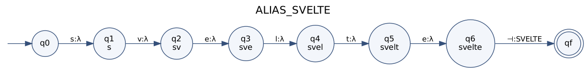

**Example run** (`svelte⊣`):

| Step | State | Reads | Writes | Next state |
|---|---|---|---|---|
| 1 | q0 | s | λ | q1 |
| 2 | q1 | v | λ | q2 |
| 3 | q2 | e | λ | q3 |
| 4 | q3 | l | λ | q4 |
| 5 | q4 | t | λ | q5 |
| 6 | q5 | e | λ | q6 |
| 7 | q6 | ⊣ | SVELTE | qf |
| | final state **qf** | | | accepting |

#### 6.22 `NEXTJS`

**Spellings:** `Next`, `Next.js`, `NextJS`  
**Clean words W:** `next`, `nextjs`

**Rational expression:** &emsp;ALIAS_NEXTJS = (`next` : λ)(⊣ : NEXTJS) ∪ (`nextjs` : λ)(⊣ : NEXTJS)

**M = (Q, Σ, Γ, δ, ω, q₀, F)**

* Q = {q0, q1, q2, q3, q4, q5, q6, qf}  (8 states; state label = prefix read: q1=`n`, q2=`ne`, q3=`nex`, q4=`next`, q5=`nextj`, q6=`nextjs`)
* Σ = {e, j, n, s, t, x, ⊣}
* Γ = {NEXTJS}
* q₀ = q0
* F = {qf}

**Language:** L = { (`next⊣`, NEXTJS), (`nextjs⊣`, NEXTJS) }

| δ(q, a) = q′ | ω(q, a) |
|---|---|
| δ(q0, n) = q1 | λ |
| δ(q1, e) = q2 | λ |
| δ(q2, x) = q3 | λ |
| δ(q3, t) = q4 | λ |
| δ(q4, j) = q5 | λ |
| δ(q4, ⊣) = qf | NEXTJS |
| δ(q5, s) = q6 | λ |
| δ(q6, ⊣) = qf | NEXTJS |

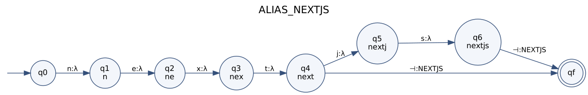

**Example run** (`next⊣`):

| Step | State | Reads | Writes | Next state |
|---|---|---|---|---|
| 1 | q0 | n | λ | q1 |
| 2 | q1 | e | λ | q2 |
| 3 | q2 | x | λ | q3 |
| 4 | q3 | t | λ | q4 |
| 5 | q4 | ⊣ | NEXTJS | qf |
| | final state **qf** | | | accepting |

#### 6.23 `NODE_JS`

**Spellings:** `Node`, `Node.js`, `NodeJS`  
**Clean words W:** `node`, `nodejs`

**Rational expression:** &emsp;ALIAS_NODE_JS = (`node` : λ)(⊣ : NODE_JS) ∪ (`nodejs` : λ)(⊣ : NODE_JS)

**M = (Q, Σ, Γ, δ, ω, q₀, F)**

* Q = {q0, q1, q2, q3, q4, q5, q6, qf}  (8 states; state label = prefix read: q1=`n`, q2=`no`, q3=`nod`, q4=`node`, q5=`nodej`, q6=`nodejs`)
* Σ = {d, e, j, n, o, s, ⊣}
* Γ = {NODE_JS}
* q₀ = q0
* F = {qf}

**Language:** L = { (`node⊣`, NODE_JS), (`nodejs⊣`, NODE_JS) }

| δ(q, a) = q′ | ω(q, a) |
|---|---|
| δ(q0, n) = q1 | λ |
| δ(q1, o) = q2 | λ |
| δ(q2, d) = q3 | λ |
| δ(q3, e) = q4 | λ |
| δ(q4, j) = q5 | λ |
| δ(q4, ⊣) = qf | NODE_JS |
| δ(q5, s) = q6 | λ |
| δ(q6, ⊣) = qf | NODE_JS |

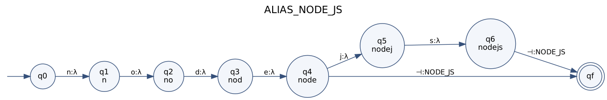

**Example run** (`node⊣`):

| Step | State | Reads | Writes | Next state |
|---|---|---|---|---|
| 1 | q0 | n | λ | q1 |
| 2 | q1 | o | λ | q2 |
| 3 | q2 | d | λ | q3 |
| 4 | q3 | e | λ | q4 |
| 5 | q4 | ⊣ | NODE_JS | qf |
| | final state **qf** | | | accepting |

#### 6.24 `EXPRESS`

**Spellings:** `Express`, `Express.js`, `ExpressJS`  
**Clean words W:** `express`, `expressjs`

**Rational expression:** &emsp;ALIAS_EXPRESS = (`express` : λ)(⊣ : EXPRESS) ∪ (`expressjs` : λ)(⊣ : EXPRESS)

**M = (Q, Σ, Γ, δ, ω, q₀, F)**

* Q = {q0, q1, q2, q3, q4, q5, q6, q7, q8, q9, qf}  (11 states; state label = prefix read: q1=`e`, q2=`ex`, q3=`exp`, q4=`expr`, q5=`expre`, q6=`expres`, q7=`express`, q8=`expressj`, q9=`expressjs`)
* Σ = {e, j, p, r, s, x, ⊣}
* Γ = {EXPRESS}
* q₀ = q0
* F = {qf}

**Language:** L = { (`express⊣`, EXPRESS), (`expressjs⊣`, EXPRESS) }

| δ(q, a) = q′ | ω(q, a) |
|---|---|
| δ(q0, e) = q1 | λ |
| δ(q1, x) = q2 | λ |
| δ(q2, p) = q3 | λ |
| δ(q3, r) = q4 | λ |
| δ(q4, e) = q5 | λ |
| δ(q5, s) = q6 | λ |
| δ(q6, s) = q7 | λ |
| δ(q7, j) = q8 | λ |
| δ(q7, ⊣) = qf | EXPRESS |
| δ(q8, s) = q9 | λ |
| δ(q9, ⊣) = qf | EXPRESS |

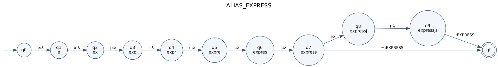

**Example run** (`express⊣`):

| Step | State | Reads | Writes | Next state |
|---|---|---|---|---|
| 1 | q0 | e | λ | q1 |
| 2 | q1 | x | λ | q2 |
| 3 | q2 | p | λ | q3 |
| 4 | q3 | r | λ | q4 |
| 5 | q4 | e | λ | q5 |
| 6 | q5 | s | λ | q6 |
| 7 | q6 | s | λ | q7 |
| 8 | q7 | ⊣ | EXPRESS | qf |
| | final state **qf** | | | accepting |

#### 6.25 `NESTJS`

**Spellings:** `Nest`, `Nest.js`, `NestJS`  
**Clean words W:** `nest`, `nestjs`

**Rational expression:** &emsp;ALIAS_NESTJS = (`nest` : λ)(⊣ : NESTJS) ∪ (`nestjs` : λ)(⊣ : NESTJS)

**M = (Q, Σ, Γ, δ, ω, q₀, F)**

* Q = {q0, q1, q2, q3, q4, q5, q6, qf}  (8 states; state label = prefix read: q1=`n`, q2=`ne`, q3=`nes`, q4=`nest`, q5=`nestj`, q6=`nestjs`)
* Σ = {e, j, n, s, t, ⊣}
* Γ = {NESTJS}
* q₀ = q0
* F = {qf}

**Language:** L = { (`nest⊣`, NESTJS), (`nestjs⊣`, NESTJS) }

| δ(q, a) = q′ | ω(q, a) |
|---|---|
| δ(q0, n) = q1 | λ |
| δ(q1, e) = q2 | λ |
| δ(q2, s) = q3 | λ |
| δ(q3, t) = q4 | λ |
| δ(q4, j) = q5 | λ |
| δ(q4, ⊣) = qf | NESTJS |
| δ(q5, s) = q6 | λ |
| δ(q6, ⊣) = qf | NESTJS |

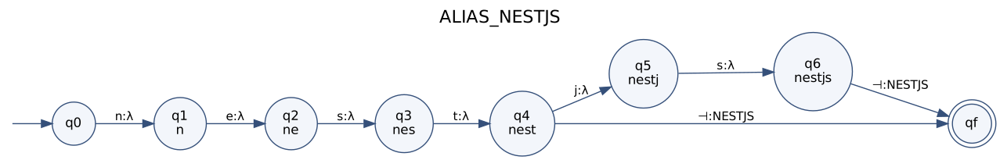

**Example run** (`nest⊣`):

| Step | State | Reads | Writes | Next state |
|---|---|---|---|---|
| 1 | q0 | n | λ | q1 |
| 2 | q1 | e | λ | q2 |
| 3 | q2 | s | λ | q3 |
| 4 | q3 | t | λ | q4 |
| 5 | q4 | ⊣ | NESTJS | qf |
| | final state **qf** | | | accepting |

#### 6.26 `DJANGO`

**Spellings:** `Django`  
**Clean words W:** `django`

**Rational expression:** &emsp;ALIAS_DJANGO = (`django` : λ)(⊣ : DJANGO)

**M = (Q, Σ, Γ, δ, ω, q₀, F)**

* Q = {q0, q1, q2, q3, q4, q5, q6, qf}  (8 states; state label = prefix read: q1=`d`, q2=`dj`, q3=`dja`, q4=`djan`, q5=`djang`, q6=`django`)
* Σ = {a, d, g, j, n, o, ⊣}
* Γ = {DJANGO}
* q₀ = q0
* F = {qf}

**Language:** L = { (`django⊣`, DJANGO) }

| δ(q, a) = q′ | ω(q, a) |
|---|---|
| δ(q0, d) = q1 | λ |
| δ(q1, j) = q2 | λ |
| δ(q2, a) = q3 | λ |
| δ(q3, n) = q4 | λ |
| δ(q4, g) = q5 | λ |
| δ(q5, o) = q6 | λ |
| δ(q6, ⊣) = qf | DJANGO |

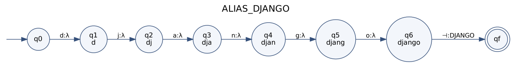

**Example run** (`django⊣`):

| Step | State | Reads | Writes | Next state |
|---|---|---|---|---|
| 1 | q0 | d | λ | q1 |
| 2 | q1 | j | λ | q2 |
| 3 | q2 | a | λ | q3 |
| 4 | q3 | n | λ | q4 |
| 5 | q4 | g | λ | q5 |
| 6 | q5 | o | λ | q6 |
| 7 | q6 | ⊣ | DJANGO | qf |
| | final state **qf** | | | accepting |

#### 6.27 `FLASK`

**Spellings:** `Flask`  
**Clean words W:** `flask`

**Rational expression:** &emsp;ALIAS_FLASK = (`flask` : λ)(⊣ : FLASK)

**M = (Q, Σ, Γ, δ, ω, q₀, F)**

* Q = {q0, q1, q2, q3, q4, q5, qf}  (7 states; state label = prefix read: q1=`f`, q2=`fl`, q3=`fla`, q4=`flas`, q5=`flask`)
* Σ = {a, f, k, l, s, ⊣}
* Γ = {FLASK}
* q₀ = q0
* F = {qf}

**Language:** L = { (`flask⊣`, FLASK) }

| δ(q, a) = q′ | ω(q, a) |
|---|---|
| δ(q0, f) = q1 | λ |
| δ(q1, l) = q2 | λ |
| δ(q2, a) = q3 | λ |
| δ(q3, s) = q4 | λ |
| δ(q4, k) = q5 | λ |
| δ(q5, ⊣) = qf | FLASK |

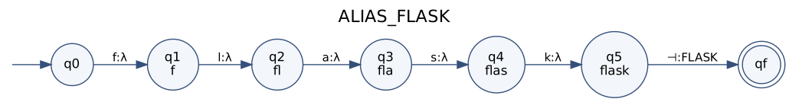

**Example run** (`flask⊣`):

| Step | State | Reads | Writes | Next state |
|---|---|---|---|---|
| 1 | q0 | f | λ | q1 |
| 2 | q1 | l | λ | q2 |
| 3 | q2 | a | λ | q3 |
| 4 | q3 | s | λ | q4 |
| 5 | q4 | k | λ | q5 |
| 6 | q5 | ⊣ | FLASK | qf |
| | final state **qf** | | | accepting |

#### 6.28 `FASTAPI`

**Spellings:** `FastAPI`, `Fast API`  
**Clean words W:** `fastapi`

**Rational expression:** &emsp;ALIAS_FASTAPI = (`fastapi` : λ)(⊣ : FASTAPI)

**M = (Q, Σ, Γ, δ, ω, q₀, F)**

* Q = {q0, q1, q2, q3, q4, q5, q6, q7, qf}  (9 states; state label = prefix read: q1=`f`, q2=`fa`, q3=`fas`, q4=`fast`, q5=`fasta`, q6=`fastap`, q7=`fastapi`)
* Σ = {a, f, i, p, s, t, ⊣}
* Γ = {FASTAPI}
* q₀ = q0
* F = {qf}

**Language:** L = { (`fastapi⊣`, FASTAPI) }

| δ(q, a) = q′ | ω(q, a) |
|---|---|
| δ(q0, f) = q1 | λ |
| δ(q1, a) = q2 | λ |
| δ(q2, s) = q3 | λ |
| δ(q3, t) = q4 | λ |
| δ(q4, a) = q5 | λ |
| δ(q5, p) = q6 | λ |
| δ(q6, i) = q7 | λ |
| δ(q7, ⊣) = qf | FASTAPI |

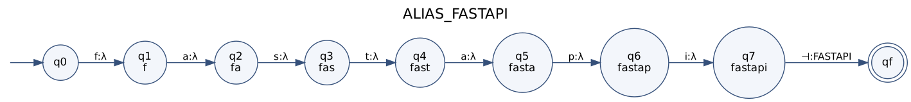

**Example run** (`fastapi⊣`):

| Step | State | Reads | Writes | Next state |
|---|---|---|---|---|
| 1 | q0 | f | λ | q1 |
| 2 | q1 | a | λ | q2 |
| 3 | q2 | s | λ | q3 |
| 4 | q3 | t | λ | q4 |
| 5 | q4 | a | λ | q5 |
| 6 | q5 | p | λ | q6 |
| 7 | q6 | i | λ | q7 |
| 8 | q7 | ⊣ | FASTAPI | qf |
| | final state **qf** | | | accepting |

#### 6.29 `SPRING_BOOT`

**Spellings:** `Spring`, `Spring Boot`, `SpringBoot`, `Spring-Boot`  
**Clean words W:** `spring`, `springboot`

**Rational expression:** &emsp;ALIAS_SPRING_BOOT = (`spring` : λ)(⊣ : SPRING_BOOT) ∪ (`springboot` : λ)(⊣ : SPRING_BOOT)

**M = (Q, Σ, Γ, δ, ω, q₀, F)**

* Q = {q0, q1, q2, q3, q4, q5, q6, q7, q8, q9, q10, qf}  (12 states; state label = prefix read: q1=`s`, q2=`sp`, q3=`spr`, q4=`spri`, q5=`sprin`, q6=`spring`, q7=`springb`, q8=`springbo`, q9=`springboo`, q10=`springboot`)
* Σ = {b, g, i, n, o, p, r, s, t, ⊣}
* Γ = {SPRING_BOOT}
* q₀ = q0
* F = {qf}

**Language:** L = { (`spring⊣`, SPRING_BOOT), (`springboot⊣`, SPRING_BOOT) }

| δ(q, a) = q′ | ω(q, a) |
|---|---|
| δ(q0, s) = q1 | λ |
| δ(q1, p) = q2 | λ |
| δ(q2, r) = q3 | λ |
| δ(q3, i) = q4 | λ |
| δ(q4, n) = q5 | λ |
| δ(q5, g) = q6 | λ |
| δ(q6, b) = q7 | λ |
| δ(q6, ⊣) = qf | SPRING_BOOT |
| δ(q7, o) = q8 | λ |
| δ(q8, o) = q9 | λ |
| δ(q9, t) = q10 | λ |
| δ(q10, ⊣) = qf | SPRING_BOOT |

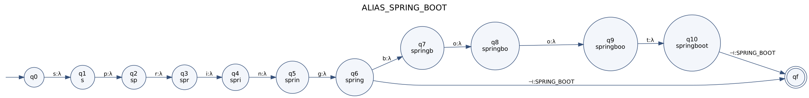

**Example run** (`spring⊣`):

| Step | State | Reads | Writes | Next state |
|---|---|---|---|---|
| 1 | q0 | s | λ | q1 |
| 2 | q1 | p | λ | q2 |
| 3 | q2 | r | λ | q3 |
| 4 | q3 | i | λ | q4 |
| 5 | q4 | n | λ | q5 |
| 6 | q5 | g | λ | q6 |
| 7 | q6 | ⊣ | SPRING_BOOT | qf |
| | final state **qf** | | | accepting |

#### 6.30 `REST`

**Spellings:** `REST`, `RESTful`, `REST API`, `REST APIs`, `RESTful API`, `RESTful APIs`, `Rest API`  
**Clean words W:** `rest`, `restapi`, `restapis`, `restful`, `restfulapi`, `restfulapis`

**Rational expression:** &emsp;ALIAS_REST = (`rest` : λ)(⊣ : REST) ∪ (`restapi` : λ)(⊣ : REST) ∪ (`restapis` : λ)(⊣ : REST) ∪ (`restful` : λ)(⊣ : REST) ∪ (`restfulapi` : λ)(⊣ : REST) ∪ (`restfulapis` : λ)(⊣ : REST)

**M = (Q, Σ, Γ, δ, ω, q₀, F)**

* Q = {q0, q1, q2, q3, q4, q5, q6, q7, q8, q9, q10, q11, q12, q13, q14, q15, qf}  (17 states; state label = prefix read: q1=`r`, q2=`re`, q3=`res`, q4=`rest`, q5=`resta`, q6=`restap`, q7=`restapi`, q8=`restapis`, q9=`restf`, q10=`restfu`, q11=`restful`, q12=`restfula`, q13=`restfulap`, q14=`restfulapi`, q15=`restfulapis`)
* Σ = {a, e, f, i, l, p, r, s, t, u, ⊣}
* Γ = {REST}
* q₀ = q0
* F = {qf}

**Language:** L = { (`rest⊣`, REST), (`restapi⊣`, REST), (`restapis⊣`, REST), (`restful⊣`, REST), (`restfulapi⊣`, REST), (`restfulapis⊣`, REST) }

| δ(q, a) = q′ | ω(q, a) |
|---|---|
| δ(q0, r) = q1 | λ |
| δ(q1, e) = q2 | λ |
| δ(q2, s) = q3 | λ |
| δ(q3, t) = q4 | λ |
| δ(q4, a) = q5 | λ |
| δ(q4, f) = q9 | λ |
| δ(q4, ⊣) = qf | REST |
| δ(q5, p) = q6 | λ |
| δ(q6, i) = q7 | λ |
| δ(q7, s) = q8 | λ |
| δ(q7, ⊣) = qf | REST |
| δ(q8, ⊣) = qf | REST |
| δ(q9, u) = q10 | λ |
| δ(q10, l) = q11 | λ |
| δ(q11, a) = q12 | λ |
| δ(q11, ⊣) = qf | REST |
| δ(q12, p) = q13 | λ |
| δ(q13, i) = q14 | λ |
| δ(q14, s) = q15 | λ |
| δ(q14, ⊣) = qf | REST |
| δ(q15, ⊣) = qf | REST |

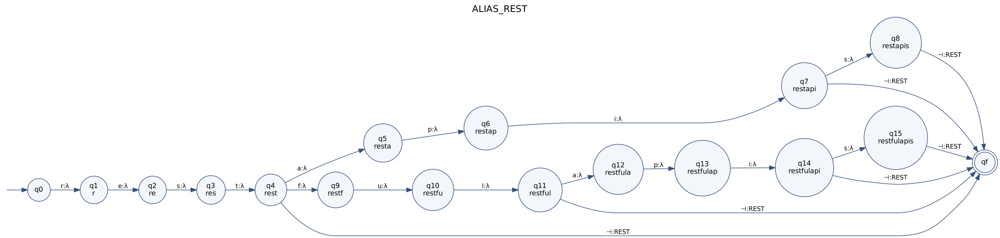

**Example run** (`rest⊣`):

| Step | State | Reads | Writes | Next state |
|---|---|---|---|---|
| 1 | q0 | r | λ | q1 |
| 2 | q1 | e | λ | q2 |
| 3 | q2 | s | λ | q3 |
| 4 | q3 | t | λ | q4 |
| 5 | q4 | ⊣ | REST | qf |
| | final state **qf** | | | accepting |

#### 6.31 `GRAPHQL`

**Spellings:** `GraphQL`, `Graph QL`  
**Clean words W:** `graphql`

**Rational expression:** &emsp;ALIAS_GRAPHQL = (`graphql` : λ)(⊣ : GRAPHQL)

**M = (Q, Σ, Γ, δ, ω, q₀, F)**

* Q = {q0, q1, q2, q3, q4, q5, q6, q7, qf}  (9 states; state label = prefix read: q1=`g`, q2=`gr`, q3=`gra`, q4=`grap`, q5=`graph`, q6=`graphq`, q7=`graphql`)
* Σ = {a, g, h, l, p, q, r, ⊣}
* Γ = {GRAPHQL}
* q₀ = q0
* F = {qf}

**Language:** L = { (`graphql⊣`, GRAPHQL) }

| δ(q, a) = q′ | ω(q, a) |
|---|---|
| δ(q0, g) = q1 | λ |
| δ(q1, r) = q2 | λ |
| δ(q2, a) = q3 | λ |
| δ(q3, p) = q4 | λ |
| δ(q4, h) = q5 | λ |
| δ(q5, q) = q6 | λ |
| δ(q6, l) = q7 | λ |
| δ(q7, ⊣) = qf | GRAPHQL |

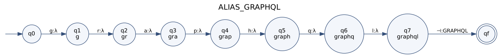

**Example run** (`graphql⊣`):

| Step | State | Reads | Writes | Next state |
|---|---|---|---|---|
| 1 | q0 | g | λ | q1 |
| 2 | q1 | r | λ | q2 |
| 3 | q2 | a | λ | q3 |
| 4 | q3 | p | λ | q4 |
| 5 | q4 | h | λ | q5 |
| 6 | q5 | q | λ | q6 |
| 7 | q6 | l | λ | q7 |
| 8 | q7 | ⊣ | GRAPHQL | qf |
| | final state **qf** | | | accepting |

#### 6.32 `WEBSOCKET`

**Spellings:** `WebSocket`, `WebSockets`, `Web Socket`, `Web Sockets`  
**Clean words W:** `websocket`, `websockets`

**Rational expression:** &emsp;ALIAS_WEBSOCKET = (`websocket` : λ)(⊣ : WEBSOCKET) ∪ (`websockets` : λ)(⊣ : WEBSOCKET)

**M = (Q, Σ, Γ, δ, ω, q₀, F)**

* Q = {q0, q1, q2, q3, q4, q5, q6, q7, q8, q9, q10, qf}  (12 states; state label = prefix read: q1=`w`, q2=`we`, q3=`web`, q4=`webs`, q5=`webso`, q6=`websoc`, q7=`websock`, q8=`websocke`, q9=`websocket`, q10=`websockets`)
* Σ = {b, c, e, k, o, s, t, w, ⊣}
* Γ = {WEBSOCKET}
* q₀ = q0
* F = {qf}

**Language:** L = { (`websocket⊣`, WEBSOCKET), (`websockets⊣`, WEBSOCKET) }

| δ(q, a) = q′ | ω(q, a) |
|---|---|
| δ(q0, w) = q1 | λ |
| δ(q1, e) = q2 | λ |
| δ(q2, b) = q3 | λ |
| δ(q3, s) = q4 | λ |
| δ(q4, o) = q5 | λ |
| δ(q5, c) = q6 | λ |
| δ(q6, k) = q7 | λ |
| δ(q7, e) = q8 | λ |
| δ(q8, t) = q9 | λ |
| δ(q9, s) = q10 | λ |
| δ(q9, ⊣) = qf | WEBSOCKET |
| δ(q10, ⊣) = qf | WEBSOCKET |

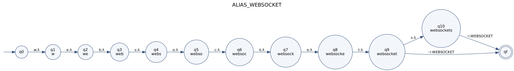

**Example run** (`websocket⊣`):

| Step | State | Reads | Writes | Next state |
|---|---|---|---|---|
| 1 | q0 | w | λ | q1 |
| 2 | q1 | e | λ | q2 |
| 3 | q2 | b | λ | q3 |
| 4 | q3 | s | λ | q4 |
| 5 | q4 | o | λ | q5 |
| 6 | q5 | c | λ | q6 |
| 7 | q6 | k | λ | q7 |
| 8 | q7 | e | λ | q8 |
| 9 | q8 | t | λ | q9 |
| 10 | q9 | ⊣ | WEBSOCKET | qf |
| | final state **qf** | | | accepting |

### Family `DATA`

#### 6.33 `PANDAS`

**Spellings:** `Pandas`  
**Clean words W:** `pandas`

**Rational expression:** &emsp;ALIAS_PANDAS = (`pandas` : λ)(⊣ : PANDAS)

**M = (Q, Σ, Γ, δ, ω, q₀, F)**

* Q = {q0, q1, q2, q3, q4, q5, q6, qf}  (8 states; state label = prefix read: q1=`p`, q2=`pa`, q3=`pan`, q4=`pand`, q5=`panda`, q6=`pandas`)
* Σ = {a, d, n, p, s, ⊣}
* Γ = {PANDAS}
* q₀ = q0
* F = {qf}

**Language:** L = { (`pandas⊣`, PANDAS) }

| δ(q, a) = q′ | ω(q, a) |
|---|---|
| δ(q0, p) = q1 | λ |
| δ(q1, a) = q2 | λ |
| δ(q2, n) = q3 | λ |
| δ(q3, d) = q4 | λ |
| δ(q4, a) = q5 | λ |
| δ(q5, s) = q6 | λ |
| δ(q6, ⊣) = qf | PANDAS |

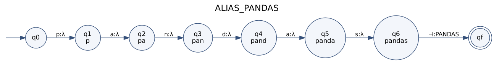

**Example run** (`pandas⊣`):

| Step | State | Reads | Writes | Next state |
|---|---|---|---|---|
| 1 | q0 | p | λ | q1 |
| 2 | q1 | a | λ | q2 |
| 3 | q2 | n | λ | q3 |
| 4 | q3 | d | λ | q4 |
| 5 | q4 | a | λ | q5 |
| 6 | q5 | s | λ | q6 |
| 7 | q6 | ⊣ | PANDAS | qf |
| | final state **qf** | | | accepting |

#### 6.34 `NUMPY`

**Spellings:** `NumPy`  
**Clean words W:** `numpy`

**Rational expression:** &emsp;ALIAS_NUMPY = (`numpy` : λ)(⊣ : NUMPY)

**M = (Q, Σ, Γ, δ, ω, q₀, F)**

* Q = {q0, q1, q2, q3, q4, q5, qf}  (7 states; state label = prefix read: q1=`n`, q2=`nu`, q3=`num`, q4=`nump`, q5=`numpy`)
* Σ = {m, n, p, u, y, ⊣}
* Γ = {NUMPY}
* q₀ = q0
* F = {qf}

**Language:** L = { (`numpy⊣`, NUMPY) }

| δ(q, a) = q′ | ω(q, a) |
|---|---|
| δ(q0, n) = q1 | λ |
| δ(q1, u) = q2 | λ |
| δ(q2, m) = q3 | λ |
| δ(q3, p) = q4 | λ |
| δ(q4, y) = q5 | λ |
| δ(q5, ⊣) = qf | NUMPY |

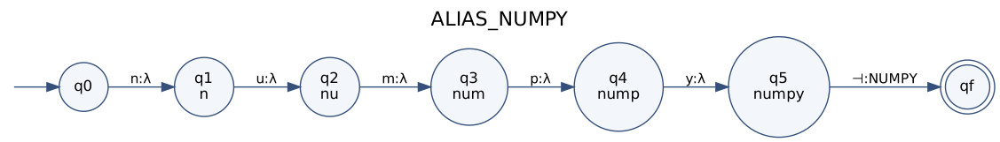

**Example run** (`numpy⊣`):

| Step | State | Reads | Writes | Next state |
|---|---|---|---|---|
| 1 | q0 | n | λ | q1 |
| 2 | q1 | u | λ | q2 |
| 3 | q2 | m | λ | q3 |
| 4 | q3 | p | λ | q4 |
| 5 | q4 | y | λ | q5 |
| 6 | q5 | ⊣ | NUMPY | qf |
| | final state **qf** | | | accepting |

#### 6.35 `SCIPY`

**Spellings:** `SciPy`  
**Clean words W:** `scipy`

**Rational expression:** &emsp;ALIAS_SCIPY = (`scipy` : λ)(⊣ : SCIPY)

**M = (Q, Σ, Γ, δ, ω, q₀, F)**

* Q = {q0, q1, q2, q3, q4, q5, qf}  (7 states; state label = prefix read: q1=`s`, q2=`sc`, q3=`sci`, q4=`scip`, q5=`scipy`)
* Σ = {c, i, p, s, y, ⊣}
* Γ = {SCIPY}
* q₀ = q0
* F = {qf}

**Language:** L = { (`scipy⊣`, SCIPY) }

| δ(q, a) = q′ | ω(q, a) |
|---|---|
| δ(q0, s) = q1 | λ |
| δ(q1, c) = q2 | λ |
| δ(q2, i) = q3 | λ |
| δ(q3, p) = q4 | λ |
| δ(q4, y) = q5 | λ |
| δ(q5, ⊣) = qf | SCIPY |

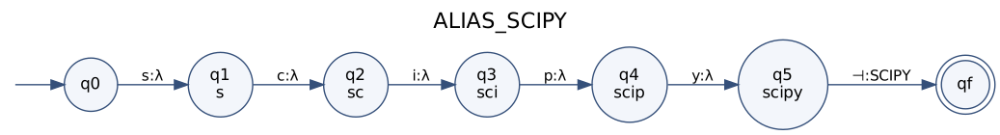

**Example run** (`scipy⊣`):

| Step | State | Reads | Writes | Next state |
|---|---|---|---|---|
| 1 | q0 | s | λ | q1 |
| 2 | q1 | c | λ | q2 |
| 3 | q2 | i | λ | q3 |
| 4 | q3 | p | λ | q4 |
| 5 | q4 | y | λ | q5 |
| 6 | q5 | ⊣ | SCIPY | qf |
| | final state **qf** | | | accepting |

#### 6.36 `SCIKIT_LEARN`

**Spellings:** `Scikit-learn`, `scikit learn`, `scikit_learn`, `sklearn`, `sk-learn`  
**Clean words W:** `scikitlearn`, `sklearn`

**Rational expression:** &emsp;ALIAS_SCIKIT_LEARN = (`scikitlearn` : λ)(⊣ : SCIKIT_LEARN) ∪ (`sklearn` : λ)(⊣ : SCIKIT_LEARN)

**M = (Q, Σ, Γ, δ, ω, q₀, F)**

* Q = {q0, q1, q2, q3, q4, q5, q6, q7, q8, q9, q10, q11, q12, q13, q14, q15, q16, q17, qf}  (19 states; state label = prefix read: q1=`s`, q2=`sc`, q3=`sci`, q4=`scik`, q5=`sciki`, q6=`scikit`, q7=`scikitl`, q8=`scikitle`, q9=`scikitlea`, q10=`scikitlear`, q11=`scikitlearn`, q12=`sk`, q13=`skl`, q14=`skle`, q15=`sklea`, q16=`sklear`, q17=`sklearn`)
* Σ = {a, c, e, i, k, l, n, r, s, t, ⊣}
* Γ = {SCIKIT_LEARN}
* q₀ = q0
* F = {qf}

**Language:** L = { (`scikitlearn⊣`, SCIKIT_LEARN), (`sklearn⊣`, SCIKIT_LEARN) }

| δ(q, a) = q′ | ω(q, a) |
|---|---|
| δ(q0, s) = q1 | λ |
| δ(q1, c) = q2 | λ |
| δ(q1, k) = q12 | λ |
| δ(q2, i) = q3 | λ |
| δ(q3, k) = q4 | λ |
| δ(q4, i) = q5 | λ |
| δ(q5, t) = q6 | λ |
| δ(q6, l) = q7 | λ |
| δ(q7, e) = q8 | λ |
| δ(q8, a) = q9 | λ |
| δ(q9, r) = q10 | λ |
| δ(q10, n) = q11 | λ |
| δ(q11, ⊣) = qf | SCIKIT_LEARN |
| δ(q12, l) = q13 | λ |
| δ(q13, e) = q14 | λ |
| δ(q14, a) = q15 | λ |
| δ(q15, r) = q16 | λ |
| δ(q16, n) = q17 | λ |
| δ(q17, ⊣) = qf | SCIKIT_LEARN |

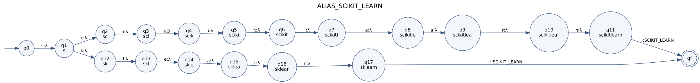

**Example run** (`scikitlearn⊣`):

| Step | State | Reads | Writes | Next state |
|---|---|---|---|---|
| 1 | q0 | s | λ | q1 |
| 2 | q1 | c | λ | q2 |
| 3 | q2 | i | λ | q3 |
| 4 | q3 | k | λ | q4 |
| 5 | q4 | i | λ | q5 |
| 6 | q5 | t | λ | q6 |
| 7 | q6 | l | λ | q7 |
| 8 | q7 | e | λ | q8 |
| 9 | q8 | a | λ | q9 |
| 10 | q9 | r | λ | q10 |
| 11 | q10 | n | λ | q11 |
| 12 | q11 | ⊣ | SCIKIT_LEARN | qf |
| | final state **qf** | | | accepting |

#### 6.37 `TENSORFLOW`

**Spellings:** `TensorFlow`, `Tensor Flow`, `TF`  
**Clean words W:** `tensorflow`, `tf`

**Rational expression:** &emsp;ALIAS_TENSORFLOW = (`tensorflow` : λ)(⊣ : TENSORFLOW) ∪ (`tf` : λ)(⊣ : TENSORFLOW)

**M = (Q, Σ, Γ, δ, ω, q₀, F)**

* Q = {q0, q1, q2, q3, q4, q5, q6, q7, q8, q9, q10, q11, qf}  (13 states; state label = prefix read: q1=`t`, q2=`te`, q3=`ten`, q4=`tens`, q5=`tenso`, q6=`tensor`, q7=`tensorf`, q8=`tensorfl`, q9=`tensorflo`, q10=`tensorflow`, q11=`tf`)
* Σ = {e, f, l, n, o, r, s, t, w, ⊣}
* Γ = {TENSORFLOW}
* q₀ = q0
* F = {qf}

**Language:** L = { (`tensorflow⊣`, TENSORFLOW), (`tf⊣`, TENSORFLOW) }

| δ(q, a) = q′ | ω(q, a) |
|---|---|
| δ(q0, t) = q1 | λ |
| δ(q1, e) = q2 | λ |
| δ(q1, f) = q11 | λ |
| δ(q2, n) = q3 | λ |
| δ(q3, s) = q4 | λ |
| δ(q4, o) = q5 | λ |
| δ(q5, r) = q6 | λ |
| δ(q6, f) = q7 | λ |
| δ(q7, l) = q8 | λ |
| δ(q8, o) = q9 | λ |
| δ(q9, w) = q10 | λ |
| δ(q10, ⊣) = qf | TENSORFLOW |
| δ(q11, ⊣) = qf | TENSORFLOW |

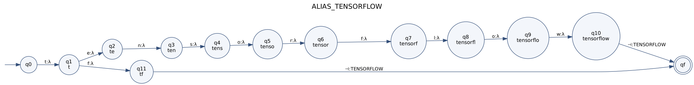

**Example run** (`tensorflow⊣`):

| Step | State | Reads | Writes | Next state |
|---|---|---|---|---|
| 1 | q0 | t | λ | q1 |
| 2 | q1 | e | λ | q2 |
| 3 | q2 | n | λ | q3 |
| 4 | q3 | s | λ | q4 |
| 5 | q4 | o | λ | q5 |
| 6 | q5 | r | λ | q6 |
| 7 | q6 | f | λ | q7 |
| 8 | q7 | l | λ | q8 |
| 9 | q8 | o | λ | q9 |
| 10 | q9 | w | λ | q10 |
| 11 | q10 | ⊣ | TENSORFLOW | qf |
| | final state **qf** | | | accepting |

#### 6.38 `PYTORCH`

**Spellings:** `PyTorch`, `Py Torch`  
**Clean words W:** `pytorch`

**Rational expression:** &emsp;ALIAS_PYTORCH = (`pytorch` : λ)(⊣ : PYTORCH)

**M = (Q, Σ, Γ, δ, ω, q₀, F)**

* Q = {q0, q1, q2, q3, q4, q5, q6, q7, qf}  (9 states; state label = prefix read: q1=`p`, q2=`py`, q3=`pyt`, q4=`pyto`, q5=`pytor`, q6=`pytorc`, q7=`pytorch`)
* Σ = {c, h, o, p, r, t, y, ⊣}
* Γ = {PYTORCH}
* q₀ = q0
* F = {qf}

**Language:** L = { (`pytorch⊣`, PYTORCH) }

| δ(q, a) = q′ | ω(q, a) |
|---|---|
| δ(q0, p) = q1 | λ |
| δ(q1, y) = q2 | λ |
| δ(q2, t) = q3 | λ |
| δ(q3, o) = q4 | λ |
| δ(q4, r) = q5 | λ |
| δ(q5, c) = q6 | λ |
| δ(q6, h) = q7 | λ |
| δ(q7, ⊣) = qf | PYTORCH |

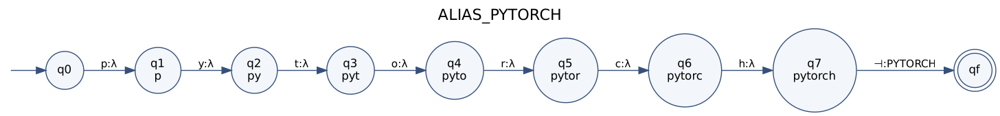

**Example run** (`pytorch⊣`):

| Step | State | Reads | Writes | Next state |
|---|---|---|---|---|
| 1 | q0 | p | λ | q1 |
| 2 | q1 | y | λ | q2 |
| 3 | q2 | t | λ | q3 |
| 4 | q3 | o | λ | q4 |
| 5 | q4 | r | λ | q5 |
| 6 | q5 | c | λ | q6 |
| 7 | q6 | h | λ | q7 |
| 8 | q7 | ⊣ | PYTORCH | qf |
| | final state **qf** | | | accepting |

#### 6.39 `KERAS`

**Spellings:** `Keras`  
**Clean words W:** `keras`

**Rational expression:** &emsp;ALIAS_KERAS = (`keras` : λ)(⊣ : KERAS)

**M = (Q, Σ, Γ, δ, ω, q₀, F)**

* Q = {q0, q1, q2, q3, q4, q5, qf}  (7 states; state label = prefix read: q1=`k`, q2=`ke`, q3=`ker`, q4=`kera`, q5=`keras`)
* Σ = {a, e, k, r, s, ⊣}
* Γ = {KERAS}
* q₀ = q0
* F = {qf}

**Language:** L = { (`keras⊣`, KERAS) }

| δ(q, a) = q′ | ω(q, a) |
|---|---|
| δ(q0, k) = q1 | λ |
| δ(q1, e) = q2 | λ |
| δ(q2, r) = q3 | λ |
| δ(q3, a) = q4 | λ |
| δ(q4, s) = q5 | λ |
| δ(q5, ⊣) = qf | KERAS |


**Example run** (`keras⊣`):

| Step | State | Reads | Writes | Next state |
|---|---|---|---|---|
| 1 | q0 | k | λ | q1 |
| 2 | q1 | e | λ | q2 |
| 3 | q2 | r | λ | q3 |
| 4 | q3 | a | λ | q4 |
| 5 | q4 | s | λ | q5 |
| 6 | q5 | ⊣ | KERAS | qf |
| | final state **qf** | | | accepting |

#### 6.40 `XGBOOST`

**Spellings:** `XGBoost`  
**Clean words W:** `xgboost`

**Rational expression:** &emsp;ALIAS_XGBOOST = (`xgboost` : λ)(⊣ : XGBOOST)

**M = (Q, Σ, Γ, δ, ω, q₀, F)**

* Q = {q0, q1, q2, q3, q4, q5, q6, q7, qf}  (9 states; state label = prefix read: q1=`x`, q2=`xg`, q3=`xgb`, q4=`xgbo`, q5=`xgboo`, q6=`xgboos`, q7=`xgboost`)
* Σ = {b, g, o, s, t, x, ⊣}
* Γ = {XGBOOST}
* q₀ = q0
* F = {qf}

**Language:** L = { (`xgboost⊣`, XGBOOST) }

| δ(q, a) = q′ | ω(q, a) |
|---|---|
| δ(q0, x) = q1 | λ |
| δ(q1, g) = q2 | λ |
| δ(q2, b) = q3 | λ |
| δ(q3, o) = q4 | λ |
| δ(q4, o) = q5 | λ |
| δ(q5, s) = q6 | λ |
| δ(q6, t) = q7 | λ |
| δ(q7, ⊣) = qf | XGBOOST |

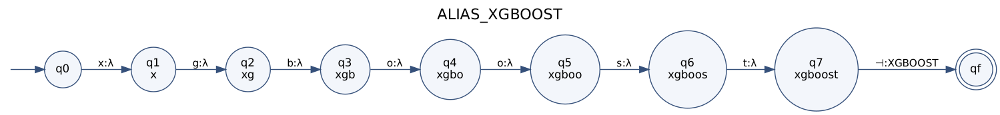

**Example run** (`xgboost⊣`):

| Step | State | Reads | Writes | Next state |
|---|---|---|---|---|
| 1 | q0 | x | λ | q1 |
| 2 | q1 | g | λ | q2 |
| 3 | q2 | b | λ | q3 |
| 4 | q3 | o | λ | q4 |
| 5 | q4 | o | λ | q5 |
| 6 | q5 | s | λ | q6 |
| 7 | q6 | t | λ | q7 |
| 8 | q7 | ⊣ | XGBOOST | qf |
| | final state **qf** | | | accepting |

#### 6.41 `LIGHTGBM`

**Spellings:** `LightGBM`  
**Clean words W:** `lightgbm`

**Rational expression:** &emsp;ALIAS_LIGHTGBM = (`lightgbm` : λ)(⊣ : LIGHTGBM)

**M = (Q, Σ, Γ, δ, ω, q₀, F)**

* Q = {q0, q1, q2, q3, q4, q5, q6, q7, q8, qf}  (10 states; state label = prefix read: q1=`l`, q2=`li`, q3=`lig`, q4=`ligh`, q5=`light`, q6=`lightg`, q7=`lightgb`, q8=`lightgbm`)
* Σ = {b, g, h, i, l, m, t, ⊣}
* Γ = {LIGHTGBM}
* q₀ = q0
* F = {qf}

**Language:** L = { (`lightgbm⊣`, LIGHTGBM) }

| δ(q, a) = q′ | ω(q, a) |
|---|---|
| δ(q0, l) = q1 | λ |
| δ(q1, i) = q2 | λ |
| δ(q2, g) = q3 | λ |
| δ(q3, h) = q4 | λ |
| δ(q4, t) = q5 | λ |
| δ(q5, g) = q6 | λ |
| δ(q6, b) = q7 | λ |
| δ(q7, m) = q8 | λ |
| δ(q8, ⊣) = qf | LIGHTGBM |

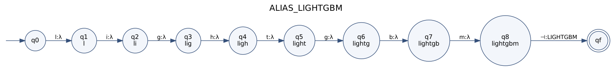

**Example run** (`lightgbm⊣`):

| Step | State | Reads | Writes | Next state |
|---|---|---|---|---|
| 1 | q0 | l | λ | q1 |
| 2 | q1 | i | λ | q2 |
| 3 | q2 | g | λ | q3 |
| 4 | q3 | h | λ | q4 |
| 5 | q4 | t | λ | q5 |
| 6 | q5 | g | λ | q6 |
| 7 | q6 | b | λ | q7 |
| 8 | q7 | m | λ | q8 |
| 9 | q8 | ⊣ | LIGHTGBM | qf |
| | final state **qf** | | | accepting |

#### 6.42 `CATBOOST`

**Spellings:** `CatBoost`  
**Clean words W:** `catboost`

**Rational expression:** &emsp;ALIAS_CATBOOST = (`catboost` : λ)(⊣ : CATBOOST)

**M = (Q, Σ, Γ, δ, ω, q₀, F)**

* Q = {q0, q1, q2, q3, q4, q5, q6, q7, q8, qf}  (10 states; state label = prefix read: q1=`c`, q2=`ca`, q3=`cat`, q4=`catb`, q5=`catbo`, q6=`catboo`, q7=`catboos`, q8=`catboost`)
* Σ = {a, b, c, o, s, t, ⊣}
* Γ = {CATBOOST}
* q₀ = q0
* F = {qf}

**Language:** L = { (`catboost⊣`, CATBOOST) }

| δ(q, a) = q′ | ω(q, a) |
|---|---|
| δ(q0, c) = q1 | λ |
| δ(q1, a) = q2 | λ |
| δ(q2, t) = q3 | λ |
| δ(q3, b) = q4 | λ |
| δ(q4, o) = q5 | λ |
| δ(q5, o) = q6 | λ |
| δ(q6, s) = q7 | λ |
| δ(q7, t) = q8 | λ |
| δ(q8, ⊣) = qf | CATBOOST |


**Example run** (`catboost⊣`):

| Step | State | Reads | Writes | Next state |
|---|---|---|---|---|
| 1 | q0 | c | λ | q1 |
| 2 | q1 | a | λ | q2 |
| 3 | q2 | t | λ | q3 |
| 4 | q3 | b | λ | q4 |
| 5 | q4 | o | λ | q5 |
| 6 | q5 | o | λ | q6 |
| 7 | q6 | s | λ | q7 |
| 8 | q7 | t | λ | q8 |
| 9 | q8 | ⊣ | CATBOOST | qf |
| | final state **qf** | | | accepting |

#### 6.43 `STATSMODELS`

**Spellings:** `Statsmodels`  
**Clean words W:** `statsmodels`

**Rational expression:** &emsp;ALIAS_STATSMODELS = (`statsmodels` : λ)(⊣ : STATSMODELS)

**M = (Q, Σ, Γ, δ, ω, q₀, F)**

* Q = {q0, q1, q2, q3, q4, q5, q6, q7, q8, q9, q10, q11, qf}  (13 states; state label = prefix read: q1=`s`, q2=`st`, q3=`sta`, q4=`stat`, q5=`stats`, q6=`statsm`, q7=`statsmo`, q8=`statsmod`, q9=`statsmode`, q10=`statsmodel`, q11=`statsmodels`)
* Σ = {a, d, e, l, m, o, s, t, ⊣}
* Γ = {STATSMODELS}
* q₀ = q0
* F = {qf}

**Language:** L = { (`statsmodels⊣`, STATSMODELS) }

| δ(q, a) = q′ | ω(q, a) |
|---|---|
| δ(q0, s) = q1 | λ |
| δ(q1, t) = q2 | λ |
| δ(q2, a) = q3 | λ |
| δ(q3, t) = q4 | λ |
| δ(q4, s) = q5 | λ |
| δ(q5, m) = q6 | λ |
| δ(q6, o) = q7 | λ |
| δ(q7, d) = q8 | λ |
| δ(q8, e) = q9 | λ |
| δ(q9, l) = q10 | λ |
| δ(q10, s) = q11 | λ |
| δ(q11, ⊣) = qf | STATSMODELS |


**Example run** (`statsmodels⊣`):

| Step | State | Reads | Writes | Next state |
|---|---|---|---|---|
| 1 | q0 | s | λ | q1 |
| 2 | q1 | t | λ | q2 |
| 3 | q2 | a | λ | q3 |
| 4 | q3 | t | λ | q4 |
| 5 | q4 | s | λ | q5 |
| 6 | q5 | m | λ | q6 |
| 7 | q6 | o | λ | q7 |
| 8 | q7 | d | λ | q8 |
| 9 | q8 | e | λ | q9 |
| 10 | q9 | l | λ | q10 |
| 11 | q10 | s | λ | q11 |
| 12 | q11 | ⊣ | STATSMODELS | qf |
| | final state **qf** | | | accepting |

#### 6.44 `MATPLOTLIB`

**Spellings:** `Matplotlib`  
**Clean words W:** `matplotlib`

**Rational expression:** &emsp;ALIAS_MATPLOTLIB = (`matplotlib` : λ)(⊣ : MATPLOTLIB)

**M = (Q, Σ, Γ, δ, ω, q₀, F)**

* Q = {q0, q1, q2, q3, q4, q5, q6, q7, q8, q9, q10, qf}  (12 states; state label = prefix read: q1=`m`, q2=`ma`, q3=`mat`, q4=`matp`, q5=`matpl`, q6=`matplo`, q7=`matplot`, q8=`matplotl`, q9=`matplotli`, q10=`matplotlib`)
* Σ = {a, b, i, l, m, o, p, t, ⊣}
* Γ = {MATPLOTLIB}
* q₀ = q0
* F = {qf}

**Language:** L = { (`matplotlib⊣`, MATPLOTLIB) }

| δ(q, a) = q′ | ω(q, a) |
|---|---|
| δ(q0, m) = q1 | λ |
| δ(q1, a) = q2 | λ |
| δ(q2, t) = q3 | λ |
| δ(q3, p) = q4 | λ |
| δ(q4, l) = q5 | λ |
| δ(q5, o) = q6 | λ |
| δ(q6, t) = q7 | λ |
| δ(q7, l) = q8 | λ |
| δ(q8, i) = q9 | λ |
| δ(q9, b) = q10 | λ |
| δ(q10, ⊣) = qf | MATPLOTLIB |


**Example run** (`matplotlib⊣`):

| Step | State | Reads | Writes | Next state |
|---|---|---|---|---|
| 1 | q0 | m | λ | q1 |
| 2 | q1 | a | λ | q2 |
| 3 | q2 | t | λ | q3 |
| 4 | q3 | p | λ | q4 |
| 5 | q4 | l | λ | q5 |
| 6 | q5 | o | λ | q6 |
| 7 | q6 | t | λ | q7 |
| 8 | q7 | l | λ | q8 |
| 9 | q8 | i | λ | q9 |
| 10 | q9 | b | λ | q10 |
| 11 | q10 | ⊣ | MATPLOTLIB | qf |
| | final state **qf** | | | accepting |

#### 6.45 `SEABORN`

**Spellings:** `Seaborn`  
**Clean words W:** `seaborn`

**Rational expression:** &emsp;ALIAS_SEABORN = (`seaborn` : λ)(⊣ : SEABORN)

**M = (Q, Σ, Γ, δ, ω, q₀, F)**

* Q = {q0, q1, q2, q3, q4, q5, q6, q7, qf}  (9 states; state label = prefix read: q1=`s`, q2=`se`, q3=`sea`, q4=`seab`, q5=`seabo`, q6=`seabor`, q7=`seaborn`)
* Σ = {a, b, e, n, o, r, s, ⊣}
* Γ = {SEABORN}
* q₀ = q0
* F = {qf}

**Language:** L = { (`seaborn⊣`, SEABORN) }

| δ(q, a) = q′ | ω(q, a) |
|---|---|
| δ(q0, s) = q1 | λ |
| δ(q1, e) = q2 | λ |
| δ(q2, a) = q3 | λ |
| δ(q3, b) = q4 | λ |
| δ(q4, o) = q5 | λ |
| δ(q5, r) = q6 | λ |
| δ(q6, n) = q7 | λ |
| δ(q7, ⊣) = qf | SEABORN |


**Example run** (`seaborn⊣`):

| Step | State | Reads | Writes | Next state |
|---|---|---|---|---|
| 1 | q0 | s | λ | q1 |
| 2 | q1 | e | λ | q2 |
| 3 | q2 | a | λ | q3 |
| 4 | q3 | b | λ | q4 |
| 5 | q4 | o | λ | q5 |
| 6 | q5 | r | λ | q6 |
| 7 | q6 | n | λ | q7 |
| 8 | q7 | ⊣ | SEABORN | qf |
| | final state **qf** | | | accepting |

#### 6.46 `PLOTLY`

**Spellings:** `Plotly`  
**Clean words W:** `plotly`

**Rational expression:** &emsp;ALIAS_PLOTLY = (`plotly` : λ)(⊣ : PLOTLY)

**M = (Q, Σ, Γ, δ, ω, q₀, F)**

* Q = {q0, q1, q2, q3, q4, q5, q6, qf}  (8 states; state label = prefix read: q1=`p`, q2=`pl`, q3=`plo`, q4=`plot`, q5=`plotl`, q6=`plotly`)
* Σ = {l, o, p, t, y, ⊣}
* Γ = {PLOTLY}
* q₀ = q0
* F = {qf}

**Language:** L = { (`plotly⊣`, PLOTLY) }

| δ(q, a) = q′ | ω(q, a) |
|---|---|
| δ(q0, p) = q1 | λ |
| δ(q1, l) = q2 | λ |
| δ(q2, o) = q3 | λ |
| δ(q3, t) = q4 | λ |
| δ(q4, l) = q5 | λ |
| δ(q5, y) = q6 | λ |
| δ(q6, ⊣) = qf | PLOTLY |


**Example run** (`plotly⊣`):

| Step | State | Reads | Writes | Next state |
|---|---|---|---|---|
| 1 | q0 | p | λ | q1 |
| 2 | q1 | l | λ | q2 |
| 3 | q2 | o | λ | q3 |
| 4 | q3 | t | λ | q4 |
| 5 | q4 | l | λ | q5 |
| 6 | q5 | y | λ | q6 |
| 7 | q6 | ⊣ | PLOTLY | qf |
| | final state **qf** | | | accepting |

#### 6.47 `TABLEAU`

**Spellings:** `Tableau`  
**Clean words W:** `tableau`

**Rational expression:** &emsp;ALIAS_TABLEAU = (`tableau` : λ)(⊣ : TABLEAU)

**M = (Q, Σ, Γ, δ, ω, q₀, F)**

* Q = {q0, q1, q2, q3, q4, q5, q6, q7, qf}  (9 states; state label = prefix read: q1=`t`, q2=`ta`, q3=`tab`, q4=`tabl`, q5=`table`, q6=`tablea`, q7=`tableau`)
* Σ = {a, b, e, l, t, u, ⊣}
* Γ = {TABLEAU}
* q₀ = q0
* F = {qf}

**Language:** L = { (`tableau⊣`, TABLEAU) }

| δ(q, a) = q′ | ω(q, a) |
|---|---|
| δ(q0, t) = q1 | λ |
| δ(q1, a) = q2 | λ |
| δ(q2, b) = q3 | λ |
| δ(q3, l) = q4 | λ |
| δ(q4, e) = q5 | λ |
| δ(q5, a) = q6 | λ |
| δ(q6, u) = q7 | λ |
| δ(q7, ⊣) = qf | TABLEAU |


**Example run** (`tableau⊣`):

| Step | State | Reads | Writes | Next state |
|---|---|---|---|---|
| 1 | q0 | t | λ | q1 |
| 2 | q1 | a | λ | q2 |
| 3 | q2 | b | λ | q3 |
| 4 | q3 | l | λ | q4 |
| 5 | q4 | e | λ | q5 |
| 6 | q5 | a | λ | q6 |
| 7 | q6 | u | λ | q7 |
| 8 | q7 | ⊣ | TABLEAU | qf |
| | final state **qf** | | | accepting |

#### 6.48 `POWER_BI`

**Spellings:** `Power BI`, `PowerBI`  
**Clean words W:** `powerbi`

**Rational expression:** &emsp;ALIAS_POWER_BI = (`powerbi` : λ)(⊣ : POWER_BI)

**M = (Q, Σ, Γ, δ, ω, q₀, F)**

* Q = {q0, q1, q2, q3, q4, q5, q6, q7, qf}  (9 states; state label = prefix read: q1=`p`, q2=`po`, q3=`pow`, q4=`powe`, q5=`power`, q6=`powerb`, q7=`powerbi`)
* Σ = {b, e, i, o, p, r, w, ⊣}
* Γ = {POWER_BI}
* q₀ = q0
* F = {qf}

**Language:** L = { (`powerbi⊣`, POWER_BI) }

| δ(q, a) = q′ | ω(q, a) |
|---|---|
| δ(q0, p) = q1 | λ |
| δ(q1, o) = q2 | λ |
| δ(q2, w) = q3 | λ |
| δ(q3, e) = q4 | λ |
| δ(q4, r) = q5 | λ |
| δ(q5, b) = q6 | λ |
| δ(q6, i) = q7 | λ |
| δ(q7, ⊣) = qf | POWER_BI |


**Example run** (`powerbi⊣`):

| Step | State | Reads | Writes | Next state |
|---|---|---|---|---|
| 1 | q0 | p | λ | q1 |
| 2 | q1 | o | λ | q2 |
| 3 | q2 | w | λ | q3 |
| 4 | q3 | e | λ | q4 |
| 5 | q4 | r | λ | q5 |
| 6 | q5 | b | λ | q6 |
| 7 | q6 | i | λ | q7 |
| 8 | q7 | ⊣ | POWER_BI | qf |
| | final state **qf** | | | accepting |

### Family `DATABASES`

#### 6.49 `POSTGRESQL`

**Spellings:** `Postgres`, `PostgreSQL`, `Postgre`  
**Clean words W:** `postgre`, `postgres`, `postgresql`

**Rational expression:** &emsp;ALIAS_POSTGRESQL = (`postgre` : λ)(⊣ : POSTGRESQL) ∪ (`postgres` : λ)(⊣ : POSTGRESQL) ∪ (`postgresql` : λ)(⊣ : POSTGRESQL)

**M = (Q, Σ, Γ, δ, ω, q₀, F)**

* Q = {q0, q1, q2, q3, q4, q5, q6, q7, q8, q9, q10, qf}  (12 states; state label = prefix read: q1=`p`, q2=`po`, q3=`pos`, q4=`post`, q5=`postg`, q6=`postgr`, q7=`postgre`, q8=`postgres`, q9=`postgresq`, q10=`postgresql`)
* Σ = {e, g, l, o, p, q, r, s, t, ⊣}
* Γ = {POSTGRESQL}
* q₀ = q0
* F = {qf}

**Language:** L = { (`postgre⊣`, POSTGRESQL), (`postgres⊣`, POSTGRESQL), (`postgresql⊣`, POSTGRESQL) }

| δ(q, a) = q′ | ω(q, a) |
|---|---|
| δ(q0, p) = q1 | λ |
| δ(q1, o) = q2 | λ |
| δ(q2, s) = q3 | λ |
| δ(q3, t) = q4 | λ |
| δ(q4, g) = q5 | λ |
| δ(q5, r) = q6 | λ |
| δ(q6, e) = q7 | λ |
| δ(q7, s) = q8 | λ |
| δ(q7, ⊣) = qf | POSTGRESQL |
| δ(q8, q) = q9 | λ |
| δ(q8, ⊣) = qf | POSTGRESQL |
| δ(q9, l) = q10 | λ |
| δ(q10, ⊣) = qf | POSTGRESQL |


**Example run** (`postgre⊣`):

| Step | State | Reads | Writes | Next state |
|---|---|---|---|---|
| 1 | q0 | p | λ | q1 |
| 2 | q1 | o | λ | q2 |
| 3 | q2 | s | λ | q3 |
| 4 | q3 | t | λ | q4 |
| 5 | q4 | g | λ | q5 |
| 6 | q5 | r | λ | q6 |
| 7 | q6 | e | λ | q7 |
| 8 | q7 | ⊣ | POSTGRESQL | qf |
| | final state **qf** | | | accepting |

#### 6.50 `MYSQL`

**Spellings:** `MySQL`  
**Clean words W:** `mysql`

**Rational expression:** &emsp;ALIAS_MYSQL = (`mysql` : λ)(⊣ : MYSQL)

**M = (Q, Σ, Γ, δ, ω, q₀, F)**

* Q = {q0, q1, q2, q3, q4, q5, qf}  (7 states; state label = prefix read: q1=`m`, q2=`my`, q3=`mys`, q4=`mysq`, q5=`mysql`)
* Σ = {l, m, q, s, y, ⊣}
* Γ = {MYSQL}
* q₀ = q0
* F = {qf}

**Language:** L = { (`mysql⊣`, MYSQL) }

| δ(q, a) = q′ | ω(q, a) |
|---|---|
| δ(q0, m) = q1 | λ |
| δ(q1, y) = q2 | λ |
| δ(q2, s) = q3 | λ |
| δ(q3, q) = q4 | λ |
| δ(q4, l) = q5 | λ |
| δ(q5, ⊣) = qf | MYSQL |


**Example run** (`mysql⊣`):

| Step | State | Reads | Writes | Next state |
|---|---|---|---|---|
| 1 | q0 | m | λ | q1 |
| 2 | q1 | y | λ | q2 |
| 3 | q2 | s | λ | q3 |
| 4 | q3 | q | λ | q4 |
| 5 | q4 | l | λ | q5 |
| 6 | q5 | ⊣ | MYSQL | qf |
| | final state **qf** | | | accepting |

#### 6.51 `MARIADB`

**Spellings:** `MariaDB`  
**Clean words W:** `mariadb`

**Rational expression:** &emsp;ALIAS_MARIADB = (`mariadb` : λ)(⊣ : MARIADB)

**M = (Q, Σ, Γ, δ, ω, q₀, F)**

* Q = {q0, q1, q2, q3, q4, q5, q6, q7, qf}  (9 states; state label = prefix read: q1=`m`, q2=`ma`, q3=`mar`, q4=`mari`, q5=`maria`, q6=`mariad`, q7=`mariadb`)
* Σ = {a, b, d, i, m, r, ⊣}
* Γ = {MARIADB}
* q₀ = q0
* F = {qf}

**Language:** L = { (`mariadb⊣`, MARIADB) }

| δ(q, a) = q′ | ω(q, a) |
|---|---|
| δ(q0, m) = q1 | λ |
| δ(q1, a) = q2 | λ |
| δ(q2, r) = q3 | λ |
| δ(q3, i) = q4 | λ |
| δ(q4, a) = q5 | λ |
| δ(q5, d) = q6 | λ |
| δ(q6, b) = q7 | λ |
| δ(q7, ⊣) = qf | MARIADB |


**Example run** (`mariadb⊣`):

| Step | State | Reads | Writes | Next state |
|---|---|---|---|---|
| 1 | q0 | m | λ | q1 |
| 2 | q1 | a | λ | q2 |
| 3 | q2 | r | λ | q3 |
| 4 | q3 | i | λ | q4 |
| 5 | q4 | a | λ | q5 |
| 6 | q5 | d | λ | q6 |
| 7 | q6 | b | λ | q7 |
| 8 | q7 | ⊣ | MARIADB | qf |
| | final state **qf** | | | accepting |

#### 6.52 `SQLITE`

**Spellings:** `SQLite`  
**Clean words W:** `sqlite`

**Rational expression:** &emsp;ALIAS_SQLITE = (`sqlite` : λ)(⊣ : SQLITE)

**M = (Q, Σ, Γ, δ, ω, q₀, F)**

* Q = {q0, q1, q2, q3, q4, q5, q6, qf}  (8 states; state label = prefix read: q1=`s`, q2=`sq`, q3=`sql`, q4=`sqli`, q5=`sqlit`, q6=`sqlite`)
* Σ = {e, i, l, q, s, t, ⊣}
* Γ = {SQLITE}
* q₀ = q0
* F = {qf}

**Language:** L = { (`sqlite⊣`, SQLITE) }

| δ(q, a) = q′ | ω(q, a) |
|---|---|
| δ(q0, s) = q1 | λ |
| δ(q1, q) = q2 | λ |
| δ(q2, l) = q3 | λ |
| δ(q3, i) = q4 | λ |
| δ(q4, t) = q5 | λ |
| δ(q5, e) = q6 | λ |
| δ(q6, ⊣) = qf | SQLITE |


**Example run** (`sqlite⊣`):

| Step | State | Reads | Writes | Next state |
|---|---|---|---|---|
| 1 | q0 | s | λ | q1 |
| 2 | q1 | q | λ | q2 |
| 3 | q2 | l | λ | q3 |
| 4 | q3 | i | λ | q4 |
| 5 | q4 | t | λ | q5 |
| 6 | q5 | e | λ | q6 |
| 7 | q6 | ⊣ | SQLITE | qf |
| | final state **qf** | | | accepting |

#### 6.53 `SQL_SERVER`

**Spellings:** `SQL Server`, `SQLServer`, `MS SQL Server`  
**Clean words W:** `mssqlserver`, `sqlserver`

**Rational expression:** &emsp;ALIAS_SQL_SERVER = (`mssqlserver` : λ)(⊣ : SQL_SERVER) ∪ (`sqlserver` : λ)(⊣ : SQL_SERVER)

**M = (Q, Σ, Γ, δ, ω, q₀, F)**

* Q = {q0, q1, q2, q3, q4, q5, q6, q7, q8, q9, q10, q11, q12, q13, q14, q15, q16, q17, q18, q19, q20, qf}  (22 states; state label = prefix read: q1=`m`, q2=`ms`, q3=`mss`, q4=`mssq`, q5=`mssql`, q6=`mssqls`, q7=`mssqlse`, q8=`mssqlser`, q9=`mssqlserv`, q10=`mssqlserve`, q11=`mssqlserver`, q12=`s`, q13=`sq`, q14=`sql`, q15=`sqls`, q16=`sqlse`, q17=`sqlser`, q18=`sqlserv`, q19=`sqlserve`, q20=`sqlserver`)
* Σ = {e, l, m, q, r, s, v, ⊣}
* Γ = {SQL_SERVER}
* q₀ = q0
* F = {qf}

**Language:** L = { (`mssqlserver⊣`, SQL_SERVER), (`sqlserver⊣`, SQL_SERVER) }

| δ(q, a) = q′ | ω(q, a) |
|---|---|
| δ(q0, m) = q1 | λ |
| δ(q0, s) = q12 | λ |
| δ(q1, s) = q2 | λ |
| δ(q2, s) = q3 | λ |
| δ(q3, q) = q4 | λ |
| δ(q4, l) = q5 | λ |
| δ(q5, s) = q6 | λ |
| δ(q6, e) = q7 | λ |
| δ(q7, r) = q8 | λ |
| δ(q8, v) = q9 | λ |
| δ(q9, e) = q10 | λ |
| δ(q10, r) = q11 | λ |
| δ(q11, ⊣) = qf | SQL_SERVER |
| δ(q12, q) = q13 | λ |
| δ(q13, l) = q14 | λ |
| δ(q14, s) = q15 | λ |
| δ(q15, e) = q16 | λ |
| δ(q16, r) = q17 | λ |
| δ(q17, v) = q18 | λ |
| δ(q18, e) = q19 | λ |
| δ(q19, r) = q20 | λ |
| δ(q20, ⊣) = qf | SQL_SERVER |


**Example run** (`mssqlserver⊣`):

| Step | State | Reads | Writes | Next state |
|---|---|---|---|---|
| 1 | q0 | m | λ | q1 |
| 2 | q1 | s | λ | q2 |
| 3 | q2 | s | λ | q3 |
| 4 | q3 | q | λ | q4 |
| 5 | q4 | l | λ | q5 |
| 6 | q5 | s | λ | q6 |
| 7 | q6 | e | λ | q7 |
| 8 | q7 | r | λ | q8 |
| 9 | q8 | v | λ | q9 |
| 10 | q9 | e | λ | q10 |
| 11 | q10 | r | λ | q11 |
| 12 | q11 | ⊣ | SQL_SERVER | qf |
| | final state **qf** | | | accepting |

#### 6.54 `SQL`

**Spellings:** `SQL`  
**Clean words W:** `sql`

**Rational expression:** &emsp;ALIAS_SQL = (`sql` : λ)(⊣ : SQL)

**M = (Q, Σ, Γ, δ, ω, q₀, F)**

* Q = {q0, q1, q2, q3, qf}  (5 states; state label = prefix read: q1=`s`, q2=`sq`, q3=`sql`)
* Σ = {l, q, s, ⊣}
* Γ = {SQL}
* q₀ = q0
* F = {qf}

**Language:** L = { (`sql⊣`, SQL) }

| δ(q, a) = q′ | ω(q, a) |
|---|---|
| δ(q0, s) = q1 | λ |
| δ(q1, q) = q2 | λ |
| δ(q2, l) = q3 | λ |
| δ(q3, ⊣) = qf | SQL |


**Example run** (`sql⊣`):

| Step | State | Reads | Writes | Next state |
|---|---|---|---|---|
| 1 | q0 | s | λ | q1 |
| 2 | q1 | q | λ | q2 |
| 3 | q2 | l | λ | q3 |
| 4 | q3 | ⊣ | SQL | qf |
| | final state **qf** | | | accepting |

#### 6.55 `ORACLE`

**Spellings:** `Oracle`  
**Clean words W:** `oracle`

**Rational expression:** &emsp;ALIAS_ORACLE = (`oracle` : λ)(⊣ : ORACLE)

**M = (Q, Σ, Γ, δ, ω, q₀, F)**

* Q = {q0, q1, q2, q3, q4, q5, q6, qf}  (8 states; state label = prefix read: q1=`o`, q2=`or`, q3=`ora`, q4=`orac`, q5=`oracl`, q6=`oracle`)
* Σ = {a, c, e, l, o, r, ⊣}
* Γ = {ORACLE}
* q₀ = q0
* F = {qf}

**Language:** L = { (`oracle⊣`, ORACLE) }

| δ(q, a) = q′ | ω(q, a) |
|---|---|
| δ(q0, o) = q1 | λ |
| δ(q1, r) = q2 | λ |
| δ(q2, a) = q3 | λ |
| δ(q3, c) = q4 | λ |
| δ(q4, l) = q5 | λ |
| δ(q5, e) = q6 | λ |
| δ(q6, ⊣) = qf | ORACLE |


**Example run** (`oracle⊣`):

| Step | State | Reads | Writes | Next state |
|---|---|---|---|---|
| 1 | q0 | o | λ | q1 |
| 2 | q1 | r | λ | q2 |
| 3 | q2 | a | λ | q3 |
| 4 | q3 | c | λ | q4 |
| 5 | q4 | l | λ | q5 |
| 6 | q5 | e | λ | q6 |
| 7 | q6 | ⊣ | ORACLE | qf |
| | final state **qf** | | | accepting |

#### 6.56 `MONGODB`

**Spellings:** `Mongo`, `MongoDB`  
**Clean words W:** `mongo`, `mongodb`

**Rational expression:** &emsp;ALIAS_MONGODB = (`mongo` : λ)(⊣ : MONGODB) ∪ (`mongodb` : λ)(⊣ : MONGODB)

**M = (Q, Σ, Γ, δ, ω, q₀, F)**

* Q = {q0, q1, q2, q3, q4, q5, q6, q7, qf}  (9 states; state label = prefix read: q1=`m`, q2=`mo`, q3=`mon`, q4=`mong`, q5=`mongo`, q6=`mongod`, q7=`mongodb`)
* Σ = {b, d, g, m, n, o, ⊣}
* Γ = {MONGODB}
* q₀ = q0
* F = {qf}

**Language:** L = { (`mongo⊣`, MONGODB), (`mongodb⊣`, MONGODB) }

| δ(q, a) = q′ | ω(q, a) |
|---|---|
| δ(q0, m) = q1 | λ |
| δ(q1, o) = q2 | λ |
| δ(q2, n) = q3 | λ |
| δ(q3, g) = q4 | λ |
| δ(q4, o) = q5 | λ |
| δ(q5, d) = q6 | λ |
| δ(q5, ⊣) = qf | MONGODB |
| δ(q6, b) = q7 | λ |
| δ(q7, ⊣) = qf | MONGODB |


**Example run** (`mongo⊣`):

| Step | State | Reads | Writes | Next state |
|---|---|---|---|---|
| 1 | q0 | m | λ | q1 |
| 2 | q1 | o | λ | q2 |
| 3 | q2 | n | λ | q3 |
| 4 | q3 | g | λ | q4 |
| 5 | q4 | o | λ | q5 |
| 6 | q5 | ⊣ | MONGODB | qf |
| | final state **qf** | | | accepting |

#### 6.57 `REDIS`

**Spellings:** `Redis`  
**Clean words W:** `redis`

**Rational expression:** &emsp;ALIAS_REDIS = (`redis` : λ)(⊣ : REDIS)

**M = (Q, Σ, Γ, δ, ω, q₀, F)**

* Q = {q0, q1, q2, q3, q4, q5, qf}  (7 states; state label = prefix read: q1=`r`, q2=`re`, q3=`red`, q4=`redi`, q5=`redis`)
* Σ = {d, e, i, r, s, ⊣}
* Γ = {REDIS}
* q₀ = q0
* F = {qf}

**Language:** L = { (`redis⊣`, REDIS) }

| δ(q, a) = q′ | ω(q, a) |
|---|---|
| δ(q0, r) = q1 | λ |
| δ(q1, e) = q2 | λ |
| δ(q2, d) = q3 | λ |
| δ(q3, i) = q4 | λ |
| δ(q4, s) = q5 | λ |
| δ(q5, ⊣) = qf | REDIS |


**Example run** (`redis⊣`):

| Step | State | Reads | Writes | Next state |
|---|---|---|---|---|
| 1 | q0 | r | λ | q1 |
| 2 | q1 | e | λ | q2 |
| 3 | q2 | d | λ | q3 |
| 4 | q3 | i | λ | q4 |
| 5 | q4 | s | λ | q5 |
| 6 | q5 | ⊣ | REDIS | qf |
| | final state **qf** | | | accepting |

#### 6.58 `FIREBASE`

**Spellings:** `Firebase`  
**Clean words W:** `firebase`

**Rational expression:** &emsp;ALIAS_FIREBASE = (`firebase` : λ)(⊣ : FIREBASE)

**M = (Q, Σ, Γ, δ, ω, q₀, F)**

* Q = {q0, q1, q2, q3, q4, q5, q6, q7, q8, qf}  (10 states; state label = prefix read: q1=`f`, q2=`fi`, q3=`fir`, q4=`fire`, q5=`fireb`, q6=`fireba`, q7=`firebas`, q8=`firebase`)
* Σ = {a, b, e, f, i, r, s, ⊣}
* Γ = {FIREBASE}
* q₀ = q0
* F = {qf}

**Language:** L = { (`firebase⊣`, FIREBASE) }

| δ(q, a) = q′ | ω(q, a) |
|---|---|
| δ(q0, f) = q1 | λ |
| δ(q1, i) = q2 | λ |
| δ(q2, r) = q3 | λ |
| δ(q3, e) = q4 | λ |
| δ(q4, b) = q5 | λ |
| δ(q5, a) = q6 | λ |
| δ(q6, s) = q7 | λ |
| δ(q7, e) = q8 | λ |
| δ(q8, ⊣) = qf | FIREBASE |


**Example run** (`firebase⊣`):

| Step | State | Reads | Writes | Next state |
|---|---|---|---|---|
| 1 | q0 | f | λ | q1 |
| 2 | q1 | i | λ | q2 |
| 3 | q2 | r | λ | q3 |
| 4 | q3 | e | λ | q4 |
| 5 | q4 | b | λ | q5 |
| 6 | q5 | a | λ | q6 |
| 7 | q6 | s | λ | q7 |
| 8 | q7 | e | λ | q8 |
| 9 | q8 | ⊣ | FIREBASE | qf |
| | final state **qf** | | | accepting |

#### 6.59 `CASSANDRA`

**Spellings:** `Cassandra`  
**Clean words W:** `cassandra`

**Rational expression:** &emsp;ALIAS_CASSANDRA = (`cassandra` : λ)(⊣ : CASSANDRA)

**M = (Q, Σ, Γ, δ, ω, q₀, F)**

* Q = {q0, q1, q2, q3, q4, q5, q6, q7, q8, q9, qf}  (11 states; state label = prefix read: q1=`c`, q2=`ca`, q3=`cas`, q4=`cass`, q5=`cassa`, q6=`cassan`, q7=`cassand`, q8=`cassandr`, q9=`cassandra`)
* Σ = {a, c, d, n, r, s, ⊣}
* Γ = {CASSANDRA}
* q₀ = q0
* F = {qf}

**Language:** L = { (`cassandra⊣`, CASSANDRA) }

| δ(q, a) = q′ | ω(q, a) |
|---|---|
| δ(q0, c) = q1 | λ |
| δ(q1, a) = q2 | λ |
| δ(q2, s) = q3 | λ |
| δ(q3, s) = q4 | λ |
| δ(q4, a) = q5 | λ |
| δ(q5, n) = q6 | λ |
| δ(q6, d) = q7 | λ |
| δ(q7, r) = q8 | λ |
| δ(q8, a) = q9 | λ |
| δ(q9, ⊣) = qf | CASSANDRA |


**Example run** (`cassandra⊣`):

| Step | State | Reads | Writes | Next state |
|---|---|---|---|---|
| 1 | q0 | c | λ | q1 |
| 2 | q1 | a | λ | q2 |
| 3 | q2 | s | λ | q3 |
| 4 | q3 | s | λ | q4 |
| 5 | q4 | a | λ | q5 |
| 6 | q5 | n | λ | q6 |
| 7 | q6 | d | λ | q7 |
| 8 | q7 | r | λ | q8 |
| 9 | q8 | a | λ | q9 |
| 10 | q9 | ⊣ | CASSANDRA | qf |
| | final state **qf** | | | accepting |

#### 6.60 `ELASTICSEARCH`

**Spellings:** `Elasticsearch`, `Elastic Search`  
**Clean words W:** `elasticsearch`

**Rational expression:** &emsp;ALIAS_ELASTICSEARCH = (`elasticsearch` : λ)(⊣ : ELASTICSEARCH)

**M = (Q, Σ, Γ, δ, ω, q₀, F)**

* Q = {q0, q1, q2, q3, q4, q5, q6, q7, q8, q9, q10, q11, q12, q13, qf}  (15 states; state label = prefix read: q1=`e`, q2=`el`, q3=`ela`, q4=`elas`, q5=`elast`, q6=`elasti`, q7=`elastic`, q8=`elastics`, q9=`elasticse`, q10=`elasticsea`, q11=`elasticsear`, q12=`elasticsearc`, q13=`elasticsearch`)
* Σ = {a, c, e, h, i, l, r, s, t, ⊣}
* Γ = {ELASTICSEARCH}
* q₀ = q0
* F = {qf}

**Language:** L = { (`elasticsearch⊣`, ELASTICSEARCH) }

| δ(q, a) = q′ | ω(q, a) |
|---|---|
| δ(q0, e) = q1 | λ |
| δ(q1, l) = q2 | λ |
| δ(q2, a) = q3 | λ |
| δ(q3, s) = q4 | λ |
| δ(q4, t) = q5 | λ |
| δ(q5, i) = q6 | λ |
| δ(q6, c) = q7 | λ |
| δ(q7, s) = q8 | λ |
| δ(q8, e) = q9 | λ |
| δ(q9, a) = q10 | λ |
| δ(q10, r) = q11 | λ |
| δ(q11, c) = q12 | λ |
| δ(q12, h) = q13 | λ |
| δ(q13, ⊣) = qf | ELASTICSEARCH |


**Example run** (`elasticsearch⊣`):

| Step | State | Reads | Writes | Next state |
|---|---|---|---|---|
| 1 | q0 | e | λ | q1 |
| 2 | q1 | l | λ | q2 |
| 3 | q2 | a | λ | q3 |
| 4 | q3 | s | λ | q4 |
| 5 | q4 | t | λ | q5 |
| 6 | q5 | i | λ | q6 |
| 7 | q6 | c | λ | q7 |
| 8 | q7 | s | λ | q8 |
| 9 | q8 | e | λ | q9 |
| 10 | q9 | a | λ | q10 |
| 11 | q10 | r | λ | q11 |
| 12 | q11 | c | λ | q12 |
| 13 | q12 | h | λ | q13 |
| 14 | q13 | ⊣ | ELASTICSEARCH | qf |
| | final state **qf** | | | accepting |

### Family `VERSION_CONTROL`

#### 6.61 `GIT`

**Spellings:** `Git`  
**Clean words W:** `git`

**Rational expression:** &emsp;ALIAS_GIT = (`git` : λ)(⊣ : GIT)

**M = (Q, Σ, Γ, δ, ω, q₀, F)**

* Q = {q0, q1, q2, q3, qf}  (5 states; state label = prefix read: q1=`g`, q2=`gi`, q3=`git`)
* Σ = {g, i, t, ⊣}
* Γ = {GIT}
* q₀ = q0
* F = {qf}

**Language:** L = { (`git⊣`, GIT) }

| δ(q, a) = q′ | ω(q, a) |
|---|---|
| δ(q0, g) = q1 | λ |
| δ(q1, i) = q2 | λ |
| δ(q2, t) = q3 | λ |
| δ(q3, ⊣) = qf | GIT |


**Example run** (`git⊣`):

| Step | State | Reads | Writes | Next state |
|---|---|---|---|---|
| 1 | q0 | g | λ | q1 |
| 2 | q1 | i | λ | q2 |
| 3 | q2 | t | λ | q3 |
| 4 | q3 | ⊣ | GIT | qf |
| | final state **qf** | | | accepting |

#### 6.62 `GITHUB`

**Spellings:** `GitHub`  
**Clean words W:** `github`

**Rational expression:** &emsp;ALIAS_GITHUB = (`github` : λ)(⊣ : GITHUB)

**M = (Q, Σ, Γ, δ, ω, q₀, F)**

* Q = {q0, q1, q2, q3, q4, q5, q6, qf}  (8 states; state label = prefix read: q1=`g`, q2=`gi`, q3=`git`, q4=`gith`, q5=`githu`, q6=`github`)
* Σ = {b, g, h, i, t, u, ⊣}
* Γ = {GITHUB}
* q₀ = q0
* F = {qf}

**Language:** L = { (`github⊣`, GITHUB) }

| δ(q, a) = q′ | ω(q, a) |
|---|---|
| δ(q0, g) = q1 | λ |
| δ(q1, i) = q2 | λ |
| δ(q2, t) = q3 | λ |
| δ(q3, h) = q4 | λ |
| δ(q4, u) = q5 | λ |
| δ(q5, b) = q6 | λ |
| δ(q6, ⊣) = qf | GITHUB |


**Example run** (`github⊣`):

| Step | State | Reads | Writes | Next state |
|---|---|---|---|---|
| 1 | q0 | g | λ | q1 |
| 2 | q1 | i | λ | q2 |
| 3 | q2 | t | λ | q3 |
| 4 | q3 | h | λ | q4 |
| 5 | q4 | u | λ | q5 |
| 6 | q5 | b | λ | q6 |
| 7 | q6 | ⊣ | GITHUB | qf |
| | final state **qf** | | | accepting |

#### 6.63 `GITLAB`

**Spellings:** `GitLab`  
**Clean words W:** `gitlab`

**Rational expression:** &emsp;ALIAS_GITLAB = (`gitlab` : λ)(⊣ : GITLAB)

**M = (Q, Σ, Γ, δ, ω, q₀, F)**

* Q = {q0, q1, q2, q3, q4, q5, q6, qf}  (8 states; state label = prefix read: q1=`g`, q2=`gi`, q3=`git`, q4=`gitl`, q5=`gitla`, q6=`gitlab`)
* Σ = {a, b, g, i, l, t, ⊣}
* Γ = {GITLAB}
* q₀ = q0
* F = {qf}

**Language:** L = { (`gitlab⊣`, GITLAB) }

| δ(q, a) = q′ | ω(q, a) |
|---|---|
| δ(q0, g) = q1 | λ |
| δ(q1, i) = q2 | λ |
| δ(q2, t) = q3 | λ |
| δ(q3, l) = q4 | λ |
| δ(q4, a) = q5 | λ |
| δ(q5, b) = q6 | λ |
| δ(q6, ⊣) = qf | GITLAB |


**Example run** (`gitlab⊣`):

| Step | State | Reads | Writes | Next state |
|---|---|---|---|---|
| 1 | q0 | g | λ | q1 |
| 2 | q1 | i | λ | q2 |
| 3 | q2 | t | λ | q3 |
| 4 | q3 | l | λ | q4 |
| 5 | q4 | a | λ | q5 |
| 6 | q5 | b | λ | q6 |
| 7 | q6 | ⊣ | GITLAB | qf |
| | final state **qf** | | | accepting |

#### 6.64 `BITBUCKET`

**Spellings:** `Bitbucket`  
**Clean words W:** `bitbucket`

**Rational expression:** &emsp;ALIAS_BITBUCKET = (`bitbucket` : λ)(⊣ : BITBUCKET)

**M = (Q, Σ, Γ, δ, ω, q₀, F)**

* Q = {q0, q1, q2, q3, q4, q5, q6, q7, q8, q9, qf}  (11 states; state label = prefix read: q1=`b`, q2=`bi`, q3=`bit`, q4=`bitb`, q5=`bitbu`, q6=`bitbuc`, q7=`bitbuck`, q8=`bitbucke`, q9=`bitbucket`)
* Σ = {b, c, e, i, k, t, u, ⊣}
* Γ = {BITBUCKET}
* q₀ = q0
* F = {qf}

**Language:** L = { (`bitbucket⊣`, BITBUCKET) }

| δ(q, a) = q′ | ω(q, a) |
|---|---|
| δ(q0, b) = q1 | λ |
| δ(q1, i) = q2 | λ |
| δ(q2, t) = q3 | λ |
| δ(q3, b) = q4 | λ |
| δ(q4, u) = q5 | λ |
| δ(q5, c) = q6 | λ |
| δ(q6, k) = q7 | λ |
| δ(q7, e) = q8 | λ |
| δ(q8, t) = q9 | λ |
| δ(q9, ⊣) = qf | BITBUCKET |


**Example run** (`bitbucket⊣`):

| Step | State | Reads | Writes | Next state |
|---|---|---|---|---|
| 1 | q0 | b | λ | q1 |
| 2 | q1 | i | λ | q2 |
| 3 | q2 | t | λ | q3 |
| 4 | q3 | b | λ | q4 |
| 5 | q4 | u | λ | q5 |
| 6 | q5 | c | λ | q6 |
| 7 | q6 | k | λ | q7 |
| 8 | q7 | e | λ | q8 |
| 9 | q8 | t | λ | q9 |
| 10 | q9 | ⊣ | BITBUCKET | qf |
| | final state **qf** | | | accepting |

#### 6.65 `SVN`

**Spellings:** `SVN`, `Subversion`  
**Clean words W:** `subversion`, `svn`

**Rational expression:** &emsp;ALIAS_SVN = (`subversion` : λ)(⊣ : SVN) ∪ (`svn` : λ)(⊣ : SVN)

**M = (Q, Σ, Γ, δ, ω, q₀, F)**

* Q = {q0, q1, q2, q3, q4, q5, q6, q7, q8, q9, q10, q11, q12, qf}  (14 states; state label = prefix read: q1=`s`, q2=`su`, q3=`sub`, q4=`subv`, q5=`subve`, q6=`subver`, q7=`subvers`, q8=`subversi`, q9=`subversio`, q10=`subversion`, q11=`sv`, q12=`svn`)
* Σ = {b, e, i, n, o, r, s, u, v, ⊣}
* Γ = {SVN}
* q₀ = q0
* F = {qf}

**Language:** L = { (`subversion⊣`, SVN), (`svn⊣`, SVN) }

| δ(q, a) = q′ | ω(q, a) |
|---|---|
| δ(q0, s) = q1 | λ |
| δ(q1, u) = q2 | λ |
| δ(q1, v) = q11 | λ |
| δ(q2, b) = q3 | λ |
| δ(q3, v) = q4 | λ |
| δ(q4, e) = q5 | λ |
| δ(q5, r) = q6 | λ |
| δ(q6, s) = q7 | λ |
| δ(q7, i) = q8 | λ |
| δ(q8, o) = q9 | λ |
| δ(q9, n) = q10 | λ |
| δ(q10, ⊣) = qf | SVN |
| δ(q11, n) = q12 | λ |
| δ(q12, ⊣) = qf | SVN |


**Example run** (`subversion⊣`):

| Step | State | Reads | Writes | Next state |
|---|---|---|---|---|
| 1 | q0 | s | λ | q1 |
| 2 | q1 | u | λ | q2 |
| 3 | q2 | b | λ | q3 |
| 4 | q3 | v | λ | q4 |
| 5 | q4 | e | λ | q5 |
| 6 | q5 | r | λ | q6 |
| 7 | q6 | s | λ | q7 |
| 8 | q7 | i | λ | q8 |
| 9 | q8 | o | λ | q9 |
| 10 | q9 | n | λ | q10 |
| 11 | q10 | ⊣ | SVN | qf |
| | final state **qf** | | | accepting |

### Family `DEVOPS_CLOUD`

#### 6.66 `DOCKER`

**Spellings:** `Docker`  
**Clean words W:** `docker`

**Rational expression:** &emsp;ALIAS_DOCKER = (`docker` : λ)(⊣ : DOCKER)

**M = (Q, Σ, Γ, δ, ω, q₀, F)**

* Q = {q0, q1, q2, q3, q4, q5, q6, qf}  (8 states; state label = prefix read: q1=`d`, q2=`do`, q3=`doc`, q4=`dock`, q5=`docke`, q6=`docker`)
* Σ = {c, d, e, k, o, r, ⊣}
* Γ = {DOCKER}
* q₀ = q0
* F = {qf}

**Language:** L = { (`docker⊣`, DOCKER) }

| δ(q, a) = q′ | ω(q, a) |
|---|---|
| δ(q0, d) = q1 | λ |
| δ(q1, o) = q2 | λ |
| δ(q2, c) = q3 | λ |
| δ(q3, k) = q4 | λ |
| δ(q4, e) = q5 | λ |
| δ(q5, r) = q6 | λ |
| δ(q6, ⊣) = qf | DOCKER |


**Example run** (`docker⊣`):

| Step | State | Reads | Writes | Next state |
|---|---|---|---|---|
| 1 | q0 | d | λ | q1 |
| 2 | q1 | o | λ | q2 |
| 3 | q2 | c | λ | q3 |
| 4 | q3 | k | λ | q4 |
| 5 | q4 | e | λ | q5 |
| 6 | q5 | r | λ | q6 |
| 7 | q6 | ⊣ | DOCKER | qf |
| | final state **qf** | | | accepting |

#### 6.67 `KUBERNETES`

**Spellings:** `Kubernetes`, `K8s`  
**Clean words W:** `k8s`, `kubernetes`

**Rational expression:** &emsp;ALIAS_KUBERNETES = (`k8s` : λ)(⊣ : KUBERNETES) ∪ (`kubernetes` : λ)(⊣ : KUBERNETES)

**M = (Q, Σ, Γ, δ, ω, q₀, F)**

* Q = {q0, q1, q2, q3, q4, q5, q6, q7, q8, q9, q10, q11, q12, qf}  (14 states; state label = prefix read: q1=`k`, q2=`k8`, q3=`k8s`, q4=`ku`, q5=`kub`, q6=`kube`, q7=`kuber`, q8=`kubern`, q9=`kuberne`, q10=`kubernet`, q11=`kubernete`, q12=`kubernetes`)
* Σ = {8, b, e, k, n, r, s, t, u, ⊣}
* Γ = {KUBERNETES}
* q₀ = q0
* F = {qf}

**Language:** L = { (`k8s⊣`, KUBERNETES), (`kubernetes⊣`, KUBERNETES) }

| δ(q, a) = q′ | ω(q, a) |
|---|---|
| δ(q0, k) = q1 | λ |
| δ(q1, 8) = q2 | λ |
| δ(q1, u) = q4 | λ |
| δ(q2, s) = q3 | λ |
| δ(q3, ⊣) = qf | KUBERNETES |
| δ(q4, b) = q5 | λ |
| δ(q5, e) = q6 | λ |
| δ(q6, r) = q7 | λ |
| δ(q7, n) = q8 | λ |
| δ(q8, e) = q9 | λ |
| δ(q9, t) = q10 | λ |
| δ(q10, e) = q11 | λ |
| δ(q11, s) = q12 | λ |
| δ(q12, ⊣) = qf | KUBERNETES |


**Example run** (`k8s⊣`):

| Step | State | Reads | Writes | Next state |
|---|---|---|---|---|
| 1 | q0 | k | λ | q1 |
| 2 | q1 | 8 | λ | q2 |
| 3 | q2 | s | λ | q3 |
| 4 | q3 | ⊣ | KUBERNETES | qf |
| | final state **qf** | | | accepting |

#### 6.68 `PODMAN`

**Spellings:** `Podman`  
**Clean words W:** `podman`

**Rational expression:** &emsp;ALIAS_PODMAN = (`podman` : λ)(⊣ : PODMAN)

**M = (Q, Σ, Γ, δ, ω, q₀, F)**

* Q = {q0, q1, q2, q3, q4, q5, q6, qf}  (8 states; state label = prefix read: q1=`p`, q2=`po`, q3=`pod`, q4=`podm`, q5=`podma`, q6=`podman`)
* Σ = {a, d, m, n, o, p, ⊣}
* Γ = {PODMAN}
* q₀ = q0
* F = {qf}

**Language:** L = { (`podman⊣`, PODMAN) }

| δ(q, a) = q′ | ω(q, a) |
|---|---|
| δ(q0, p) = q1 | λ |
| δ(q1, o) = q2 | λ |
| δ(q2, d) = q3 | λ |
| δ(q3, m) = q4 | λ |
| δ(q4, a) = q5 | λ |
| δ(q5, n) = q6 | λ |
| δ(q6, ⊣) = qf | PODMAN |


**Example run** (`podman⊣`):

| Step | State | Reads | Writes | Next state |
|---|---|---|---|---|
| 1 | q0 | p | λ | q1 |
| 2 | q1 | o | λ | q2 |
| 3 | q2 | d | λ | q3 |
| 4 | q3 | m | λ | q4 |
| 5 | q4 | a | λ | q5 |
| 6 | q5 | n | λ | q6 |
| 7 | q6 | ⊣ | PODMAN | qf |
| | final state **qf** | | | accepting |

#### 6.69 `HELM`

**Spellings:** `Helm`  
**Clean words W:** `helm`

**Rational expression:** &emsp;ALIAS_HELM = (`helm` : λ)(⊣ : HELM)

**M = (Q, Σ, Γ, δ, ω, q₀, F)**

* Q = {q0, q1, q2, q3, q4, qf}  (6 states; state label = prefix read: q1=`h`, q2=`he`, q3=`hel`, q4=`helm`)
* Σ = {e, h, l, m, ⊣}
* Γ = {HELM}
* q₀ = q0
* F = {qf}

**Language:** L = { (`helm⊣`, HELM) }

| δ(q, a) = q′ | ω(q, a) |
|---|---|
| δ(q0, h) = q1 | λ |
| δ(q1, e) = q2 | λ |
| δ(q2, l) = q3 | λ |
| δ(q3, m) = q4 | λ |
| δ(q4, ⊣) = qf | HELM |


**Example run** (`helm⊣`):

| Step | State | Reads | Writes | Next state |
|---|---|---|---|---|
| 1 | q0 | h | λ | q1 |
| 2 | q1 | e | λ | q2 |
| 3 | q2 | l | λ | q3 |
| 4 | q3 | m | λ | q4 |
| 5 | q4 | ⊣ | HELM | qf |
| | final state **qf** | | | accepting |

#### 6.70 `AWS`

**Spellings:** `AWS`, `Amazon Web Services`  
**Clean words W:** `amazonwebservices`, `aws`

**Rational expression:** &emsp;ALIAS_AWS = (`amazonwebservices` : λ)(⊣ : AWS) ∪ (`aws` : λ)(⊣ : AWS)

**M = (Q, Σ, Γ, δ, ω, q₀, F)**

* Q = {q0, q1, q2, q3, q4, q5, q6, q7, q8, q9, q10, q11, q12, q13, q14, q15, q16, q17, q18, q19, qf}  (21 states; state label = prefix read: q1=`a`, q2=`am`, q3=`ama`, q4=`amaz`, q5=`amazo`, q6=`amazon`, q7=`amazonw`, q8=`amazonwe`, q9=`amazonweb`, q10=`amazonwebs`, q11=`amazonwebse`, q12=`amazonwebser`, q13=`amazonwebserv`, q14=`amazonwebservi`, q15=`amazonwebservic`, q16=`amazonwebservice`, q17=`amazonwebservices`, q18=`aw`, q19=`aws`)
* Σ = {a, b, c, e, i, m, n, o, r, s, v, w, z, ⊣}
* Γ = {AWS}
* q₀ = q0
* F = {qf}

**Language:** L = { (`amazonwebservices⊣`, AWS), (`aws⊣`, AWS) }

| δ(q, a) = q′ | ω(q, a) |
|---|---|
| δ(q0, a) = q1 | λ |
| δ(q1, m) = q2 | λ |
| δ(q1, w) = q18 | λ |
| δ(q2, a) = q3 | λ |
| δ(q3, z) = q4 | λ |
| δ(q4, o) = q5 | λ |
| δ(q5, n) = q6 | λ |
| δ(q6, w) = q7 | λ |
| δ(q7, e) = q8 | λ |
| δ(q8, b) = q9 | λ |
| δ(q9, s) = q10 | λ |
| δ(q10, e) = q11 | λ |
| δ(q11, r) = q12 | λ |
| δ(q12, v) = q13 | λ |
| δ(q13, i) = q14 | λ |
| δ(q14, c) = q15 | λ |
| δ(q15, e) = q16 | λ |
| δ(q16, s) = q17 | λ |
| δ(q17, ⊣) = qf | AWS |
| δ(q18, s) = q19 | λ |
| δ(q19, ⊣) = qf | AWS |


**Example run** (`amazonwebservices⊣`):

| Step | State | Reads | Writes | Next state |
|---|---|---|---|---|
| 1 | q0 | a | λ | q1 |
| 2 | q1 | m | λ | q2 |
| 3 | q2 | a | λ | q3 |
| 4 | q3 | z | λ | q4 |
| 5 | q4 | o | λ | q5 |
| 6 | q5 | n | λ | q6 |
| 7 | q6 | w | λ | q7 |
| 8 | q7 | e | λ | q8 |
| 9 | q8 | b | λ | q9 |
| 10 | q9 | s | λ | q10 |
| 11 | q10 | e | λ | q11 |
| 12 | q11 | r | λ | q12 |
| 13 | q12 | v | λ | q13 |
| 14 | q13 | i | λ | q14 |
| 15 | q14 | c | λ | q15 |
| 16 | q15 | e | λ | q16 |
| 17 | q16 | s | λ | q17 |
| 18 | q17 | ⊣ | AWS | qf |
| | final state **qf** | | | accepting |

#### 6.71 `AZURE`

**Spellings:** `Azure`  
**Clean words W:** `azure`

**Rational expression:** &emsp;ALIAS_AZURE = (`azure` : λ)(⊣ : AZURE)

**M = (Q, Σ, Γ, δ, ω, q₀, F)**

* Q = {q0, q1, q2, q3, q4, q5, qf}  (7 states; state label = prefix read: q1=`a`, q2=`az`, q3=`azu`, q4=`azur`, q5=`azure`)
* Σ = {a, e, r, u, z, ⊣}
* Γ = {AZURE}
* q₀ = q0
* F = {qf}

**Language:** L = { (`azure⊣`, AZURE) }

| δ(q, a) = q′ | ω(q, a) |
|---|---|
| δ(q0, a) = q1 | λ |
| δ(q1, z) = q2 | λ |
| δ(q2, u) = q3 | λ |
| δ(q3, r) = q4 | λ |
| δ(q4, e) = q5 | λ |
| δ(q5, ⊣) = qf | AZURE |


**Example run** (`azure⊣`):

| Step | State | Reads | Writes | Next state |
|---|---|---|---|---|
| 1 | q0 | a | λ | q1 |
| 2 | q1 | z | λ | q2 |
| 3 | q2 | u | λ | q3 |
| 4 | q3 | r | λ | q4 |
| 5 | q4 | e | λ | q5 |
| 6 | q5 | ⊣ | AZURE | qf |
| | final state **qf** | | | accepting |

#### 6.72 `GCP`

**Spellings:** `GCP`, `Google Cloud`, `Google Cloud Platform`  
**Clean words W:** `gcp`, `googlecloud`, `googlecloudplatform`

**Rational expression:** &emsp;ALIAS_GCP = (`gcp` : λ)(⊣ : GCP) ∪ (`googlecloud` : λ)(⊣ : GCP) ∪ (`googlecloudplatform` : λ)(⊣ : GCP)

**M = (Q, Σ, Γ, δ, ω, q₀, F)**

* Q = {q0, q1, q2, q3, q4, q5, q6, q7, q8, q9, q10, q11, q12, q13, q14, q15, q16, q17, q18, q19, q20, q21, qf}  (23 states; state label = prefix read: q1=`g`, q2=`gc`, q3=`gcp`, q4=`go`, q5=`goo`, q6=`goog`, q7=`googl`, q8=`google`, q9=`googlec`, q10=`googlecl`, q11=`googleclo`, q12=`googleclou`, q13=`googlecloud`, q14=`googlecloudp`, q15=`googlecloudpl`, q16=`googlecloudpla`, q17=`googlecloudplat`, q18=`googlecloudplatf`, q19=`googlecloudplatfo`, q20=`googlecloudplatfor`, q21=`googlecloudplatform`)
* Σ = {a, c, d, e, f, g, l, m, o, p, r, t, u, ⊣}
* Γ = {GCP}
* q₀ = q0
* F = {qf}

**Language:** L = { (`gcp⊣`, GCP), (`googlecloud⊣`, GCP), (`googlecloudplatform⊣`, GCP) }

| δ(q, a) = q′ | ω(q, a) |
|---|---|
| δ(q0, g) = q1 | λ |
| δ(q1, c) = q2 | λ |
| δ(q1, o) = q4 | λ |
| δ(q2, p) = q3 | λ |
| δ(q3, ⊣) = qf | GCP |
| δ(q4, o) = q5 | λ |
| δ(q5, g) = q6 | λ |
| δ(q6, l) = q7 | λ |
| δ(q7, e) = q8 | λ |
| δ(q8, c) = q9 | λ |
| δ(q9, l) = q10 | λ |
| δ(q10, o) = q11 | λ |
| δ(q11, u) = q12 | λ |
| δ(q12, d) = q13 | λ |
| δ(q13, p) = q14 | λ |
| δ(q13, ⊣) = qf | GCP |
| δ(q14, l) = q15 | λ |
| δ(q15, a) = q16 | λ |
| δ(q16, t) = q17 | λ |
| δ(q17, f) = q18 | λ |
| δ(q18, o) = q19 | λ |
| δ(q19, r) = q20 | λ |
| δ(q20, m) = q21 | λ |
| δ(q21, ⊣) = qf | GCP |


**Example run** (`gcp⊣`):

| Step | State | Reads | Writes | Next state |
|---|---|---|---|---|
| 1 | q0 | g | λ | q1 |
| 2 | q1 | c | λ | q2 |
| 3 | q2 | p | λ | q3 |
| 4 | q3 | ⊣ | GCP | qf |
| | final state **qf** | | | accepting |

#### 6.73 `TERRAFORM`

**Spellings:** `Terraform`  
**Clean words W:** `terraform`

**Rational expression:** &emsp;ALIAS_TERRAFORM = (`terraform` : λ)(⊣ : TERRAFORM)

**M = (Q, Σ, Γ, δ, ω, q₀, F)**

* Q = {q0, q1, q2, q3, q4, q5, q6, q7, q8, q9, qf}  (11 states; state label = prefix read: q1=`t`, q2=`te`, q3=`ter`, q4=`terr`, q5=`terra`, q6=`terraf`, q7=`terrafo`, q8=`terrafor`, q9=`terraform`)
* Σ = {a, e, f, m, o, r, t, ⊣}
* Γ = {TERRAFORM}
* q₀ = q0
* F = {qf}

**Language:** L = { (`terraform⊣`, TERRAFORM) }

| δ(q, a) = q′ | ω(q, a) |
|---|---|
| δ(q0, t) = q1 | λ |
| δ(q1, e) = q2 | λ |
| δ(q2, r) = q3 | λ |
| δ(q3, r) = q4 | λ |
| δ(q4, a) = q5 | λ |
| δ(q5, f) = q6 | λ |
| δ(q6, o) = q7 | λ |
| δ(q7, r) = q8 | λ |
| δ(q8, m) = q9 | λ |
| δ(q9, ⊣) = qf | TERRAFORM |


**Example run** (`terraform⊣`):

| Step | State | Reads | Writes | Next state |
|---|---|---|---|---|
| 1 | q0 | t | λ | q1 |
| 2 | q1 | e | λ | q2 |
| 3 | q2 | r | λ | q3 |
| 4 | q3 | r | λ | q4 |
| 5 | q4 | a | λ | q5 |
| 6 | q5 | f | λ | q6 |
| 7 | q6 | o | λ | q7 |
| 8 | q7 | r | λ | q8 |
| 9 | q8 | m | λ | q9 |
| 10 | q9 | ⊣ | TERRAFORM | qf |
| | final state **qf** | | | accepting |

#### 6.74 `ANSIBLE`

**Spellings:** `Ansible`  
**Clean words W:** `ansible`

**Rational expression:** &emsp;ALIAS_ANSIBLE = (`ansible` : λ)(⊣ : ANSIBLE)

**M = (Q, Σ, Γ, δ, ω, q₀, F)**

* Q = {q0, q1, q2, q3, q4, q5, q6, q7, qf}  (9 states; state label = prefix read: q1=`a`, q2=`an`, q3=`ans`, q4=`ansi`, q5=`ansib`, q6=`ansibl`, q7=`ansible`)
* Σ = {a, b, e, i, l, n, s, ⊣}
* Γ = {ANSIBLE}
* q₀ = q0
* F = {qf}

**Language:** L = { (`ansible⊣`, ANSIBLE) }

| δ(q, a) = q′ | ω(q, a) |
|---|---|
| δ(q0, a) = q1 | λ |
| δ(q1, n) = q2 | λ |
| δ(q2, s) = q3 | λ |
| δ(q3, i) = q4 | λ |
| δ(q4, b) = q5 | λ |
| δ(q5, l) = q6 | λ |
| δ(q6, e) = q7 | λ |
| δ(q7, ⊣) = qf | ANSIBLE |


**Example run** (`ansible⊣`):

| Step | State | Reads | Writes | Next state |
|---|---|---|---|---|
| 1 | q0 | a | λ | q1 |
| 2 | q1 | n | λ | q2 |
| 3 | q2 | s | λ | q3 |
| 4 | q3 | i | λ | q4 |
| 5 | q4 | b | λ | q5 |
| 6 | q5 | l | λ | q6 |
| 7 | q6 | e | λ | q7 |
| 8 | q7 | ⊣ | ANSIBLE | qf |
| | final state **qf** | | | accepting |

#### 6.75 `JENKINS`

**Spellings:** `Jenkins`  
**Clean words W:** `jenkins`

**Rational expression:** &emsp;ALIAS_JENKINS = (`jenkins` : λ)(⊣ : JENKINS)

**M = (Q, Σ, Γ, δ, ω, q₀, F)**

* Q = {q0, q1, q2, q3, q4, q5, q6, q7, qf}  (9 states; state label = prefix read: q1=`j`, q2=`je`, q3=`jen`, q4=`jenk`, q5=`jenki`, q6=`jenkin`, q7=`jenkins`)
* Σ = {e, i, j, k, n, s, ⊣}
* Γ = {JENKINS}
* q₀ = q0
* F = {qf}

**Language:** L = { (`jenkins⊣`, JENKINS) }

| δ(q, a) = q′ | ω(q, a) |
|---|---|
| δ(q0, j) = q1 | λ |
| δ(q1, e) = q2 | λ |
| δ(q2, n) = q3 | λ |
| δ(q3, k) = q4 | λ |
| δ(q4, i) = q5 | λ |
| δ(q5, n) = q6 | λ |
| δ(q6, s) = q7 | λ |
| δ(q7, ⊣) = qf | JENKINS |


**Example run** (`jenkins⊣`):

| Step | State | Reads | Writes | Next state |
|---|---|---|---|---|
| 1 | q0 | j | λ | q1 |
| 2 | q1 | e | λ | q2 |
| 3 | q2 | n | λ | q3 |
| 4 | q3 | k | λ | q4 |
| 5 | q4 | i | λ | q5 |
| 6 | q5 | n | λ | q6 |
| 7 | q6 | s | λ | q7 |
| 8 | q7 | ⊣ | JENKINS | qf |
| | final state **qf** | | | accepting |

#### 6.76 `GITHUB_ACTIONS`

**Spellings:** `GitHub Actions`, `GitHubActions`  
**Clean words W:** `githubactions`

**Rational expression:** &emsp;ALIAS_GITHUB_ACTIONS = (`githubactions` : λ)(⊣ : GITHUB_ACTIONS)

**M = (Q, Σ, Γ, δ, ω, q₀, F)**

* Q = {q0, q1, q2, q3, q4, q5, q6, q7, q8, q9, q10, q11, q12, q13, qf}  (15 states; state label = prefix read: q1=`g`, q2=`gi`, q3=`git`, q4=`gith`, q5=`githu`, q6=`github`, q7=`githuba`, q8=`githubac`, q9=`githubact`, q10=`githubacti`, q11=`githubactio`, q12=`githubaction`, q13=`githubactions`)
* Σ = {a, b, c, g, h, i, n, o, s, t, u, ⊣}
* Γ = {GITHUB_ACTIONS}
* q₀ = q0
* F = {qf}

**Language:** L = { (`githubactions⊣`, GITHUB_ACTIONS) }

| δ(q, a) = q′ | ω(q, a) |
|---|---|
| δ(q0, g) = q1 | λ |
| δ(q1, i) = q2 | λ |
| δ(q2, t) = q3 | λ |
| δ(q3, h) = q4 | λ |
| δ(q4, u) = q5 | λ |
| δ(q5, b) = q6 | λ |
| δ(q6, a) = q7 | λ |
| δ(q7, c) = q8 | λ |
| δ(q8, t) = q9 | λ |
| δ(q9, i) = q10 | λ |
| δ(q10, o) = q11 | λ |
| δ(q11, n) = q12 | λ |
| δ(q12, s) = q13 | λ |
| δ(q13, ⊣) = qf | GITHUB_ACTIONS |


**Example run** (`githubactions⊣`):

| Step | State | Reads | Writes | Next state |
|---|---|---|---|---|
| 1 | q0 | g | λ | q1 |
| 2 | q1 | i | λ | q2 |
| 3 | q2 | t | λ | q3 |
| 4 | q3 | h | λ | q4 |
| 5 | q4 | u | λ | q5 |
| 6 | q5 | b | λ | q6 |
| 7 | q6 | a | λ | q7 |
| 8 | q7 | c | λ | q8 |
| 9 | q8 | t | λ | q9 |
| 10 | q9 | i | λ | q10 |
| 11 | q10 | o | λ | q11 |
| 12 | q11 | n | λ | q12 |
| 13 | q12 | s | λ | q13 |
| 14 | q13 | ⊣ | GITHUB_ACTIONS | qf |
| | final state **qf** | | | accepting |

#### 6.77 `GITLAB_CI`

**Spellings:** `GitLab CI`, `GitLab CI/CD`, `GitLabCI`  
**Clean words W:** `gitlabci`, `gitlabcicd`

**Rational expression:** &emsp;ALIAS_GITLAB_CI = (`gitlabci` : λ)(⊣ : GITLAB_CI) ∪ (`gitlabcicd` : λ)(⊣ : GITLAB_CI)

**M = (Q, Σ, Γ, δ, ω, q₀, F)**

* Q = {q0, q1, q2, q3, q4, q5, q6, q7, q8, q9, q10, qf}  (12 states; state label = prefix read: q1=`g`, q2=`gi`, q3=`git`, q4=`gitl`, q5=`gitla`, q6=`gitlab`, q7=`gitlabc`, q8=`gitlabci`, q9=`gitlabcic`, q10=`gitlabcicd`)
* Σ = {a, b, c, d, g, i, l, t, ⊣}
* Γ = {GITLAB_CI}
* q₀ = q0
* F = {qf}

**Language:** L = { (`gitlabci⊣`, GITLAB_CI), (`gitlabcicd⊣`, GITLAB_CI) }

| δ(q, a) = q′ | ω(q, a) |
|---|---|
| δ(q0, g) = q1 | λ |
| δ(q1, i) = q2 | λ |
| δ(q2, t) = q3 | λ |
| δ(q3, l) = q4 | λ |
| δ(q4, a) = q5 | λ |
| δ(q5, b) = q6 | λ |
| δ(q6, c) = q7 | λ |
| δ(q7, i) = q8 | λ |
| δ(q8, c) = q9 | λ |
| δ(q8, ⊣) = qf | GITLAB_CI |
| δ(q9, d) = q10 | λ |
| δ(q10, ⊣) = qf | GITLAB_CI |


**Example run** (`gitlabci⊣`):

| Step | State | Reads | Writes | Next state |
|---|---|---|---|---|
| 1 | q0 | g | λ | q1 |
| 2 | q1 | i | λ | q2 |
| 3 | q2 | t | λ | q3 |
| 4 | q3 | l | λ | q4 |
| 5 | q4 | a | λ | q5 |
| 6 | q5 | b | λ | q6 |
| 7 | q6 | c | λ | q7 |
| 8 | q7 | i | λ | q8 |
| 9 | q8 | ⊣ | GITLAB_CI | qf |
| | final state **qf** | | | accepting |

#### 6.78 `ARGO_CD`

**Spellings:** `Argo`, `Argo CD`, `ArgoCD`  
**Clean words W:** `argo`, `argocd`

**Rational expression:** &emsp;ALIAS_ARGO_CD = (`argo` : λ)(⊣ : ARGO_CD) ∪ (`argocd` : λ)(⊣ : ARGO_CD)

**M = (Q, Σ, Γ, δ, ω, q₀, F)**

* Q = {q0, q1, q2, q3, q4, q5, q6, qf}  (8 states; state label = prefix read: q1=`a`, q2=`ar`, q3=`arg`, q4=`argo`, q5=`argoc`, q6=`argocd`)
* Σ = {a, c, d, g, o, r, ⊣}
* Γ = {ARGO_CD}
* q₀ = q0
* F = {qf}

**Language:** L = { (`argo⊣`, ARGO_CD), (`argocd⊣`, ARGO_CD) }

| δ(q, a) = q′ | ω(q, a) |
|---|---|
| δ(q0, a) = q1 | λ |
| δ(q1, r) = q2 | λ |
| δ(q2, g) = q3 | λ |
| δ(q3, o) = q4 | λ |
| δ(q4, c) = q5 | λ |
| δ(q4, ⊣) = qf | ARGO_CD |
| δ(q5, d) = q6 | λ |
| δ(q6, ⊣) = qf | ARGO_CD |


**Example run** (`argo⊣`):

| Step | State | Reads | Writes | Next state |
|---|---|---|---|---|
| 1 | q0 | a | λ | q1 |
| 2 | q1 | r | λ | q2 |
| 3 | q2 | g | λ | q3 |
| 4 | q3 | o | λ | q4 |
| 5 | q4 | ⊣ | ARGO_CD | qf |
| | final state **qf** | | | accepting |

#### 6.79 `LINUX`

**Spellings:** `Linux`  
**Clean words W:** `linux`

**Rational expression:** &emsp;ALIAS_LINUX = (`linux` : λ)(⊣ : LINUX)

**M = (Q, Σ, Γ, δ, ω, q₀, F)**

* Q = {q0, q1, q2, q3, q4, q5, qf}  (7 states; state label = prefix read: q1=`l`, q2=`li`, q3=`lin`, q4=`linu`, q5=`linux`)
* Σ = {i, l, n, u, x, ⊣}
* Γ = {LINUX}
* q₀ = q0
* F = {qf}

**Language:** L = { (`linux⊣`, LINUX) }

| δ(q, a) = q′ | ω(q, a) |
|---|---|
| δ(q0, l) = q1 | λ |
| δ(q1, i) = q2 | λ |
| δ(q2, n) = q3 | λ |
| δ(q3, u) = q4 | λ |
| δ(q4, x) = q5 | λ |
| δ(q5, ⊣) = qf | LINUX |


**Example run** (`linux⊣`):

| Step | State | Reads | Writes | Next state |
|---|---|---|---|---|
| 1 | q0 | l | λ | q1 |
| 2 | q1 | i | λ | q2 |
| 3 | q2 | n | λ | q3 |
| 4 | q3 | u | λ | q4 |
| 5 | q4 | x | λ | q5 |
| 6 | q5 | ⊣ | LINUX | qf |
| | final state **qf** | | | accepting |

---

## 7. The sorting transducers

### 7.1 What has to be sorted

The statement asks that the qualifications reach Stage 3 in the canonical order of the profile, e.g. for Full Stack: Frontend → Backend → Database → Version control. Each profile of `profiles.py` fixes an ordered list of categories; each category is a set of canonical tokens.

| Profile | Canonical order of categories |
|---|---|
| `full_stack` (Full Stack Developer) | EXPERIENCE → FE_LANGUAGE → FE_FRAMEWORK → BE_LANGUAGE → BE_FRAMEWORK → API_COMMUNICATION → DATABASE_SQL → DATABASE_NOSQL → DEVOPS_CLOUD → VERSION_CONTROL |
| `machine_learning` (Machine Learning Engineer) | CORE_LANGUAGE → DATA_PROCESSING → ML_FRAMEWORKS → DATABASE → VERSION_CONTROL |
| `cloud_devops` (Cloud & DevOps Engineer) | SCRIPTING_OS → CICD → CONTAINERS_ORCHESTRATION → CLOUD_IAC → VERSION_CONTROL |
| `data_scientist` (Data Scientist) | DATA_LANGUAGE → DATA_ANALYSIS_STATS → DATA_VISUALIZATION → MACHINE_LEARNING → VERSION_CONTROL |

### 7.2 One transducer cannot sort

Sorting by blocks is not a rational relation. Take the two-token alphabet {a, b} and the regular language (ab)\*. A sorter maps (ab)ⁿ to aⁿbⁿ, so the image of (ab)\* would be { aⁿbⁿ | n ≥ 0 }, which is not regular. But the image of a regular language under a rational relation is always regular, so no FST can compute the sort. (With a bounded number of distinct tokens a huge FST would exist, with one state for each subset of tokens seen, but it is not usable.)

**Construction used instead.** For a profile P with categories c₁, …, c_k and an input sequence x:

&emsp;**Sort_P(x) = FILTER_{c₁}(x) · FILTER_{c₂}(x) · … · FILTER_{c_k}(x) · FILTER_REST(x)**

Each factor is the output of a one-state transducer (7.3) applied to the *same* input; the factors are concatenated in the order of the profile. Every pass is a rational relation, and the sort only uses k + 1 of them (at most 11 for the profiles of this project).

### 7.3 FILTER

**General definition.** For a set K of tokens to keep and an alphabet A ⊇ K (the symbols present in the input), **FILTER_K = (Q, Σ, Γ, δ, ω, q₀, F)** with

* Q = {q0},  q₀ = q0,  F = {q0}
* Σ = A,  Γ = K
* δ(q0, t) = q0 for every t ∈ A
* ω(q0, t) = t if t ∈ K, and ω(q0, t) = λ otherwise

**Rational expression.** &emsp;**FILTER_K = ( ⋃_{t∈K} t:t  ∪  ⋃_{t∈A∖K} t:λ )\***

**Language.** L(FILTER_K) = { (x, x|_K) | x ∈ A\* } where x|_K is x with the tokens outside K deleted, keeping order (it accepts every sequence over A, including the empty one).

**FILTER_REST** is FILTER_K with K = the tokens of the input that do not belong to Σ_P, minus `EXPERIENCE_PRESENT` when the profile has no `EXPERIENCE` category (so that token is erased). It is built at run time because K depends on the résumé.

The tables below give, for every profile, the transducer of every category. In each tuple the alphabet is written as *A = Σ_P ∪ {tokens outside the profile}*: the symbols outside Σ_P also have a self-loop with output λ.

### 7.4 Profile `full_stack` — Full Stack Developer

Passes in order: `FILTER_EXPERIENCE` → `FILTER_FE_LANGUAGE` → `FILTER_FE_FRAMEWORK` → `FILTER_BE_LANGUAGE` → `FILTER_BE_FRAMEWORK` → `FILTER_API_COMMUNICATION` → `FILTER_DATABASE_SQL` → `FILTER_DATABASE_NOSQL` → `FILTER_DEVOPS_CLOUD` → `FILTER_VERSION_CONTROL` → `FILTER_REST`.


#### 7.4.1.1 `FILTER_EXPERIENCE` (full_stack)

* K = Γ = {EXPERIENCE_PRESENT}
* Q = {q0}, q₀ = q0, F = {q0}
* Σ = A ⊇ Σ_full_stack ∪ {EXPERIENCE_PRESENT} (37 tokens of the profile)
* δ(q0, t) = q0 for every t ∈ A;  ω(q0, t) = t for t ∈ K (1 tokens) and λ otherwise
* Rational expression: ( EXPERIENCE_PRESENT:EXPERIENCE_PRESENT ∪ (A∖K):λ )\*


#### 7.4.1.2 `FILTER_FE_LANGUAGE` (full_stack)

* K = Γ = {CSS, HTML, JAVASCRIPT, TYPESCRIPT}
* Q = {q0}, q₀ = q0, F = {q0}
* Σ = A ⊇ Σ_full_stack ∪ {EXPERIENCE_PRESENT} (37 tokens of the profile)
* δ(q0, t) = q0 for every t ∈ A;  ω(q0, t) = t for t ∈ K (4 tokens) and λ otherwise
* Rational expression: ( CSS:CSS ∪ HTML:HTML ∪ JAVASCRIPT:JAVASCRIPT ∪ TYPESCRIPT:TYPESCRIPT ∪ (A∖K):λ )\*


#### 7.4.1.3 `FILTER_FE_FRAMEWORK` (full_stack)

* K = Γ = {ANGULAR, NEXTJS, REACT, SVELTE, VUE}
* Q = {q0}, q₀ = q0, F = {q0}
* Σ = A ⊇ Σ_full_stack ∪ {EXPERIENCE_PRESENT} (37 tokens of the profile)
* δ(q0, t) = q0 for every t ∈ A;  ω(q0, t) = t for t ∈ K (5 tokens) and λ otherwise
* Rational expression: ( ANGULAR:ANGULAR ∪ NEXTJS:NEXTJS ∪ REACT:REACT ∪ SVELTE:SVELTE ∪ VUE:VUE ∪ (A∖K):λ )\*


#### 7.4.1.4 `FILTER_BE_LANGUAGE` (full_stack)

* K = Γ = {CSHARP, GO, JAVA, NODE_JS, PYTHON}
* Q = {q0}, q₀ = q0, F = {q0}
* Σ = A ⊇ Σ_full_stack ∪ {EXPERIENCE_PRESENT} (37 tokens of the profile)
* δ(q0, t) = q0 for every t ∈ A;  ω(q0, t) = t for t ∈ K (5 tokens) and λ otherwise
* Rational expression: ( CSHARP:CSHARP ∪ GO:GO ∪ JAVA:JAVA ∪ NODE_JS:NODE_JS ∪ PYTHON:PYTHON ∪ (A∖K):λ )\*


#### 7.4.1.5 `FILTER_BE_FRAMEWORK` (full_stack)

* K = Γ = {DJANGO, EXPRESS, FASTAPI, NESTJS, SPRING_BOOT}
* Q = {q0}, q₀ = q0, F = {q0}
* Σ = A ⊇ Σ_full_stack ∪ {EXPERIENCE_PRESENT} (37 tokens of the profile)
* δ(q0, t) = q0 for every t ∈ A;  ω(q0, t) = t for t ∈ K (5 tokens) and λ otherwise
* Rational expression: ( DJANGO:DJANGO ∪ EXPRESS:EXPRESS ∪ FASTAPI:FASTAPI ∪ NESTJS:NESTJS ∪ SPRING_BOOT:SPRING_BOOT ∪ (A∖K):λ )\*


#### 7.4.1.6 `FILTER_API_COMMUNICATION` (full_stack)

* K = Γ = {GRAPHQL, REST, WEBSOCKET}
* Q = {q0}, q₀ = q0, F = {q0}
* Σ = A ⊇ Σ_full_stack ∪ {EXPERIENCE_PRESENT} (37 tokens of the profile)
* δ(q0, t) = q0 for every t ∈ A;  ω(q0, t) = t for t ∈ K (3 tokens) and λ otherwise
* Rational expression: ( GRAPHQL:GRAPHQL ∪ REST:REST ∪ WEBSOCKET:WEBSOCKET ∪ (A∖K):λ )\*


#### 7.4.1.7 `FILTER_DATABASE_SQL` (full_stack)

* K = Γ = {MYSQL, ORACLE, POSTGRESQL, SQL, SQLITE}
* Q = {q0}, q₀ = q0, F = {q0}
* Σ = A ⊇ Σ_full_stack ∪ {EXPERIENCE_PRESENT} (37 tokens of the profile)
* δ(q0, t) = q0 for every t ∈ A;  ω(q0, t) = t for t ∈ K (5 tokens) and λ otherwise
* Rational expression: ( MYSQL:MYSQL ∪ ORACLE:ORACLE ∪ POSTGRESQL:POSTGRESQL ∪ SQL:SQL ∪ SQLITE:SQLITE ∪ (A∖K):λ )\*


#### 7.4.1.8 `FILTER_DATABASE_NOSQL` (full_stack)

* K = Γ = {FIREBASE, MONGODB, REDIS}
* Q = {q0}, q₀ = q0, F = {q0}
* Σ = A ⊇ Σ_full_stack ∪ {EXPERIENCE_PRESENT} (37 tokens of the profile)
* δ(q0, t) = q0 for every t ∈ A;  ω(q0, t) = t for t ∈ K (3 tokens) and λ otherwise
* Rational expression: ( FIREBASE:FIREBASE ∪ MONGODB:MONGODB ∪ REDIS:REDIS ∪ (A∖K):λ )\*


#### 7.4.1.9 `FILTER_DEVOPS_CLOUD` (full_stack)

* K = Γ = {AWS, DOCKER, KUBERNETES}
* Q = {q0}, q₀ = q0, F = {q0}
* Σ = A ⊇ Σ_full_stack ∪ {EXPERIENCE_PRESENT} (37 tokens of the profile)
* δ(q0, t) = q0 for every t ∈ A;  ω(q0, t) = t for t ∈ K (3 tokens) and λ otherwise
* Rational expression: ( AWS:AWS ∪ DOCKER:DOCKER ∪ KUBERNETES:KUBERNETES ∪ (A∖K):λ )\*


#### 7.4.1.10 `FILTER_VERSION_CONTROL` (full_stack)

* K = Γ = {GIT, GITHUB, GITLAB}
* Q = {q0}, q₀ = q0, F = {q0}
* Σ = A ⊇ Σ_full_stack ∪ {EXPERIENCE_PRESENT} (37 tokens of the profile)
* δ(q0, t) = q0 for every t ∈ A;  ω(q0, t) = t for t ∈ K (3 tokens) and λ otherwise
* Rational expression: ( GIT:GIT ∪ GITHUB:GITHUB ∪ GITLAB:GITLAB ∪ (A∖K):λ )\*


**Check of the order for `full_stack`.** Category sequence of the passes = rank order of `profiles.py`; a differential test compares the result with a plain stable sort by category rank.

### 7.4 Profile `machine_learning` — Machine Learning Engineer

Passes in order: `FILTER_CORE_LANGUAGE` → `FILTER_DATA_PROCESSING` → `FILTER_ML_FRAMEWORKS` → `FILTER_DATABASE` → `FILTER_VERSION_CONTROL` → `FILTER_REST`.


#### 7.4.2.1 `FILTER_CORE_LANGUAGE` (machine_learning)

* K = Γ = {JULIA, PYTHON, R}
* Q = {q0}, q₀ = q0, F = {q0}
* Σ = A ⊇ Σ_machine_learning ∪ {EXPERIENCE_PRESENT} (18 tokens of the profile)
* δ(q0, t) = q0 for every t ∈ A;  ω(q0, t) = t for t ∈ K (3 tokens) and λ otherwise
* Rational expression: ( JULIA:JULIA ∪ PYTHON:PYTHON ∪ R:R ∪ (A∖K):λ )\*


#### 7.4.2.2 `FILTER_DATA_PROCESSING` (machine_learning)

* K = Γ = {NUMPY, PANDAS, SCIPY}
* Q = {q0}, q₀ = q0, F = {q0}
* Σ = A ⊇ Σ_machine_learning ∪ {EXPERIENCE_PRESENT} (18 tokens of the profile)
* δ(q0, t) = q0 for every t ∈ A;  ω(q0, t) = t for t ∈ K (3 tokens) and λ otherwise
* Rational expression: ( NUMPY:NUMPY ∪ PANDAS:PANDAS ∪ SCIPY:SCIPY ∪ (A∖K):λ )\*


#### 7.4.2.3 `FILTER_ML_FRAMEWORKS` (machine_learning)

* K = Γ = {KERAS, PYTORCH, SCIKIT_LEARN, TENSORFLOW, XGBOOST}
* Q = {q0}, q₀ = q0, F = {q0}
* Σ = A ⊇ Σ_machine_learning ∪ {EXPERIENCE_PRESENT} (18 tokens of the profile)
* δ(q0, t) = q0 for every t ∈ A;  ω(q0, t) = t for t ∈ K (5 tokens) and λ otherwise
* Rational expression: ( KERAS:KERAS ∪ PYTORCH:PYTORCH ∪ SCIKIT_LEARN:SCIKIT_LEARN ∪ TENSORFLOW:TENSORFLOW ∪ XGBOOST:XGBOOST ∪ (A∖K):λ )\*


#### 7.4.2.4 `FILTER_DATABASE` (machine_learning)

* K = Γ = {MYSQL, POSTGRESQL, SQL}
* Q = {q0}, q₀ = q0, F = {q0}
* Σ = A ⊇ Σ_machine_learning ∪ {EXPERIENCE_PRESENT} (18 tokens of the profile)
* δ(q0, t) = q0 for every t ∈ A;  ω(q0, t) = t for t ∈ K (3 tokens) and λ otherwise
* Rational expression: ( MYSQL:MYSQL ∪ POSTGRESQL:POSTGRESQL ∪ SQL:SQL ∪ (A∖K):λ )\*


#### 7.4.2.5 `FILTER_VERSION_CONTROL` (machine_learning)

* K = Γ = {GIT, GITHUB, GITLAB}
* Q = {q0}, q₀ = q0, F = {q0}
* Σ = A ⊇ Σ_machine_learning ∪ {EXPERIENCE_PRESENT} (18 tokens of the profile)
* δ(q0, t) = q0 for every t ∈ A;  ω(q0, t) = t for t ∈ K (3 tokens) and λ otherwise
* Rational expression: ( GIT:GIT ∪ GITHUB:GITHUB ∪ GITLAB:GITLAB ∪ (A∖K):λ )\*


**Check of the order for `machine_learning`.** Category sequence of the passes = rank order of `profiles.py`; a differential test compares the result with a plain stable sort by category rank.

### 7.4 Profile `cloud_devops` — Cloud & DevOps Engineer

Passes in order: `FILTER_SCRIPTING_OS` → `FILTER_CICD` → `FILTER_CONTAINERS_ORCHESTRATION` → `FILTER_CLOUD_IAC` → `FILTER_VERSION_CONTROL` → `FILTER_REST`.


#### 7.4.3.1 `FILTER_SCRIPTING_OS` (cloud_devops)

* K = Γ = {BASH, LINUX, POWERSHELL, PYTHON}
* Q = {q0}, q₀ = q0, F = {q0}
* Σ = A ⊇ Σ_cloud_devops ∪ {EXPERIENCE_PRESENT} (21 tokens of the profile)
* δ(q0, t) = q0 for every t ∈ A;  ω(q0, t) = t for t ∈ K (4 tokens) and λ otherwise
* Rational expression: ( BASH:BASH ∪ LINUX:LINUX ∪ POWERSHELL:POWERSHELL ∪ PYTHON:PYTHON ∪ (A∖K):λ )\*


#### 7.4.3.2 `FILTER_CICD` (cloud_devops)

* K = Γ = {ARGO_CD, GITHUB_ACTIONS, GITLAB_CI, JENKINS}
* Q = {q0}, q₀ = q0, F = {q0}
* Σ = A ⊇ Σ_cloud_devops ∪ {EXPERIENCE_PRESENT} (21 tokens of the profile)
* δ(q0, t) = q0 for every t ∈ A;  ω(q0, t) = t for t ∈ K (4 tokens) and λ otherwise
* Rational expression: ( ARGO_CD:ARGO_CD ∪ GITHUB_ACTIONS:GITHUB_ACTIONS ∪ GITLAB_CI:GITLAB_CI ∪ JENKINS:JENKINS ∪ (A∖K):λ )\*


#### 7.4.3.3 `FILTER_CONTAINERS_ORCHESTRATION` (cloud_devops)

* K = Γ = {DOCKER, HELM, KUBERNETES, PODMAN}
* Q = {q0}, q₀ = q0, F = {q0}
* Σ = A ⊇ Σ_cloud_devops ∪ {EXPERIENCE_PRESENT} (21 tokens of the profile)
* δ(q0, t) = q0 for every t ∈ A;  ω(q0, t) = t for t ∈ K (4 tokens) and λ otherwise
* Rational expression: ( DOCKER:DOCKER ∪ HELM:HELM ∪ KUBERNETES:KUBERNETES ∪ PODMAN:PODMAN ∪ (A∖K):λ )\*


#### 7.4.3.4 `FILTER_CLOUD_IAC` (cloud_devops)

* K = Γ = {ANSIBLE, AWS, AZURE, GCP, TERRAFORM}
* Q = {q0}, q₀ = q0, F = {q0}
* Σ = A ⊇ Σ_cloud_devops ∪ {EXPERIENCE_PRESENT} (21 tokens of the profile)
* δ(q0, t) = q0 for every t ∈ A;  ω(q0, t) = t for t ∈ K (5 tokens) and λ otherwise
* Rational expression: ( ANSIBLE:ANSIBLE ∪ AWS:AWS ∪ AZURE:AZURE ∪ GCP:GCP ∪ TERRAFORM:TERRAFORM ∪ (A∖K):λ )\*


#### 7.4.3.5 `FILTER_VERSION_CONTROL` (cloud_devops)

* K = Γ = {GIT, GITHUB, GITLAB}
* Q = {q0}, q₀ = q0, F = {q0}
* Σ = A ⊇ Σ_cloud_devops ∪ {EXPERIENCE_PRESENT} (21 tokens of the profile)
* δ(q0, t) = q0 for every t ∈ A;  ω(q0, t) = t for t ∈ K (3 tokens) and λ otherwise
* Rational expression: ( GIT:GIT ∪ GITHUB:GITHUB ∪ GITLAB:GITLAB ∪ (A∖K):λ )\*


**Check of the order for `cloud_devops`.** Category sequence of the passes = rank order of `profiles.py`; a differential test compares the result with a plain stable sort by category rank.

### 7.4 Profile `data_scientist` — Data Scientist

Passes in order: `FILTER_DATA_LANGUAGE` → `FILTER_DATA_ANALYSIS_STATS` → `FILTER_DATA_VISUALIZATION` → `FILTER_MACHINE_LEARNING` → `FILTER_VERSION_CONTROL` → `FILTER_REST`.


#### 7.4.4.1 `FILTER_DATA_LANGUAGE` (data_scientist)

* K = Γ = {JULIA, PYTHON, R, SQL}
* Q = {q0}, q₀ = q0, F = {q0}
* Σ = A ⊇ Σ_data_scientist ∪ {EXPERIENCE_PRESENT} (21 tokens of the profile)
* δ(q0, t) = q0 for every t ∈ A;  ω(q0, t) = t for t ∈ K (4 tokens) and λ otherwise
* Rational expression: ( JULIA:JULIA ∪ PYTHON:PYTHON ∪ R:R ∪ SQL:SQL ∪ (A∖K):λ )\*


#### 7.4.4.2 `FILTER_DATA_ANALYSIS_STATS` (data_scientist)

* K = Γ = {NUMPY, PANDAS, SCIPY, STATSMODELS}
* Q = {q0}, q₀ = q0, F = {q0}
* Σ = A ⊇ Σ_data_scientist ∪ {EXPERIENCE_PRESENT} (21 tokens of the profile)
* δ(q0, t) = q0 for every t ∈ A;  ω(q0, t) = t for t ∈ K (4 tokens) and λ otherwise
* Rational expression: ( NUMPY:NUMPY ∪ PANDAS:PANDAS ∪ SCIPY:SCIPY ∪ STATSMODELS:STATSMODELS ∪ (A∖K):λ )\*


#### 7.4.4.3 `FILTER_DATA_VISUALIZATION` (data_scientist)

* K = Γ = {MATPLOTLIB, PLOTLY, POWER_BI, SEABORN, TABLEAU}
* Q = {q0}, q₀ = q0, F = {q0}
* Σ = A ⊇ Σ_data_scientist ∪ {EXPERIENCE_PRESENT} (21 tokens of the profile)
* δ(q0, t) = q0 for every t ∈ A;  ω(q0, t) = t for t ∈ K (5 tokens) and λ otherwise
* Rational expression: ( MATPLOTLIB:MATPLOTLIB ∪ PLOTLY:PLOTLY ∪ POWER_BI:POWER_BI ∪ SEABORN:SEABORN ∪ TABLEAU:TABLEAU ∪ (A∖K):λ )\*


#### 7.4.4.4 `FILTER_MACHINE_LEARNING` (data_scientist)

* K = Γ = {CATBOOST, LIGHTGBM, SCIKIT_LEARN, XGBOOST}
* Q = {q0}, q₀ = q0, F = {q0}
* Σ = A ⊇ Σ_data_scientist ∪ {EXPERIENCE_PRESENT} (21 tokens of the profile)
* δ(q0, t) = q0 for every t ∈ A;  ω(q0, t) = t for t ∈ K (4 tokens) and λ otherwise
* Rational expression: ( CATBOOST:CATBOOST ∪ LIGHTGBM:LIGHTGBM ∪ SCIKIT_LEARN:SCIKIT_LEARN ∪ XGBOOST:XGBOOST ∪ (A∖K):λ )\*


#### 7.4.4.5 `FILTER_VERSION_CONTROL` (data_scientist)

* K = Γ = {GIT, GITHUB, GITLAB}
* Q = {q0}, q₀ = q0, F = {q0}
* Σ = A ⊇ Σ_data_scientist ∪ {EXPERIENCE_PRESENT} (21 tokens of the profile)
* δ(q0, t) = q0 for every t ∈ A;  ω(q0, t) = t for t ∈ K (3 tokens) and λ otherwise
* Rational expression: ( GIT:GIT ∪ GITHUB:GITHUB ∪ GITLAB:GITLAB ∪ (A∖K):λ )\*


**Check of the order for `data_scientist`.** Category sequence of the passes = rank order of `profiles.py`; a differential test compares the result with a plain stable sort by category rank.

---

## 8. Worked examples with complete traces

### 8.1 The example of the statement

A résumé with 3 years of experience and the skills `Git, NodeJS, JS, Postgres, React.js`.

| Raw token | After CLEAN | After ALIAS |
|---|---|---|
| `3` | `3` | `EXPERIENCE_PRESENT` |
| `Git` | `git` | `GIT` |
| `NodeJS` | `nodejs` | `NODE_JS` |
| `JS` | `js` | `JAVASCRIPT` |
| `Postgres` | `postgres` | `POSTGRESQL` |
| `React.js` | `reactjs` | `REACT` |

The first row is the number of years: the digit string is read by EXPERIENCE (it does not go through CLEAN/ALIAS); the table only shows the result.

**ALIAS reading `nodejs⊣`** (note that the same states are used by `node⊣`):

| Step | State | Reads | Writes | Next state |
|---|---|---|---|---|
| 1 | q0 | n | λ | q277 |
| 2 | q277 | o | λ | q287 |
| 3 | q287 | d | λ | q288 |
| 4 | q288 | e | λ | q289 |
| 5 | q289 | j | λ | q290 |
| 6 | q290 | s | λ | q291 |
| 7 | q291 | ⊣ | NODE_JS | qf |
| | final state **qf** | | | accepting |

**ALIAS reading `git⊣` and `github⊣`** (the prefix problem):

| Step | State | Reads | Writes | Next state |
|---|---|---|---|---|
| 1 | q0 | g | λ | q131 |
| 2 | q131 | i | λ | q134 |
| 3 | q134 | t | λ | q135 |
| 4 | q135 | ⊣ | GIT | qf |
| | final state **qf** | | | accepting |

| Step | State | Reads | Writes | Next state |
|---|---|---|---|---|
| 1 | q0 | g | λ | q131 |
| 2 | q131 | i | λ | q134 |
| 3 | q134 | t | λ | q135 |
| 4 | q135 | h | λ | q136 |
| 5 | q136 | u | λ | q137 |
| 6 | q137 | b | λ | q138 |
| 7 | q138 | ⊣ | GITHUB | qf |
| | final state **qf** | | | accepting |

**Sort for Full Stack.** Input to the sort: `EXPERIENCE_PRESENT, GIT, NODE_JS, JAVASCRIPT, POSTGRESQL, REACT`

| Pass | Transducer | Output |
|---|---|---|
| 1 | `FILTER_EXPERIENCE` | `EXPERIENCE_PRESENT` |
| 2 | `FILTER_FE_LANGUAGE` | `JAVASCRIPT` |
| 3 | `FILTER_FE_FRAMEWORK` | `REACT` |
| 4 | `FILTER_BE_LANGUAGE` | `NODE_JS` |
| 7 | `FILTER_DATABASE_SQL` | `POSTGRESQL` |
| 10 | `FILTER_VERSION_CONTROL` | `GIT` |
| — | concatenation | **`EXPERIENCE_PRESENT, JAVASCRIPT, REACT, NODE_JS, POSTGRESQL, GIT`** |

This is the sequence of the statement (`JAVASCRIPT, REACT, NODE_JS, POSTGRESQL, GIT`) preceded by `EXPERIENCE_PRESENT`.

### 8.2 The same résumé for the other profiles

| Profile | Sorted output | Why |
|---|---|---|
| `machine_learning` | `POSTGRESQL, GIT, NODE_JS, JAVASCRIPT, REACT` | only `GIT` is in this profile; the rest go last in their original order; `EXPERIENCE_PRESENT` is erased (no such category) |
| `cloud_devops` | `GIT, NODE_JS, JAVASCRIPT, POSTGRESQL, REACT` | same: only `GIT` |
| `data_scientist` | `GIT, NODE_JS, JAVASCRIPT, POSTGRESQL, REACT` | same: only `GIT` |

### 8.3 Skills outside the vocabulary

| Raw token | Recognised | Output | Reason |
|---|---|---|---|
| `Brainfuck` | no | `BRAINFUCK` | ALIAS reads `b` and then stops: no clean word starts with `br` |
| `Foo-Bar` | no | `FOO_BAR` | `foobar` is not in W |
| `Café` | no | `CAFÉ` | `é` is not in Σ of CLEAN |
| `R&D` | no | `R&D` | `&` is not in Σ of CLEAN |

The fallback keeps the information: the token is upper-cased with `_` instead of `-` and spaces, and it is listed in `unrecognized_tokens`.

**ALIAS reading `brainfuck⊣`:**

| Step | State | Reads | Writes | Next state |
|---|---|---|---|---|
| 1 | q0 | b | λ | q42 |
| 2 | q42 | r | — | — (no transition: the input is rejected) |

### 8.4 Tokens written in different ways

| Written as | Clean word | Canonical |
|---|---|---|
| `Node.js` | `nodejs` | `NODE_JS` |
| `NODE.JS` | `nodejs` | `NODE_JS` |
| `node js` | `nodejs` | `NODE_JS` |
| `Node_JS` | `nodejs` | `NODE_JS` |
| `Scikit-learn` | `scikitlearn` | `SCIKIT_LEARN` |
| `scikit learn` | `scikitlearn` | `SCIKIT_LEARN` |
| `sklearn` | `sklearn` | `SCIKIT_LEARN` |
| `Py Torch` | `pytorch` | `PYTORCH` |
| `Tensor Flow` | `tensorflow` | `TENSORFLOW` |
| `PostgreSQL` | `postgresql` | `POSTGRESQL` |
| `Postgres` | `postgres` | `POSTGRESQL` |
| `GitLab CI/CD` | `gitlabcicd` | `GITLAB_CI` |
| `Amazon Web Services` | `amazonwebservices` | `AWS` |
| `C#` | `c#` | `CSHARP` |
| `Golang` | `golang` | `GO` |

---

## 9. Properties and proofs

### 9.1 Determinism

**Claim.** Every transducer of Stage 2 is deterministic: δ and ω are functions on the same domain.

*Argument.* CLEAN, EXPERIENCE and FILTER have one transition for each (state, symbol) pair, written explicitly. In A(W, c) the state p·a is unique for each (p, a), and ⊣ leads only to q_f. For ω to be single-valued it is enough that c is a function on W; if two different canonical tokens had the same clean word, `clean_aliases` raises `ValueError` before the transducer is built. `Transducer.validate()` checks the rest (`set(δ) = set(ω)`, symbols inside Σ and Γ). ∎

### 9.2 Correctness of the alias transducer

**Claim.** For every word u ∈ Σ\* ∖ {⊣}: δ\*(q₀, u) = u if u ∈ Pref(W), and is undefined otherwise. Consequently L(A(W, c)) = { (w⊣, c(w)) | w ∈ W }.

*Proof.* Induction on |u|. For u = ε, δ\*(q₀, ε) = q₀ = ε ∈ Pref(W). Suppose the claim holds for u and let a be a character. If ua ∈ Pref(W), then u ∈ Pref(W) and by construction δ(u, a) = ua, so δ\*(q₀, ua) = ua. If ua ∉ Pref(W), either u ∉ Pref(W) (δ\*(q₀, u) undefined) or u ∈ Pref(W) and no transition δ(u, a) exists, so the run stops. Now take x = u⊣. The only transition on ⊣ goes from w ∈ W to q_f, therefore δ\*(q₀, x) ∈ F iff u ∈ W, and then ω\*(q₀, x) = λ…λ · c(u) = c(u), because all letter edges write λ. ∎

### 9.3 The end marker removes the prefix ambiguity

**Claim.** If w₁ is a proper prefix of w₂ (both in W), the translation of w₁⊣ is c(w₁) and the translation of w₂⊣ is c(w₂); neither run writes anything extra.

*Proof.* By 9.2 the run of w₁⊣ ends with the edge w₁ —⊣:c(w₁)→ q_f. The run of w₂⊣ passes through the state w₁ but takes the edge for the next letter of w₂, which writes λ; it only writes at the edge from w₂. ∎ (Without ⊣ the output would be written at the last letter and the run for w₂ would have written c(w₁) as well.)

### 9.4 Fixed points

**Claim.** For every canonical token s, ALIAS(CLEAN(s)·⊣) = s; i.e. canonical tokens are fixed points of the cascade, and `normalize(normalize(x)) = normalize(x)` for recognised tokens.

*Proof.* `clean_aliases` adds the canonical token itself to the spellings of s, so CLEAN(s) ∈ W_s and c(CLEAN(s)) = s. Apply 9.2. ∎ (Tested for all tokens.)

### 9.5 Completeness with respect to Stage 3

**Claim.** Every skill of every profile is the output of ALIAS for some spelling: Σ_P ∖ {EXPERIENCE_PRESENT} ⊆ Γ_ALIAS for the four profiles P, and `EXPERIENCE_PRESENT` is the output of EXPERIENCE.

*Argument.* By construction (the vocabulary lists the skills of all profiles) and checked by `test_vocabulary_covers_every_skill_of_every_profile`: if somebody adds a skill to a profile and forgets to add its spelling, that test fails. ∎

### 9.6 Properties of the sort

Let x be the list of canonical tokens, P a profile with categories c₁ … c_k, and y = Sort_P(x).

1. **Permutation.** y is a permutation of x without the tokens erased by FILTER_REST (only `EXPERIENCE_PRESENT` when P has no `EXPERIENCE` category). *Proof:* every token t of x is kept by exactly one pass: if t ∈ c_i it is kept by FILTER_{c_i} and erased by the others; if t ∉ Σ_P it is kept only by FILTER_REST. The category sets of one profile are pairwise disjoint (checked on `profiles.py`), so no token is copied twice.
2. **Canonical order.** If t ∈ c_i and t′ ∈ c_j with i < j, then t precedes t′ in y, because the output of pass i precedes the output of pass j in the concatenation. Tokens outside Σ_P come last.
3. **Stability.** Inside a pass the tokens are copied in input order (FILTER never reorders), so the order inside a category and inside FILTER_REST is that of the résumé.
4. **Independence of the input order.** Two inputs that are permutations of each other give outputs with the same sequence of categories; they differ only inside a category (property 3). Tested with all permutations of 8 tokens per profile.
5. **Equality with a plain sort.** y = sorted(x, key = rank) with rank(t) = index of cat(t), 999 outside the profile. Tested differentially on random lists.

### 9.7 Complexity

* CLEAN and ALIAS read one symbol at a time with one table lookup: time **O(|x|)** for a token of length |x|, independent of the size of the vocabulary (503 states).
* EXPERIENCE: O(number of digits).
* Sort: k + 1 passes over n tokens, **O(k · n)** with k ≤ 10 categories.

---

## 10. Implementation with pyformlang

| File | Content |
|---|---|
| `src/stage2_fst/aliases.py` | Vocabulary `ALIAS_FAMILIES`: family → canonical token → spellings; `EXPERIENCE_TOKEN` |
| `src/stage2_fst/transducers.py` | `Transducer` (explicit 7-tuple, `validate`, `simulate`, `to_fst`, `translate`), builders `build_clean_transducer`, `build_alias_transducer`, `build_family_transducers`, `build_full_alias_transducer`, `build_experience_transducer`, `build_filter_transducer`, `clean_aliases`, `run_fst` |
| `src/stage2_fst/normalizer.py` | Public API: `normalize_token`, `normalize_qualifications`, `sort_to_canonical_order`, `normalize_and_sort`; result classes `NormalizationResult`, `TokenTrace` |

`Transducer` keeps Q, Σ, Γ, δ, ω, q₀ and F explicitly, converts itself to a `pyformlang.fst.FST` with `to_fst()` and has a small independent simulator `simulate()` that the tests use to cross-check pyformlang.

```python
from pyformlang.fst import FST

fst = FST()
fst.add_transitions([("q0", "j", "q1", []),             # j : λ
                     ("q1", "s", "q11", []),            # s : λ
                     ("q11", "⊣", "qf", ["JAVASCRIPT"])])  # ⊣ : JAVASCRIPT
fst.add_start_state("q0")
fst.add_final_state("qf")
list(fst.translate(["j", "s", "⊣"]))                    # [['JAVASCRIPT']]
```

Running the cascade for one token (`normalize_token`):

```python
word = clean_word("Node.js")                       # CLEAN  -> "nodejs"
run_fst(alias_fst, list(word) + [END])             # ALIAS  -> ["NODE_JS"]
```

Both the whole ALIAS and EXPERIENCE are built once and cached (`lru_cache`). The sort builds its one-state FILTER transducers on every call because their alphabet is the set of tokens of that résumé.

**Integration.** The UI must call `normalize_and_sort(extraction.raw_tokens, profile_id, extraction.years_of_experience)`; without the third argument `EXPERIENCE_PRESENT` is never produced. `normalize_qualifications([raw]).normalized_tokens[0]` (used by the web API) keeps working.

---

## 11. Verification

The tests, their design (equivalence classes, boundary values, differential and mutation testing) and the traceability matrix are documented in [`stage2_tests.md`](stage2_tests.md). Run them with:

```
py -m pytest tests/test_stage2_transducers.py tests/test_stage2_normalizer.py tests/test_stage2_vocabulary.py -q
```

---

## 12. Design decisions and limitations

* **Why transducers and not a dictionary.** They give an explicit 7-tuple, a diagram, a language L(T) and an execution in pyformlang. They also make capitalisation and punctuation variants free (`Node.js`, `NODE.JS`, `node js`…).
* **Separators are erased, so spellings that differ only in separators are the same word** (`Next.js`/`Nextjs`, `Power BI`/`PowerBI`). The builder rejects a vocabulary in which two different tokens collide.
* **Non-ASCII characters and symbols such as `&`** are outside Σ of CLEAN, so such tokens are *unrecognised*.
* **The sort is a construction with several passes** (7.2), not a single transducer; it is still made only of transducers.
* **Duplicates are kept** (`JS` and `JavaScript` give two `JAVASCRIPT`); removing them is a decision of the caller.
* **Unknown skills** keep the upper-case form of the raw token (`Foo-Bar` → `FOO_BAR`) and are reported in `unrecognized_tokens`.
* **Known gap:** a misspelling that is not in the vocabulary (`Javascipt`) is unrecognised. Adding it is a one-line change in `aliases.py`.

---

## 13. References

* Aristizábal, A. A. & Villota, A. *Finite State Transducers* (course slides, Computación y Estructuras Discretas III, Universidad Icesi).
* Hopcroft, J. E., Motwani, R. & Ullman, J. D. *Introduction to Automata Theory, Languages, and Computation*.
* Sipser, M. *Introduction to the Theory of Computation*.
* Mohri, M. *Finite-State Transducers in Language and Speech Processing*. Computational Linguistics 23(2), 1997.
* pyformlang documentation, module `pyformlang.fst` — <https://pyformlang.readthedocs.io/>.

---

## Appendix A — Complete transition table of the alias transducer

All the 616 transitions of ALIAS, grouped by state (503 states). `a → q′` means δ(q, a) = q′ and ω(q, a) = λ; `⊣ → qf / S` means δ(q, ⊣) = qf and ω(q, ⊣) = S. q₀ = q0, F = {qf}.

| State | Prefix | Outgoing transitions |
|---|---|---|
| q0 | `ε` | a → q1, b → q42, c → q54, d → q81, e → q92, f → q113, g → q131, h → q181, j → q189, k → q210, l → q231, m → q242, n → q277, o → q296, p → q302, r → q348, s → q376, t → q446, v → q480, w → q485, x → q495 |
| q1 | `a` | m → q2, n → q18, r → q31, w → q36, z → q38 |
| q2 | `am` | a → q3 |
| q3 | `ama` | z → q4 |
| q4 | `amaz` | o → q5 |
| q5 | `amazo` | n → q6 |
| q6 | `amazon` | w → q7 |
| q7 | `amazonw` | e → q8 |
| q8 | `amazonwe` | b → q9 |
| q9 | `amazonweb` | s → q10 |
| q10 | `amazonwebs` | e → q11 |
| q11 | `amazonwebse` | r → q12 |
| q12 | `amazonwebser` | v → q13 |
| q13 | `amazonwebserv` | i → q14 |
| q14 | `amazonwebservi` | c → q15 |
| q15 | `amazonwebservic` | e → q16 |
| q16 | `amazonwebservice` | s → q17 |
| q17 | `amazonwebservices` | ⊣ → qf / **AWS** |
| q18 | `an` | g → q19, s → q26 |
| q19 | `ang` | u → q20 |
| q20 | `angu` | l → q21 |
| q21 | `angul` | a → q22 |
| q22 | `angula` | r → q23 |
| q23 | `angular` | j → q24, ⊣ → qf / **ANGULAR** |
| q24 | `angularj` | s → q25 |
| q25 | `angularjs` | ⊣ → qf / **ANGULAR** |
| q26 | `ans` | i → q27 |
| q27 | `ansi` | b → q28 |
| q28 | `ansib` | l → q29 |
| q29 | `ansibl` | e → q30 |
| q30 | `ansible` | ⊣ → qf / **ANSIBLE** |
| q31 | `ar` | g → q32 |
| q32 | `arg` | o → q33 |
| q33 | `argo` | c → q34, ⊣ → qf / **ARGO_CD** |
| q34 | `argoc` | d → q35 |
| q35 | `argocd` | ⊣ → qf / **ARGO_CD** |
| q36 | `aw` | s → q37 |
| q37 | `aws` | ⊣ → qf / **AWS** |
| q38 | `az` | u → q39 |
| q39 | `azu` | r → q40 |
| q40 | `azur` | e → q41 |
| q41 | `azure` | ⊣ → qf / **AZURE** |
| q42 | `b` | a → q43, i → q46 |
| q43 | `ba` | s → q44 |
| q44 | `bas` | h → q45 |
| q45 | `bash` | ⊣ → qf / **BASH** |
| q46 | `bi` | t → q47 |
| q47 | `bit` | b → q48 |
| q48 | `bitb` | u → q49 |
| q49 | `bitbu` | c → q50 |
| q50 | `bitbuc` | k → q51 |
| q51 | `bitbuck` | e → q52 |
| q52 | `bitbucke` | t → q53 |
| q53 | `bitbucket` | ⊣ → qf / **BITBUCKET** |
| q54 | `c` | # → q55, + → q56, a → q58, p → q72, s → q74 |
| q55 | `c#` | ⊣ → qf / **CSHARP** |
| q56 | `c+` | + → q57 |
| q57 | `c++` | ⊣ → qf / **CPP** |
| q58 | `ca` | s → q59, t → q66 |
| q59 | `cas` | s → q60 |
| q60 | `cass` | a → q61 |
| q61 | `cassa` | n → q62 |
| q62 | `cassan` | d → q63 |
| q63 | `cassand` | r → q64 |
| q64 | `cassandr` | a → q65 |
| q65 | `cassandra` | ⊣ → qf / **CASSANDRA** |
| q66 | `cat` | b → q67 |
| q67 | `catb` | o → q68 |
| q68 | `catbo` | o → q69 |
| q69 | `catboo` | s → q70 |
| q70 | `catboos` | t → q71 |
| q71 | `catboost` | ⊣ → qf / **CATBOOST** |
| q72 | `cp` | p → q73 |
| q73 | `cpp` | ⊣ → qf / **CPP** |
| q74 | `cs` | h → q75, s → q79 |
| q75 | `csh` | a → q76 |
| q76 | `csha` | r → q77 |
| q77 | `cshar` | p → q78 |
| q78 | `csharp` | ⊣ → qf / **CSHARP** |
| q79 | `css` | 3 → q80, ⊣ → qf / **CSS** |
| q80 | `css3` | ⊣ → qf / **CSS** |
| q81 | `d` | j → q82, o → q87 |
| q82 | `dj` | a → q83 |
| q83 | `dja` | n → q84 |
| q84 | `djan` | g → q85 |
| q85 | `djang` | o → q86 |
| q86 | `django` | ⊣ → qf / **DJANGO** |
| q87 | `do` | c → q88 |
| q88 | `doc` | k → q89 |
| q89 | `dock` | e → q90 |
| q90 | `docke` | r → q91 |
| q91 | `docker` | ⊣ → qf / **DOCKER** |
| q92 | `e` | l → q93, x → q105 |
| q93 | `el` | a → q94 |
| q94 | `ela` | s → q95 |
| q95 | `elas` | t → q96 |
| q96 | `elast` | i → q97 |
| q97 | `elasti` | c → q98 |
| q98 | `elastic` | s → q99 |
| q99 | `elastics` | e → q100 |
| q100 | `elasticse` | a → q101 |
| q101 | `elasticsea` | r → q102 |
| q102 | `elasticsear` | c → q103 |
| q103 | `elasticsearc` | h → q104 |
| q104 | `elasticsearch` | ⊣ → qf / **ELASTICSEARCH** |
| q105 | `ex` | p → q106 |
| q106 | `exp` | r → q107 |
| q107 | `expr` | e → q108 |
| q108 | `expre` | s → q109 |
| q109 | `expres` | s → q110 |
| q110 | `express` | j → q111, ⊣ → qf / **EXPRESS** |
| q111 | `expressj` | s → q112 |
| q112 | `expressjs` | ⊣ → qf / **EXPRESS** |
| q113 | `f` | a → q114, i → q120, l → q127 |
| q114 | `fa` | s → q115 |
| q115 | `fas` | t → q116 |
| q116 | `fast` | a → q117 |
| q117 | `fasta` | p → q118 |
| q118 | `fastap` | i → q119 |
| q119 | `fastapi` | ⊣ → qf / **FASTAPI** |
| q120 | `fi` | r → q121 |
| q121 | `fir` | e → q122 |
| q122 | `fire` | b → q123 |
| q123 | `fireb` | a → q124 |
| q124 | `fireba` | s → q125 |
| q125 | `firebas` | e → q126 |
| q126 | `firebase` | ⊣ → qf / **FIREBASE** |
| q127 | `fl` | a → q128 |
| q128 | `fla` | s → q129 |
| q129 | `flas` | k → q130 |
| q130 | `flask` | ⊣ → qf / **FLASK** |
| q131 | `g` | c → q132, i → q134, o → q153, r → q175 |
| q132 | `gc` | p → q133 |
| q133 | `gcp` | ⊣ → qf / **GCP** |
| q134 | `gi` | t → q135 |
| q135 | `git` | h → q136, l → q146, ⊣ → qf / **GIT** |
| q136 | `gith` | u → q137 |
| q137 | `githu` | b → q138 |
| q138 | `github` | a → q139, ⊣ → qf / **GITHUB** |
| q139 | `githuba` | c → q140 |
| q140 | `githubac` | t → q141 |
| q141 | `githubact` | i → q142 |
| q142 | `githubacti` | o → q143 |
| q143 | `githubactio` | n → q144 |
| q144 | `githubaction` | s → q145 |
| q145 | `githubactions` | ⊣ → qf / **GITHUB_ACTIONS** |
| q146 | `gitl` | a → q147 |
| q147 | `gitla` | b → q148 |
| q148 | `gitlab` | c → q149, ⊣ → qf / **GITLAB** |
| q149 | `gitlabc` | i → q150 |
| q150 | `gitlabci` | c → q151, ⊣ → qf / **GITLAB_CI** |
| q151 | `gitlabcic` | d → q152 |
| q152 | `gitlabcicd` | ⊣ → qf / **GITLAB_CI** |
| q153 | `go` | l → q154, o → q158, ⊣ → qf / **GO** |
| q154 | `gol` | a → q155 |
| q155 | `gola` | n → q156 |
| q156 | `golan` | g → q157 |
| q157 | `golang` | ⊣ → qf / **GO** |
| q158 | `goo` | g → q159 |
| q159 | `goog` | l → q160 |
| q160 | `googl` | e → q161 |
| q161 | `google` | c → q162 |
| q162 | `googlec` | l → q163 |
| q163 | `googlecl` | o → q164 |
| q164 | `googleclo` | u → q165 |
| q165 | `googleclou` | d → q166 |
| q166 | `googlecloud` | p → q167, ⊣ → qf / **GCP** |
| q167 | `googlecloudp` | l → q168 |
| q168 | `googlecloudpl` | a → q169 |
| q169 | `googlecloudpla` | t → q170 |
| q170 | `googlecloudplat` | f → q171 |
| q171 | `googlecloudplatf` | o → q172 |
| q172 | `googlecloudplatfo` | r → q173 |
| q173 | `googlecloudplatfor` | m → q174 |
| q174 | `googlecloudplatform` | ⊣ → qf / **GCP** |
| q175 | `gr` | a → q176 |
| q176 | `gra` | p → q177 |
| q177 | `grap` | h → q178 |
| q178 | `graph` | q → q179 |
| q179 | `graphq` | l → q180 |
| q180 | `graphql` | ⊣ → qf / **GRAPHQL** |
| q181 | `h` | e → q182, t → q185 |
| q182 | `he` | l → q183 |
| q183 | `hel` | m → q184 |
| q184 | `helm` | ⊣ → qf / **HELM** |
| q185 | `ht` | m → q186 |
| q186 | `htm` | l → q187 |
| q187 | `html` | 5 → q188, ⊣ → qf / **HTML** |
| q188 | `html5` | ⊣ → qf / **HTML** |
| q189 | `j` | a → q190, e → q199, s → q205, u → q206 |
| q190 | `ja` | v → q191 |
| q191 | `jav` | a → q192 |
| q192 | `java` | s → q193, ⊣ → qf / **JAVA** |
| q193 | `javas` | c → q194 |
| q194 | `javasc` | r → q195 |
| q195 | `javascr` | i → q196 |
| q196 | `javascri` | p → q197 |
| q197 | `javascrip` | t → q198 |
| q198 | `javascript` | ⊣ → qf / **JAVASCRIPT** |
| q199 | `je` | n → q200 |
| q200 | `jen` | k → q201 |
| q201 | `jenk` | i → q202 |
| q202 | `jenki` | n → q203 |
| q203 | `jenkin` | s → q204 |
| q204 | `jenkins` | ⊣ → qf / **JENKINS** |
| q205 | `js` | ⊣ → qf / **JAVASCRIPT** |
| q206 | `ju` | l → q207 |
| q207 | `jul` | i → q208 |
| q208 | `juli` | a → q209 |
| q209 | `julia` | ⊣ → qf / **JULIA** |
| q210 | `k` | 8 → q211, e → q213, o → q217, u → q222 |
| q211 | `k8` | s → q212 |
| q212 | `k8s` | ⊣ → qf / **KUBERNETES** |
| q213 | `ke` | r → q214 |
| q214 | `ker` | a → q215 |
| q215 | `kera` | s → q216 |
| q216 | `keras` | ⊣ → qf / **KERAS** |
| q217 | `ko` | t → q218 |
| q218 | `kot` | l → q219 |
| q219 | `kotl` | i → q220 |
| q220 | `kotli` | n → q221 |
| q221 | `kotlin` | ⊣ → qf / **KOTLIN** |
| q222 | `ku` | b → q223 |
| q223 | `kub` | e → q224 |
| q224 | `kube` | r → q225 |
| q225 | `kuber` | n → q226 |
| q226 | `kubern` | e → q227 |
| q227 | `kuberne` | t → q228 |
| q228 | `kubernet` | e → q229 |
| q229 | `kubernete` | s → q230 |
| q230 | `kubernetes` | ⊣ → qf / **KUBERNETES** |
| q231 | `l` | i → q232 |
| q232 | `li` | g → q233, n → q239 |
| q233 | `lig` | h → q234 |
| q234 | `ligh` | t → q235 |
| q235 | `light` | g → q236 |
| q236 | `lightg` | b → q237 |
| q237 | `lightgb` | m → q238 |
| q238 | `lightgbm` | ⊣ → qf / **LIGHTGBM** |
| q239 | `lin` | u → q240 |
| q240 | `linu` | x → q241 |
| q241 | `linux` | ⊣ → qf / **LINUX** |
| q242 | `m` | a → q243, o → q257, s → q263, y → q273 |
| q243 | `ma` | r → q244, t → q249 |
| q244 | `mar` | i → q245 |
| q245 | `mari` | a → q246 |
| q246 | `maria` | d → q247 |
| q247 | `mariad` | b → q248 |
| q248 | `mariadb` | ⊣ → qf / **MARIADB** |
| q249 | `mat` | p → q250 |
| q250 | `matp` | l → q251 |
| q251 | `matpl` | o → q252 |
| q252 | `matplo` | t → q253 |
| q253 | `matplot` | l → q254 |
| q254 | `matplotl` | i → q255 |
| q255 | `matplotli` | b → q256 |
| q256 | `matplotlib` | ⊣ → qf / **MATPLOTLIB** |
| q257 | `mo` | n → q258 |
| q258 | `mon` | g → q259 |
| q259 | `mong` | o → q260 |
| q260 | `mongo` | d → q261, ⊣ → qf / **MONGODB** |
| q261 | `mongod` | b → q262 |
| q262 | `mongodb` | ⊣ → qf / **MONGODB** |
| q263 | `ms` | s → q264 |
| q264 | `mss` | q → q265 |
| q265 | `mssq` | l → q266 |
| q266 | `mssql` | s → q267 |
| q267 | `mssqls` | e → q268 |
| q268 | `mssqlse` | r → q269 |
| q269 | `mssqlser` | v → q270 |
| q270 | `mssqlserv` | e → q271 |
| q271 | `mssqlserve` | r → q272 |
| q272 | `mssqlserver` | ⊣ → qf / **SQL_SERVER** |
| q273 | `my` | s → q274 |
| q274 | `mys` | q → q275 |
| q275 | `mysq` | l → q276 |
| q276 | `mysql` | ⊣ → qf / **MYSQL** |
| q277 | `n` | e → q278, o → q287, u → q292 |
| q278 | `ne` | s → q279, x → q283 |
| q279 | `nes` | t → q280 |
| q280 | `nest` | j → q281, ⊣ → qf / **NESTJS** |
| q281 | `nestj` | s → q282 |
| q282 | `nestjs` | ⊣ → qf / **NESTJS** |
| q283 | `nex` | t → q284 |
| q284 | `next` | j → q285, ⊣ → qf / **NEXTJS** |
| q285 | `nextj` | s → q286 |
| q286 | `nextjs` | ⊣ → qf / **NEXTJS** |
| q287 | `no` | d → q288 |
| q288 | `nod` | e → q289 |
| q289 | `node` | j → q290, ⊣ → qf / **NODE_JS** |
| q290 | `nodej` | s → q291 |
| q291 | `nodejs` | ⊣ → qf / **NODE_JS** |
| q292 | `nu` | m → q293 |
| q293 | `num` | p → q294 |
| q294 | `nump` | y → q295 |
| q295 | `numpy` | ⊣ → qf / **NUMPY** |
| q296 | `o` | r → q297 |
| q297 | `or` | a → q298 |
| q298 | `ora` | c → q299 |
| q299 | `orac` | l → q300 |
| q300 | `oracl` | e → q301 |
| q301 | `oracle` | ⊣ → qf / **ORACLE** |
| q302 | `p` | a → q303, h → q308, l → q310, o → q315, y → q338 |
| q303 | `pa` | n → q304 |
| q304 | `pan` | d → q305 |
| q305 | `pand` | a → q306 |
| q306 | `panda` | s → q307 |
| q307 | `pandas` | ⊣ → qf / **PANDAS** |
| q308 | `ph` | p → q309 |
| q309 | `php` | ⊣ → qf / **PHP** |
| q310 | `pl` | o → q311 |
| q311 | `plo` | t → q312 |
| q312 | `plot` | l → q313 |
| q313 | `plotl` | y → q314 |
| q314 | `plotly` | ⊣ → qf / **PLOTLY** |
| q315 | `po` | d → q316, s → q320, w → q328 |
| q316 | `pod` | m → q317 |
| q317 | `podm` | a → q318 |
| q318 | `podma` | n → q319 |
| q319 | `podman` | ⊣ → qf / **PODMAN** |
| q320 | `pos` | t → q321 |
| q321 | `post` | g → q322 |
| q322 | `postg` | r → q323 |
| q323 | `postgr` | e → q324 |
| q324 | `postgre` | s → q325, ⊣ → qf / **POSTGRESQL** |
| q325 | `postgres` | q → q326, ⊣ → qf / **POSTGRESQL** |
| q326 | `postgresq` | l → q327 |
| q327 | `postgresql` | ⊣ → qf / **POSTGRESQL** |
| q328 | `pow` | e → q329 |
| q329 | `powe` | r → q330 |
| q330 | `power` | b → q331, s → q333 |
| q331 | `powerb` | i → q332 |
| q332 | `powerbi` | ⊣ → qf / **POWER_BI** |
| q333 | `powers` | h → q334 |
| q334 | `powersh` | e → q335 |
| q335 | `powershe` | l → q336 |
| q336 | `powershel` | l → q337 |
| q337 | `powershell` | ⊣ → qf / **POWERSHELL** |
| q338 | `py` | t → q339, ⊣ → qf / **PYTHON** |
| q339 | `pyt` | h → q340, o → q344 |
| q340 | `pyth` | o → q341 |
| q341 | `pytho` | n → q342 |
| q342 | `python` | 3 → q343, ⊣ → qf / **PYTHON** |
| q343 | `python3` | ⊣ → qf / **PYTHON** |
| q344 | `pyto` | r → q345 |
| q345 | `pytor` | c → q346 |
| q346 | `pytorc` | h → q347 |
| q347 | `pytorch` | ⊣ → qf / **PYTORCH** |
| q348 | `r` | e → q349, u → q371, ⊣ → qf / **R** |
| q349 | `re` | a → q350, d → q355, s → q358 |
| q350 | `rea` | c → q351 |
| q351 | `reac` | t → q352 |
| q352 | `react` | j → q353, ⊣ → qf / **REACT** |
| q353 | `reactj` | s → q354 |
| q354 | `reactjs` | ⊣ → qf / **REACT** |
| q355 | `red` | i → q356 |
| q356 | `redi` | s → q357 |
| q357 | `redis` | ⊣ → qf / **REDIS** |
| q358 | `res` | t → q359 |
| q359 | `rest` | a → q360, f → q364, ⊣ → qf / **REST** |
| q360 | `resta` | p → q361 |
| q361 | `restap` | i → q362 |
| q362 | `restapi` | s → q363, ⊣ → qf / **REST** |
| q363 | `restapis` | ⊣ → qf / **REST** |
| q364 | `restf` | u → q365 |
| q365 | `restfu` | l → q366 |
| q366 | `restful` | a → q367, ⊣ → qf / **REST** |
| q367 | `restfula` | p → q368 |
| q368 | `restfulap` | i → q369 |
| q369 | `restfulapi` | s → q370, ⊣ → qf / **REST** |
| q370 | `restfulapis` | ⊣ → qf / **REST** |
| q371 | `ru` | b → q372, s → q374 |
| q372 | `rub` | y → q373 |
| q373 | `ruby` | ⊣ → qf / **RUBY** |
| q374 | `rus` | t → q375 |
| q375 | `rust` | ⊣ → qf / **RUST** |
| q376 | `s` | c → q377, e → q389, k → q395, p → q401, q → q410, t → q421, u → q431, v → q440 |
| q377 | `sc` | i → q378 |
| q378 | `sci` | k → q379, p → q387 |
| q379 | `scik` | i → q380 |
| q380 | `sciki` | t → q381 |
| q381 | `scikit` | l → q382 |
| q382 | `scikitl` | e → q383 |
| q383 | `scikitle` | a → q384 |
| q384 | `scikitlea` | r → q385 |
| q385 | `scikitlear` | n → q386 |
| q386 | `scikitlearn` | ⊣ → qf / **SCIKIT_LEARN** |
| q387 | `scip` | y → q388 |
| q388 | `scipy` | ⊣ → qf / **SCIPY** |
| q389 | `se` | a → q390 |
| q390 | `sea` | b → q391 |
| q391 | `seab` | o → q392 |
| q392 | `seabo` | r → q393 |
| q393 | `seabor` | n → q394 |
| q394 | `seaborn` | ⊣ → qf / **SEABORN** |
| q395 | `sk` | l → q396 |
| q396 | `skl` | e → q397 |
| q397 | `skle` | a → q398 |
| q398 | `sklea` | r → q399 |
| q399 | `sklear` | n → q400 |
| q400 | `sklearn` | ⊣ → qf / **SCIKIT_LEARN** |
| q401 | `sp` | r → q402 |
| q402 | `spr` | i → q403 |
| q403 | `spri` | n → q404 |
| q404 | `sprin` | g → q405 |
| q405 | `spring` | b → q406, ⊣ → qf / **SPRING_BOOT** |
| q406 | `springb` | o → q407 |
| q407 | `springbo` | o → q408 |
| q408 | `springboo` | t → q409 |
| q409 | `springboot` | ⊣ → qf / **SPRING_BOOT** |
| q410 | `sq` | l → q411 |
| q411 | `sql` | i → q412, s → q415, ⊣ → qf / **SQL** |
| q412 | `sqli` | t → q413 |
| q413 | `sqlit` | e → q414 |
| q414 | `sqlite` | ⊣ → qf / **SQLITE** |
| q415 | `sqls` | e → q416 |
| q416 | `sqlse` | r → q417 |
| q417 | `sqlser` | v → q418 |
| q418 | `sqlserv` | e → q419 |
| q419 | `sqlserve` | r → q420 |
| q420 | `sqlserver` | ⊣ → qf / **SQL_SERVER** |
| q421 | `st` | a → q422 |
| q422 | `sta` | t → q423 |
| q423 | `stat` | s → q424 |
| q424 | `stats` | m → q425 |
| q425 | `statsm` | o → q426 |
| q426 | `statsmo` | d → q427 |
| q427 | `statsmod` | e → q428 |
| q428 | `statsmode` | l → q429 |
| q429 | `statsmodel` | s → q430 |
| q430 | `statsmodels` | ⊣ → qf / **STATSMODELS** |
| q431 | `su` | b → q432 |
| q432 | `sub` | v → q433 |
| q433 | `subv` | e → q434 |
| q434 | `subve` | r → q435 |
| q435 | `subver` | s → q436 |
| q436 | `subvers` | i → q437 |
| q437 | `subversi` | o → q438 |
| q438 | `subversio` | n → q439 |
| q439 | `subversion` | ⊣ → qf / **SVN** |
| q440 | `sv` | e → q441, n → q445 |
| q441 | `sve` | l → q442 |
| q442 | `svel` | t → q443 |
| q443 | `svelt` | e → q444 |
| q444 | `svelte` | ⊣ → qf / **SVELTE** |
| q445 | `svn` | ⊣ → qf / **SVN** |
| q446 | `t` | a → q447, e → q453, f → q469, s → q470, y → q471 |
| q447 | `ta` | b → q448 |
| q448 | `tab` | l → q449 |
| q449 | `tabl` | e → q450 |
| q450 | `table` | a → q451 |
| q451 | `tablea` | u → q452 |
| q452 | `tableau` | ⊣ → qf / **TABLEAU** |
| q453 | `te` | n → q454, r → q462 |
| q454 | `ten` | s → q455 |
| q455 | `tens` | o → q456 |
| q456 | `tenso` | r → q457 |
| q457 | `tensor` | f → q458 |
| q458 | `tensorf` | l → q459 |
| q459 | `tensorfl` | o → q460 |
| q460 | `tensorflo` | w → q461 |
| q461 | `tensorflow` | ⊣ → qf / **TENSORFLOW** |
| q462 | `ter` | r → q463 |
| q463 | `terr` | a → q464 |
| q464 | `terra` | f → q465 |
| q465 | `terraf` | o → q466 |
| q466 | `terrafo` | r → q467 |
| q467 | `terrafor` | m → q468 |
| q468 | `terraform` | ⊣ → qf / **TERRAFORM** |
| q469 | `tf` | ⊣ → qf / **TENSORFLOW** |
| q470 | `ts` | ⊣ → qf / **TYPESCRIPT** |
| q471 | `ty` | p → q472 |
| q472 | `typ` | e → q473 |
| q473 | `type` | s → q474 |
| q474 | `types` | c → q475 |
| q475 | `typesc` | r → q476 |
| q476 | `typescr` | i → q477 |
| q477 | `typescri` | p → q478 |
| q478 | `typescrip` | t → q479 |
| q479 | `typescript` | ⊣ → qf / **TYPESCRIPT** |
| q480 | `v` | u → q481 |
| q481 | `vu` | e → q482 |
| q482 | `vue` | j → q483, ⊣ → qf / **VUE** |
| q483 | `vuej` | s → q484 |
| q484 | `vuejs` | ⊣ → qf / **VUE** |
| q485 | `w` | e → q486 |
| q486 | `we` | b → q487 |
| q487 | `web` | s → q488 |
| q488 | `webs` | o → q489 |
| q489 | `webso` | c → q490 |
| q490 | `websoc` | k → q491 |
| q491 | `websock` | e → q492 |
| q492 | `websocke` | t → q493 |
| q493 | `websocket` | s → q494, ⊣ → qf / **WEBSOCKET** |
| q494 | `websockets` | ⊣ → qf / **WEBSOCKET** |
| q495 | `x` | g → q496 |
| q496 | `xg` | b → q497 |
| q497 | `xgb` | o → q498 |
| q498 | `xgbo` | o → q499 |
| q499 | `xgboo` | s → q500 |
| q500 | `xgboos` | t → q501 |
| q501 | `xgboost` | ⊣ → qf / **XGBOOST** |
| qf | accepting | — |

