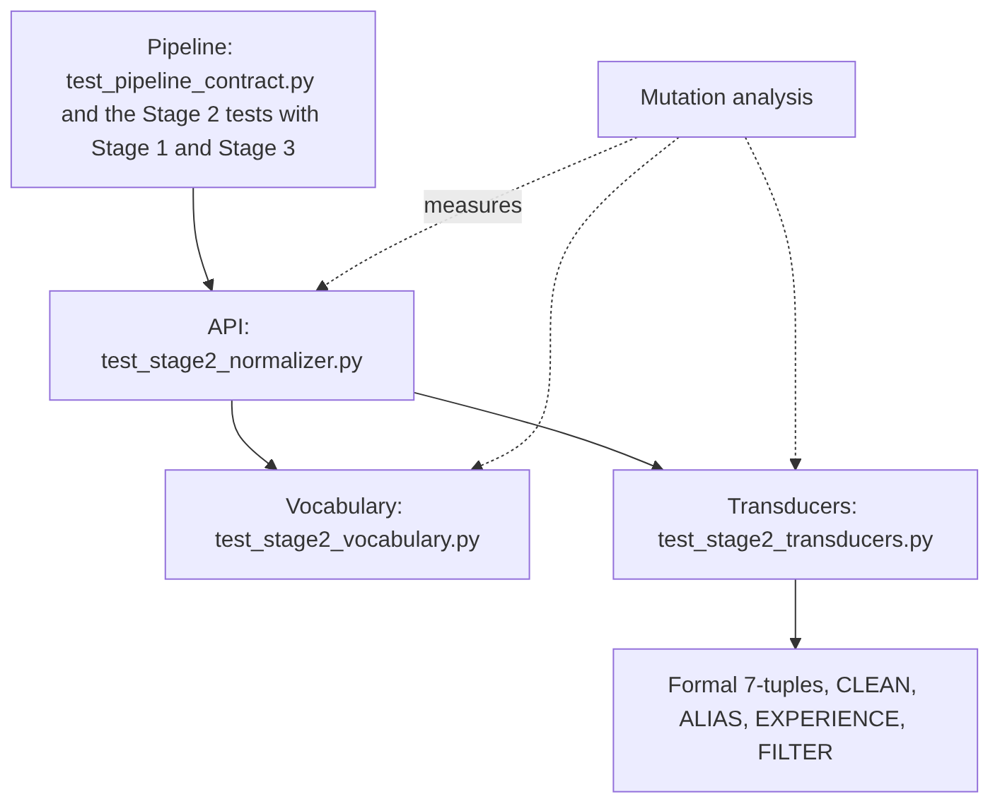
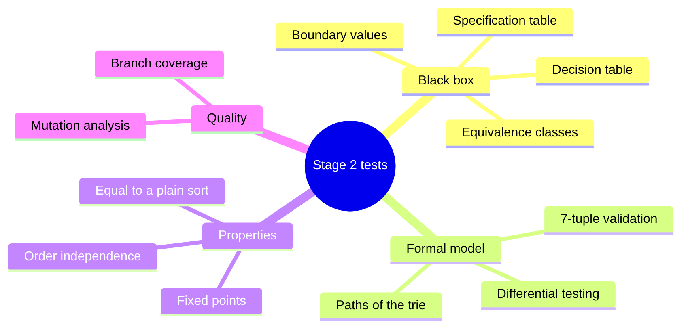
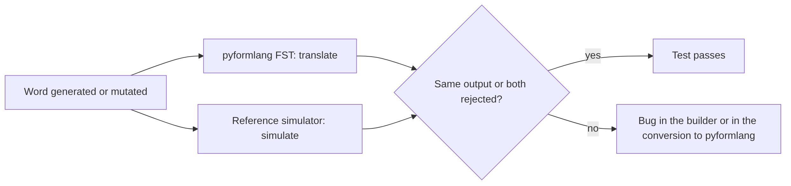
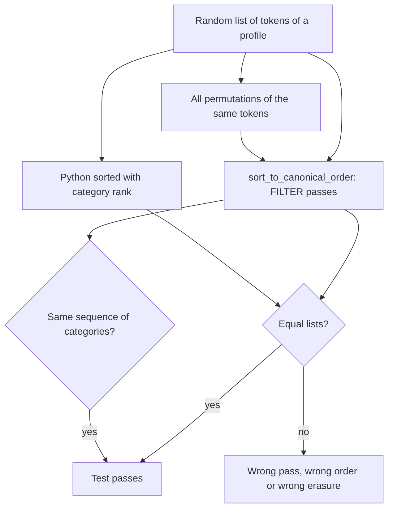
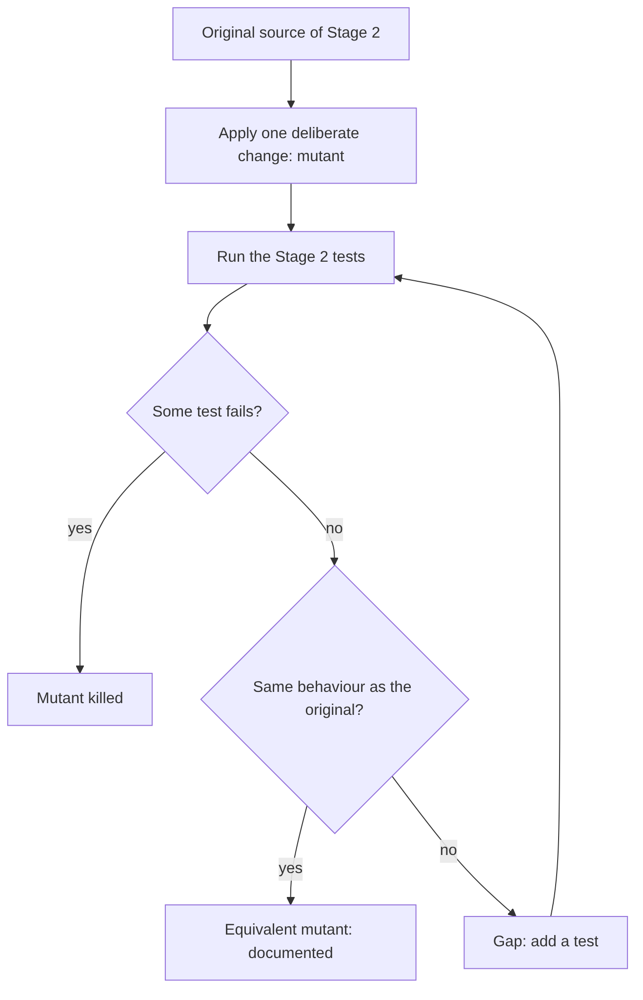

# Stage 2 — Design of Test Cases

> **ResumeLens** · Computación y Estructuras Discretas III · 2026-2
> Requirement of the assignment: **"Design of test cases, including scenarios"**, for Stage 2 (finite-state transducers).
> Companion of [`stage2_fst.md`](stage2_fst.md) (design and formalization of the transducers) and [`stage1_tests.md`](stage1_tests.md).

This document explains **what is tested, why, with which data and what result is expected** for Stage 2, and how good the tests are
(coverage and mutation analysis). Every scenario below corresponds to a real test of the repository; the numbers were obtained by running
the suite and the tables of examples were produced by running the real code.

## Contents

1. [Test strategy](#1-test-strategy)
2. [Test techniques applied](#2-test-techniques-applied)
3. [Test data](#3-test-data)
4. [Catalog of test cases and scenarios](#4-catalog-of-test-cases-and-scenarios)
5. [Equivalence classes and boundary analysis](#5-equivalence-classes-and-boundary-analysis)
6. [How good are the tests? Coverage and mutation analysis](#6-how-good-are-the-tests-coverage-and-mutation-analysis)
7. [Traceability: requirement → transducer → test](#7-traceability-requirement--transducer--test)
8. [Defects found and how the tests changed](#8-defects-found-and-how-the-tests-changed)
9. [How to run](#9-how-to-run)
10. [Limitations and future tests](#10-limitations-and-future-tests)
11. [References](#11-references)

---

## 1. Test strategy

### 1.1 What must be true (test objectives)

| # | Objective | Why it matters |
|---|---|---|
| O1 | Every transducer is a well-formed **deterministic 7-tuple** (Q, Σ, Γ, δ, ω, q₀, F) | The statement asks for the complete formal definition of each transducer |
| O2 | Every spelling of the vocabulary reaches **its** canonical token, whatever the capitalisation or separators | It is the purpose of the stage; a wrong token changes the classification |
| O3 | A word that is a prefix of another (`git` / `github`) is not confused with it | It is the typical error of a trie transducer; it is solved with the end marker ⊣ |
| O4 | Words outside the vocabulary or outside the alphabet are **reported, not lost**, and never crash the stage | Real résumés contain unknown skills |
| O5 | The years of Stage 1 become `EXPERIENCE_PRESENT` only when they are positive | Stage 1 passes an integer, not a token |
| O6 | The sort follows the category order of **each of the 4 profiles**, is stable and does not depend on the order of the résumé | It is the second requirement of the statement |
| O7 | Stage 2 can produce **every** skill that Stage 3 accepts and recognises every technology that Stage 1 extracts | Otherwise some candidates could never be classified |
| O8 | Stage 1 → 2 → 3 work together on the résumé fixtures | The final result depends on the three stages |
| O9 | The two implementations of the transducers (pyformlang and an independent simulator) agree | Guards against errors in the conversion to pyformlang |

### 1.2 Test levels



| Level | File | Tests | What it checks |
|---|---|---|---|
| Unit — transducers | `test_stage2_transducers.py` | 66 | the 7-tuples, CLEAN, ALIAS, EXPERIENCE and FILTER one by one |
| API | `test_stage2_normalizer.py` | 70 | normalization, sorting, years, fallback, contracts with Stages 1 and 3 |
| Vocabulary | `test_stage2_vocabulary.py` | 290 | a specification table of every spelling (144 spellings) |
| **Total of Stage 2** | | **426** | |
| Pipeline | `test_pipeline_contract.py` | 3 | Stage 1 → 2 → 3 (written with Stage 3, run together here) |
| **Total** | | **429** | `429 passed in 0.82s` |

The whole repository (Stages 1, 2 and 3 and the web API) runs as `681 passed in 1.93s`.

### 1.3 Tools and conventions

| Tool | Use |
|---|---|
| `pytest` | runner; `@pytest.mark.parametrize` for the data tables |
| `pyformlang.fst.FST` | engine executed by the program and by the tests |
| `Transducer.simulate` | small independent simulator of the 7-tuple, used as an oracle |
| `coverage.py` (`--branch`) | statement and branch coverage of `src/stage2_fst` |
| mutation script | 43 deliberate changes to the source (section 6) |
| `random.Random(seed)` | the random tests use fixed seeds (2026 and 7), so they are reproducible |

Conventions: names of the form `test_<what>_<expected>`; a test checks one idea; the expected values are written in the test (they are not computed by the code under test).

---

## 2. Test techniques applied



| Technique | What it is | Where it is used in Stage 2 |
|---|---|---|
| **Equivalence partitioning** | Group the inputs that must behave the same and test one or more of each group | Token classes (5.1), profiles, spelling variants |
| **Boundary value analysis** | Test at the edges of each class | years 0/1/−1/None, empty and blank tokens, prefixes of aliases, missing end marker |
| **Negative testing** | Check that wrong inputs are rejected | symbols outside Σ, ambiguous vocabulary, malformed tuples, `3.5` as years |
| **Decision table** | List the combinations of conditions and the expected action | what happens to each kind of token in the sort (5.4), what is reported as transformed or unrecognised |
| **State / path testing** | Walk the paths of the automaton | every spelling = one path of the trie; the end marker; non-final states |
| **Differential testing** | Compare two independent implementations | pyformlang vs reference simulator (300 random words); FILTER sort vs `sorted` |
| **Specification table** | A hand-written table of expected pairs, checked against the data | the 144 pairs (spelling, token) |
| **Property testing** | A property that must hold for many inputs | canonical tokens are fixed points; CLEAN is idempotent; the sort does not depend on the résumé order |
| **Contract testing** | The interface agreed with the neighbouring stages | years as `int`; every skill of Stage 3 can be produced; every technology of Stage 1 is recognised |
| **Regression testing** | Keep the cases that failed in an earlier version | the 20 spellings that the first dictionary did not translate |
| **Coverage** | Measure how much code the tests execute | `coverage.py` with branches |
| **Mutation analysis** | Break the code on purpose and see whether a test notices | 43 mutants (section 6) |

### 2.1 The two differential tests





---

## 3. Test data

| Source | Content | Used by |
|---|---|---|
| Specification table (`test_stage2_vocabulary.py`) | 144 pairs (spelling, canonical token) written by hand | vocabulary tests |
| `tests/test_stage1_contract.py::SURFACE_FORMS` | 67 surface forms, one for each canonical token of the four profiles | contract tests |
| `accepts` examples of the Stage 1 technology specifications | the spellings that Stage 1 can produce | contract tests |
| `tests/data/resumes/*.txt` | Wednesday Addams, Mary Jane Watson, rich résumé | end-to-end tests |
| `profiles.py` | the 4 profiles, their categories and alphabets | sort tests |
| Random generators | words of the vocabulary with one character changed (seed 2026); lists of tokens of a profile (seed 7) | differential tests |

**Vocabulary covered by the specification table**

| Family | Canonical tokens | Spellings in the specification table |
|---|---|---|
| `LANGUAGES` | 17 | 30 |
| `WEB` | 15 | 43 |
| `DATA` | 16 | 24 |
| `DATABASES` | 12 | 18 |
| `VERSION_CONTROL` | 5 | 6 |
| `DEVOPS_CLOUD` | 14 | 23 |

**The four profiles** (data of the sort tests)

| Profile | Categories | Passes | Largest category |
|---|---|---|---|
| `full_stack` | 10 | 11 | 5 tokens |
| `machine_learning` | 5 | 6 | 5 tokens |
| `cloud_devops` | 5 | 6 | 5 tokens |
| `data_scientist` | 5 | 6 | 5 tokens |

---

## 4. Catalog of test cases and scenarios

Each row is one test function; `×n` means that it is parametrized and runs n times. Identifiers `TC2-TRF`, `TC2-API` and `TC2-VOC` are used by the traceability matrix (section 7).

### 4.1 Transducers (`test_stage2_transducers.py`, 66 tests)

| ID | Test | Technique | Scenario | Expected result |
|---|---|---|---|---|
| TC2-TRF-01 | `test_every_transducer_is_a_well_formed_deterministic_7_tuple` ×9 | Formal check | CLEAN, EXPERIENCE, the whole ALIAS and the six family transducers | q0 ∈ Q, F ⊆ Q, δ and ω have the same domain, every symbol is in Σ and every output in Γ |
| TC2-TRF-02 | `test_validate_rejects_a_symbol_outside_sigma` | Negative test | A transducer whose transition reads a symbol that is not in Σ | `validate()` raises AssertionError |
| TC2-TRF-03 | `test_validate_rejects_an_output_outside_gamma` | Negative test | A transition that writes a symbol that is not in Γ | `validate()` raises AssertionError |
| TC2-TRF-04 | `test_clean_transducer_has_one_state_and_the_documented_alphabets` | Formal check | The 7-tuple of CLEAN against section 4.1 of `stage2_fst.md` | Q = {q0}; A–Z in Σ but not in Γ; separators in Σ but not in Γ |
| TC2-TRF-05 | `test_experience_transducer_definition` | Formal check | The 7-tuple of EXPERIENCE against section 4.2 | Q = {q0, q1}, F = {q1}, Γ = {EXPERIENCE_PRESENT} |
| TC2-TRF-06 | `test_clean_removes_case_and_separators_but_keeps_hash_and_plus` ×12 | Equivalence classes | Twelve raw tokens: dotted, hyphenated, spaced, underscored, slashed, with `#`/`+`, single letter, with digit | `Node.js`→`nodejs`, `C#`→`c#`, `GitLab CI/CD`→`gitlabcicd`, … |
| TC2-TRF-07 | `test_clean_rejects_symbols_outside_the_input_alphabet` ×6 | Negative test | `Café`, `R&D`, `node(js)`, `a,b`, `C!`, `日本` | `clean_word` returns None (no translation) |
| TC2-TRF-08 | `test_clean_is_idempotent_and_ignores_case` | Property | Five tokens cleaned twice; upper-case and lower-case versions | CLEAN(CLEAN(x)) = CLEAN(x); CLEAN(X) = CLEAN(x) |
| TC2-TRF-09 | `test_every_spelling_reaches_its_canonical_token` | Path coverage | Every spelling of the vocabulary read by the whole ALIAS | Output is exactly [canonical token] |
| TC2-TRF-10 | `test_family_transducers_agree_with_the_full_transducer` | Consistency | Every spelling read by its family transducer and by the whole ALIAS | Both write the same canonical token |
| TC2-TRF-11 | `test_pyformlang_and_the_reference_simulator_agree_on_random_inputs` | Differential testing | 300 words taken from the vocabulary, with a random character replaced or appended (seed 2026) | pyformlang output = independent simulator output, or both reject |
| TC2-TRF-12 | `test_unknown_words_and_strict_prefixes_are_rejected` ×8 | Boundary values | `""`, `gitx`, `gi`, `githubs`, `nod`, `pythonn`, `c`, `sqlserverx` | ALIAS rejects (None) |
| TC2-TRF-13 | `test_a_word_that_is_a_prefix_of_another_does_not_swallow_it` | Boundary values | `git`/`github`/`gitlab`/`gitlabci`, `sql`/`sqlite`, `java`/`javascript` | Each word gives its own token and only one |
| TC2-TRF-14 | `test_end_marker_is_required` | Boundary values | `git` read without the end marker ⊣ | Rejected (None) |
| TC2-TRF-15 | `test_ambiguous_vocabulary_is_rejected_at_build_time` | Negative test | Two tokens with the same clean word (`Node.js` / `nodejs`); a spelling with `!` | `clean_aliases` raises ValueError |
| TC2-TRF-16 | `test_alias_transducer_is_a_trie` | Formal check | A(W, c) for W = {git, github} | 8 states (7 prefixes + qf), 8 transitions, F = {qf}, 2 edges with ⊣ |
| TC2-TRF-17 | `test_vocabulary_covers_every_skill_of_every_profile` | Contract | Alphabet of each of the 4 profiles against Γ of ALIAS | Every skill (except EXPERIENCE_PRESENT) can be produced |
| TC2-TRF-18 | `test_canonical_tokens_are_fixed_points_of_the_cascade` | Property | Every canonical token run through CLEAN and ALIAS | The same token comes out |
| TC2-TRF-19 | `test_experience_maps_any_number_to_one_symbol` ×6 | Boundary values | `0`, `1`, `3`, `10`, `99`, `2026` | [EXPERIENCE_PRESENT] |
| TC2-TRF-20 | `test_experience_rejects_what_is_not_a_number` ×5 | Negative test | `""`, `a`, `3a`, `-3`, `3.5` | Rejected (None) |
| TC2-TRF-21 | `test_filter_keeps_only_the_wanted_tokens_in_order` | Equivalence classes | FILTER({A, C}) over A B C; input `C B A B A`; input `B B` | `C A A`; empty output |
| TC2-TRF-22 | `test_filter_matches_its_reference_simulator` | Exhaustive testing | All sequences over {X, Y, Z} of length 0 to 4 (121 sequences) | pyformlang = reference simulator |
| TC2-TRF-23 | `test_reference_simulator_rejects_a_word_that_ends_in_a_non_final_state` | State-based testing | `git` without ⊣; `gi⊣`; `git⊣` | None; None; [GIT] |
| TC2-TRF-24 | `test_validate_rejects_delta_and_omega_with_different_domains` | Negative test | δ has a transition that ω does not define | `validate()` raises AssertionError |
| TC2-TRF-25 | `test_validate_rejects_final_states_that_are_not_states` | Negative test | F contains a state that is not in Q | `validate()` raises AssertionError |
| TC2-TRF-26 | `test_clean_aliases_adds_the_canonical_token_as_a_spelling` | Unit test | `clean_aliases({NODE_JS: [Node]})` | {node: NODE_JS, nodejs: NODE_JS} |

### 4.2 Public API, sorting and contracts (`test_stage2_normalizer.py`, 70 tests)

| ID | Test | Technique | Scenario | Expected result |
|---|---|---|---|---|
| TC2-API-01 | `test_examples_of_the_statement` ×16 | Acceptance | The 16 transformations listed in the statement (JS, Javascript, React.js, … PyTorch) | The canonical token of the statement |
| TC2-API-02 | `test_forms_that_the_old_dictionary_missed` ×20 | Regression | Twenty spellings that the first version (a dictionary) did not translate: `C#`, `Golang`, `GitLab CI/CD`, `RESTful APIs`, … | The canonical token |
| TC2-API-03 | `test_capitalisation_and_separators_do_not_matter` | Equivalence classes | Seven variants of `Node.js` | [NODE_JS] |
| TC2-API-04 | `test_result_reports_transformations_and_unrecognized_tokens` | Decision table | `JS`, `JAVASCRIPT` (already canonical), `Brainfuck`, `Rust Lang` | Only `JS` is in `transformations_applied`; the last two are in `unrecognized_tokens` as `BRAINFUCK`, `RUST_LANG` |
| TC2-API-05 | `test_trace_describes_the_cascade_of_every_token` | Unit test | `Node.js` and `Foo-Bar` | Trace (raw, clean, canonical, recognised) = (Node.js, nodejs, NODE_JS, True) and (Foo-Bar, foobar, FOO_BAR, False) |
| TC2-API-06 | `test_unknown_skill_keeps_the_old_fallback_form` | Regression | `Foo-Bar`, `my tool` | `FOO_BAR`, `MY_TOOL` |
| TC2-API-07 | `test_symbols_outside_the_alphabet_are_unrecognized_not_a_crash` | Negative test | `Café`, `R&D`, `日本` | Reported as unrecognised, no exception |
| TC2-API-08 | `test_empty_and_blank_tokens_are_skipped` | Boundary values | `[]`, `["", "  ", "\t"]` | Empty result |
| TC2-API-09 | `test_tokens_are_stripped_before_the_cascade` | Boundary values | `"  Node.js\t"` and `" 3 "` | [NODE_JS, EXPERIENCE_PRESENT]; raw values are stored without the spaces |
| TC2-API-10 | `test_single_token_api_used_by_the_web_server` | Contract | `normalize_qualifications(["Postgres"]).normalized_tokens[0]`, as used by `web_api/server.py` | `POSTGRESQL` |
| TC2-API-11 | `test_digit_tokens_still_become_the_experience_symbol` | Regression | The token `3` (behaviour of the first version) | [EXPERIENCE_PRESENT] and `{3: EXPERIENCE_PRESENT}` |
| TC2-API-12 | `test_years_from_stage_1_become_experience_present_first` | Contract | `years_of_experience=7` with the token `Git` | [EXPERIENCE_PRESENT, GIT] |
| TC2-API-13 | `test_no_experience_symbol_without_positive_years` ×3 | Boundary values | years = None, 0, −1 | No EXPERIENCE_PRESENT |
| TC2-API-14 | `test_experience_symbol_is_kept_for_profiles_that_have_the_category_and_dropped_otherwise` | Decision table | 3 years with the 4 profiles | First token for `full_stack`; erased for the other three |
| TC2-API-15 | `test_statement_example_for_full_stack` | Acceptance | `Git, NodeJS, JS, Postgres, React.js` for Full Stack | `JAVASCRIPT, REACT, NODE_JS, POSTGRESQL, GIT` |
| TC2-API-16 | `test_sorting_follows_the_category_order_of_each_profile` | Equivalence classes | One résumé for each of the other three profiles, written in reverse order | Tokens in the category order of the profile |
| TC2-API-17 | `test_tokens_outside_the_profile_go_last_in_their_original_order` | Decision table | `Rust, Git, Kotlin, JS` for Full Stack | `JAVASCRIPT, GIT, RUST, KOTLIN` |
| TC2-API-18 | `test_order_inside_a_category_is_the_order_written_in_the_resume` | Stability | `REACT, VUE` and `VUE, REACT` (same category) | Order unchanged in both cases |
| TC2-API-19 | `test_unknown_profile_leaves_the_tokens_untouched_and_empty_input_is_empty` | Boundary values | Profile `nope`; empty list | Input returned unchanged; empty list |
| TC2-API-20 | `test_duplicates_are_kept` | Boundary values | `GIT, REACT, GIT` | `REACT, GIT, GIT` |
| TC2-API-21 | `test_sort_equals_a_plain_stable_sort_by_category_rank` ×4 | Differential testing | 60 random lists (0–12 tokens, including tokens outside the profile) for each of the 4 profiles (seed 7) | Equal to `sorted(key=category rank)` |
| TC2-API-22 | `test_result_does_not_depend_on_the_order_in_the_resume` ×4 | Property | Up to 200 permutations of 8 tokens of each profile | Same sequence of categories and same multiset |
| TC2-API-23 | `test_every_surface_form_of_the_stage_1_contract_reaches_its_canonical_token` | Contract | The 67 surface forms of `test_stage1_contract.py` | Each reaches its canonical token |
| TC2-API-24 | `test_every_technology_example_of_stage_1_is_recognised_by_stage_2` | Contract | Every `accepts` example of the technology specs of Stage 1 | None is reported as unrecognised |
| TC2-API-25 | `test_resume_fixtures_go_through_the_three_stages` ×3 | End to end | Wednesday Addams, Mary Jane Watson and the rich résumé, for the 4 profiles | Sorting only moves tokens; Stage 3 returns a result for each profile |
| TC2-API-26 | `test_wednesday_addams_is_accepted_for_full_stack_with_experience` | End to end | The résumé of the statement through Stages 1 → 2 → 3 | EXPERIENCE_PRESENT first and Full Stack accepted |

### 4.3 Vocabulary (`test_stage2_vocabulary.py`, 290 tests)

| ID | Test | Technique | Scenario | Expected result |
|---|---|---|---|---|
| TC2-VOC-01 | `test_spelling_is_translated_to_its_canonical_token` ×144 | Specification table | Each of the 144 (spelling, token) pairs of the table | Recognised and equal to the token |
| TC2-VOC-02 | `test_capitalisation_and_separators_of_a_spelling_do_not_change_the_result` ×144 | Equivalence classes | Upper-case and lower-case version of each of the 144 spellings | Same canonical token |
| TC2-VOC-03 | `test_specification_and_vocabulary_list_the_same_spellings` | Consistency | Table of the test against `ALIAS_FAMILIES` | Same set of pairs (nothing added or deleted without review) |
| TC2-VOC-04 | `test_specification_has_no_repeated_entries` | Consistency | The table of the test | No repeated pair |

### 4.4 Pipeline (`test_pipeline_contract.py`, 3 tests)

These tests were written with Stage 3 and check Stages 1 → 2 → 3 for the résumé of the statement, the rejection of raw tokens that skip Stage 2 and a second résumé. They run together with the tests of this stage.

---

## 5. Equivalence classes and boundary analysis

### 5.1 Classes of raw tokens

| Class | Representative inputs | Expected behaviour | Real result |
|---|---|---|---|
| Canonical token | `NODE_JS`, `SPRING_BOOT` | fixed point | `NODE_JS`, `SPRING_BOOT` |
| Alias with different case | `javascript`, `JAVASCRIPT`, `JavaScript` | same token | `JAVASCRIPT`, `JAVASCRIPT`, `JAVASCRIPT` |
| Alias with separators | `Node.js`, `node-js`, `node js`, `Node_JS` | same token | `NODE_JS`, `NODE_JS`, `NODE_JS`, `NODE_JS` |
| Alias with a symbol that is kept | `C#`, `C++` | CSHARP, CPP | `CSHARP`, `CPP` |
| Alias with digits | `HTML5`, `Python3` | HTML, PYTHON | `HTML`, `PYTHON` |
| Several words | `Amazon Web Services`, `Google Cloud Platform`, `GitLab CI/CD` | AWS, GCP, GITLAB_CI | `AWS`, `GCP`, `GITLAB_CI` |
| Prefix of another alias | `Git`, `SQL`, `Java` | own token, not the longer one | `GIT`, `SQL`, `JAVA` |
| Unknown, ASCII | `Brainfuck`, `Foo-Bar`, `my tool` | upper-case fallback, reported | `BRAINFUCK`, `FOO_BAR`, `MY_TOOL` |
| Unknown, not ASCII or with symbols | `Café`, `R&D` | fallback, reported, no exception | `CAFÉ`, `R&D` |
| Only digits | `3`, `10` | EXPERIENCE_PRESENT | `EXPERIENCE_PRESENT`, `EXPERIENCE_PRESENT` |
| Empty or blank | '', '   ' | skipped | `(skipped)`, `(skipped)` |
| Padded with white space | `Git`, `JS` | stripped, then normalised | `GIT`, `JAVASCRIPT` |

### 5.2 Years of experience (boundary values)

Stage 1 gives an integer. EXPERIENCE only runs when it is positive.

| `years_of_experience` | Class | `normalized_tokens` for `["Git"]` (Full Stack) |
|---|---|---|
| `None` | not reported | `['GIT']` |
| `-1` | invalid (negative) | `['GIT']` |
| `0` | boundary: no experience | `['GIT']` |
| `1` | boundary: smallest positive | `['EXPERIENCE_PRESENT', 'GIT']` |
| `3` | typical | `['EXPERIENCE_PRESENT', 'GIT']` |
| `10` | two digits | `['EXPERIENCE_PRESENT', 'GIT']` |
| `99` | largest two-digit | `['EXPERIENCE_PRESENT', 'GIT']` |

The boundary is between 0 and 1; `None` and negative values behave like 0.

### 5.3 Words that are prefixes of other words

| Word | Is a prefix of | Result of the prefix | Result of the longer word |
|---|---|---|---|
| `git` | `github` | GIT | GITHUB |
| `git` | `gitlab` | GIT | GITLAB |
| `gitlab` | `gitlabci` | GITLAB | GITLAB_CI |
| `sql` | `sqlite` | SQL | SQLITE |
| `java` | `javascript` | JAVA | JAVASCRIPT |
| `node` | `nodejs` | NODE_JS | NODE_JS |
| `react` | `reactjs` | REACT | REACT |
| `py` | `pytorch` | PYTHON | PYTORCH |
| `c` | `csharp` | rejected (not a word of the vocabulary) | CSHARP |

Each word reaches **its own** token; without the end marker the shorter one would also write its token before the longer one.

### 5.4 Decision table of the sort

| Token | In the alphabet of the profile? | Profile has category EXPERIENCE? | Where it goes | Example (Full Stack / Machine Learning) |
|---|---|---|---|---|
| a skill of the profile | yes | — | its category pass, by profile order | `PYTHON`, `GIT` are placed by category |
| a skill of another profile or unknown | no | — | `FILTER_REST` (last), input order | `RUST` is last |
| `EXPERIENCE_PRESENT` | yes | yes | first (category EXPERIENCE) | Full Stack: `EXPERIENCE_PRESENT, PYTHON, GIT, RUST` |
| `EXPERIENCE_PRESENT` | no | no | erased | Machine Learning: `PYTHON, GIT, RUST` |

Besides this table the tests cover: empty list, one token, duplicates, the same category with two orders, unknown profile, and one random comparison with `sorted` for each profile.

---

## 6. How good are the tests? Coverage and mutation analysis

### 6.1 Coverage

| File | Statements | Missed | Branches | Partial | Coverage |
|---|---|---|---|---|---|
| `src/stage2_fst/__init__.py` | 2 | 0 | 0 | 0 | 100% |
| `src/stage2_fst/aliases.py` | 5 | 0 | 0 | 0 | 100% |
| `src/stage2_fst/normalizer.py` | 82 | 0 | 26 | 0 | 100% |
| `src/stage2_fst/transducers.py` | 135 | 0 | 38 | 0 | 100% |
| **TOTAL** | 224 | 0 | 64 | 0 | 100% |

### 6.2 Mutation analysis



Coverage says which lines are executed, not whether the tests would notice a wrong result. For that, **43 deliberate changes** (mutants) were applied
to the source one at a time and the Stage 2 tests were run each time. A mutant is *killed* if a test fails.

* The first version of the suite killed **30 of 43** (70 %): 13 mutants survived.
* Ten of them showed real gaps (deleting a spelling from the vocabulary, a reference simulator that accepts a non-final state, a validator that does not check Q, F or the domains, tokens that are not stripped, a canonical token that is not added as a spelling). Tests were added for them: the specification table (`test_stage2_vocabulary.py`) and five tests in the other two files.
* The final suite kills **40 of 43**. The remaining **3** are *equivalent mutants*: the change does not alter the behaviour of the program, so no test can kill them (explained in the table). Kill rate over the non-equivalent mutants: **100 %**.

| Id | Deliberate change | Original suite | Final suite | First test that fails |
|---|---|---|---|---|
| M01 | CLEAN no longer erases the slash (GitLab CI/CD) | killed | killed | error while building the transducers (collection of `tests/test_stage2_transducers.py`) |
| M02 | CLEAN no longer erases the underscore (scikit_learn) | killed | killed | error while building the transducers (collection of `tests/test_stage2_transducers.py`) |
| M03 | CLEAN no longer erases the space (Power BI) | killed | killed | error while building the transducers (collection of `tests/test_stage2_transducers.py`) |
| M04 | CLEAN rejects the plus sign (C++) | killed | killed | error while building the transducers (collection of `tests/test_stage2_transducers.py`) |
| M05 | CLEAN rejects digits (HTML5) | killed | killed | error while building the transducers (collection of `tests/test_stage2_transducers.py`) |
| M06 | ALIAS writes the canonical token in lower case | killed | killed | error while building the transducers (collection of `tests/test_stage2_transducers.py`) |
| M07 | the canonical token itself is not added as a spelling | **survived** | killed | `test_clean_aliases_adds_the_canonical_token_as_a_spelling` |
| M08 | ambiguous vocabulary is not detected | killed | killed | `test_every_spelling_reaches_its_canonical_token` |
| M09 | a spelling that cannot be cleaned is accepted | killed | killed | `test_ambiguous_vocabulary_is_rejected_at_build_time` |
| M10 | EXPERIENCE also accepts the empty word | killed | killed | `test_experience_transducer_definition` |
| M11 | EXPERIENCE writes one symbol per digit | killed | killed | `test_experience_maps_any_number_to_one_symbol[10]` |
| M12 | FILTER keeps the wrong tokens | killed | killed | `test_filter_keeps_only_the_wanted_tokens_in_order` |
| M13 | reference simulator accepts a non-final state | **survived** | killed | `test_reference_simulator_rejects_a_word_that_ends_in_a_non_final_state` |
| M14 | run_fst returns [] instead of None for a rejected word | killed | killed | `test_pyformlang_and_the_reference_simulator_agree_on_random_inputs` |
| M15 | validate no longer checks that δ and ω have the same domain | **survived** | killed | `test_validate_rejects_delta_and_omega_with_different_domains` |
| M16 | validate no longer checks that symbols are in Σ | killed | killed | `test_validate_rejects_a_symbol_outside_sigma` |
| M17 | validate no longer checks F ⊆ Q | **survived** | killed | `test_validate_rejects_final_states_that_are_not_states` |
| M18 | ALIAS: the end marker does not lead to the final state | killed | killed | `test_every_spelling_reaches_its_canonical_token` |
| M19 | digit tokens are not sent to EXPERIENCE | killed | killed | `test_tokens_are_stripped_before_the_cascade` |
| M20 | 0 years produce EXPERIENCE_PRESENT | killed | killed | `test_no_experience_symbol_without_positive_years[0]` |
| M21 | EXPERIENCE_PRESENT is not placed first | killed | killed | `test_years_from_stage_1_become_experience_present_first` |
| M22 | identity transformations are reported | killed | killed | `test_result_reports_transformations_and_unrecognized_tokens` |
| M23 | fallback keeps the hyphen | killed | killed | `test_trace_describes_the_cascade_of_every_token` |
| M24 | blank tokens are not skipped | killed | killed | `test_empty_and_blank_tokens_are_skipped` |
| M25 | unrecognized tokens are reported in canonical form | killed | killed | `test_result_reports_transformations_and_unrecognized_tokens` |
| M26 | tokens are not stripped | **survived** | killed | `test_tokens_are_stripped_before_the_cascade` |
| M27 | fallback is built from the clean word | killed | killed | `test_result_reports_transformations_and_unrecognized_tokens` |
| M28 | EXPERIENCE_PRESENT is kept for profiles without that category | killed | killed | `test_experience_symbol_is_kept_for_profiles_that_have_the_category_and_dropped_otherwise` |
| M29 | tokens outside the profile are not sent to the end | killed | killed | `test_statement_example_for_full_stack` |
| M30 | unknown profile returns an empty list | killed | killed | `test_unknown_profile_leaves_the_tokens_untouched_and_empty_input_is_empty` |
| M31 | empty input is no longer short-circuited | **survived** | equivalent | — (The empty list gives empty passes anyway; the guard only saves work.) |
| M32 | passes are built for categories that are not in the résumé | **survived** | equivalent | — (A pass for a category that is not in the résumé copies nothing; the filter only saves work.) |
| M33 | a rejected FILTER output is not turned into an empty list | **survived** | equivalent | — (FILTER accepts every sequence over its alphabet, so its output is never None; `or []` is a defensive guard that cannot be reached.) |
| M34 | vocabulary: `C#` removed | killed | killed | `test_forms_that_the_old_dictionary_missed[C#-CSHARP]` |
| M35 | vocabulary: `MS SQL Server` removed | **survived** | killed | `test_spelling_is_translated_to_its_canonical_token[MS SQL Server-SQL_SERVER]` |
| M36 | vocabulary: `Elastic Search` removed | **survived** | killed | `test_specification_and_vocabulary_list_the_same_spellings` |
| M37 | vocabulary: `Power Shell` removed | **survived** | killed | `test_specification_and_vocabulary_list_the_same_spellings` |
| M38 | vocabulary: `Fast API` removed | **survived** | killed | `test_specification_and_vocabulary_list_the_same_spellings` |
| M39 | vocabulary: `Rest` collides with REST | killed | killed | error while building the transducers (collection of `tests/test_stage2_transducers.py`) |
| M40 | vocabulary: `GitLab CI/CD` removed | killed | killed | `test_forms_that_the_old_dictionary_missed[GitLab CI/CD-GITLAB_CI]` |
| M41 | vocabulary: `Subversion` removed | killed | killed | `test_forms_that_the_old_dictionary_missed[Subversion-SVN]` |
| M42 | vocabulary: `TF` removed | **survived** | killed | `test_spelling_is_translated_to_its_canonical_token[TF-TENSORFLOW]` |
| M43 | experience token renamed | killed | killed | `test_vocabulary_covers_every_skill_of_every_profile` |

---

## 7. Traceability: requirement → transducer → test

| Requirement | Transducer / function | Tests |
|---|---|---|
| Formal definition of each transducer as a 7-tuple | all (`Transducer.validate`) | TC2-TRF-01 … 05, 16, and the negative checks TRF-02, 03, 24, 25 |
| Transform equivalent textual representations into one canonical token | CLEAN → ALIAS | TC2-TRF-06, 08, 09, 10, 13, 14, 18; TC2-API-01, 02, 03; TC2-VOC-01 … 04 |
| The examples of the statement (`JS`, `React.js`, `sklearn`, …) | CLEAN → ALIAS | TC2-API-01 (16 cases), TC2-API-15, TC2-VOC-01 |
| Implement the transformations with pyformlang | `Transducer.to_fst`, `run_fst` | TC2-TRF-09, 11 (differential), 22, 23 |
| Unknown skills are not lost | fallback in `normalize_token` | TC2-TRF-07, 12; TC2-API-04, 05, 06, 07 |
| Years → `EXPERIENCE_PRESENT` | EXPERIENCE | TC2-TRF-19, 20; TC2-API-11, 12, 13, 14, 26 |
| Sort by the canonical order of the selected profile | FILTER passes | TC2-TRF-21, 22; TC2-API-15 … 22 |
| Result independent of the order in the résumé | FILTER passes | TC2-API-21, 22 |
| Stage 2 can produce what Stage 3 accepts | vocabulary | TC2-TRF-17; TC2-API-23 |
| Stage 2 recognises what Stage 1 extracts | vocabulary | TC2-API-23, 24 |
| Stages 1 → 2 → 3 work together | whole stage | TC2-API-25, 26; `test_pipeline_contract.py` |

The numbering of the identifiers follows the order of the tables of section 4.

---

## 8. Defects found and how the tests changed

**Defects of the first version (a Python dictionary), found by the contract tests against Stage 1.**

| Surface form (Stage 1) | Old dictionary (first version) | Transducers | Impact |
|---|---|---|---|
| `Java Script` | `JAVA_SCRIPT` | `JAVASCRIPT` | not a token of Stage 3: the candidate loses `JAVASCRIPT` |
| `Python3` | `PYTHON3` | `PYTHON` | not a token of Stage 3 |
| `C#` | `C#` | `CSHARP` | Stage 3 can never receive `CSHARP` |
| `C++` | `C++` | `CPP` | unknown skill |
| `RESTful / RESTful APIs` | `RESTFUL / RESTFUL_APIS` | `REST` | not a token of Stage 3 |
| `Google Cloud Platform` | `GOOGLE_CLOUD_PLATFORM` | `GCP` | not a token of Stage 3 |
| `GitLab CI/CD` | `GITLAB_CI/CD` | `GITLAB_CI` | not a token of Stage 3 |
| `Java, Go, Oracle, Firebase` | `same word in capitals, but reported as unrecognised` | `recognised` | wrong report: they are skills of the profiles |

All the surface forms in the table are produced by Stage 1, so the old normalization sent tokens to Stage 3 that its automata cannot read. The regression test `test_forms_that_the_old_dictionary_missed` keeps them.

**Interface finding.** Stage 1 returns the years as an `int` outside `raw_tokens`, but the pipeline of the interface did not pass it to Stage 2, so `EXPERIENCE_PRESENT` was never produced. `normalize_and_sort` now receives `years_of_experience`; the tests in 5.2 and `test_wednesday_addams_is_accepted_for_full_stack_with_experience` check it. The UI must pass the argument (see `stage2_fst.md`, section 10).

**Gaps in the test suite, found by the mutation analysis (section 6).** Vocabulary entries could be deleted without a test failing, the reference simulator and the validator were not fully checked, and white space around tokens was not tested. They are covered by `test_stage2_vocabulary.py`, `test_reference_simulator_rejects_a_word_that_ends_in_a_non_final_state`, `test_validate_rejects_delta_and_omega_with_different_domains`, `test_validate_rejects_final_states_that_are_not_states`, `test_clean_aliases_adds_the_canonical_token_as_a_spelling` and `test_tokens_are_stripped_before_the_cascade`.

---

## 9. How to run

```
py -m pytest tests/test_stage2_transducers.py tests/test_stage2_normalizer.py tests/test_stage2_vocabulary.py -q
py -m pytest -q                                    # the whole repository
py -m coverage run --branch --source=src/stage2_fst -m pytest -q tests/test_stage2_transducers.py tests/test_stage2_normalizer.py tests/test_stage2_vocabulary.py
py -m coverage report -m
```

Expected: `429 passed in 0.82s` for the first command including the pipeline file, and `681 passed in 1.93s` for the whole repository.
To repeat the mutation analysis, apply one change of the table of section 6.2 to the indicated file and run the first command: a failing test means that the mutant is killed.

---

## 10. Limitations and future tests

* The **specification table repeats the vocabulary on purpose**: adding a spelling means adding it in two places. That is the price of detecting a spelling that disappears.
* The mutants are chosen by hand (43). They cover CLEAN, ALIAS, EXPERIENCE, FILTER, the normalizer and the vocabulary, but they are not all the possible changes.
* The **Streamlit interface and the web API** are not tested here beyond the call used by `web_api/server.py`; the UI must pass `years_of_experience`.
* The **random tests** are small (300 words, 60 lists per profile) and use fixed seeds; a property-based library (Hypothesis) could explore more.
* Performance is not tested; the transducers read one symbol per step and the sizes are small (144 spellings).
* Spellings with typing mistakes (`Javascipt`) are out of scope: they are reported as unrecognised.

---

## 11. References

* Myers, G. J., Sandler, C. & Badgett, T. *The Art of Software Testing*. Wiley.
* Ammann, P. & Offutt, J. *Introduction to Software Testing*. Cambridge University Press (equivalence classes, boundary values, mutation).
* McKeeman, W. M. *Differential Testing for Software*. Digital Technical Journal 10(1), 1998.
* pytest documentation — <https://docs.pytest.org/> · coverage.py documentation — <https://coverage.readthedocs.io/>.
* Aristizábal, A. A. & Villota, A. *Finite State Transducers* (course slides, Universidad Icesi).
