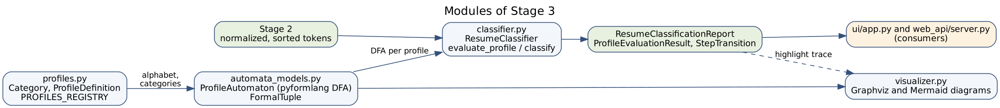
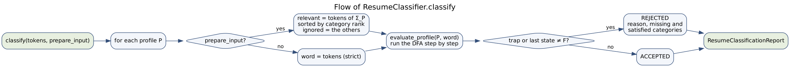
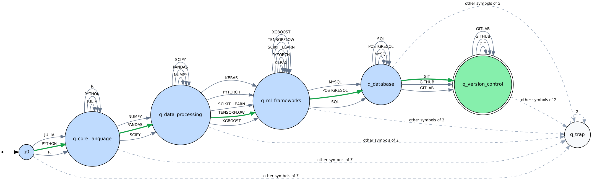
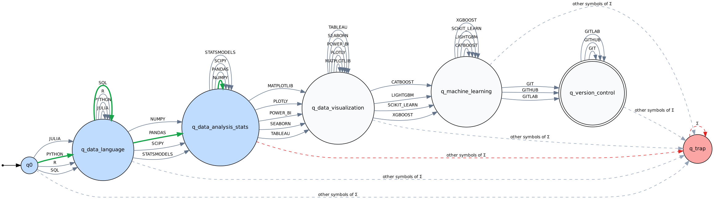

# Stage 3 — Qualification Pattern Recognition: Design and Formalization

Generated with `python scripts/export_formalization.py` from the executable models: every table, count and example below was produced by running the real code, so the document cannot drift from the implementation.

**Contents**

- **Part I — Design:** purpose and scope, architecture, module reference (functions, inputs and outputs), how a candidate is classified, the four profiles in plain language, design notes on the automata, worked examples, integration with the other stages, design decisions, limitations, how to run, references.
- **Part II — Formalization:** contract, automaton type and formal semantics; the formal framework (definitions, Lemmas 1–2 and Theorems 1–5 with proofs: language of each automaton, totality and determinism, no useless states, minimality, correctness of the preparation; complexity; correspondence between the mathematics and the code; worked examples of δ); and for each profile the tuple (Q, Σ, δ, q0, F), the recognized pattern, the complete δ table, structural properties (state languages, witnesses, minimality) and the diagram.
- **Verification against assignment item 3.**
- Test-case and scenario design: [`stage3_tests.md`](stage3_tests.md).

---

## Part I — Design

### 1. Purpose and scope

Stage 3 decides, for each of four professional profiles, whether a candidate's qualifications form a **word of the language** that the profile describes. The input is the list of *canonical tokens* produced by Stage 2 (for instance `PYTHON`, `PANDAS`, `GIT`); the output is, per profile, an **ACCEPTED/REJECTED verdict with a step-by-step trace** and a diagnosis (missing requirements, offending token, foreign tokens).

| | |
|---|---|
| Input | `List[str]` of canonical tokens (Stage 2 output, sorted or not) |
| Output | `ResumeClassificationReport` (verdict + trace per profile) |
| Formal model | one **DFA** per profile, built with `pyformlang` (`DeterministicFiniteAutomaton`) |
| Profiles | Full Stack Developer, Machine Learning Engineer, Cloud & DevOps Engineer, Data Scientist |
| Not in scope | scoring, ranking, proficiency levels, hiring decisions (a candidate may match 0–4 profiles) |

### 2. Architecture



Dependencies are one-directional: `profiles` → `automata_models` → `classifier` → `visualizer`. Nothing in Stage 3 imports Stages 1 or 2; the contract with them is only the *list of canonical tokens*. The scripts and the two user-facing front ends (Streamlit and the local web API) are consumers.

| File | Responsibility |
|---|---|
| `src/stage3_classifier/profiles.py` | Declarative definition of the profiles: categories, canonical order, alphabet Σ, mandatory requirement groups |
| `src/stage3_classifier/automata_models.py` | Builds one total DFA per profile with `pyformlang`; exposes the formal 5-tuple |
| `src/stage3_classifier/classifier.py` | Executes a word step by step, produces the trace and the diagnosis; classifies a candidate against all profiles |
| `src/stage3_classifier/visualizer.py` | Graphviz and Mermaid diagrams derived from the real transition table, optionally highlighting a trace |
| `src/stage3_classifier/__init__.py` | Public API of the package |
| `scripts/export_diagrams.py` | Writes `docs/diagrams/<profile>.{dot,svg,png}` and the HTML viewer |
| `scripts/export_formalization.py` | Writes `docs/stage3_formalization.md` from the DFAs |

### 3. Module reference (functions, inputs and outputs)

#### 3.1 `profiles.py`

| Element | Signature | Input | Output |
|---|---|---|---|
| `Category` | frozen dataclass `(name, description, skills)` | — | one qualification category and its set of tokens |
| `ProfileDefinition` | frozen dataclass `(profile_id, title, domain, canonical_categories)` | — | a profile: ordered list of categories |
| `ProfileDefinition.required_groups` | property | — | `Dict[str, Set[str]]`: requirement name → categories that can satisfy it |
| `ProfileDefinition.alphabet` | property | — | `Set[str]` = Σ, the union of all category token sets |
| `ProfileDefinition.get_category_for_skill` | `(self, skill: str) -> str \| None` | a token | name of its category, or `None` |
| `PROFILES_REGISTRY` | `Dict[str, ProfileDefinition]` | — | the four profiles keyed by `profile_id` |

#### 3.2 `automata_models.py`

| Element | Signature | Input | Output |
|---|---|---|---|
| `FormalTuple` | dataclass | — | M = (Q, Σ, δ, q0, F) as plain Python sets and a dict |
| `FormalTuple.to_markdown` | `(self) -> str` | — | the tuple rendered as Markdown |
| `ProfileAutomaton.__init__` | `(self, profile: profiles.ProfileDefinition)` | a `ProfileDefinition` | builds the DFA, then completes δ with `q_trap` |
| `ProfileAutomaton._build_automaton` | `(self) -> None` | — | strict linear chain: one state per category, self-loop on the category, forward edge to the next |
| `ProfileAutomaton._build_fullstack_automaton` | `(self) -> None` | — | chain with optional categories and bypass edges (see §6.1) |
| `ProfileAutomaton._complete_with_trap` | `(self) -> None` | — | adds absorbing `q_trap` so that δ is total on Q × Σ |
| `ProfileAutomaton.accepts` | `(self, word: List[str]) -> bool` | a word (list of tokens) | `bool`, using pyformlang's own `accepts` |
| `ProfileAutomaton.get_formal_tuple` | `(self) -> automata_models.FormalTuple` | — | `FormalTuple` extracted from the pyformlang object |
| `build_all_automata` | `() -> Dict[str, automata_models.ProfileAutomaton]` | — | `Dict[profile_id, ProfileAutomaton]` |

#### 3.3 `classifier.py`

| Element | Signature | Input | Output |
|---|---|---|---|
| `ClassificationStatus` | `str` enum | — | `ACCEPTED` / `REJECTED` |
| `ResumeClassifier.__init__` | `(self)` | — | builds all four automata once |
| `ResumeClassifier.evaluate_profile` | `(self, profile_id: str, tokens: List[str]) -> classifier.ProfileEvaluationResult` | profile id, token list (**strict**: no filtering, no sorting) | `ProfileEvaluationResult`; raises `ValueError` for an unknown profile id |
| `ResumeClassifier.classify` | `(self, tokens: List[str], *, prepare_input: bool = True) -> classifier.ResumeClassificationReport` | token list; `prepare_input` (default `True`) | `ResumeClassificationReport` for the four profiles |

#### 3.4 `visualizer.py`

| Function | Signature | Output |
|---|---|---|
| `build_graphviz_diagram` | `(automaton: automata_models.ProfileAutomaton, result: Optional[classifier.ProfileEvaluationResult] = None) -> graphviz.graphs.Digraph` | a `graphviz.Digraph`; with a result, the visited states/edges are highlighted (green accepted, red trap) |
| `generate_graphviz_dot` | `(automaton: automata_models.ProfileAutomaton, result: Optional[classifier.ProfileEvaluationResult] = None) -> str` | DOT source string |
| `generate_mermaid_diagram` | `(automaton: automata_models.ProfileAutomaton) -> str` | Mermaid `stateDiagram-v2` with one explicit line per pair of δ |

#### 3.5 Data structures returned by the classifier

**`StepTransition`**

| Field | Type | Meaning |
|---|---|---|
| `step_number` | `<class 'int'>` | 1-based position of the token in the evaluated word |
| `source_state` | `<class 'str'>` | state before reading the token (`q_trap` once trapped) |
| `symbol` | `<class 'str'>` | the token read |
| `target_state` | `<class 'str'>` | state after reading it |
| `category` | `Optional[str]` | category of the token in the profile, `None` if the token is outside Σ |
| `is_valid_transition` | `<class 'bool'>` | `False` when the move goes to (or stays in) `q_trap` |

**`ProfileEvaluationResult`**

| Field | Type | Meaning |
|---|---|---|
| `profile_id` | `<class 'str'>` | registry key (`full_stack`, `machine_learning`, `cloud_devops`, `data_scientist`) |
| `profile_title` | `<class 'str'>` | human-readable profile name |
| `status` | `<enum 'ClassificationStatus'>` | `ACCEPTED` or `REJECTED` |
| `is_accepted` | `<class 'bool'>` | boolean shortcut for `status == ACCEPTED` |
| `final_state` | `<class 'str'>` | state where the run ended (`q_trap` if rejected by a violation) |
| `expected_final_state` | `<class 'str'>` | the single accepting state F of the profile |
| `trace` | `List[StepTransition]` | one `StepTransition` per input token |
| `evaluated_tokens` | `List[str]` | the word the DFA actually read |
| `ignored_tokens` | `List[str]` | tokens outside Σ of the profile (only filled when `prepare_input=True`) |
| `rejection_reason` | `Optional[str]` | diagnostic text; `None` when accepted |
| `missing_categories` | `List[str]` | mandatory requirement groups with no token in the input |
| `satisfied_categories` | `List[str]` | categories of the profile observed in the input, in canonical order |

**`ResumeClassificationReport`**

| Field | Type | Meaning |
|---|---|---|
| `input_tokens` | `List[str]` | the list given to `classify` |
| `accepted_profiles` | `List[str]` | titles of the accepted profiles |
| `rejected_profiles` | `List[str]` | titles of the rejected profiles |
| `results_by_profile` | `Dict[str, ProfileEvaluationResult]` | `profile_id` → `ProfileEvaluationResult` |

**`FormalTuple`**

| Field | Type | Meaning |
|---|---|---|
| `states` | `Set[str]` | Q |
| `alphabet` | `Set[str]` | Σ |
| `transitions` | `Dict[Tuple[str, str], str]` | δ as a dict `(state, symbol) → state` |
| `initial_state` | `<class 'str'>` | q0 |
| `final_states` | `Set[str]` | F |

### 4. How a candidate is classified



**`classify(tokens, prepare_input=True)`**

1. For each profile P in the registry compute `rank`, the position of each of its tokens in the canonical order.
2. *Preparation* (only when `prepare_input=True`): keep the tokens that belong to Σ_P and sort them by rank (stable sort). The rest go to `ignored_tokens`. This is an integration step, **not** a DFA transition.
3. Call `evaluate_profile(P, word)`.
4. Collect accepted and rejected profile titles into the report.

**`evaluate_profile(profile_id, tokens)`**, pseudocode:

```text
state ← q0 ; trapped ← false
for i, token in enumerate(tokens, 1):
    category ← category of token in the profile (None if outside Σ)
    if trapped: record (q_trap, token, q_trap, invalid) ; continue
    next ← δ(state, token)                 # pyformlang lookup; absent or q_trap means violation
    if next is a real state: record the valid step ; state ← next
    else: trapped ← true ; record (state, token, q_trap, invalid)
          reason ← 'token not in alphabet'  if token ∉ Σ  else  'canonical-order violation at step i'
accepted ← not trapped and state = the accepting state
observed ← categories of all tokens ; satisfied ← observed in canonical order
missing ← mandatory requirement groups with no observed category
if rejected and no reason yet: reason ← 'empty sequence'  or  'missing: …'
```

Cost: O(n) per profile for recognition (one dictionary lookup per token, after an O(1) amortised category lookup per token over a fixed vocabulary), O(n log n) for the preparation sort.

#### Why two modes?

| Mode | Call | What it proves |
|---|---|---|
| Prepared (default) | `classify(tokens)` | Candidate-level question: *does this candidate cover the profile?* Order and foreign skills are irrelevant to the candidate, so they are normalised away per profile. |
| Strict | `classify(tokens, prepare_input=False)` or `evaluate_profile` | Language-level question: *is this exact word in L(M)?* Used by the tests, the demo without Stage 2 and the web API in `tokens` mode. |

### 5. Profiles in plain language

A profile is a **pattern of categories in a fixed order**: first the core language, then the libraries built on top of it, then storage, and finally version control. A résumé matches when it names at least one skill from every mandatory category, in that order, and nothing in between breaks the order. Each category is a *block*: once the automaton moves to a later block it cannot go back (a database followed by a language is rejected in strict mode).

| Profile | Domain | Σ size | States (with trap) | Transitions in δ (total / to trap) | Accepting state |
|---|---|---|---|---|---|
| Full Stack Developer | Software Engineering | 37 | 12 | 444 / 320 | `q_version_control` |
| Machine Learning Engineer | AI / Data | 17 | 7 | 119 / 85 | `q_version_control` |
| Cloud & DevOps Engineer | Software Engineering | 20 | 7 | 140 / 100 | `q_version_control` |
| Data Scientist | AI / Data | 20 | 7 | 140 / 100 | `q_version_control` |

The number of transitions is |Q| × |Σ| because δ is total (every pair has exactly one target).

#### 5.1 Full Stack Developer

**What it models:** a developer who can build both sides of a web application.

**Pattern in words:** Optionally a reported number of years, then at least one frontend language (HTML/CSS/JavaScript/TypeScript), optionally frontend frameworks, then a backend (a language **or** a framework), optionally API technologies, then a database (SQL **or** NoSQL, or both), optionally cloud/DevOps tools, and finally at least one version-control tool.

**Pattern as a regular expression over categories:** `EXPERIENCE* FE_LANGUAGE+ FE_FRAMEWORK* (BE_LANGUAGE+ BE_FRAMEWORK* | BE_FRAMEWORK+) API_COMMUNICATION* (DATABASE_SQL+ DATABASE_NOSQL* | DATABASE_NOSQL+) DEVOPS_CLOUD* VERSION_CONTROL+`

| # | Category | Mandatory? | Tokens |
|---|---|---|---|
| 1 | EXPERIENCE | optional | EXPERIENCE_PRESENT |
| 2 | FE_LANGUAGE | mandatory | CSS, HTML, JAVASCRIPT, TYPESCRIPT |
| 3 | FE_FRAMEWORK | optional | ANGULAR, NEXTJS, REACT, SVELTE, VUE |
| 4 | BE_LANGUAGE | one of BE_FRAMEWORK / BE_LANGUAGE (group BACKEND) | CSHARP, GO, JAVA, NODE_JS, PYTHON |
| 5 | BE_FRAMEWORK | one of BE_FRAMEWORK / BE_LANGUAGE (group BACKEND) | DJANGO, EXPRESS, FASTAPI, NESTJS, SPRING_BOOT |
| 6 | API_COMMUNICATION | optional | GRAPHQL, REST, WEBSOCKET |
| 7 | DATABASE_SQL | one of DATABASE_NOSQL / DATABASE_SQL (group DATABASE) | MYSQL, ORACLE, POSTGRESQL, SQL, SQLITE |
| 8 | DATABASE_NOSQL | one of DATABASE_NOSQL / DATABASE_SQL (group DATABASE) | FIREBASE, MONGODB, REDIS |
| 9 | DEVOPS_CLOUD | optional | AWS, DOCKER, KUBERNETES |
| 10 | VERSION_CONTROL | mandatory | GIT, GITHUB, GITLAB |

The complete transition diagram and the δ table of this profile are in Part II, section *Full Stack Developer*.

**Examples (strict evaluation, executed by the generator):**

| Case | Word | Verdict | Reason / final state |
|---|---|---|---|
| Minimal accepted word | JAVASCRIPT, PYTHON, POSTGRESQL, GIT | **ACCEPTED** | ends in `q_version_control` |
| Extended accepted word | EXPERIENCE_PRESENT, HTML, JAVASCRIPT, REACT, NODE_JS, EXPRESS, REST, POSTGRESQL, MONGODB, DOCKER, GIT, GITHUB | **ACCEPTED** | ends in `q_version_control` |
| Backend by framework only | TYPESCRIPT, DJANGO, MONGODB, GITLAB | **ACCEPTED** | ends in `q_version_control` |
| Requirement omitted: no frontend language | PYTHON, POSTGRESQL, GIT | **REJECTED** | Canonical-order violation at step 1: Token 'PYTHON' (category BE_LANGUAGE) is not valid from state q0. |
| Requirement omitted: no backend | JAVASCRIPT, POSTGRESQL, GIT | **REJECTED** | Canonical-order violation at step 2: Token 'POSTGRESQL' (category DATABASE_SQL) is not valid from state q_fe_language. |
| Requirement omitted: no database | JAVASCRIPT, PYTHON, GIT | **REJECTED** | Canonical-order violation at step 3: Token 'GIT' (category VERSION_CONTROL) is not valid from state q_be_language. |
| Requirement omitted: no version control | JAVASCRIPT, PYTHON, POSTGRESQL | **REJECTED** | Mandatory competencies are missing to complete the profile: VERSION_CONTROL. |
| Out of canonical order | PYTHON, JAVASCRIPT, POSTGRESQL, GIT | **REJECTED** | Canonical-order violation at step 1: Token 'PYTHON' (category BE_LANGUAGE) is not valid from state q0. |
| Foreign token appended | JAVASCRIPT, PYTHON, POSTGRESQL, GIT, COBOL | **REJECTED** | Token 'COBOL' does not belong to the alphabet of profile Full Stack Developer. |
| Empty sequence | *(empty)* | **REJECTED** | Empty sequence. No competencies provided. |

#### 5.2 Machine Learning Engineer

**What it models:** an engineer who trains and ships machine-learning models.

**Pattern in words:** A core language, then data-processing libraries, then at least one ML framework, then a database, then version control. All five blocks are mandatory.

**Pattern as a regular expression over categories:** `CORE_LANGUAGE+ DATA_PROCESSING+ ML_FRAMEWORKS+ DATABASE+ VERSION_CONTROL+`

| # | Category | Mandatory? | Tokens |
|---|---|---|---|
| 1 | CORE_LANGUAGE | mandatory | JULIA, PYTHON, R |
| 2 | DATA_PROCESSING | mandatory | NUMPY, PANDAS, SCIPY |
| 3 | ML_FRAMEWORKS | mandatory | KERAS, PYTORCH, SCIKIT_LEARN, TENSORFLOW, XGBOOST |
| 4 | DATABASE | mandatory | MYSQL, POSTGRESQL, SQL |
| 5 | VERSION_CONTROL | mandatory | GIT, GITHUB, GITLAB |

The complete transition diagram and the δ table of this profile are in Part II, section *Machine Learning Engineer*.

**Examples (strict evaluation, executed by the generator):**

| Case | Word | Verdict | Reason / final state |
|---|---|---|---|
| Minimal accepted word | PYTHON, PANDAS, TENSORFLOW, POSTGRESQL, GIT | **ACCEPTED** | ends in `q_version_control` |
| Extended accepted word | PYTHON, NUMPY, PANDAS, SCIKIT_LEARN, PYTORCH, MYSQL, GITHUB | **ACCEPTED** | ends in `q_version_control` |
| Requirement omitted: no core language | PANDAS, TENSORFLOW, POSTGRESQL, GIT | **REJECTED** | Canonical-order violation at step 1: Token 'PANDAS' (category DATA_PROCESSING) is not valid from state q0. |
| Requirement omitted: no data processing | PYTHON, TENSORFLOW, POSTGRESQL, GIT | **REJECTED** | Canonical-order violation at step 2: Token 'TENSORFLOW' (category ML_FRAMEWORKS) is not valid from state q_core_language. |
| Requirement omitted: no ML framework | PYTHON, PANDAS, POSTGRESQL, GIT | **REJECTED** | Canonical-order violation at step 3: Token 'POSTGRESQL' (category DATABASE) is not valid from state q_data_processing. |
| Requirement omitted: no database | PYTHON, PANDAS, TENSORFLOW, GIT | **REJECTED** | Canonical-order violation at step 4: Token 'GIT' (category VERSION_CONTROL) is not valid from state q_ml_frameworks. |
| Requirement omitted: no version control | PYTHON, PANDAS, TENSORFLOW, POSTGRESQL | **REJECTED** | Mandatory competencies are missing to complete the profile: VERSION_CONTROL. |
| Out of canonical order | PANDAS, PYTHON, TENSORFLOW, POSTGRESQL, GIT | **REJECTED** | Canonical-order violation at step 1: Token 'PANDAS' (category DATA_PROCESSING) is not valid from state q0. |
| Foreign token appended | PYTHON, PANDAS, TENSORFLOW, POSTGRESQL, GIT, COBOL | **REJECTED** | Token 'COBOL' does not belong to the alphabet of profile Machine Learning Engineer. |
| Empty sequence | *(empty)* | **REJECTED** | Empty sequence. No competencies provided. |

#### 5.3 Cloud & DevOps Engineer

**What it models:** an engineer who automates, containerises and deploys infrastructure.

**Pattern in words:** Scripting/OS skills, then CI/CD tools, then containers/orchestration, then cloud/IaC, then version control. All five blocks are mandatory.

**Pattern as a regular expression over categories:** `SCRIPTING_OS+ CICD+ CONTAINERS_ORCHESTRATION+ CLOUD_IAC+ VERSION_CONTROL+`

| # | Category | Mandatory? | Tokens |
|---|---|---|---|
| 1 | SCRIPTING_OS | mandatory | BASH, LINUX, POWERSHELL, PYTHON |
| 2 | CICD | mandatory | ARGO_CD, GITHUB_ACTIONS, GITLAB_CI, JENKINS |
| 3 | CONTAINERS_ORCHESTRATION | mandatory | DOCKER, HELM, KUBERNETES, PODMAN |
| 4 | CLOUD_IAC | mandatory | ANSIBLE, AWS, AZURE, GCP, TERRAFORM |
| 5 | VERSION_CONTROL | mandatory | GIT, GITHUB, GITLAB |

The complete transition diagram and the δ table of this profile are in Part II, section *Cloud & DevOps Engineer*.

**Examples (strict evaluation, executed by the generator):**

| Case | Word | Verdict | Reason / final state |
|---|---|---|---|
| Minimal accepted word | BASH, JENKINS, DOCKER, AWS, GIT | **ACCEPTED** | ends in `q_version_control` |
| Extended accepted word | LINUX, PYTHON, GITHUB_ACTIONS, GITLAB_CI, DOCKER, KUBERNETES, TERRAFORM, AWS, GITHUB | **ACCEPTED** | ends in `q_version_control` |
| Requirement omitted: no scripting/OS | JENKINS, DOCKER, AWS, GIT | **REJECTED** | Canonical-order violation at step 1: Token 'JENKINS' (category CICD) is not valid from state q0. |
| Requirement omitted: no CI/CD | BASH, DOCKER, AWS, GIT | **REJECTED** | Canonical-order violation at step 2: Token 'DOCKER' (category CONTAINERS_ORCHESTRATION) is not valid from state q_scripting_os. |
| Requirement omitted: no containers | BASH, JENKINS, AWS, GIT | **REJECTED** | Canonical-order violation at step 3: Token 'AWS' (category CLOUD_IAC) is not valid from state q_cicd. |
| Requirement omitted: no cloud/IaC | BASH, JENKINS, DOCKER, GIT | **REJECTED** | Canonical-order violation at step 4: Token 'GIT' (category VERSION_CONTROL) is not valid from state q_containers_orchestration. |
| Requirement omitted: no version control | BASH, JENKINS, DOCKER, AWS | **REJECTED** | Mandatory competencies are missing to complete the profile: VERSION_CONTROL. |
| Out of canonical order | JENKINS, BASH, DOCKER, AWS, GIT | **REJECTED** | Canonical-order violation at step 1: Token 'JENKINS' (category CICD) is not valid from state q0. |
| Foreign token appended | BASH, JENKINS, DOCKER, AWS, GIT, COBOL | **REJECTED** | Token 'COBOL' does not belong to the alphabet of profile Cloud & DevOps Engineer. |
| Empty sequence | *(empty)* | **REJECTED** | Empty sequence. No competencies provided. |

#### 5.4 Data Scientist

**What it models:** an analyst who explores data, visualises it and fits models.

**Pattern in words:** A data language, then analysis/statistics libraries, then visualisation tools, then machine-learning libraries, then version control. All five blocks are mandatory.

**Pattern as a regular expression over categories:** `DATA_LANGUAGE+ DATA_ANALYSIS_STATS+ DATA_VISUALIZATION+ MACHINE_LEARNING+ VERSION_CONTROL+`

| # | Category | Mandatory? | Tokens |
|---|---|---|---|
| 1 | DATA_LANGUAGE | mandatory | JULIA, PYTHON, R, SQL |
| 2 | DATA_ANALYSIS_STATS | mandatory | NUMPY, PANDAS, SCIPY, STATSMODELS |
| 3 | DATA_VISUALIZATION | mandatory | MATPLOTLIB, PLOTLY, POWER_BI, SEABORN, TABLEAU |
| 4 | MACHINE_LEARNING | mandatory | CATBOOST, LIGHTGBM, SCIKIT_LEARN, XGBOOST |
| 5 | VERSION_CONTROL | mandatory | GIT, GITHUB, GITLAB |

The complete transition diagram and the δ table of this profile are in Part II, section *Data Scientist*.

**Examples (strict evaluation, executed by the generator):**

| Case | Word | Verdict | Reason / final state |
|---|---|---|---|
| Minimal accepted word | PYTHON, PANDAS, MATPLOTLIB, SCIKIT_LEARN, GIT | **ACCEPTED** | ends in `q_version_control` |
| Extended accepted word | PYTHON, R, NUMPY, PANDAS, SEABORN, PLOTLY, XGBOOST, LIGHTGBM, GITHUB | **ACCEPTED** | ends in `q_version_control` |
| Requirement omitted: no data language | PANDAS, MATPLOTLIB, SCIKIT_LEARN, GIT | **REJECTED** | Canonical-order violation at step 1: Token 'PANDAS' (category DATA_ANALYSIS_STATS) is not valid from state q0. |
| Requirement omitted: no analysis/statistics | PYTHON, MATPLOTLIB, SCIKIT_LEARN, GIT | **REJECTED** | Canonical-order violation at step 2: Token 'MATPLOTLIB' (category DATA_VISUALIZATION) is not valid from state q_data_language. |
| Requirement omitted: no visualisation | PYTHON, PANDAS, SCIKIT_LEARN, GIT | **REJECTED** | Canonical-order violation at step 3: Token 'SCIKIT_LEARN' (category MACHINE_LEARNING) is not valid from state q_data_analysis_stats. |
| Requirement omitted: no machine learning | PYTHON, PANDAS, MATPLOTLIB, GIT | **REJECTED** | Canonical-order violation at step 4: Token 'GIT' (category VERSION_CONTROL) is not valid from state q_data_visualization. |
| Requirement omitted: no version control | PYTHON, PANDAS, MATPLOTLIB, SCIKIT_LEARN | **REJECTED** | Mandatory competencies are missing to complete the profile: VERSION_CONTROL. |
| Out of canonical order | PANDAS, PYTHON, MATPLOTLIB, SCIKIT_LEARN, GIT | **REJECTED** | Canonical-order violation at step 1: Token 'PANDAS' (category DATA_ANALYSIS_STATS) is not valid from state q0. |
| Foreign token appended | PYTHON, PANDAS, MATPLOTLIB, SCIKIT_LEARN, GIT, COBOL | **REJECTED** | Token 'COBOL' does not belong to the alphabet of profile Data Scientist. |
| Empty sequence | *(empty)* | **REJECTED** | Empty sequence. No competencies provided. |

#### 5.5 Reading the rejection messages

`rejection_reason` has three forms:

| Situation | Message |
|---|---|
| Token outside Σ | *Token 'X' does not belong to the alphabet of profile P.* |
| Token inside Σ but not allowed from the current state | *Canonical-order violation at step i: Token 'X' (category C) is not valid from state q.* |
| No violation but the word ends outside F | *Mandatory competencies are missing to complete the profile: …* or, for an empty input, *Empty sequence. No competencies provided.* |

When the input is **prepared**, a missing mandatory block usually shows up as an *order violation* at the first token of the following block (the automaton cannot skip it). The field `missing_categories` always states the real cause, which is why both are shown together in the UI.

### 6. Design notes on the automata

#### 6.1 Full Stack: optional blocks and bypass edges

Full Stack is the only profile with optional categories, so it is the only one that is not a strict chain. Its DFA has 11 real states plus the trap. The bypass edges implement the regular expression above:

- `q0` accepts `EXPERIENCE_PRESENT` (→ `q_experience`) or goes straight to a frontend language.
- `q_fe_language` / `q_fe_framework` can jump directly to a backend language or framework (a frontend framework is optional).
- Any backend state (`q_be_language`, `q_be_framework`) can jump over `API_COMMUNICATION` to a database; a backend framework alone is enough (`BE_FRAMEWORK+`).
- `q_database_sql` can be followed by NoSQL or DevOps/Cloud or version control; `q_database_nosql` can go directly to DevOps/Cloud or version control.
- Only `q_version_control` is accepting. Everything else (skipping the frontend language, the backend, the database or the version control) ends in a non-accepting state.

#### 6.2 The other three profiles: strict chains

Machine Learning, Cloud & DevOps and Data Scientist have five categories, all mandatory. Each state loops on its own category (several tools of the same block) and has exactly one forward edge, so every accepted word matches `C1+ C2+ C3+ C4+ C5+`.

#### 6.3 Why a total δ with an explicit trap state?

A partial DFA would be enough for acceptance, but the project must **show the path of a rejection**. With an explicit `q_trap` every (state, symbol) pair has one target, the trace of a rejected résumé is a legal run of the automaton, and the diagrams and tables are complete.

### 7. Worked examples

#### 7.1 The statement's example (Machine Learning)

Word: `PYTHON, PANDAS, TENSORFLOW, POSTGRESQL, GIT` evaluated by the Machine Learning DFA.

| Step | Source state | Symbol | Category | Target state | Valid |
|---|---|---|---|---|---|
| 1 | `q0` | PYTHON | CORE_LANGUAGE | `q_core_language` | yes |
| 2 | `q_core_language` | PANDAS | DATA_PROCESSING | `q_data_processing` | yes |
| 3 | `q_data_processing` | TENSORFLOW | ML_FRAMEWORKS | `q_ml_frameworks` | yes |
| 4 | `q_ml_frameworks` | POSTGRESQL | DATABASE | `q_database` | yes |
| 5 | `q_database` | GIT | VERSION_CONTROL | `q_version_control` | yes |

Final state `q_version_control` = F, so the word is **ACCEPTED**.



The same skills without the ML framework (`PYTHON, PANDAS, POSTGRESQL, GIT`) are rejected: the machine cannot move from `q_data_processing` to `q_database`.

| Field | Value |
|---|---|
| `status` | REJECTED |
| `final_state` | `q_trap` |
| `missing_categories` | ['ML_FRAMEWORKS'] |
| `rejection_reason` | Canonical-order violation at step 3: Token 'POSTGRESQL' (category DATABASE) is not valid from state q_data_processing. |

#### 7.2 End to end: Wednesday Addams

Résumé (`tests/data/resumes/wednesday_addams.txt`):

```text
Wednesday Addams
3 years of experience developing web applications.
Technical Skills:
JS, React.js, NodeJS, Postgres, Git.
```

1. **Stage 1** (regular expressions): raw tokens `['JS', 'React.js', 'NodeJS', 'Postgres', 'Git']`, years of experience `3`.
2. **Stage 2** (transducers): normalized and sorted tokens `['EXPERIENCE_PRESENT', 'JAVASCRIPT', 'REACT', 'NODE_JS', 'POSTGRESQL', 'GIT']`.
3. **Stage 3** (this stage): accepted profiles → **Full Stack Developer**.

| Profile | Verdict | Word read by the DFA | Ignored tokens | Missing mandatory groups |
|---|---|---|---|---|
| Full Stack Developer | ACCEPTED | EXPERIENCE_PRESENT, JAVASCRIPT, REACT, NODE_JS, POSTGRESQL, GIT | — | — |
| Machine Learning Engineer | REJECTED | POSTGRESQL, GIT | EXPERIENCE_PRESENT, JAVASCRIPT, REACT, NODE_JS | CORE_LANGUAGE, DATA_PROCESSING, ML_FRAMEWORKS |
| Cloud & DevOps Engineer | REJECTED | GIT | EXPERIENCE_PRESENT, JAVASCRIPT, REACT, NODE_JS, POSTGRESQL | SCRIPTING_OS, CICD, CONTAINERS_ORCHESTRATION, CLOUD_IAC |
| Data Scientist | REJECTED | GIT | EXPERIENCE_PRESENT, JAVASCRIPT, REACT, NODE_JS, POSTGRESQL | DATA_LANGUAGE, DATA_ANALYSIS_STATS, DATA_VISUALIZATION, MACHINE_LEARNING |

#### 7.3 End to end: Mary Jane Watson

Résumé (`tests/data/resumes/mary_jane_watson.txt`):

```text
Mary Jane Watson

2 years of experience developing predictive models and data-processing pipelines.
Technical Skills:
Python, Pandas, NumPy, Scikit-learn, TensorFlow, SQL, Git.
```

1. **Stage 1** (regular expressions): raw tokens `['Python', 'Pandas', 'NumPy', 'Scikit-learn', 'TensorFlow', 'SQL', 'Git']`, years of experience `2`.
2. **Stage 2** (transducers): normalized and sorted tokens `['PYTHON', 'PANDAS', 'NUMPY', 'SCIKIT_LEARN', 'TENSORFLOW', 'SQL', 'GIT']`.
3. **Stage 3** (this stage): accepted profiles → **Machine Learning Engineer**.

| Profile | Verdict | Word read by the DFA | Ignored tokens | Missing mandatory groups |
|---|---|---|---|---|
| Full Stack Developer | REJECTED | PYTHON, SQL, GIT | PANDAS, NUMPY, SCIKIT_LEARN, TENSORFLOW | FE_LANGUAGE |
| Machine Learning Engineer | ACCEPTED | PYTHON, PANDAS, NUMPY, SCIKIT_LEARN, TENSORFLOW, SQL, GIT | — | — |
| Cloud & DevOps Engineer | REJECTED | PYTHON, GIT | PANDAS, NUMPY, SCIKIT_LEARN, TENSORFLOW, SQL | CICD, CONTAINERS_ORCHESTRATION, CLOUD_IAC |
| Data Scientist | REJECTED | PYTHON, SQL, PANDAS, NUMPY, SCIKIT_LEARN, GIT | TENSORFLOW | DATA_VISUALIZATION |

Mary Jane is **rejected** as a Data Scientist: she lists no visualisation tool, so the run stops at `SCIKIT_LEARN` (red state in the diagram). Note how `TENSORFLOW` is ignored because it is not in the Data Scientist alphabet.



### 8. Integration with the other stages

| Boundary | Contract |
|---|---|
| Stage 1 → Stage 2 | `ExtractionResult.raw_tokens` (list of strings) and `years_of_experience` |
| Stage 2 → Stage 3 | `NormalizationResult.normalized_tokens`: canonical tokens in Σ of the profiles; `EXPERIENCE_PRESENT` is the only numeric-derived symbol |
| Stage 3 → UI (`src/ui/app.py`) | `classify(tokens, prepare_input=…)`; the trace feeds `build_graphviz_diagram(auto, result)` |
| Stage 3 → web API (`src/web_api/server.py`) | `classify(tokens, prepare_input=(mode == 'resume'))`; fields of the result are serialised into JSON |
| Stage 3 → Stage 4 (DSL, pending) | the report (`accepted_profiles`, `results_by_profile`, `missing_categories`) is the data the textX rules and the HTML visualisation will consume |

Stage 2 already sorts tokens into the canonical order of one profile (`normalize_and_sort(..., profile_id)`); Stage 3 re-sorts per profile in `prepare_input` mode. The two sorts use the same category order, so they are compatible, and Stage 3 does not depend on Stage 2 having sorted.

### 9. Design decisions

| Decision | Rationale |
|---|---|
| One DFA per profile, not one global automaton | Each profile has its own alphabet and order; independent verdicts allow a candidate to match several profiles. |
| DFA instead of NFA/ε-NFA | There is exactly one possible reaction to each token in each state; no ε-moves are needed. Determinism gives O(n) recognition and unambiguous traces. |
| Categories are disjoint inside a profile | A token determines its block without ambiguity (`PYTHON` is in a different category in each profile, never twice in the same one). |
| Total δ with `q_trap` | Rejections are legal runs; the trace and diagrams show where the word broke. |
| `EXPERIENCE_PRESENT` as one finite symbol | A DFA cannot read an unbounded set of numbers; the exact number stays as Stage 1 metadata. |
| Preparation outside the DFA | Filtering and sorting is an operation on the input, not part of the language; keeping it separate preserves the formal definition and allows a strict mode. |
| `required_groups` separate from the DFA | The automaton decides acceptance; the groups only explain *why* something is missing. |
| Presence, not proficiency | A token only says the skill was named; no level is inferred. |

### 10. Limitations

- The four patterns are **team decisions** derived from the examples in the assignment; the detailed requirements that the instructor said would be provided separately are not in the repository and must be checked against them.
- Machine Learning, Cloud & DevOps and Data Scientist require **all five** categories (strict chains). A candidate lacking, for example, a database is not a Machine Learning Engineer for this model.
- Σ is limited to the 79 canonical tokens of Stage 2; a skill outside it cannot satisfy any requirement.
- In prepared mode, a missing block is reported as an order violation by `rejection_reason`; read it together with `missing_categories`.
- There is no scoring or partial credit: the verdict is binary per profile.

### 11. How to run and regenerate

```bash
python -m pytest -q                         # all tests
python scripts/export_diagrams.py           # docs/diagrams/<profile>.{dot,svg,png}
python scripts/export_formalization.py      # docs/stage3_formalization.md
```

Minimal usage:

```python
from src.stage3_classifier import ResumeClassifier
clf = ResumeClassifier()
report = clf.classify(["PYTHON", "PANDAS", "TENSORFLOW", "POSTGRESQL", "GIT"])
report.accepted_profiles                    # ['Machine Learning Engineer']
report.results_by_profile["machine_learning"].trace   # list of StepTransition
```

### 12. References

- Hopcroft, J. E., Motwani, R., & Ullman, J. D. (2006). *Introduction to Automata Theory, Languages, and Computation* (3rd ed.). Pearson. (DFA definition, extended transition function, total transition function, dead/trap state.)
- Sipser, M. (2012). *Introduction to the Theory of Computation* (3rd ed.). Cengage. (Formal definition of a DFA, regular expressions and their equivalence with finite automata.)
- Kozen, D. C. (1997). *Automata and Computability*. Springer. (Myhill–Nerode theorem, minimization.)
- Kleene, S. C. (1956). Representation of events in nerve nets and finite automata. In C. E. Shannon & J. McCarthy (Eds.), *Automata Studies* (pp. 3–41). Princeton University Press. (Regular events.)
- Rabin, M. O., & Scott, D. (1959). Finite automata and their decision problems. *IBM Journal of Research and Development, 3*(2), 114–125. (Deterministic and nondeterministic automata.)
- Moore, E. F. (1956). Gedanken-experiments on sequential machines. In C. E. Shannon & J. McCarthy (Eds.), *Automata Studies* (pp. 129–153). Princeton University Press. (Partition-refinement algorithm used in Theorem 4.)
- Nerode, A. (1958). Linear automaton transformations. *Proceedings of the American Mathematical Society, 9*(4), 541–544. (Nerode equivalence.)
- Hopcroft, J. E. (1971). An n log n algorithm for minimizing states in a finite automaton. In Z. Kohavi & A. Paz (Eds.), *Theory of Machines and Computations* (pp. 189–196). Academic Press.
- pyformlang documentation: <https://pyformlang.readthedocs.io/> (`DeterministicFiniteAutomaton`, `Symbol`, `State`).
- Graphviz documentation: <https://graphviz.org/documentation/> (DOT language).
- Course assignment *Integrative Task 1 – 2026-2*, item 3 (qualification pattern recognition), and `docs/Initial Doc.md`.


---

## Part II — Formalization

### Contract and design criteria

The input is a list of canonical tokens produced by Stage 2, not résumé text. Four patterns are recognized by one common solution based on `pyformlang`. A candidate may satisfy zero, one or several profiles; no rankings or hiring decisions are produced.

`classify(tokens)` prepares one sequence per profile: it keeps the symbols of the profile alphabet and sorts them by category. Unrelated skills are kept in `ignored_tokens` for auditing and never satisfy a requirement. `evaluated_tokens` holds the sequence that was actually recognized. This preparation is an integration step, not a DFA transition. `evaluate_profile(id, tokens)` and `classify(tokens, prepare_input=False)` recognize the word strictly, without filtering or sorting it. Direct mode and the demo without Stage 2 use this strict evaluation.

Each symbol represents an explicitly identified competency; it does not certify proficiency. `EXPERIENCE_PRESENT` represents a reported number of years, zero included. Experience is optional and has no minimum threshold in this pattern. The exact years remain Stage 1 metadata. The literal symbol `\d` and an infinite alphabet of numbers are not used.

### Automaton type and formal semantics

For each profile, M = (Q, Σ, δ, q0, F). The alphabet categories are pairwise disjoint within a profile. δ: Q × Σ → Q is total, with exactly one target per pair. There are no ε-transitions and no alternative choices for the same symbol, so the four models are DFAs. `q_trap` belongs to Q, does not belong to F and satisfies δ(q_trap, s) = q_trap for every s ∈ Σ. A token outside Σ is rejected before δ is applied; its move to the trap in the trace is a diagnostic convention, not an extension of the domain of δ.

The states `q_<category>` record the last block consumed. In Full Stack they do not imply that all the previous categories were observed, because skips exist. `satisfied_categories` lists the categories observed in the input; `missing_categories` lists the absent mandatory requirements. A word that has every requirement can still be rejected for disorder in strict evaluation.

Recognizing a word costs O(n) once the model is built. Preparing each profile by sorting costs O(n log n). In the expressions below, C+ means one or more skills of the category, C* allows zero or more, and | denotes alternatives.

### Formal framework

This section states precisely what each automaton recognizes and proves the properties that the previous section only asserts. Statements marked **(machine-checked)** are also verified by the script that generates this document: the export stops if the implementation contradicts the text.

#### Definitions

Fix a profile P with categories C₁, …, C_k listed in canonical order.

1. The **alphabet** Σ_P is the union of the category sets. The categories are pairwise disjoint, so the map κ: Σ_P → {C₁, …, C_k} that sends a token to its category is well defined; it extends to words by κ(s₁ … s_n) = κ(s₁) … κ(s_n), a word over the *category alphabet*. For readability a category is written with a single letter in the formulas below (Full Stack: E = EXPERIENCE, F = FE_LANGUAGE, G = FE_FRAMEWORK, B = BE_LANGUAGE, K = BE_FRAMEWORK, A = API_COMMUNICATION, S = DATABASE_SQL, N = DATABASE_NOSQL, D = DEVOPS_CLOUD, V = VERSION_CONTROL; the other profiles: A, B, C, D, E in canonical order).
2. A **word** is a finite sequence of tokens of Σ_P. A DFA is M = (Q, Σ, δ, q0, F) with δ: Q × Σ → Q. The **extended transition function** δ*: Q × Σ* → Q is defined by δ*(q, ε) = q and δ*(q, ws) = δ(δ*(q, w), s).
3. The **language of the automaton** is L(M) = { w ∈ Σ* : δ*(q0, w) ∈ F }. A candidate *satisfies the profile in strict mode* iff their token word belongs to L(M_P).
4. The **category pattern** R_P is a regular expression over the category alphabet:

| Profile | R_P |
|---|---|
| Full Stack Developer | `E*F+G*(B+K*\|K+)A*(S+N*\|N+)D*V+` |
| Machine Learning Engineer | `A+B+C+D+E+` |
| Cloud & DevOps Engineer | `A+B+C+D+E+` |
| Data Scientist | `A+B+C+D+E+` |

   In the chain profiles R_P = C₁⁺ C₂⁺ … C₅⁺. In Full Stack, the two alternations satisfy (B⁺K\*|K⁺) = B\*K\* ∖ {ε} and (S⁺N\*|N⁺) = S\*N\* ∖ {ε}, so R_FS = E\* F⁺ G\* (B\*K\*∖ε) A\* (S\*N\*∖ε) D\* V⁺: a backend block is any non-empty run of backend languages followed by backend frameworks, and the same holds for the database block.
5. For a state q let **Λ(q) = { u ∈ category words : δ*(q0, u) = q }** (computed on any tokens with those categories; Lemma 1 shows the choice of tokens is irrelevant).

#### Lemma 1 — δ depends only on the category of the symbol  (machine-checked)

*For every state q and every category C, all tokens of C have the same image: δ(q, s) = δ(q, s′) whenever κ(s) = κ(s′).*

*Proof.* The constructors `_build_automaton` and `_build_fullstack_automaton` add transitions by looping over `category.skills` with a single target per category, and `_complete_with_trap` adds the trap for every pair that is still undefined, again for every token of the category. The generator verifies the statement for every state and category of the four automata; this is what allows the δ tables of this document to be written by category. ∎

Consequently each M_P is the composition of κ with a DFA B_P over the category alphabet (same states, δ_B(q, C) = the cell of the table), and **w ∈ L(M_P) ⇔ κ(w) ∈ L(B_P)**.

#### Lemma 2 — the languages Λ(q)

*The language of category words reaching each state is the one given in the column Λ(q) of the table of every profile (section «Structural properties»). In particular Λ(q_F) = R_P and Λ(q_trap) is the set of category words that are not a prefix of any word of R_P.*

*Proof.* By induction on the length of the word. The family Λ(q) is uniquely determined by the system of equations

- ε ∈ Λ(q0) and ε ∉ Λ(q) for q ≠ q0;
- Λ(q′) ∖ {ε} = ⋃ { Λ(q)·C : δ(q, C) = q′ }  for every state q′,

because a word u·C reaches q′ exactly when u reaches a state q with δ(q, C) = q′ (definition of δ*). So it is enough to check that the claimed languages satisfy these equations, which is read directly from the incoming edges of each state in the δ table.

*Chain profiles.* The claim is Λ(q_j) = C₁⁺…C_j⁺. The state q_j has exactly two incoming edges: the loop (q_j, C_j) and the advance (q_{j−1}, C_j) (for j = 1 the advance starts at q0). Hence Λ(q_j) = Λ(q_{j−1})·C_j ∪ Λ(q_j)·C_j = C₁⁺…C_{j−1}⁺C_j ∪ C₁⁺…C_j⁺C_j = C₁⁺…C_j⁺. ∎

*Full Stack.* The equations are the following; the left-hand side is Λ of the state and the right-hand side is the union of the incoming edges (state, category) taken from the δ table; the equality of each line is an identity between regular expressions (for example Λ(q_fe_framework) = E\*F⁺G ∪ E\*F⁺G⁺G = E\*F⁺G⁺).

| State q′ | Incoming edges (q, C) with δ(q, C) = q′ | Λ(q′) |
|---|---|---|
| `q0` | — (initial state) | ε |
| `q_api_communication` | (q_api_communication, A), (q_be_framework, A), (q_be_language, A) | `E*F+G*(B+K*\|K+)A+` |
| `q_be_framework` | (q_be_framework, K), (q_be_language, K), (q_fe_framework, K), (q_fe_language, K) | `E*F+G*(B+K+\|K+)` |
| `q_be_language` | (q_be_language, B), (q_fe_framework, B), (q_fe_language, B) | `E*F+G*B+` |
| `q_database_nosql` | (q_api_communication, N), (q_be_framework, N), (q_be_language, N), (q_database_nosql, N), (q_database_sql, N) | `E*F+G*(B+K*\|K+)A*(S+N+\|N+)` |
| `q_database_sql` | (q_api_communication, S), (q_be_framework, S), (q_be_language, S), (q_database_sql, S) | `E*F+G*(B+K*\|K+)A*S+` |
| `q_devops_cloud` | (q_database_nosql, D), (q_database_sql, D), (q_devops_cloud, D) | `E*F+G*(B+K*\|K+)A*(S+N*\|N+)D+` |
| `q_experience` | (q0, E), (q_experience, E) | `E+` |
| `q_fe_framework` | (q_fe_framework, G), (q_fe_language, G) | `E*F+G+` |
| `q_fe_language` | (q0, F), (q_experience, F), (q_fe_language, F) | `E*F+` |
| `q_version_control` | (q_database_nosql, V), (q_database_sql, V), (q_devops_cloud, V), (q_version_control, V) | `E*F+G*(B+K*\|K+)A*(S+N*\|N+)D*V+` |

**(machine-checked)** For every profile the generator runs the DFA on *all* category words up to length 5 (Full Stack, 10 categories: 111,111 words) or 7 (the other profiles, 5 categories: 97,656 words) and checks that each word reaches exactly the state whose Λ contains it. ∎

#### Theorem 1 — language of each automaton

*For every profile P, L(M_P) = κ⁻¹(L(R_P)) = { w ∈ Σ_P* : κ(w) matches R_P }.*

*Proof.* By Lemma 1, w ∈ L(M_P) iff δ*(q0, w) = q_F, i.e. iff κ(w) ∈ Λ(q_F). By Lemma 2, Λ(q_F) = L(R_P). ∎

In words: a word of tokens is accepted in strict mode exactly when, replacing every token by its category, the result is a sequence of non-empty blocks of categories in canonical order that follows the pattern of the profile. Tokens outside Σ_P are not words of Σ_P*: they are rejected by the evaluator before δ is applied (see *Contract and design criteria*).

#### Theorem 2 — each M_P is a total deterministic automaton without ε-transitions  (machine-checked)

*Q × Σ_P → Q is a total function: for every state q and every token s there is exactly one target δ(q, s). The number of transitions is |Q|·|Σ_P|.*

*Proof.* The transitions are stored in a `pyformlang` `DeterministicFiniteAutomaton`, which keeps at most one target per (state, symbol) pair and has no ε-transitions (determinism). After the construction, `_complete_with_trap` visits every pair (q, s) with q ∈ Q ∪ {q_trap} and s ∈ Σ_P and adds q → q_trap on s if no transition is defined (totality). The trap has the loop on every symbol, hence δ(q_trap, s) = q_trap. ∎

| Profile | States (with trap) | Alphabet size | States × alphabet | Transitions in δ | Transitions into the trap |
|---|---|---|---|---|---|
| Full Stack Developer | 12 | 37 | 444 | 444 | 320 |
| Machine Learning Engineer | 7 | 17 | 119 | 119 | 85 |
| Cloud & DevOps Engineer | 7 | 20 | 140 | 140 | 100 |
| Data Scientist | 7 | 20 | 140 | 140 | 100 |

#### Theorem 3 — no useless states: every state except the trap is reachable and co-reachable  (machine-checked)

*Every state q ≠ q_trap is reachable from q0 and can reach F; q_trap is reachable but cannot reach F (it is the only dead state).*

*Proof.* For reachability and co-reachability it is enough to exhibit a word: the tables «Structural properties» of each profile list, for every state, a shortest word from q0 (computed by breadth-first search over δ) and a shortest suffix to F (computed backwards). For `q_trap`, every transition leaving it returns to it and F does not contain it, so no suffix exists. ∎

A consequence is that a rejected word that is a prefix of a valid word is rejected only because it **stops too early** (it ends in a non-accepting state, never in the trap), which is exactly the case that the evaluator reports as «mandatory competencies are missing».

#### Theorem 4 — minimality  (machine-checked)

*The three chain automata (Machine Learning, Cloud & DevOps, Data Scientist) are the minimal complete DFAs of their languages. The Full Stack automaton has exactly one pair of equivalent states, q0 and q_experience; merging them gives its minimal DFA, with one state less.*

*Proof.* Two states q, q′ are equivalent iff for every word z, δ*(q, z) ∈ F ⇔ δ*(q′, z) ∈ F. Moore's algorithm starts with the partition {F, Q∖F} and splits two states whenever some symbol sends them to different classes; it stops when a round does not create a new class. The generator runs it on the real automata: the number of rounds and the class counts appear below the table of each profile. By the Myhill–Nerode theorem the final classes are the states of the minimal DFA. In the chain automata every class is a singleton, so they are minimal. In Full Stack the only non-singleton class is {q0, q_experience}: both states have the same row of the δ table (EXPERIENCE → q_experience, FE_LANGUAGE → q_fe_language, everything else → q_trap), hence the same set of valid continuations E\*F⁺…; after merging them the loop on E is attached to q0. ∎

*Remark (a design decision).* The implemented Full Stack automaton keeps `q_experience` as a separate state although it is language-equivalent to `q0`. The extra state does not change L(M_FS) (Theorem 1 is stated for the implemented automaton), and it has a practical benefit: the trace and the diagram show explicitly that the optional EXPERIENCE_PRESENT symbol was read. Minimality is therefore a property of the language, not an extra requirement on the implementation.

Intuitively the other states are distinguishable because their sets of valid continuations differ: the languages Λ(q) are pairwise different and each state needs a different set of future categories to reach F (e.g. in Full Stack `q_database_sql` accepts V directly, whereas `q_api_communication` needs a database first).

#### Theorem 5 — correctness of the preparation (filtering and sorting)

For a candidate with token list t, `classify(t)` evaluates, for every profile P, the word **prep_P(t)**: the subsequence of tokens that belong to Σ_P, stably sorted by the position of their category in the canonical order. Let O(t) ⊆ {C₁, …, C_k} be the set of categories of P that appear in t.

*Claim A. κ(prep_P(t)) = C_{i₁}^{n₁} C_{i₂}^{n₂} … C_{i_m}^{n_m} with i₁ < i₂ < … < i_m, n_j ≥ 1, and {C_{i₁}, …, C_{i_m}} = O(t).*

*Proof.* The sort is by category rank, so equal categories are adjacent and the ranks are non-decreasing; every observed category contributes at least one token (n_j ≥ 1) and no unobserved category contributes any. ∎

*Claim B. Let O be a set of categories and let β(O) be the word with one block C_i⁺ per category of O in canonical order (any block lengths ≥ 1). Then β(O) matches R_P iff O contains every mandatory requirement of P:*

- *chain profiles:* O = {C₁, …, C₅} (all five categories);
- *Full Stack:* F ∈ O, V ∈ O, O ∩ {B, K} ≠ ∅ and O ∩ {S, N} ≠ ∅ (E, G, A and D are optional).

*Proof.* Chain: R_P = C₁⁺…C₅⁺ matches a block word iff every one of the five letters occurs. Full Stack: by the rewriting of R_FS shown in the definitions, R_FS = E\* F⁺ G\* (B\*K\*∖ε) A\* (S\*N\*∖ε) D\* V⁺; a block word in the order E < F < G < B < K < A < S < N < D < V matches iff F and V occur, at least one of B, K occurs (so that the factor B\*K\* is non-empty) and at least one of S, N occurs. The canonical order of the profile is exactly this order, so no block is ever out of place. ∎

**Theorem 5.** *prep_P(t) ∈ L(M_P) ⇔ O(t) contains every mandatory requirement of P ⇔ `missing_categories` is empty.* In particular, if the candidate has at least one skill in every mandatory requirement, the prepared word belongs to the language, whatever the original order, the repetitions or the foreign skills in t.

*Proof.* By Claim A the word κ(prep_P(t)) is a block word over O(t); by Claim B it matches R_P iff the mandatory requirements are in O(t); by Theorem 1 this is equivalent to prep_P(t) ∈ L(M_P). The set of mandatory requirements is the dictionary `required_groups`, and `missing_categories` lists those requirements without any observed category. ∎

The theorem is also verified by tests: `test_fullstack_all_category_combinations_match_defined_requirements` evaluates the 2¹⁰ = 1,024 category subsets of Full Stack, the tests EC-05 and OR-01 check all permutations and 2,500 random words per profile (see [`stage3_tests.md`](stage3_tests.md)). Note that this is a statement about the *prepared* word; in **strict mode** the word must already be in canonical order (Theorem 1), and a word with every requirement can still be rejected by disorder.

#### Complexity

| Operation | Time | Space | Justification |
|---|---|---|---|
| Build the four automata (once) | O(number of transitions) = 843 transitions in total | one table of states × alphabet per profile | one transition per pair (Theorem 2) |
| Recognize a word of n tokens (`evaluate_profile`, strict) | O(n) | O(n) trace | one lookup δ(q, s) per token; the trace stores one record per token |
| Prepare the word of one profile | O(n log n) | O(n) | filter (O(n)) plus a stable sort by rank |
| `classify` over the 4 profiles | O(n log n) | O(n) | four independent preparations and runs |

With a fixed vocabulary of 79 tokens the category lookup is O(1) per token. All sizes are tiny, so the cost of the step-by-step trace and of rendering diagrams, not of the automaton, dominates the running time.

#### Correspondence between the mathematics and the code

| Mathematics | Python |
|---|---|
| Profile P, categories C₁ … C_k in canonical order | `ProfileDefinition`, `canonical_categories` (list of `Category`) |
| Alphabet Σ_P | `ProfileDefinition.alphabet` |
| Category map κ | `ProfileDefinition.get_category_for_skill` |
| Automaton M_P | `ProfileAutomaton.dfa` (a `pyformlang` `DeterministicFiniteAutomaton`) |
| Q, q0, F, δ as sets and a function | `FormalTuple` returned by `ProfileAutomaton.get_formal_tuple()` (`states`, `initial_state`, `final_states`, `transitions`) |
| Dead state | `q_trap`, created by `_complete_with_trap` |
| Accepting state q_F | `state_names[-1]` (always `q_version_control`) |
| w ∈ L(M_P) | `ProfileAutomaton.accepts(word)`; with trace: `ResumeClassifier.evaluate_profile(profile_id, word)` |
| Configuration after i symbols δ*(q0, s₁…s_i) | `StepTransition(step_number=i, source_state, symbol, target_state)` |
| Pattern R_P | the expression printed under **Recognized pattern**; used as an independent oracle in test OR-01 |
| prep_P(t) | the `rank`/`sorted` code of `ResumeClassifier.classify` with `prepare_input=True` |
| Foreign tokens (not in Σ_P) | `ProfileEvaluationResult.ignored_tokens` |
| Observed categories O(t) | `ProfileEvaluationResult.satisfied_categories` |
| Mandatory requirements | `ProfileDefinition.required_groups` (name → set of categories that can satisfy it) |
| Missing requirements | `ProfileEvaluationResult.missing_categories` |

#### Worked example: reading δ from the table

Machine Learning Engineer, word **PYTHON · PANDAS · TENSORFLOW · POSTGRESQL · GIT**. The row of the δ table is the current state and the column is the category of the token (κ).

| i | Token s_i | κ(s_i) | Current state | Cell of the table | δ*(q0, s₁…s_i) |
|---|---|---|---|---|---|
| 1 | PYTHON | CORE_LANGUAGE | `q0` | row `q0`, column CORE_LANGUAGE → `q_core_language` | `q_core_language` |
| 2 | PANDAS | DATA_PROCESSING | `q_core_language` | row `q_core_language`, column DATA_PROCESSING → `q_data_processing` | `q_data_processing` |
| 3 | TENSORFLOW | ML_FRAMEWORKS | `q_data_processing` | row `q_data_processing`, column ML_FRAMEWORKS → `q_ml_frameworks` | `q_ml_frameworks` |
| 4 | POSTGRESQL | DATABASE | `q_ml_frameworks` | row `q_ml_frameworks`, column DATABASE → `q_database` | `q_database` |
| 5 | GIT | VERSION_CONTROL | `q_database` | row `q_database`, column VERSION_CONTROL → `q_version_control` | `q_version_control` |

δ*(q0, w) = `q_version_control` ∈ F, so w ∈ L(M_ML) and the candidate is accepted. By Theorem 1 this is the same as κ(w) = A B C D E matching A⁺B⁺C⁺D⁺E⁺.

Same automaton, word **PYTHON · POSTGRESQL · GIT** (no data-processing and no ML framework):

| i | Token | κ | Current state | Cell | State after |
|---|---|---|---|---|---|
| 1 | PYTHON | CORE_LANGUAGE | `q0` | row `q0`, column CORE_LANGUAGE → `q_core_language` | `q_core_language` |
| 2 | POSTGRESQL | DATABASE | `q_core_language` | row `q_core_language`, column DATABASE → `q_trap` | `q_trap` |
| 3 | GIT | VERSION_CONTROL | `q_trap` | row `q_trap`, column VERSION_CONTROL → `q_trap` | `q_trap` |

The second step falls into `q_trap`, which absorbs the rest of the word; δ* = `q_trap` ∉ F, so the word is rejected. The evaluator reports a canonical-order violation at step 2 (the automaton cannot skip the blocks DATA_PROCESSING and ML_FRAMEWORKS), and `missing_categories` names the real causes: DATA_PROCESSING and ML_FRAMEWORKS.

Full Stack Developer shows the **bypass edges** of the table. Word **TYPESCRIPT · DJANGO · MONGODB · GITLAB** (frontend language, a backend framework only, a NoSQL database only, version control):

| i | Token | κ | Current state | Cell | State after |
|---|---|---|---|---|---|
| 1 | TYPESCRIPT | FE_LANGUAGE | `q0` | row `q0`, column FE_LANGUAGE → `q_fe_language` | `q_fe_language` |
| 2 | DJANGO | BE_FRAMEWORK | `q_fe_language` | row `q_fe_language`, column BE_FRAMEWORK → `q_be_framework` | `q_be_framework` |
| 3 | MONGODB | DATABASE_NOSQL | `q_be_framework` | row `q_be_framework`, column DATABASE_NOSQL → `q_database_nosql` | `q_database_nosql` |
| 4 | GITLAB | VERSION_CONTROL | `q_database_nosql` | row `q_database_nosql`, column VERSION_CONTROL → `q_version_control` | `q_version_control` |

The word skips FE_FRAMEWORK, BE_LANGUAGE, API_COMMUNICATION, DATABASE_SQL and DEVOPS_CLOUD and is still accepted, as the pattern `E* F+ G* (B+K*|K+) A* (S+N*|N+) D* V+` predicts: κ(w) = F K N V.

### Full Stack Developer

Domain: Software Engineering.

**Q** = {q0, q_api_communication, q_be_framework, q_be_language, q_database_nosql, q_database_sql, q_devops_cloud, q_experience, q_fe_framework, q_fe_language, q_trap, q_version_control}

**q0** = `q0`.

**F** = {q_version_control}

**Σ** is the union of the following categories:

| Category | Symbols |
|---|---|
| EXPERIENCE | EXPERIENCE_PRESENT |
| FE_LANGUAGE | CSS, HTML, JAVASCRIPT, TYPESCRIPT |
| FE_FRAMEWORK | ANGULAR, NEXTJS, REACT, SVELTE, VUE |
| BE_LANGUAGE | CSHARP, GO, JAVA, NODE_JS, PYTHON |
| BE_FRAMEWORK | DJANGO, EXPRESS, FASTAPI, NESTJS, SPRING_BOOT |
| API_COMMUNICATION | GRAPHQL, REST, WEBSOCKET |
| DATABASE_SQL | MYSQL, ORACLE, POSTGRESQL, SQL, SQLITE |
| DATABASE_NOSQL | FIREBASE, MONGODB, REDIS |
| DEVOPS_CLOUD | AWS, DOCKER, KUBERNETES |
| VERSION_CONTROL | GIT, GITHUB, GITLAB |

**Recognized pattern:**

`EXPERIENCE* FE_LANGUAGE+ FE_FRAMEWORK* (BE_LANGUAGE+ BE_FRAMEWORK* | BE_FRAMEWORK+) API_COMMUNICATION* (DATABASE_SQL+ DATABASE_NOSQL* | DATABASE_NOSQL+) DEVOPS_CLOUD* VERSION_CONTROL+`

**Minimum requirements:** FE_LANGUAGE (FE_LANGUAGE); BACKEND (BE_FRAMEWORK or BE_LANGUAGE); DATABASE (DATABASE_NOSQL or DATABASE_SQL); VERSION_CONTROL (VERSION_CONTROL).

**Complete δ by category:** each cell applies to every symbol of its column.

| State | EXPERIENCE | FE_LANGUAGE | FE_FRAMEWORK | BE_LANGUAGE | BE_FRAMEWORK | API_COMMUNICATION | DATABASE_SQL | DATABASE_NOSQL | DEVOPS_CLOUD | VERSION_CONTROL |
|---|---|---|---|---|---|---|---|---|---|---|
| q0 | q_experience | q_fe_language | q_trap | q_trap | q_trap | q_trap | q_trap | q_trap | q_trap | q_trap |
| q_api_communication | q_trap | q_trap | q_trap | q_trap | q_trap | q_api_communication | q_database_sql | q_database_nosql | q_trap | q_trap |
| q_be_framework | q_trap | q_trap | q_trap | q_trap | q_be_framework | q_api_communication | q_database_sql | q_database_nosql | q_trap | q_trap |
| q_be_language | q_trap | q_trap | q_trap | q_be_language | q_be_framework | q_api_communication | q_database_sql | q_database_nosql | q_trap | q_trap |
| q_database_nosql | q_trap | q_trap | q_trap | q_trap | q_trap | q_trap | q_trap | q_database_nosql | q_devops_cloud | q_version_control |
| q_database_sql | q_trap | q_trap | q_trap | q_trap | q_trap | q_trap | q_database_sql | q_database_nosql | q_devops_cloud | q_version_control |
| q_devops_cloud | q_trap | q_trap | q_trap | q_trap | q_trap | q_trap | q_trap | q_trap | q_devops_cloud | q_version_control |
| q_experience | q_experience | q_fe_language | q_trap | q_trap | q_trap | q_trap | q_trap | q_trap | q_trap | q_trap |
| q_fe_framework | q_trap | q_trap | q_fe_framework | q_be_language | q_be_framework | q_trap | q_trap | q_trap | q_trap | q_trap |
| q_fe_language | q_trap | q_fe_language | q_fe_framework | q_be_language | q_be_framework | q_trap | q_trap | q_trap | q_trap | q_trap |
| q_trap | q_trap | q_trap | q_trap | q_trap | q_trap | q_trap | q_trap | q_trap | q_trap | q_trap |
| q_version_control | q_trap | q_trap | q_trap | q_trap | q_trap | q_trap | q_trap | q_trap | q_trap | q_version_control |

**Structural properties (generated from the DFA).** Λ(q) is the set of category words that lead from q0 to q (Lemma 2). A *witness* is a shortest word of tokens that reaches q from q0 (reachability) and a shortest suffix that leads from q to F (co-reachability); `q_trap` has no suffix because it cannot reach F.

| State q | Λ(q) over categories | Witness q0 → q | Suffix q → F |
|---|---|---|---|
| `q0` | ε | *(empty word)* | CSS, CSHARP, MYSQL, GIT |
| `q_api_communication` | `E*F+G*(B+K*\|K+)A+` | CSS, CSHARP, GRAPHQL | MYSQL, GIT |
| `q_be_framework` | `E*F+G*(B+K+\|K+)` | CSS, DJANGO | MYSQL, GIT |
| `q_be_language` | `E*F+G*B+` | CSS, CSHARP | MYSQL, GIT |
| `q_database_nosql` | `E*F+G*(B+K*\|K+)A*(S+N+\|N+)` | CSS, CSHARP, FIREBASE | GIT |
| `q_database_sql` | `E*F+G*(B+K*\|K+)A*S+` | CSS, CSHARP, MYSQL | GIT |
| `q_devops_cloud` | `E*F+G*(B+K*\|K+)A*(S+N*\|N+)D+` | CSS, CSHARP, MYSQL, AWS | GIT |
| `q_experience` | `E+` | EXPERIENCE_PRESENT | CSS, CSHARP, MYSQL, GIT |
| `q_fe_framework` | `E*F+G+` | CSS, ANGULAR | CSHARP, MYSQL, GIT |
| `q_fe_language` | `E*F+` | CSS | CSHARP, MYSQL, GIT |
| `q_trap` | *complement of the others* | ANGULAR | *none (dead state)* |
| `q_version_control` | `E*F+G*(B+K*\|K+)A*(S+N*\|N+)D*V+` | CSS, CSHARP, MYSQL, GIT | *(empty word)* |

Moore's algorithm ends after 5 refinement rounds (class counts per round: 2, 3, 6, 9, 11, 11) with 11 classes for 12 states: the only equivalent states are `q0` ≡ `q_experience` (Theorem 4). The implemented automaton is therefore one state larger than the minimal one; see the remark after Theorem 4.


In Graphviz, "other symbols of Σ" groups the exact complement of the solid edges of the state. Mermaid contains one explicit transition for every pair of δ.

### Machine Learning Engineer

Domain: AI / Data.

**Q** = {q0, q_core_language, q_data_processing, q_database, q_ml_frameworks, q_trap, q_version_control}

**q0** = `q0`.

**F** = {q_version_control}

**Σ** is the union of the following categories:

| Category | Symbols |
|---|---|
| CORE_LANGUAGE | JULIA, PYTHON, R |
| DATA_PROCESSING | NUMPY, PANDAS, SCIPY |
| ML_FRAMEWORKS | KERAS, PYTORCH, SCIKIT_LEARN, TENSORFLOW, XGBOOST |
| DATABASE | MYSQL, POSTGRESQL, SQL |
| VERSION_CONTROL | GIT, GITHUB, GITLAB |

**Recognized pattern:**

`CORE_LANGUAGE+ DATA_PROCESSING+ ML_FRAMEWORKS+ DATABASE+ VERSION_CONTROL+`

**Minimum requirements:** CORE_LANGUAGE (CORE_LANGUAGE); DATA_PROCESSING (DATA_PROCESSING); ML_FRAMEWORKS (ML_FRAMEWORKS); DATABASE (DATABASE); VERSION_CONTROL (VERSION_CONTROL).

**Complete δ by category:** each cell applies to every symbol of its column.

| State | CORE_LANGUAGE | DATA_PROCESSING | ML_FRAMEWORKS | DATABASE | VERSION_CONTROL |
|---|---|---|---|---|---|
| q0 | q_core_language | q_trap | q_trap | q_trap | q_trap |
| q_core_language | q_core_language | q_data_processing | q_trap | q_trap | q_trap |
| q_data_processing | q_trap | q_data_processing | q_ml_frameworks | q_trap | q_trap |
| q_database | q_trap | q_trap | q_trap | q_database | q_version_control |
| q_ml_frameworks | q_trap | q_trap | q_ml_frameworks | q_database | q_trap |
| q_trap | q_trap | q_trap | q_trap | q_trap | q_trap |
| q_version_control | q_trap | q_trap | q_trap | q_trap | q_version_control |

**Structural properties (generated from the DFA).** Λ(q) is the set of category words that lead from q0 to q (Lemma 2). A *witness* is a shortest word of tokens that reaches q from q0 (reachability) and a shortest suffix that leads from q to F (co-reachability); `q_trap` has no suffix because it cannot reach F.

| State q | Λ(q) over categories | Witness q0 → q | Suffix q → F |
|---|---|---|---|
| `q0` | ε | *(empty word)* | JULIA, NUMPY, KERAS, MYSQL, GIT |
| `q_core_language` | `A+` | JULIA | NUMPY, KERAS, MYSQL, GIT |
| `q_data_processing` | `A+B+` | JULIA, NUMPY | KERAS, MYSQL, GIT |
| `q_database` | `A+B+C+D+` | JULIA, NUMPY, KERAS, MYSQL | GIT |
| `q_ml_frameworks` | `A+B+C+` | JULIA, NUMPY, KERAS | MYSQL, GIT |
| `q_trap` | *complement of the others* | NUMPY | *none (dead state)* |
| `q_version_control` | `A+B+C+D+E+` | JULIA, NUMPY, KERAS, MYSQL, GIT | *(empty word)* |

Moore's algorithm separates the 7 states into singleton classes after 6 refinement rounds (class counts per round: 2, 3, 4, 5, 6, 7, 7); no two states are equivalent, so this DFA is **minimal** (Theorem 4).


In Graphviz, "other symbols of Σ" groups the exact complement of the solid edges of the state. Mermaid contains one explicit transition for every pair of δ.

### Cloud & DevOps Engineer

Domain: Software Engineering.

**Q** = {q0, q_cicd, q_cloud_iac, q_containers_orchestration, q_scripting_os, q_trap, q_version_control}

**q0** = `q0`.

**F** = {q_version_control}

**Σ** is the union of the following categories:

| Category | Symbols |
|---|---|
| SCRIPTING_OS | BASH, LINUX, POWERSHELL, PYTHON |
| CICD | ARGO_CD, GITHUB_ACTIONS, GITLAB_CI, JENKINS |
| CONTAINERS_ORCHESTRATION | DOCKER, HELM, KUBERNETES, PODMAN |
| CLOUD_IAC | ANSIBLE, AWS, AZURE, GCP, TERRAFORM |
| VERSION_CONTROL | GIT, GITHUB, GITLAB |

**Recognized pattern:**

`SCRIPTING_OS+ CICD+ CONTAINERS_ORCHESTRATION+ CLOUD_IAC+ VERSION_CONTROL+`

**Minimum requirements:** SCRIPTING_OS (SCRIPTING_OS); CICD (CICD); CONTAINERS_ORCHESTRATION (CONTAINERS_ORCHESTRATION); CLOUD_IAC (CLOUD_IAC); VERSION_CONTROL (VERSION_CONTROL).

**Complete δ by category:** each cell applies to every symbol of its column.

| State | SCRIPTING_OS | CICD | CONTAINERS_ORCHESTRATION | CLOUD_IAC | VERSION_CONTROL |
|---|---|---|---|---|---|
| q0 | q_scripting_os | q_trap | q_trap | q_trap | q_trap |
| q_cicd | q_trap | q_cicd | q_containers_orchestration | q_trap | q_trap |
| q_cloud_iac | q_trap | q_trap | q_trap | q_cloud_iac | q_version_control |
| q_containers_orchestration | q_trap | q_trap | q_containers_orchestration | q_cloud_iac | q_trap |
| q_scripting_os | q_scripting_os | q_cicd | q_trap | q_trap | q_trap |
| q_trap | q_trap | q_trap | q_trap | q_trap | q_trap |
| q_version_control | q_trap | q_trap | q_trap | q_trap | q_version_control |

**Structural properties (generated from the DFA).** Λ(q) is the set of category words that lead from q0 to q (Lemma 2). A *witness* is a shortest word of tokens that reaches q from q0 (reachability) and a shortest suffix that leads from q to F (co-reachability); `q_trap` has no suffix because it cannot reach F.

| State q | Λ(q) over categories | Witness q0 → q | Suffix q → F |
|---|---|---|---|
| `q0` | ε | *(empty word)* | BASH, ARGO_CD, DOCKER, ANSIBLE, GIT |
| `q_cicd` | `A+B+` | BASH, ARGO_CD | DOCKER, ANSIBLE, GIT |
| `q_cloud_iac` | `A+B+C+D+` | BASH, ARGO_CD, DOCKER, ANSIBLE | GIT |
| `q_containers_orchestration` | `A+B+C+` | BASH, ARGO_CD, DOCKER | ANSIBLE, GIT |
| `q_scripting_os` | `A+` | BASH | ARGO_CD, DOCKER, ANSIBLE, GIT |
| `q_trap` | *complement of the others* | ARGO_CD | *none (dead state)* |
| `q_version_control` | `A+B+C+D+E+` | BASH, ARGO_CD, DOCKER, ANSIBLE, GIT | *(empty word)* |

Moore's algorithm separates the 7 states into singleton classes after 6 refinement rounds (class counts per round: 2, 3, 4, 5, 6, 7, 7); no two states are equivalent, so this DFA is **minimal** (Theorem 4).


In Graphviz, "other symbols of Σ" groups the exact complement of the solid edges of the state. Mermaid contains one explicit transition for every pair of δ.

### Data Scientist

Domain: AI / Data.

**Q** = {q0, q_data_analysis_stats, q_data_language, q_data_visualization, q_machine_learning, q_trap, q_version_control}

**q0** = `q0`.

**F** = {q_version_control}

**Σ** is the union of the following categories:

| Category | Symbols |
|---|---|
| DATA_LANGUAGE | JULIA, PYTHON, R, SQL |
| DATA_ANALYSIS_STATS | NUMPY, PANDAS, SCIPY, STATSMODELS |
| DATA_VISUALIZATION | MATPLOTLIB, PLOTLY, POWER_BI, SEABORN, TABLEAU |
| MACHINE_LEARNING | CATBOOST, LIGHTGBM, SCIKIT_LEARN, XGBOOST |
| VERSION_CONTROL | GIT, GITHUB, GITLAB |

**Recognized pattern:**

`DATA_LANGUAGE+ DATA_ANALYSIS_STATS+ DATA_VISUALIZATION+ MACHINE_LEARNING+ VERSION_CONTROL+`

**Minimum requirements:** DATA_LANGUAGE (DATA_LANGUAGE); DATA_ANALYSIS_STATS (DATA_ANALYSIS_STATS); DATA_VISUALIZATION (DATA_VISUALIZATION); MACHINE_LEARNING (MACHINE_LEARNING); VERSION_CONTROL (VERSION_CONTROL).

**Complete δ by category:** each cell applies to every symbol of its column.

| State | DATA_LANGUAGE | DATA_ANALYSIS_STATS | DATA_VISUALIZATION | MACHINE_LEARNING | VERSION_CONTROL |
|---|---|---|---|---|---|
| q0 | q_data_language | q_trap | q_trap | q_trap | q_trap |
| q_data_analysis_stats | q_trap | q_data_analysis_stats | q_data_visualization | q_trap | q_trap |
| q_data_language | q_data_language | q_data_analysis_stats | q_trap | q_trap | q_trap |
| q_data_visualization | q_trap | q_trap | q_data_visualization | q_machine_learning | q_trap |
| q_machine_learning | q_trap | q_trap | q_trap | q_machine_learning | q_version_control |
| q_trap | q_trap | q_trap | q_trap | q_trap | q_trap |
| q_version_control | q_trap | q_trap | q_trap | q_trap | q_version_control |

**Structural properties (generated from the DFA).** Λ(q) is the set of category words that lead from q0 to q (Lemma 2). A *witness* is a shortest word of tokens that reaches q from q0 (reachability) and a shortest suffix that leads from q to F (co-reachability); `q_trap` has no suffix because it cannot reach F.

| State q | Λ(q) over categories | Witness q0 → q | Suffix q → F |
|---|---|---|---|
| `q0` | ε | *(empty word)* | JULIA, NUMPY, MATPLOTLIB, CATBOOST, GIT |
| `q_data_analysis_stats` | `A+B+` | JULIA, NUMPY | MATPLOTLIB, CATBOOST, GIT |
| `q_data_language` | `A+` | JULIA | NUMPY, MATPLOTLIB, CATBOOST, GIT |
| `q_data_visualization` | `A+B+C+` | JULIA, NUMPY, MATPLOTLIB | CATBOOST, GIT |
| `q_machine_learning` | `A+B+C+D+` | JULIA, NUMPY, MATPLOTLIB, CATBOOST | GIT |
| `q_trap` | *complement of the others* | NUMPY | *none (dead state)* |
| `q_version_control` | `A+B+C+D+E+` | JULIA, NUMPY, MATPLOTLIB, CATBOOST, GIT | *(empty word)* |

Moore's algorithm separates the 7 states into singleton classes after 6 refinement rounds (class counts per round: 2, 3, 4, 5, 6, 7, 7); no two states are equivalent, so this DFA is **minimal** (Theorem 4).


In Graphviz, "other symbols of Σ" groups the exact complement of the solid edges of the state. Mermaid contains one explicit transition for every pair of δ.

---

## Verification against assignment item 3

| Requirement | Evidence |
|---|---|
| Four profiles with one general solution | Common registry and shared construction/evaluation; Full Stack, ML, DevOps and Data Scientist |
| Complete Q, Σ, δ, q0 and F per automaton | Sections above and `get_formal_tuple()`; total table generated from the DFA |
| Explain and justify DFA/NFA/ε-NFA | Determinism, totality and absence of ε: Theorem 2; language of each automaton: Theorem 1; minimality: Theorem 4 |
| Transition diagram | DOT/SVG/PNG and Mermaid derived from the model |
| Correctness of the integration (filtering and sorting before the DFA) | Theorem 5 and the tests that verify it |
| Explain the professional pattern | Regular expression and minimum requirements in each section; plain-language explanation in Part I (section 5) |
| Implement with pyformlang | `ProfileAutomaton.dfa` is a `DeterministicFiniteAutomaton` |
| Test cases and scenarios | `stage3_tests.md`; `tests/test_stage3.py` (section 8: scenarios), `test_stage3_regressions.py` and `test_pipeline_contract.py` |
| Module design (functions, inputs and outputs) | Part I of this document (sections 2–4) |

The assignment presents technologies as examples and asks the team to define the patterns. For that reason Full Stack accepts a backend by language/runtime or by framework, SQL or NoSQL, and makes the frontend framework, APIs and deployment optional. ML requires one skill from the ML_FRAMEWORKS group, without requiring Scikit-learn and a deep-learning framework at the same time. These are explicit team decisions, not additional textual requirements of the instructor.

The assignment mentions detailed requirements that would be provided separately. This verification is based on `docs/Initial Doc.md`; it must also be checked against any instructor annex that is not in the repository.

All four stages are integrated: extraction with re, normalization and ordering with pyformlang FSTs, DFA recognition, and a textX-validated DSL before HTML generation. The delivery matrix in `delivery_checklist.md` links the poster and literature review, and identifies pending external checks and oral-presentation requirements. Stages 1 and 2 are documented in `stage1_regex.md` and `stage2_fst.md`.

The test-case and scenario design of this stage is in [`stage3_tests.md`](stage3_tests.md).

Run `python -m pytest -q` to verify the scenarios. The regressions cover simultaneous classification, strict evaluation, optional categories, years 0/3/10/25, totality of δ, diagrams, omission of each requirement and the 1024 presence combinations of the ten Full Stack categories.
