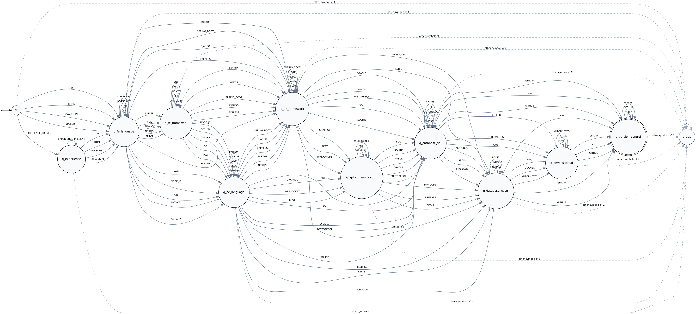
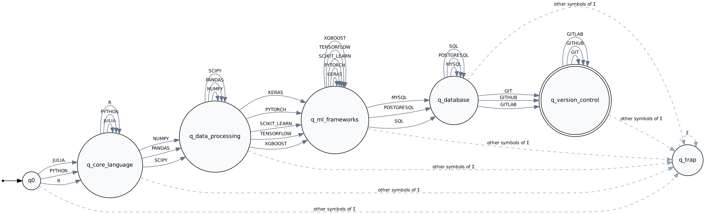
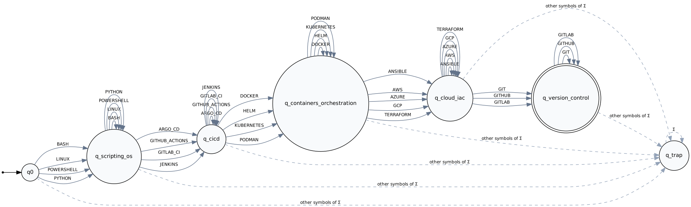
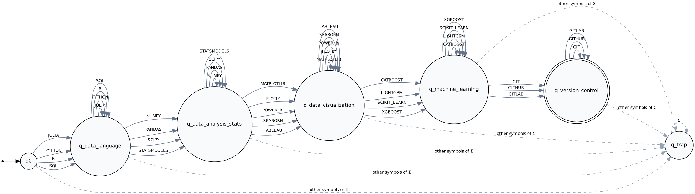

# Etapa 3 — Reconocimiento de patrones de cualificación

Documento generado con `python scripts/export_formalization.py` desde los modelos ejecutables.

## Contrato y criterios de diseño

La entrada contiene tokens canónicos de la etapa 2, no texto de una hoja de vida. Se reconocen cuatro patrones mediante una misma solución basada en `pyformlang`. Un candidato puede cumplir cero, uno o varios perfiles; no se generan rankings ni decisiones de contratación.

`classify(tokens)` prepara una secuencia por perfil: conserva los símbolos de su alfabeto y los ordena por categoría. Las habilidades ajenas se conservan en `ignored_tokens` para auditoría y no satisfacen requisitos. `evaluated_tokens` contiene la secuencia efectivamente reconocida. Esta preparación es una operación de integración, no una transición del DFA. `evaluate_profile(id, tokens)` y `classify(tokens, prepare_input=False)` reconocen la palabra estrictamente, sin filtrarla ni reordenarla. El modo directo y la demostración sin etapa 2 usan esta evaluación estricta.

Cada símbolo representa una competencia identificada explícitamente; no certifica el nivel de dominio. `EXPERIENCE_PRESENT` representa un número de años reportado, incluido cero. La experiencia es opcional y no tiene umbral mínimo en este patrón. Los años exactos permanecen como metadatos de la etapa 1. No se usa el símbolo literal `\d` ni un alfabeto infinito de números.

## Tipo de autómata y semántica formal

Para cada perfil, M = (Q, Σ, δ, q0, F). Las categorías del alfabeto son disjuntas dentro de un perfil. δ: Q × Σ → Q es total, con un único destino por par. No hay transiciones ε ni decisiones alternativas para un mismo símbolo: los cuatro modelos son DFA. `q_trap` pertenece a Q, no pertenece a F y satisface δ(q_trap, s) = q_trap para todo s ∈ Σ. Un token externo a Σ se rechaza antes de aplicar δ; su paso a trampa en la traza es una convención de diagnóstico, no una extensión del dominio de δ.

Los estados `q_<categoría>` indican el último bloque consumido. En Full Stack no implican que se hayan observado todas las categorías anteriores, porque existen saltos. `satisfied_categories` enumera categorías observadas en la entrada; `missing_categories` enumera requisitos obligatorios ausentes. Una palabra con todos los requisitos puede rechazarse por desorden en la evaluación estricta.

Reconocer una palabra cuesta O(n), dado un modelo construido. Preparar cada perfil mediante ordenamiento cuesta O(n log n). En las expresiones siguientes, C+ significa una o más habilidades de la categoría y C* permite cero o más; | representa alternativas.

## Full Stack Developer

Dominio: Software Engineering.

**Q** = {q0, q_api_communication, q_be_framework, q_be_language, q_database_nosql, q_database_sql, q_devops_cloud, q_experience, q_fe_framework, q_fe_language, q_trap, q_version_control}

**q0** = `q0`.

**F** = {q_version_control}

**Σ** es la unión de las siguientes categorías:

| Categoría | Símbolos |
|---|---|
| EXPERIENCE | EXPERIENCE_PRESENT |
| FE_LANGUAGE | CSS, HTML, JAVASCRIPT, TYPESCRIPT |
| FE_FRAMEWORK | ANGULAR, NEXTJS, REACT, SVELTE, VUE |
| BE_LANGUAGE | CSHARP, GO, JAVA, NODE_JS, PYTHON |
| BE_FRAMEWORK | DJANGO, EXPRESS, FASTAPI, NESTJS, SPRING_BOOT |
| API_COMMUNICATION | GRAPHQL, REST, WEBSOCKET |
| DATABASE_SQL | MYSQL, ORACLE, POSTGRESQL, SQL, SQLITE |
| DATABASE_NOSQL | FIREBASE, MONGODB, REDIS |
| DEVOPS_CLOUD | AWS, DOCKER, KUBERNETES |
| VERSION_CONTROL | GIT, GITHUB, GITLAB |

**Patrón reconocido:**

`EXPERIENCE* FE_LANGUAGE+ FE_FRAMEWORK* (BE_LANGUAGE+ BE_FRAMEWORK* | BE_FRAMEWORK+) API_COMMUNICATION* (DATABASE_SQL+ DATABASE_NOSQL* | DATABASE_NOSQL+) DEVOPS_CLOUD* VERSION_CONTROL+`

**Requisitos mínimos:** FE_LANGUAGE (FE_LANGUAGE); BACKEND (BE_FRAMEWORK o BE_LANGUAGE); DATABASE (DATABASE_NOSQL o DATABASE_SQL); VERSION_CONTROL (VERSION_CONTROL).

**δ completa por categorías:** cada celda se aplica a todos los símbolos de su columna.

| Estado | EXPERIENCE | FE_LANGUAGE | FE_FRAMEWORK | BE_LANGUAGE | BE_FRAMEWORK | API_COMMUNICATION | DATABASE_SQL | DATABASE_NOSQL | DEVOPS_CLOUD | VERSION_CONTROL |
|---|---|---|---|---|---|---|---|---|---|---|
| q0 | q_experience | q_fe_language | q_trap | q_trap | q_trap | q_trap | q_trap | q_trap | q_trap | q_trap |
| q_api_communication | q_trap | q_trap | q_trap | q_trap | q_trap | q_api_communication | q_database_sql | q_database_nosql | q_trap | q_trap |
| q_be_framework | q_trap | q_trap | q_trap | q_trap | q_be_framework | q_api_communication | q_database_sql | q_database_nosql | q_trap | q_trap |
| q_be_language | q_trap | q_trap | q_trap | q_be_language | q_be_framework | q_api_communication | q_database_sql | q_database_nosql | q_trap | q_trap |
| q_database_nosql | q_trap | q_trap | q_trap | q_trap | q_trap | q_trap | q_trap | q_database_nosql | q_devops_cloud | q_version_control |
| q_database_sql | q_trap | q_trap | q_trap | q_trap | q_trap | q_trap | q_database_sql | q_database_nosql | q_devops_cloud | q_version_control |
| q_devops_cloud | q_trap | q_trap | q_trap | q_trap | q_trap | q_trap | q_trap | q_trap | q_devops_cloud | q_version_control |
| q_experience | q_experience | q_fe_language | q_trap | q_trap | q_trap | q_trap | q_trap | q_trap | q_trap | q_trap |
| q_fe_framework | q_trap | q_trap | q_fe_framework | q_be_language | q_be_framework | q_trap | q_trap | q_trap | q_trap | q_trap |
| q_fe_language | q_trap | q_fe_language | q_fe_framework | q_be_language | q_be_framework | q_trap | q_trap | q_trap | q_trap | q_trap |
| q_trap | q_trap | q_trap | q_trap | q_trap | q_trap | q_trap | q_trap | q_trap | q_trap | q_trap |
| q_version_control | q_trap | q_trap | q_trap | q_trap | q_trap | q_trap | q_trap | q_trap | q_trap | q_version_control |

En Graphviz, «otros símbolos de Σ» agrupa el complemento exacto de las aristas sólidas del estado. Mermaid contiene una transición explícita por cada par de δ.

## Machine Learning Engineer

Dominio: AI / Data.

**Q** = {q0, q_core_language, q_data_processing, q_database, q_ml_frameworks, q_trap, q_version_control}

**q0** = `q0`.

**F** = {q_version_control}

**Σ** es la unión de las siguientes categorías:

| Categoría | Símbolos |
|---|---|
| CORE_LANGUAGE | JULIA, PYTHON, R |
| DATA_PROCESSING | NUMPY, PANDAS, SCIPY |
| ML_FRAMEWORKS | KERAS, PYTORCH, SCIKIT_LEARN, TENSORFLOW, XGBOOST |
| DATABASE | MYSQL, POSTGRESQL, SQL |
| VERSION_CONTROL | GIT, GITHUB, GITLAB |

**Patrón reconocido:**

`CORE_LANGUAGE+ DATA_PROCESSING+ ML_FRAMEWORKS+ DATABASE+ VERSION_CONTROL+`

**Requisitos mínimos:** CORE_LANGUAGE (CORE_LANGUAGE); DATA_PROCESSING (DATA_PROCESSING); ML_FRAMEWORKS (ML_FRAMEWORKS); DATABASE (DATABASE); VERSION_CONTROL (VERSION_CONTROL).

**δ completa por categorías:** cada celda se aplica a todos los símbolos de su columna.

| Estado | CORE_LANGUAGE | DATA_PROCESSING | ML_FRAMEWORKS | DATABASE | VERSION_CONTROL |
|---|---|---|---|---|---|
| q0 | q_core_language | q_trap | q_trap | q_trap | q_trap |
| q_core_language | q_core_language | q_data_processing | q_trap | q_trap | q_trap |
| q_data_processing | q_trap | q_data_processing | q_ml_frameworks | q_trap | q_trap |
| q_database | q_trap | q_trap | q_trap | q_database | q_version_control |
| q_ml_frameworks | q_trap | q_trap | q_ml_frameworks | q_database | q_trap |
| q_trap | q_trap | q_trap | q_trap | q_trap | q_trap |
| q_version_control | q_trap | q_trap | q_trap | q_trap | q_version_control |

En Graphviz, «otros símbolos de Σ» agrupa el complemento exacto de las aristas sólidas del estado. Mermaid contiene una transición explícita por cada par de δ.

## Cloud & DevOps Engineer

Dominio: Software Engineering.

**Q** = {q0, q_cicd, q_cloud_iac, q_containers_orchestration, q_scripting_os, q_trap, q_version_control}

**q0** = `q0`.

**F** = {q_version_control}

**Σ** es la unión de las siguientes categorías:

| Categoría | Símbolos |
|---|---|
| SCRIPTING_OS | BASH, LINUX, POWERSHELL, PYTHON |
| CICD | ARGO_CD, GITHUB_ACTIONS, GITLAB_CI, JENKINS |
| CONTAINERS_ORCHESTRATION | DOCKER, HELM, KUBERNETES, PODMAN |
| CLOUD_IAC | ANSIBLE, AWS, AZURE, GCP, TERRAFORM |
| VERSION_CONTROL | GIT, GITHUB, GITLAB |

**Patrón reconocido:**

`SCRIPTING_OS+ CICD+ CONTAINERS_ORCHESTRATION+ CLOUD_IAC+ VERSION_CONTROL+`

**Requisitos mínimos:** SCRIPTING_OS (SCRIPTING_OS); CICD (CICD); CONTAINERS_ORCHESTRATION (CONTAINERS_ORCHESTRATION); CLOUD_IAC (CLOUD_IAC); VERSION_CONTROL (VERSION_CONTROL).

**δ completa por categorías:** cada celda se aplica a todos los símbolos de su columna.

| Estado | SCRIPTING_OS | CICD | CONTAINERS_ORCHESTRATION | CLOUD_IAC | VERSION_CONTROL |
|---|---|---|---|---|---|
| q0 | q_scripting_os | q_trap | q_trap | q_trap | q_trap |
| q_cicd | q_trap | q_cicd | q_containers_orchestration | q_trap | q_trap |
| q_cloud_iac | q_trap | q_trap | q_trap | q_cloud_iac | q_version_control |
| q_containers_orchestration | q_trap | q_trap | q_containers_orchestration | q_cloud_iac | q_trap |
| q_scripting_os | q_scripting_os | q_cicd | q_trap | q_trap | q_trap |
| q_trap | q_trap | q_trap | q_trap | q_trap | q_trap |
| q_version_control | q_trap | q_trap | q_trap | q_trap | q_version_control |

En Graphviz, «otros símbolos de Σ» agrupa el complemento exacto de las aristas sólidas del estado. Mermaid contiene una transición explícita por cada par de δ.

## Data Scientist

Dominio: AI / Data.

**Q** = {q0, q_data_analysis_stats, q_data_language, q_data_visualization, q_machine_learning, q_trap, q_version_control}

**q0** = `q0`.

**F** = {q_version_control}

**Σ** es la unión de las siguientes categorías:

| Categoría | Símbolos |
|---|---|
| DATA_LANGUAGE | JULIA, PYTHON, R, SQL |
| DATA_ANALYSIS_STATS | NUMPY, PANDAS, SCIPY, STATSMODELS |
| DATA_VISUALIZATION | MATPLOTLIB, PLOTLY, POWER_BI, SEABORN, TABLEAU |
| MACHINE_LEARNING | CATBOOST, LIGHTGBM, SCIKIT_LEARN, XGBOOST |
| VERSION_CONTROL | GIT, GITHUB, GITLAB |

**Patrón reconocido:**

`DATA_LANGUAGE+ DATA_ANALYSIS_STATS+ DATA_VISUALIZATION+ MACHINE_LEARNING+ VERSION_CONTROL+`

**Requisitos mínimos:** DATA_LANGUAGE (DATA_LANGUAGE); DATA_ANALYSIS_STATS (DATA_ANALYSIS_STATS); DATA_VISUALIZATION (DATA_VISUALIZATION); MACHINE_LEARNING (MACHINE_LEARNING); VERSION_CONTROL (VERSION_CONTROL).

**δ completa por categorías:** cada celda se aplica a todos los símbolos de su columna.

| Estado | DATA_LANGUAGE | DATA_ANALYSIS_STATS | DATA_VISUALIZATION | MACHINE_LEARNING | VERSION_CONTROL |
|---|---|---|---|---|---|
| q0 | q_data_language | q_trap | q_trap | q_trap | q_trap |
| q_data_analysis_stats | q_trap | q_data_analysis_stats | q_data_visualization | q_trap | q_trap |
| q_data_language | q_data_language | q_data_analysis_stats | q_trap | q_trap | q_trap |
| q_data_visualization | q_trap | q_trap | q_data_visualization | q_machine_learning | q_trap |
| q_machine_learning | q_trap | q_trap | q_trap | q_machine_learning | q_version_control |
| q_trap | q_trap | q_trap | q_trap | q_trap | q_trap |
| q_version_control | q_trap | q_trap | q_trap | q_trap | q_version_control |

En Graphviz, «otros símbolos de Σ» agrupa el complemento exacto de las aristas sólidas del estado. Mermaid contiene una transición explícita por cada par de δ.

## Verificación contra el enunciado del punto 3

| Requisito | Evidencia |
|---|---|
| Cuatro perfiles con una solución general | Registro común y construcción/evaluación compartidas; Full Stack, ML, DevOps y Data Scientist |
| Definición completa de Q, Σ, δ, q0 y F por autómata | Secciones anteriores y `get_formal_tuple()`; tabla total generada del DFA |
| Explicar y justificar DFA/NFA/ε-NFA | Determinismo, totalidad y ausencia de ε explicados arriba |
| Diagrama de transición | DOT/SVG/PNG y Mermaid derivados del modelo |
| Explicar el patrón profesional | Expresión regular y requisitos mínimos de cada sección |
| Implementar usando pyformlang | `ProfileAutomaton.dfa` es un `DeterministicFiniteAutomaton` |
| Casos de prueba y escenarios | `tests/test_stage3.py`, `test_stage3_regressions.py` y `test_pipeline_contract.py` |

El enunciado presenta tecnologías como ejemplos y solicita que el equipo defina los patrones. Por eso Full Stack admite backend por lenguaje/entorno o framework, SQL o NoSQL, y hace opcionales framework frontend, APIs y despliegue. ML exige una habilidad del grupo ML_FRAMEWORKS, sin exigir simultáneamente Scikit-learn y un framework de deep learning. Estas son decisiones explícitas del equipo, no requisitos textuales adicionales del docente.

El enunciado menciona requisitos detallados que se proporcionarían por separado. Esta verificación se basa en `docs/Initial Doc.md`; debe contrastarse también con cualquier anexo del docente que no esté en el repositorio.

La conformidad del punto 3 no implica que el proyecto completo esté terminado: la etapa 2 actual utiliza un diccionario de referencia (no un FST implementado), la etapa 1 es una extracción de referencia y la etapa 4 no contiene aún la DSL textX. Poster, revisión de literatura, registro de uso de IAG y presentación son entregables independientes.

Ejecutar `python -m pytest -q` para verificar los escenarios. Las regresiones cubren clasificación simultánea, evaluación estricta, categorías opcionales, años 0/3/10/25, totalidad de δ, diagramas, omisión de cada requisito y las 1024 combinaciones de presencia de las diez categorías de Full Stack.
