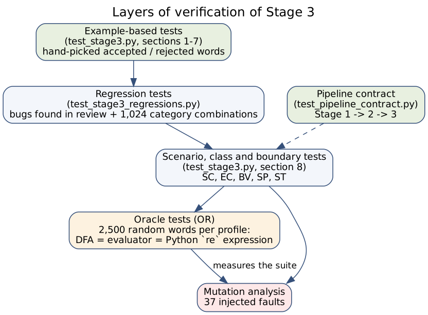

# Stage 3 — Test-Case and Scenario Design

*The catalog and the mutation table below are generated from the real test files and from an executed mutation run.*

Companion of [`stage3_formalization.md`](stage3_formalization.md): Part I (modules, patterns, worked examples) and Part II (formal tuples and δ tables). This document explains **what is tested, why those cases were chosen, and how we know the tests are good**.

## 1. Objectives and what is under test

Stage 3 is a set of four DFAs plus an evaluator that produces a verdict and a trace. A faulty implementation can fail in five ways, and each one drives a family of tests:

| Risk | Example | Family |
|---|---|---|
| Wrong language (the DFA accepts/rejects the wrong words) | a bypass edge lets the backend be skipped | EC, OR |
| Wrong vocabulary (a token in the wrong category or missing) | `PODMAN` dropped from containers | SP |
| Wrong diagnosis (verdict is right but trace or reasons are wrong) | step numbers off by one, inverted `missing_categories` | BV, ST |
| Wrong integration (preparation, strict mode, report) | strict mode silently sorts the word | SC, BV |
| Wrong visualisation | the trap state painted as visited | ST |

The suite for this stage contains **121 test cases** (functions expanded by `parametrize`) in three files. Run them with `python -m pytest -q tests/test_stage3.py tests/test_stage3_regressions.py tests/test_pipeline_contract.py`; the whole repository suite is run with `python -m pytest -q`.

## 2. Test techniques

| Technique | Where it is used | Why |
|---|---|---|
| **Equivalence-class partitioning** | EC tests: one representative per class of input (valid word, one mandatory block missing, foreign token, repetitions, alternatives inside a block) | The input space is huge; words of the same class must behave identically |
| **Boundary-value analysis** | BV tests: empty word, one-token words, every proper prefix of a valid word, 8,000–10,000-token words, the first/last position for a foreign token | Errors concentrate at the edges of the accepted language |
| **Decision table** | §4: combinations of *(all mandatory blocks present?, order canonical?, all tokens in Σ?, mode)* → verdict | Makes the rules of the evaluator explicit and testable |
| **Exhaustive testing** | all 1,024 presence combinations of the ten Full Stack categories; all permutations of each minimal word (24 to 120 each) | The space is small enough to enumerate |
| **Property-based / oracle testing** | OR tests: random words, three independent implementations must agree | Detects faults that nobody thought to write an example for |
| **Differential testing** | pyformlang `accepts` vs the step-by-step evaluator vs a Python regular expression over category letters | The oracle is independent of the code under test |
| **Specification table** | SP tests pin the exact vocabulary of every profile | The professional patterns are a *specification*, not a derived value |
| **Scenario / end-to-end testing** | SC tests: real résumé fixtures through Stages 1 → 2 → 3 | Validates the contract between stages |
| **Mutation analysis** | §7 | Measures whether the tests would notice a fault |

## 3. Test data

| Data | Source | Used by |
|---|---|---|
| Minimal accepted word per profile | `FULL` in `tests/test_stage3.py` (section 8) (4–5 tokens) | EC, BV, OR |
| Four résumé fixtures | `tests/data/resumes/{wednesday_addams, mary_jane_watson, rich_resume, spanish_resume}.txt` | SC |
| Specification table | `SPEC` in `tests/test_stage3.py` (section 8): category → tokens for the 4 profiles (37 + 17 + 20 + 20 symbols) | SP |
| Random words | `random.Random(seed)` with fixed seeds (20261011, 7, 3, 11): reproducible | OR, ST |
| Foreign token | `COBOL` (not in any alphabet) | EC, BV |

## 4. Decision table of the evaluator

`evaluate_profile` is **strict**; `classify` prepares the word first. Conditions are evaluated on the word read by the DFA.

| # | Word non-empty | All tokens ∈ Σ | Blocks in canonical order | Every mandatory block present | Result | Covered by |
|---|---|---|---|---|---|---|
| R1 | no | — | — | — | REJECTED, final `q0`, reason *empty sequence* | BV01 |
| R2 | yes | no | — | — | REJECTED, `q_trap`, reason *not in alphabet* | EC06, SC08 |
| R3 | yes | yes | no | — | REJECTED, `q_trap`, reason *order violation* | EC04, BV04 |
| R4 | yes | yes | yes | no | REJECTED, ends in a non-accepting state, `missing_categories` ≠ ∅ | EC01, BV02 |
| R5 | yes | yes | yes | yes | ACCEPTED, final = F | EC02, EC03, EC08, SC07 |
| P1 | prepared mode: foreign tokens | | | | moved to `ignored_tokens`, never satisfy a requirement | EC06, EC07 |
| P2 | prepared mode: any order | | | | the word is sorted per profile, then R4/R5 apply | EC05, OR03 |

## 5. Catalog of tests

Identifiers: **SC** scenario · **EC** equivalence class · **BV** boundary value · **SP** specification table · **OR** oracle · **ST** structural (formal model, theorems and diagrams). Tests without an identifier are the original ones of the stage. The identified tests are in section 8 of `test_stage3.py`.

### `tests/test_stage3.py`

| Test | Cases | What it checks |
|---|---|---|
| `test_full_stack_minimal_accepted` | 1 | Minimal sequence fulfilling each category exactly once in canonical order. |
| `test_full_stack_multiple_skills_accepted` | 1 | Multiple skills per category exercising self-loops. |
| `test_full_stack_with_numeric_experience_accepted` | 1 | Candidate starts with the canonical optional experience symbol. |
| `test_full_stack_missing_vcs_rejected` | 1 | Candidate has Frontend, Backend, DB, but lacks Version Control. |
| `test_full_stack_out_of_order_rejected` | 1 | Candidate listed Git before Backend (violates canonical order). |
| `test_full_stack_foreign_token_rejected` | 1 | Candidate has skills from another domain not in Full Stack alphabet. |
| `test_machine_learning_minimal_accepted` | 1 | machine learning minimal accepted |
| `test_machine_learning_extended_accepted` | 1 | machine learning extended accepted |
| `test_machine_learning_missing_ml_framework_rejected` | 1 | Knows Python, Pandas, SQL, Git, but no ML/DL framework. |
| `test_devops_minimal_accepted` | 1 | devops minimal accepted |
| `test_devops_extended_accepted` | 1 | devops extended accepted |
| `test_devops_missing_containers_rejected` | 1 | devops missing containers rejected |
| `test_data_scientist_minimal_accepted` | 1 | data scientist minimal accepted |
| `test_data_scientist_extended_accepted` | 1 | data scientist extended accepted |
| `test_data_scientist_missing_visualization_rejected` | 1 | Candidate lacks Data Visualization skills. |
| `test_data_scientist_out_of_order_rejected` | 1 | Candidate listed ML before Visualization. |
| `test_empty_tokens_rejected` | 1 | Empty token list should be rejected by all profiles. |
| `test_formal_tuples_structure` | 1 | Verifies that all 4 automata produce valid 5-tuples. |
| `test_visualization_generators` | 1 | Verifies that Mermaid and Graphviz strings are generated correctly. |
| **SC-01** `test_sc01_wednesday_addams_is_only_full_stack` | 1 | Résumé → Stage 1 → 2 → 3: accepted only as Full Stack |
| **SC-02** `test_sc02_mary_jane_is_only_machine_learning` | 1 | Accepted only as ML; Data Scientist rejected because visualisation is missing and TENSORFLOW is ignored |
| **SC-03** `test_sc03_rich_resume_matches_two_profiles` | 1 | A rich résumé matches Full Stack and Cloud & DevOps; out-of-vocabulary skills are reported, not used |
| **SC-04** `test_sc04_spanish_resume_is_machine_learning` | 1 | Spanish résumé is classified as ML |
| **SC-05** `test_sc05_candidate_with_no_matching_profile` | 1 | No profile accepted → all four rejected |
| **SC-06** `test_sc06_one_candidate_can_satisfy_all_four_profiles` | 1 | The union of the four minimal words satisfies every profile |
| **SC-07** `test_sc07_statement_example_trace` | 1 | PYTHON, PANDAS, TENSORFLOW, POSTGRESQL, GIT: exact sequence of states |
| **SC-08** `test_sc08_raw_tokens_without_stage2_are_rejected_by_every_profile` | 1 | Raw tokens (JS, React.js…) bypassing Stage 2 are trapped immediately |
| **EC-01** `test_ec01_every_mandatory_group_is_necessary` | 4 | Removing any one mandatory group is rejected and reported in `missing_categories` |
| **EC-02** `test_ec02_repetition_inside_a_block_is_accepted` | 4 | Each token repeated three times stays accepted (self-loops) |
| **EC-03** `test_ec03_every_category_alternative_is_accepted` | 4 | Replacing a token by ANY other token of its category stays accepted |
| **EC-04** `test_ec04_adjacent_swap_of_different_blocks_is_rejected_in_strict_mode` | 4 | Every adjacent swap across blocks is rejected strictly |
| **EC-05** `test_ec05_prepared_mode_accepts_every_permutation` | 4 | All permutations of the minimal word are accepted after preparation |
| **EC-06** `test_ec06_foreign_token_anywhere_is_rejected_strictly_and_ignored_when_prepared` | 4 | A foreign token at every position: rejected strictly, ignored when prepared |
| **EC-07** `test_ec07_tokens_of_other_profiles_do_not_satisfy_requirements` | 1 | DOCKER/AWS cannot replace the missing database |
| **EC-08** `test_ec08_full_stack_alternatives` | 1 | Backend by framework only, NoSQL only, API and DevOps present, experience present |
| **BV-01** `test_bv01_empty_and_single_token_words` | 4 | Empty word and every one-token word are rejected |
| **BV-02** `test_bv02_prefixes_of_a_valid_word_are_rejected_and_the_full_word_accepted` | 4 | Every proper prefix rejected, the full word accepted |
| **BV-03** `test_bv03_very_long_word_is_linear_and_accepted` | 4 | 8,000–10,000-token word accepted, one trace step per token |
| **BV-04** `test_bv04_trap_is_absorbing_and_trace_is_consistent` | 4 | Trace numbering, continuity and absorbing trap |
| **BV-05** `test_bv05_unknown_profile_and_input_not_mutated` | 4 | Unknown profile → ValueError; inputs are never mutated |
| **BV-06** `test_bv06_experience_only_matters_in_full_stack` | 1 | EXPERIENCE_PRESENT is accepted strictly only by Full Stack; ignored by the others when prepared |
| **OR-01** `test_or01_dfa_agrees_with_independent_regular_expression` | 4 | 2,500 random words per profile: pyformlang DFA = evaluator = `re.fullmatch` over category letters |
| **OR-02** `test_or02_missing_categories_match_a_direct_computation` | 4 | `missing_categories`/`satisfied_categories` equal a direct set computation |
| **OR-03** `test_or03_prepared_and_strict_agree_on_already_prepared_words` | 1 | On already-sorted words both modes agree |
| **ST-01** `test_st01_formal_model_properties` | 4 | Single accepting state, total δ, trap absorbing, no hidden dead states, Σ partitioned by categories |
| **ST-02** `test_st02_diagrams_follow_the_model` | 4 | Mermaid has one line per δ pair; highlighting adds green/red colours only when a result is given |
| **ST-03** `test_st03_foreign_symbol_is_drawn_outside_sigma` | 1 | A foreign token is drawn as an edge labelled “fuera de Σ” |
| **ST-04** `test_st04_report_partitions_the_profiles` | 1 | Report invariants over 200 random inputs (partition of profiles, status/reason consistency) |
| **SP-01** `test_sp01_profile_definitions_match_the_specification_table` | 4 | Exact category contents and canonical order for the 4 profiles |
| **SP-02** `test_sp02_every_token_of_the_alphabet_is_accepted_in_its_block` | 4 | Every one of the 94 profile symbols can be used in its block and the word is accepted |
| **SP-03** `test_sp03_required_groups` | 1 | Mandatory requirement groups per profile |
| **ST-05** `test_st05_diagram_colours_and_edges` | 1 | Node colours, grouped trap edges and Mermaid start arrow |
| **ST-06** `test_st06_minimality_theorem` | 1 | Theorem 4: chain DFAs are minimal; Full Stack has exactly the pair q0 ≡ q_experience (Moore's algorithm) |
| **ST-07** `test_st07_every_state_is_reachable_and_only_the_trap_is_dead` | 1 | Theorem 3: witness words really lead to each state and from each state to F |
| **ST-08** `test_st08_theory_section_is_consistent_with_the_implementation` | 1 | The formal-framework section (Lemmas 1–2, Theorems 1–5) is regenerated and its mechanical checks pass |

### `tests/test_stage3_regressions.py`

| Test | Cases | What it checks |
|---|---|---|
| `test_classification_prepares_each_profile_and_preserves_input` | 1 | classification prepares each profile and preserves input |
| `test_optional_categories_are_not_invented_or_required` | 1 | optional categories are not invented or required |
| `test_missing_means_absent_not_unreachable_after_trap` | 1 | missing means absent not unreachable after trap |
| `test_experience_is_a_finite_optional_symbol` | 4 | experience is a finite optional symbol |
| `test_formal_models_are_total_and_match_evaluator_and_diagrams` | 1 | formal models are total and match evaluator and diagrams |
| `test_mermaid_fullstack_contains_direct_entry_and_bypass` | 1 | mermaid fullstack contains direct entry and bypass |
| `test_strict_classification_does_not_repair_invalid_words` | 1 | strict classification does not repair invalid words |
| `test_fullstack_all_category_combinations_match_defined_requirements` | 1 | fullstack all category combinations match defined requirements |
| `test_all_profiles_require_each_mandatory_group` | 1 | all profiles require each mandatory group |

### `tests/test_pipeline_contract.py`

| Test | Cases | What it checks |
|---|---|---|
| `test_wednesday_addams_end_to_end_pipeline` | 1 | Verifies that Wednesday Addams' CV text traverses Stages 1, 2, and 3 successfully. |
| `test_stage3_rejects_raw_tokens_without_stage2` | 1 | Proves that Stage 3 strictly REQUIRES Stage 2. |
| `test_mary_jane_watson_ml_engineer_pipeline` | 1 | Verifies that Mary Jane Watson's ML Engineer CV traverses Stages 1, 2, and 3. |

## 6. Coverage

Measured with `coverage run --branch --source=src/stage3_classifier -m pytest …` over the three test files:

| Module | Statements | Branches | Coverage (before this review) | Coverage (now) |
|---|---|---|---|---|
| `automata_models.py` | 144 | 88 | 100 % | 100 % |
| `classifier.py` | 95 | 18 | 98 % (line 71: unknown profile) | 100 % |
| `profiles.py` | 34 | 8 | 100 % | 100 % |
| `visualizer.py` | 45 | 20 | 83 % (trace highlighting, foreign symbol) | 100 % |
| **Total** | **322** | **134** | **97 %** | **100 %** |

Coverage says the code was *executed*, not that the results were *checked*; that is what the next section measures.

## 7. Mutation analysis

We injected **37 faults** (one at a time) into the four modules of the stage and ran the suites. A mutant is *killed* when at least one test fails. The first column is the original suite of the stage (sections 1–7 of `test_stage3.py`, `test_stage3_regressions.py`, `test_pipeline_contract.py`); the second adds the tests of section 8 of `test_stage3.py`.

| Suite | Mutants killed | Score |
|---|---|---|
| Original (34 tests) | 23 / 37 | 62 % |
| With scenarios (121 tests) | 35 / 37 | 95 % |

| ID | Module | Injected fault | Original | Final | First failing test |
|---|---|---|---|---|---|
| M01 | `automata_models.py` | δ is not completed with the trap state | killed | killed | `test_formal_models_are_total_and_match_evaluator_and_diagrams` |
| M02 | `automata_models.py` | the trap state has no self-loops | killed | killed | `test_formal_models_are_total_and_match_evaluator_and_diagrams` |
| M03 | `automata_models.py` | chain profiles lose the self-loop of each category | killed | killed | `test_machine_learning_extended_accepted` |
| M04 | `automata_models.py` | chain profiles cannot advance into the last category | killed | killed | `test_machine_learning_minimal_accepted` |
| M05 | `automata_models.py` | chain profiles accept in the penultimate state | killed | killed | `test_all_profiles_require_each_mandatory_group` |
| M06 | `automata_models.py` | chain profiles start with the second category | killed | killed | `test_machine_learning_minimal_accepted` |
| M07 | `automata_models.py` | Full Stack: no edge from frontend language to backend language | killed | killed | `test_full_stack_minimal_accepted` |
| M08 | `automata_models.py` | Full Stack: EXPERIENCE_PRESENT not accepted from q0 | killed | killed | `test_full_stack_with_numeric_experience_accepted` |
| M09 | `automata_models.py` | Full Stack: extra edge that lets the backend be skipped | killed | killed | `test_fullstack_all_category_combinations_match_defined_requirements` |
| M10 | `automata_models.py` | Full Stack: NoSQL cannot go directly to version control | killed | killed | `test_full_stack_multiple_skills_accepted` |
| M11 | `automata_models.py` | Full Stack: no edge from API to NoSQL | killed | killed | `test_fullstack_all_category_combinations_match_defined_requirements` |
| M12 | `automata_models.py` | formal tuple reports q0 as accepting state | survived | killed | `test_st01_formal_model_properties[full_stack]` |
| M13 | `automata_models.py` | accepts() sorts the word before running | killed | killed | `test_all_profiles_require_each_mandatory_group` |
| M14 | `classifier.py` | any untrapped run is accepted | killed | killed | `test_full_stack_missing_vcs_rejected` |
| M15 | `classifier.py` | acceptance does not check the trap flag (equivalent mutant) | survived | SURVIVED |  |
| M16 | `classifier.py` | foreign tokens get the order-violation message | killed | killed | `test_stage3_rejects_raw_tokens_without_stage2` |
| M17 | `classifier.py` | missing categories are inverted | killed | killed | `test_full_stack_missing_vcs_rejected` |
| M18 | `classifier.py` | satisfied categories are inverted | killed | killed | `test_optional_categories_are_not_invented_or_required` |
| M19 | `classifier.py` | empty-input message swapped | survived | killed | `test_bv01_empty_and_single_token_words[full_stack]` |
| M20 | `classifier.py` | step numbers start at 0 | survived | killed | `test_bv04_trap_is_absorbing_and_trace_is_consistent[full_stack]` |
| M21 | `classifier.py` | preparation sorts in reverse canonical order | killed | killed | `test_classification_prepares_each_profile_and_preserves_input` |
| M22 | `classifier.py` | ignored tokens are not reported | killed | killed | `test_classification_prepares_each_profile_and_preserves_input` |
| M23 | `classifier.py` | strict mode also prepares the input | killed | killed | `test_strict_classification_does_not_repair_invalid_words` |
| M24 | `classifier.py` | report lists ids instead of titles | killed | killed | `test_classification_prepares_each_profile_and_preserves_input` |
| M25 | `classifier.py` | unknown profile raises KeyError instead of ValueError | survived | killed | `test_bv05_unknown_profile_and_input_not_mutated[full_stack]` |
| M26 | `classifier.py` | trace after the trap keeps the old source state | survived | SURVIVED |  |
| M27 | `classifier.py` | moves into the trap are recorded as valid | killed | killed | `test_stage3_rejects_raw_tokens_without_stage2` |
| M28 | `classifier.py` | expected final state is wrong | survived | killed | `test_st04_report_partitions_the_profiles` |
| M29 | `profiles.py` | backend requirement only by language | killed | killed | `test_all_profiles_require_each_mandatory_group` |
| M30 | `profiles.py` | database requirement only SQL | killed | killed | `test_all_profiles_require_each_mandatory_group` |
| M31 | `profiles.py` | version control not reported as required in chain profiles | survived | killed | `test_sp03_required_groups` |
| M32 | `profiles.py` | GITLAB removed from Full Stack version control | survived | killed | `test_ec08_full_stack_alternatives` |
| M33 | `profiles.py` | PODMAN removed from DevOps containers | survived | killed | `test_sp01_profile_definitions_match_the_specification_table[cloud_devops]` |
| M34 | `profiles.py` | STATSMODELS removed from Data Scientist | survived | killed | `test_sp01_profile_definitions_match_the_specification_table[data_scientist]` |
| M35 | `visualizer.py` | trap state painted as a visited state | survived | killed | `test_st05_diagram_colours_and_edges` |
| M36 | `visualizer.py` | Mermaid start arrow points to the accepting state | survived | killed | `test_st05_diagram_colours_and_edges` |
| M37 | `visualizer.py` | Graphviz draws every edge to the trap | survived | killed | `test_st05_diagram_colours_and_edges` |

**Surviving mutants.** M15 (acceptance does not check the trap flag (equivalent mutant)); M26 (trace after the trap keeps the old source state).

Both are *equivalent mutants*: after a move to the trap the evaluator sets `current_state_name = "q_trap"`, so the extra `not is_trapped` guard in M15 and the use of `current_state_name` instead of the literal `"q_trap"` as the source state in M26 never change any observable value. They do not indicate a gap in the tests.

The 12 mutants that the original suite missed (M12, M19, M20, M25, M28, M31–M37) concerned: the accepting state in the formal tuple, the message for empty input, step numbering, the exception type, `expected_final_state`, the list of required groups, the vocabulary of three categories and three visualiser details. They motivated the SP, BV and ST tests.

## 8. Limitations

- The oracle of OR-01 encodes the same patterns that the team defined; it proves the DFA implements the pattern, not that the pattern is the one the instructor has in mind.
- The streamlit app and the React front end still contain Spanish interface text; they only display the English messages produced by Stage 3.
- The Streamlit app and the web API are not covered by automated tests of Stage 3 (the API has its own `tests/test_web_api.py`).
- Mutation analysis uses 37 hand-written mutants, not an exhaustive tool.

## 9. References

- Myers, G. J., Sandler, C., & Badgett, T. (2011). *The Art of Software Testing* (3rd ed.). Wiley. (Equivalence classes, boundary values, decision tables.)
- Jia, Y., & Harman, M. (2011). An analysis and survey of the development of mutation testing. *IEEE Transactions on Software Engineering, 37*(5), 649–678.
- McKeeman, W. M. (1998). Differential testing for software. *Digital Technical Journal, 10*(1), 100–107.
- Hopcroft, J. E., Motwani, R., & Ullman, J. D. (2006). *Introduction to Automata Theory, Languages, and Computation* (3rd ed.). Pearson.
