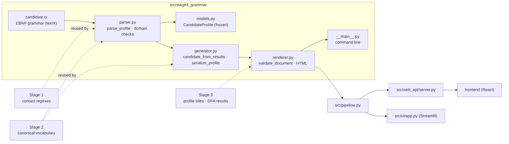
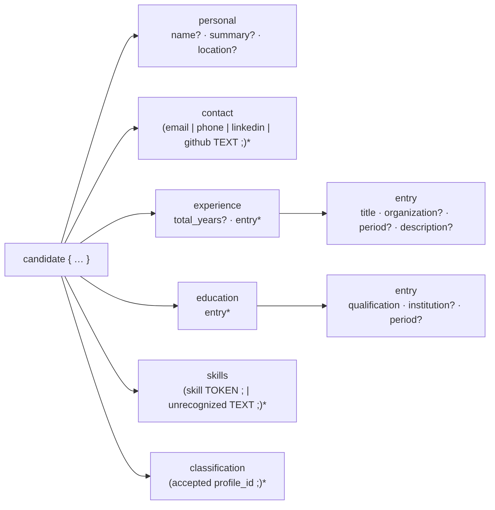
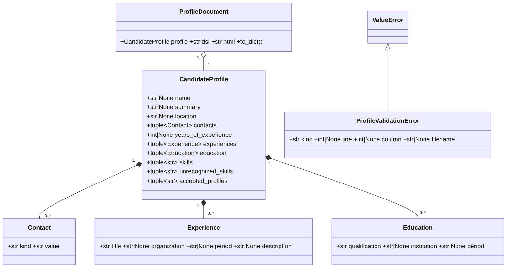
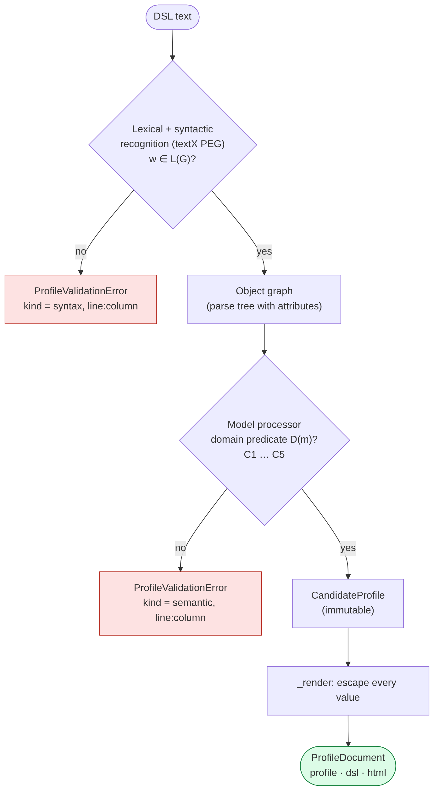
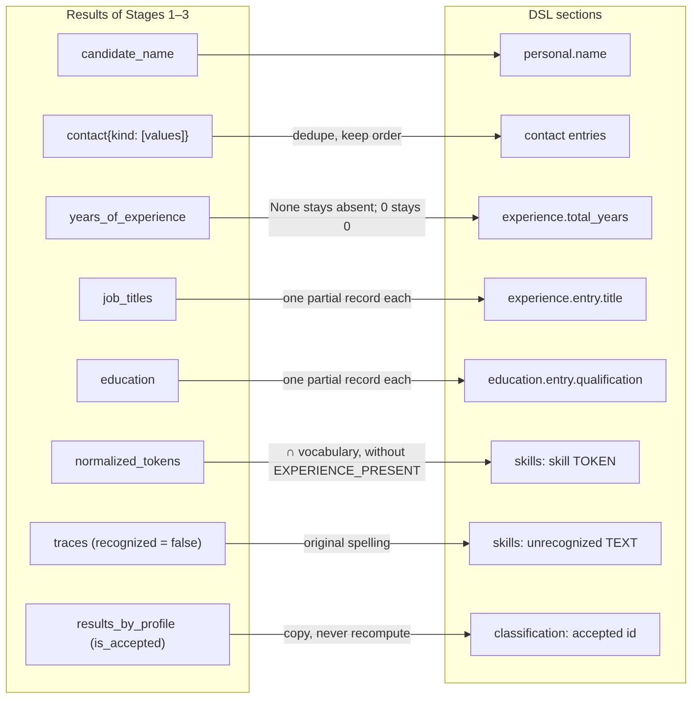
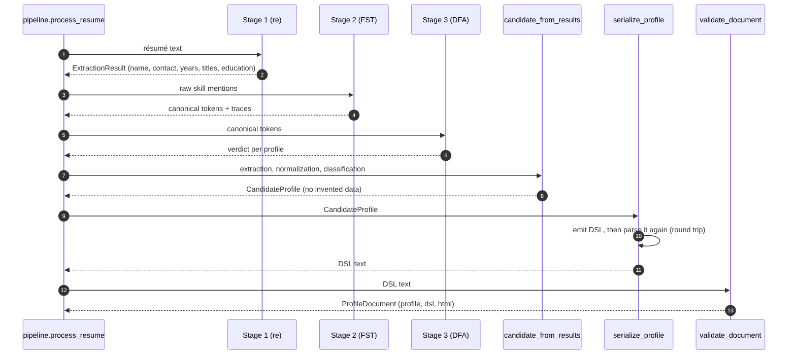
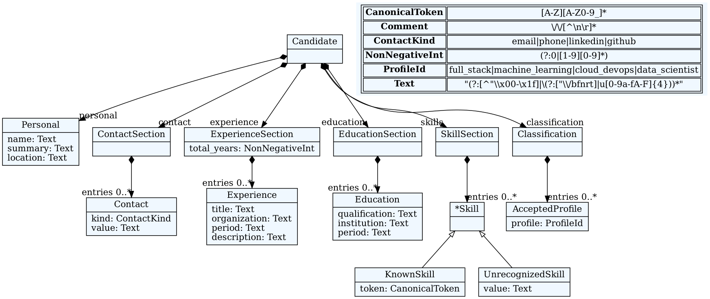
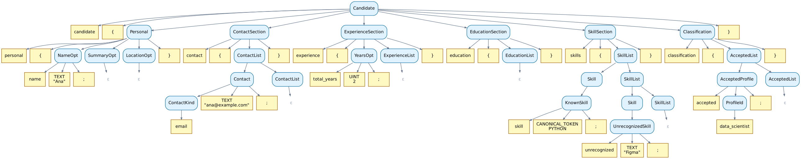
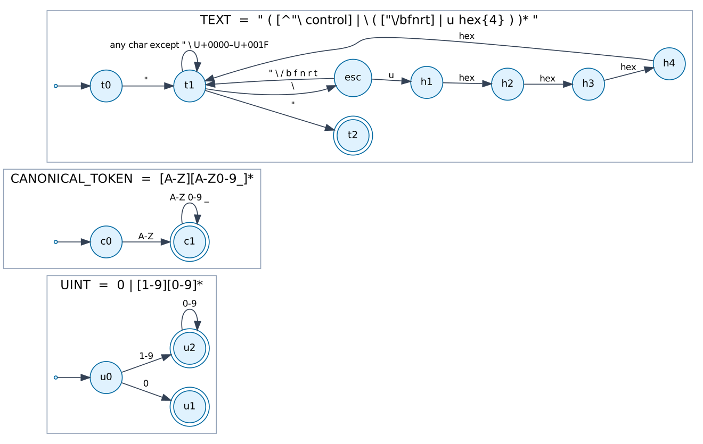
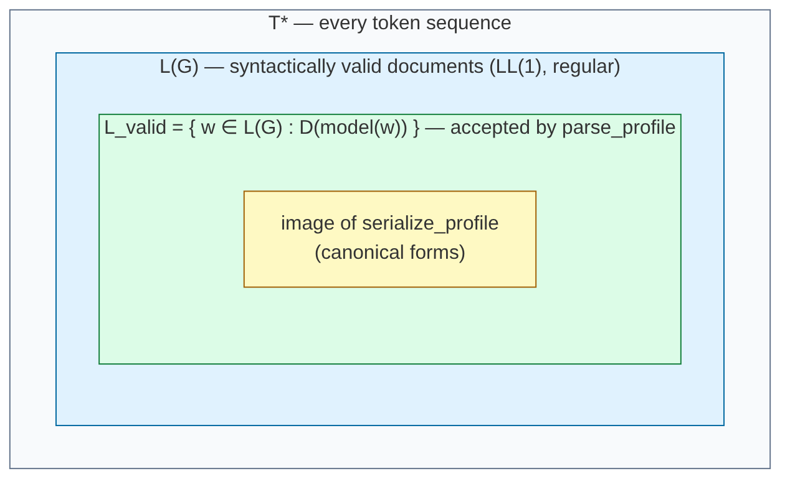

# Stage 4 — Candidate Profile Language: Design and Formalization

Stage 4 defines **ResumeLens-DSL**, a small domain-specific language that represents, in a fixed structure, everything the first three stages know about a candidate. The language is specified with a context-free grammar in EBNF, implemented with **textX**, validated in two layers (syntax, then domain rules) and, only when valid, turned into a short self-contained **HTML** page.

The facts and tables in Part II are mechanically checked: the FIRST/FOLLOW/PREDICT tables are printed by `python scripts/export_stage4_artifacts.py --tables`, and the BNF, the sets and the parse tree are computed from the grammar by that script, so they can be regenerated if `candidate.tx` changes. The theorems are proved by hand in the text; the behaviour of the implementation is covered by the Stage 4 tests described in [`stage4_tests.md`](stage4_tests.md).

**Contents**

- **Part I — Design:** purpose and scope · architecture · the language by example · module reference (functions, inputs, outputs, errors) · how a document is processed · generation from Stages 1–3 · validated HTML visualization · integration · design decisions · limitations · how to run and regenerate.
- **Part II — Formalization:** notation · the grammar G in EBNF, in the notation used in class and in pure BNF (`A → α | β`) · terminals and nonterminals · lexical level (regular definitions and automata) · tabular proof, derivations and parse trees · Theorem 1 (G is LL(1), hence unambiguous) · Theorem 2 (G is not self-embedding, hence L(G) is regular) · static semantics (domain predicate) · semantic rules (attribute grammar) · Theorem 3 (round trip) · Theorem 4 (validation before rendering, escaping) · complexity · correspondence between mathematics and code.
- **Verification against assignment item 4.**
- Test-case and scenario design: [`stage4_tests.md`](stage4_tests.md).

---

## Part I — Design

### 1. Purpose and scope

Stages 1–3 *find*, *normalize* and *classify* qualifications. Stage 4 answers a different question: **how must the resulting information be written down so that any program (or person) can read it back without ambiguity?** The grammar fixes the structure of a candidate profile; it does not discover information and does not decide whether a candidate qualifies.

| | |
|---|---|
| Input | Results of Stages 1–3 (`ExtractionResult`, `NormalizationResult`, `ResumeClassificationReport`), or a DSL text written/edited by a person |
| Output | `ProfileDocument` = validated DSL text + immutable `CandidateProfile` + HTML page; or a `ProfileValidationError` with kind (`syntax`/`semantic`), line and column |
| Formal model | context-free grammar G (EBNF) implemented with textX; regular lexical classes; a domain predicate D checked by textX model processors |
| File extension | `.resume` (UTF-8) |
| Not in scope | inferring missing data, scoring or ranking, recomputing Stage 3 from an edited document, verifying that personal facts are true |

### 2. Architecture



Dependencies are one-directional: `candidate.tx` → `parser` → `models`, `parser` → `generator` → `renderer` → `__main__`. Stage 4 reuses two *single sources of truth* from earlier stages instead of copying them: the contact regular expressions of Stage 1 (`SPECS_BY_NAME`) and the canonical vocabulary of Stage 2 (`all_canonical_tokens()`). Stage 3 contributes the profile identifiers and their display titles.

| File | Responsibility |
|---|---|
| `src/stage4_grammar/candidate.tx` | The grammar, written in textX's EBNF-like notation: 16 syntactic rules + 4 lexical (match) rules |
| `src/stage4_grammar/parser.py` | Builds the textX metamodel once, parses a complete source, applies the domain checks, converts the object graph into a `CandidateProfile`, normalizes errors into `ProfileValidationError` |
| `src/stage4_grammar/models.py` | Immutable records: `CandidateProfile`, `Contact`, `Experience`, `Education` |
| `src/stage4_grammar/generator.py` | `candidate_from_results` (Stages 1–3 → model) and `serialize_profile` (model → canonical DSL, verified by re-parsing) |
| `src/stage4_grammar/renderer.py` | `validate_document`, `generate_document`, `render_profile_html`; the private `_render` builds the HTML |
| `src/stage4_grammar/__main__.py` | Command line: `python -m src.stage4_grammar FILE [--html OUT]` |
| `src/stage4_grammar/__init__.py` | Public API of the package |
| `docs/examples/*.resume`, `docs/examples/wednesday.html` | A valid example, an invalid example and the HTML generated from the valid one |
| `scripts/export_stage4_artifacts.py` | Regenerates the diagrams of `docs/diagrams/stage4*/` and prints the formal tables of Part II |
| `scripts/stage4_bnf.py` | A pure-BNF model of the grammar (FIRST/FOLLOW, LL(1) table, derivations) used only to generate the tables and the parse tree of this document |

### 3. The language by example

A document has **six sections in a fixed order**, each delimited by braces; scalar fields and list entries end with `;`; free text is a double-quoted JSON-style string; normalized skills are bare upper-case symbols; `//` starts a comment.

```text
// Valid structured candidate. No skills are inferred from the candidate's name.
candidate {
  personal {
    name "Wednesday Addams";
    summary "Developer with experience building web applications.";
    location "Jericho";
  }
  contact {
    email "wednesday.addams@example.com";
    phone "+57 300 123 4567";
    github "github.com/wadd";
  }
  experience {
    total_years 3;
    entry {
      title "Web Application Developer";
      organization "Nevermore Academy";
      period "2023-2026";
      description "Built interfaces and services using JavaScript and Node.js.";
    }
    entry { title "Software Developer"; organization "Independent projects"; }
  }
  education {
    entry { qualification "Bachelor of Science in Computer Science"; institution "Example University"; }
    entry { qualification "AWS Certified Solutions Architect"; }
  }
  skills {
    skill JAVASCRIPT; skill REACT; skill NODE_JS; skill POSTGRESQL; skill GIT;
    unrecognized "Figma";
  }
  classification { accepted full_stack; }
}
```



| Section | Field | Multiplicity | Value | Meaning |
|---|---|---|---|---|
| `personal` | `name`, `summary`, `location` | each 0..1, in this order | TEXT | identity and short description |
| `contact` | `email` / `phone` / `linkedin` / `github` | 0..n, any order | TEXT matching the Stage 1 expression of that kind | how to reach the candidate |
| `experience` | `total_years` | 0..1, first | UINT | total years reported in the résumé (absent ≠ 0) |
| `experience` | `entry { … }` | 0..n | `title` (1) · `organization`, `period`, `description` (0..1 each, in order) | one job |
| `education` | `entry { … }` | 0..n | `qualification` (1) · `institution`, `period` (0..1 each) | a degree or certification |
| `skills` | `skill` | 0..n, mixed with `unrecognized` | CANONICAL_TOKEN of the Stage 2 vocabulary | normalized qualification |
| `skills` | `unrecognized` | 0..n | TEXT | a reported skill outside the vocabulary (kept as evidence, never used by the DFAs) |
| `classification` | `accepted` | 0..n | `full_stack` · `machine_learning` · `cloud_devops` · `data_scientist` | one per profile whose DFA accepted |

**Structural characteristics** (asked by the assignment):

1. *Fixed, explicit structure.* The six sections always appear, in the same order, even when empty. A reader never has to guess whether a section was forgotten or is empty.
2. *Nesting of bounded depth.* Document → section → record → field: at most four levels. Repetition happens only **inside** a section (lists of contacts, jobs, studies, skills and accepted profiles).
3. *Optional versus repeated.* Optional elements use `[ … ]` (0 or 1 occurrence); repeated elements use `{ … }` (0 or more). Each record has exactly one mandatory field (`title`, `qualification`), so a record can never be empty.
4. *Keyword-led statements.* Every statement starts with a distinct keyword. This is what makes the grammar LL(1): the next keyword always decides which rule applies (Theorem 1).
5. *Typed lexemes.* Three regular token classes (TEXT, CANONICAL_TOKEN, UINT) separate free text from controlled vocabulary and from numbers; a skill cannot be written as free text by mistake, and free text cannot inject structure.
6. *Comments and layout are insignificant.* Whitespace and `//` comments may appear between any two tokens without changing the meaning (`test_line_comments_do_not_consume_urls_or_strings`).

### 4. Module reference (functions, inputs and outputs)



#### 4.1 `parser.py`

| Function / class | Input | Output | Errors |
|---|---|---|---|
| `parse_profile(source, *, filename=None)` | the complete DSL text (`str`) | `CandidateProfile` | `TypeError` if `source` is not a string; `ProfileValidationError(kind='syntax')` for lexical/syntactic errors; `ProfileValidationError(kind='semantic')` for domain errors |
| `parse_profile_file(path)` | path of a UTF-8 `.resume` file | `CandidateProfile` | as above, plus `OSError`/`UnicodeError`; the error keeps the file name |
| `ProfileValidationError` | `message`, `kind`, `line`, `column`, `filename` | `ValueError` subclass; `str(e)` = `file:line:col: kind: message` | — |
| `_metamodel()` (private, cached) | `candidate.tx` | textX metamodel with `Text → json.loads`, `NonNegativeInt → int` converters and the model processor `_validate_model` | — |
| `_validate_model(model, mm)` (private) | textX object graph | nothing; raises `TextXSemanticError` at the location of the first offending record | — |

Parsing is protected by a re-entrant lock because the web server can validate several documents concurrently with the same cached metamodel.

#### 4.2 `models.py`

`CandidateProfile(name, summary, location, contacts, years_of_experience, experiences, education, skills, unrecognized_skills, accepted_profiles)` and its parts are **frozen dataclasses**. Missing scalars are `None`, repeated elements are tuples, so two parses of the same text produce equal, hashable, independent values. The constructor does not validate: `parse_profile` is the validation boundary.

#### 4.3 `generator.py`

| Function | Input | Output | Notes |
|---|---|---|---|
| `candidate_from_results(extraction, normalization, classification, *, name=None, summary=None)` | the three stage results | `CandidateProfile` | copies facts, never infers them (§6) |
| `serialize_profile(profile)` | `CandidateProfile` | canonical DSL text (2-space indentation, fields in grammar order) | free text is JSON-escaped, symbols are checked against `[A-Za-z][A-Za-z0-9_]*` before interpolation; the result is parsed again and must give back exactly `profile`, otherwise `ValueError` |

#### 4.4 `renderer.py`

| Function | Input | Output |
|---|---|---|
| `validate_document(source, *, filename=None)` | DSL text | `ProfileDocument(profile, dsl, html)` — the HTML exists only if the whole text is valid |
| `generate_document(profile)` | `CandidateProfile` | `validate_document(serialize_profile(profile))` |
| `render_profile_html(source)` | DSL text | the HTML string only |
| `ProfileDocument.to_dict()` | — | `{'validated': True, 'dsl', 'html', 'profile'}` (JSON for the web API) |

#### 4.5 `__main__.py`

`python -m src.stage4_grammar FILE [--html OUT]` prints the parsed model as JSON (exit 0) or the located error on stderr (exit 1). `--html` is written only after complete validation and is refused if it would overwrite the input.

### 5. How a document is processed



1. **Lexical and syntactic recognition.** textX reads the whole text with the grammar `candidate.tx`. Tokens are recognized on the fly (scannerless PEG parsing): keywords must end at a word boundary (`autokwd=True`), TEXT/CANONICAL_TOKEN/UINT are regular expressions, whitespace and comments are skipped. If the text is not a sentence of L(G), or there is anything after the final `}`, parsing stops with a **syntax** error located at the first token that cannot be consumed.
2. **Object graph.** For a sentence of L(G) textX builds one object per rule application (the parse tree with its attributes). Converters turn TEXT into Python strings (`json.loads`, which decodes the escapes) and UINT into `int`. Automatic default values are disabled, so an absent `total_years` stays `None` and `total_years 0` stays `0`.
3. **Domain checks.** The model processor evaluates the domain predicate D (Part II, §17): non-blank text, contact formats, vocabulary membership, no duplicated set elements, valid Unicode. The first violation raises a **semantic** error located at the offending record.
4. **Model.** The object graph is converted into an immutable `CandidateProfile`.
5. **Visualization.** Only now `_render` is called; every value is HTML-escaped.

### 6. Generation from Stages 1–3





`candidate_from_results` follows one rule: **copy what is known, invent nothing**.

| DSL element | Source | Rule |
|---|---|---|
| `personal.name` | `extraction.candidate_name` | absent if Stage 1 found no name |
| `contact` | `extraction.contact` | all values, duplicates removed in stable order |
| `experience.total_years` | `extraction.years_of_experience` | once per candidate; `None` → field omitted; `0` → `total_years 0;` |
| `experience.entry.title` | `extraction.job_titles` | one partial record per title; organization/period are **not** guessed |
| `education.entry.qualification` | `extraction.education` | one partial record per mention; institution/period are not guessed |
| `skill` | `normalization.normalized_tokens` ∩ vocabulary | `EXPERIENCE_PRESENT` is a classifier symbol, not a skill, so it is not emitted |
| `unrecognized` | normalization traces with `recognized = False` | original spelling kept |
| `accepted` | `classification.results_by_profile[…].is_accepted` | copied from the four DFAs; never recomputed |

Why partial records? The extractor finds titles and degrees reliably, but associating each title with an employer and a period from free text is not reliable with regular expressions. Leaving those optional fields empty keeps the document **true**; a person can complete them by editing the DSL.

### 7. Validated HTML visualization


The page is a single file without scripts, external fonts or images; a `Content-Security-Policy` meta tag forbids loading anything. It is responsive and printable. Sections without data are omitted, except *Declared accepted profiles*, which always appears and says explicitly when there are none. Accepted profiles are shown with the Stage 3 titles (e.g. *Full Stack Developer*). The footer reminds the reader that validation checks structure and domain rules, not the truth of personal data.

### 8. Integration with the other stages and the interfaces

| Consumer | How it uses Stage 4 |
|---|---|
| `src/pipeline.py` · `process_resume(text)` | runs Stages 1–3, then `candidate_from_results` → `generate_document`; the result carries `document` |
| `src/web_api/server.py` | `POST /api/evaluate` returns the generated `document` (DSL + HTML + profile); `POST /api/validate-profile` validates an edited DSL and returns either the document or the located error (HTTP 400, no HTML) |
| `frontend/` (React) | *Profile output* panel: shows, edits, validates and downloads the DSL and the HTML; a stale preview is removed as soon as the text changes |
| `src/ui/app.py` (Streamlit) | shows the structured profile and offers the DSL and HTML for download |
| Command line | `python -m src.stage4_grammar FILE --html OUT` |

Editing the DSL changes **declarations**: `accepted cloud_devops;` added by hand is syntactically valid, but Stage 4 does not certify it; only the pipeline output comes from the automata (test `test_grammar_validation_does_not_claim_to_reclassify_the_candidate` in `tests/test_stage4_grammar.py`).

### 9. Design decisions

| Decision | Alternatives considered | Reason |
|---|---|---|
| Fixed order of sections and fields | free order (`(A|B|C)*`) | one canonical form per profile, simpler generation, LL(1) grammar, clear error messages ("expected `contact`") |
| Keyword-led statements | positional values, JSON/YAML | readable by people; makes every choice decidable with one token of look-ahead |
| JSON-style strings for TEXT | single quotes, raw text until `;` | proven escaping rules (RFC 8259); `json.dumps`/`json.loads` give an exact inverse pair for serialization |
| Skills as bare CANONICAL_TOKEN symbols | quoted strings | a skill is a symbol of the Stage 2/3 alphabet, not free text; free text goes to `unrecognized` |
| Vocabulary, contact formats and uniqueness checked after parsing (model processor) | enumerate 79 skills / encode e-mail syntax in the grammar | single source of truth (Stages 1–2); clearer semantic messages; uniqueness is a context condition, not a syntactic property (§17) |
| Absent ≠ zero | default 0 | "the résumé does not say" and "the résumé says 0 years" are different facts |
| Re-parse after serialization | trust the serializer | turns the round-trip theorem into a runtime guarantee; catches lossy models (e.g. lists instead of tuples) |
| HTML only after validation, everything escaped | template engine with auto-escape | no dependency; the property is simple enough to prove (Theorem 4) |
| Stage 4 never recomputes Stage 3 | re-run the DFAs on the declared skills | separation of concerns: the grammar describes structure; the automata decide qualification |

### 10. Limitations

- Experience and education records produced from a résumé are partial (title or qualification only).
- `period` is descriptive text; no date arithmetic is done.
- Contact validation accepts exactly the formats recognized by Stage 1, not every valid e-mail or phone number in the world.
- A manually edited `classification` section is a declaration, not a verified result.
- The language is in English; keywords are case-sensitive.

### 11. How to run and regenerate

```bash
python -m pip install -r requirements.txt
python -m src.stage4_grammar docs/examples/wednesday.resume                 # JSON, exit 0
python -m src.stage4_grammar docs/examples/invalid_candidate.resume         # located error, exit 1
python -m src.stage4_grammar docs/examples/wednesday.resume --html out.html # HTML after validation
python -m pytest -q tests/test_stage4_grammar.py tests/test_stage4_generation.py tests/test_pipeline_stage4.py tests/test_web_stage4.py
python scripts/export_stage4_artifacts.py            # diagrams (needs Graphviz; Mermaid diagrams need mmdc)
python scripts/export_stage4_artifacts.py --tables   # FIRST / FOLLOW / PREDICT tables of Part II
```

---

## Part II — Formalization

### 12. Notation

- A **grammar** is G = (N, T, P, S): nonterminals N, terminals T, productions P ⊆ N × (N ∪ T)\*, start symbol S ∈ N.
- ⇒ is one derivation step, ⇒\* its reflexive–transitive closure, ⇒⁺ its transitive closure. ⇒ₗₘ is a *leftmost* step (the leftmost nonterminal is rewritten). **L(G) = { w ∈ T\* : S ⇒\* w }**.
- ε is the empty word. For α ∈ (N ∪ T)\*: NULLABLE(α) iff α ⇒\* ε; FIRST(α) = { a ∈ T : α ⇒\* aβ }; for A ∈ N, FOLLOW(A) = { a ∈ T ∪ {$} : S$ ⇒\* βAaγ }, where `$` marks the end of the input.
- The grammar is defined over **tokens**. The text of a document is first a word over Unicode characters; the lexical level (§15) maps it to a word over T.

### 13. The grammar G

#### 13.1 EBNF (as implemented in `candidate.tx`)

Notation (ISO/IEC 14977 style): `,` concatenation, `|` alternative, `[ x ]` zero or one, `{ x }` zero or more, `"…"` a terminal keyword or symbol, upper-case names are token classes.

```ebnf
Candidate         = "candidate", "{", Personal, ContactSection, ExperienceSection,
                    EducationSection, SkillSection, Classification, "}" ;
Personal          = "personal", "{", [ "name", TEXT, ";" ], [ "summary", TEXT, ";" ],
                    [ "location", TEXT, ";" ], "}" ;
ContactSection    = "contact", "{", { Contact }, "}" ;
Contact           = ContactKind, TEXT, ";" ;
ContactKind       = "email" | "phone" | "linkedin" | "github" ;
ExperienceSection = "experience", "{", [ "total_years", UINT, ";" ], { Experience }, "}" ;
Experience        = "entry", "{", "title", TEXT, ";", [ "organization", TEXT, ";" ],
                    [ "period", TEXT, ";" ], [ "description", TEXT, ";" ], "}" ;
EducationSection  = "education", "{", { Education }, "}" ;
Education         = "entry", "{", "qualification", TEXT, ";", [ "institution", TEXT, ";" ],
                    [ "period", TEXT, ";" ], "}" ;
SkillSection      = "skills", "{", { Skill }, "}" ;
Skill             = KnownSkill | UnrecognizedSkill ;
KnownSkill        = "skill", CANONICAL_TOKEN, ";" ;
UnrecognizedSkill = "unrecognized", TEXT, ";" ;
Classification    = "classification", "{", { AcceptedProfile }, "}" ;
AcceptedProfile   = "accepted", ProfileId, ";" ;
ProfileId         = "full_stack" | "machine_learning" | "cloud_devops" | "data_scientist" ;
```

The correspondence with textX is direct: `a=B` stores the value of B in attribute `a`, `( … )?` is `[ … ]`, `entries*=B` is `{ B }` stored as a list, and `|` is ordered choice. The textX metamodel generated from the file (classes = rules, attributes = assignments) is:



#### 13.1.1 The same EBNF in the notation used in class

The course slides (*BNF and EBNF – Backus Naur Form*) write non-terminals between ⟨ ⟩, use `::=` as separator, `;` as terminator, quoted terminals, `?` for an option (zero or one), `*` for repetition (zero or more) and `|` for choice; sequence is juxtaposition. In that notation the 16 rules of `candidate.tx` are:

```text
⟨Candidate⟩         ::= 'candidate' '{' ⟨Personal⟩ ⟨ContactSection⟩ ⟨ExperienceSection⟩ ⟨EducationSection⟩
                        ⟨SkillSection⟩ ⟨Classification⟩ '}' ;
⟨Personal⟩          ::= 'personal' '{' ('name' TEXT ';')? ('summary' TEXT ';')? ('location' TEXT ';')? '}' ;
⟨ContactSection⟩    ::= 'contact' '{' ⟨Contact⟩* '}' ;
⟨Contact⟩           ::= ⟨ContactKind⟩ TEXT ';' ;
⟨ContactKind⟩       ::= 'email' | 'phone' | 'linkedin' | 'github' ;
⟨ExperienceSection⟩ ::= 'experience' '{' ('total_years' UINT ';')? ⟨Experience⟩* '}' ;
⟨Experience⟩        ::= 'entry' '{' 'title' TEXT ';' ('organization' TEXT ';')? ('period' TEXT ';')?
                        ('description' TEXT ';')? '}' ;
⟨EducationSection⟩  ::= 'education' '{' ⟨Education⟩* '}' ;
⟨Education⟩         ::= 'entry' '{' 'qualification' TEXT ';' ('institution' TEXT ';')? ('period' TEXT ';')? '}' ;
⟨SkillSection⟩      ::= 'skills' '{' ⟨Skill⟩* '}' ;
⟨Skill⟩             ::= ⟨KnownSkill⟩ | ⟨UnrecognizedSkill⟩ ;
⟨KnownSkill⟩        ::= 'skill' CANONICAL_TOKEN ';' ;
⟨UnrecognizedSkill⟩ ::= 'unrecognized' TEXT ';' ;
⟨Classification⟩    ::= 'classification' '{' ⟨AcceptedProfile⟩* '}' ;
⟨AcceptedProfile⟩   ::= 'accepted' ⟨ProfileId⟩ ';' ;
⟨ProfileId⟩         ::= 'full_stack' | 'machine_learning' | 'cloud_devops' | 'data_scientist' ;
```

`TEXT`, `UINT` and `CANONICAL_TOKEN` are token classes (§15). As the slides explain, `?` and `*` are what EBNF adds to BNF; §13.3 removes them again to obtain productions of the form `A → α | β`.

#### 13.2 Terminals and nonterminals

- **S** = `Candidate`.
- **N_EBNF** (16 rules of `candidate.tx`): `Candidate`, `Personal`, `ContactSection`, `Contact`, `ContactKind`, `ExperienceSection`, `Experience`, `EducationSection`, `Education`, `SkillSection`, `Skill`, `KnownSkill`, `UnrecognizedSkill`, `Classification`, `AcceptedProfile`, `ProfileId`.
- **T** (35 terminals):
  - 29 keywords — `candidate`, `personal`, `name`, `summary`, `location`, `contact`, `email`, `phone`, `linkedin`, `github`, `experience`, `total_years`, `entry`, `title`, `organization`, `period`, `description`, `education`, `qualification`, `institution`, `skills`, `skill`, `unrecognized`, `classification`, `accepted`, `full_stack`, `machine_learning`, `cloud_devops`, `data_scientist`;
  - 3 punctuation symbols — `{`, `}`, `;`;
  - 3 token classes — `TEXT`, `CANONICAL_TOKEN`, `UINT`. A token of a class carries its lexeme as an attribute (e.g. `TEXT("Ana")`); for the grammar all lexemes of a class are the same terminal.

The four textX match rules `Text`, `CanonicalToken`, `NonNegativeInt` and `Comment` are **lexical**, not syntactic: they define the token classes and the ignorable comments (§15).

#### 13.3 Pure BNF

The EBNF operators are removed with the standard construction: for each `[ X ]` a new nonterminal `XOpt → X | ε`, and for each `{ X }` a new nonterminal `XList → X XList | ε` (right recursion). The result is a CFG with |N| = 30 (16 + 9 `…Opt` + 5 `…List`) and **|P| = 51 productions**, listed with their PREDICT sets in §16.2.

Written as in class (`A → α | β`, one line per nonterminal, `ε` for the empty word), the grammar G = (N, T, P, S) is:

```text
Candidate → candidate { Personal ContactSection ExperienceSection EducationSection SkillSection Classification }
Personal → personal { NameOpt SummaryOpt LocationOpt }
NameOpt → name TEXT ; | ε
SummaryOpt → summary TEXT ; | ε
LocationOpt → location TEXT ; | ε
ContactSection → contact { ContactList }
ContactList → Contact ContactList | ε
Contact → ContactKind TEXT ;
ContactKind → email | phone | linkedin | github
ExperienceSection → experience { YearsOpt ExperienceList }
YearsOpt → total_years UINT ; | ε
ExperienceList → Experience ExperienceList | ε
Experience → entry { title TEXT ; OrganizationOpt WorkPeriodOpt DescriptionOpt }
OrganizationOpt → organization TEXT ; | ε
WorkPeriodOpt → period TEXT ; | ε
DescriptionOpt → description TEXT ; | ε
EducationSection → education { EducationList }
EducationList → Education EducationList | ε
Education → entry { qualification TEXT ; InstitutionOpt StudyPeriodOpt }
InstitutionOpt → institution TEXT ; | ε
StudyPeriodOpt → period TEXT ; | ε
SkillSection → skills { SkillList }
SkillList → Skill SkillList | ε
Skill → KnownSkill | UnrecognizedSkill
KnownSkill → skill CANONICAL_TOKEN ;
UnrecognizedSkill → unrecognized TEXT ;
Classification → classification { AcceptedList }
AcceptedList → AcceptedProfile AcceptedList | ε
AcceptedProfile → accepted ProfileId ;
ProfileId → full_stack | machine_learning | cloud_devops | data_scientist
```

Each `|` separates alternatives of the same nonterminal, so the 30 lines contain the 51 productions of P. Only `ContactList`, `ExperienceList`, `EducationList`, `SkillList` and `AcceptedList` are recursive, always at the right end (`XList → X XList | ε`), like `S → aS | a` in a right-linear grammar. The rule `Skill → KnownSkill | UnrecognizedSkill` is the only one whose alternatives are nonterminals, as in `S → A | B`.

**Lemma 1 (the expansion preserves the language).** *Replacing `[X]` by `XOpt` with `XOpt → X | ε` and `{X}` by `XList` with `XList → X XList | ε` does not change the generated language.*

*Proof.* L(XOpt) = L(X) ∪ {ε} is, by definition, the meaning of `[X]`. For lists, by induction on k: XList ⇒\* w iff w = w₁…w_k with each wᵢ ∈ L(X) and k ≥ 0 — the base case is `XList → ε` (k = 0) and each application of `XList → X XList` adds one factor. That is the meaning of `{X}` = L(X)\*. Replacing a sub-expression by a nonterminal with the same language does not change the language of the enclosing production. ∎

This BNF is written a second time, independently of textX, in `scripts/stage4_bnf.py`; the sets and tables below are computed from it.

### 14. Derivations and parse trees

**Tabular proof.** The course slides prove that a string is legal by a *tabular proof*: the first line is the start symbol, every line is obtained from the previous one by expanding the leftmost nonterminal with one production, and the last line is the string. The table proves that the document

```text
candidate { personal { name "Ana" ; } contact { } experience { } education { } skills { skill PYTHON ; } classification { } }
```

matches the grammar, i.e. belongs to L(G). Nonterminals are written ⟨…⟩, `p#` is the production number of §16.2, and *(ε)* marks an empty production. The table is printed by `python scripts/export_stage4_artifacts.py --proof`.

| Step | Rule / action | Sentential form |
|---|---|---|
| 1 | Start | ⟨Candidate⟩ |
| 2 | Expand ⟨Candidate⟩ with p1 | candidate { ⟨Personal⟩ ⟨ContactSection⟩ ⟨ExperienceSection⟩ ⟨EducationSection⟩ ⟨SkillSection⟩ ⟨Classification⟩ } |
| 3 | Expand ⟨Personal⟩ with p2 | candidate { personal { ⟨NameOpt⟩ ⟨SummaryOpt⟩ ⟨LocationOpt⟩ } ⟨ContactSection⟩ ⟨ExperienceSection⟩ ⟨EducationSection⟩ ⟨SkillSection⟩ ⟨Classification⟩ } |
| 4 | Expand ⟨NameOpt⟩ with p3 | candidate { personal { name "Ana" ; ⟨SummaryOpt⟩ ⟨LocationOpt⟩ } ⟨ContactSection⟩ ⟨ExperienceSection⟩ ⟨EducationSection⟩ ⟨SkillSection⟩ ⟨Classification⟩ } |
| 5 | Expand ⟨SummaryOpt⟩ with p6 (ε) | candidate { personal { name "Ana" ; ⟨LocationOpt⟩ } ⟨ContactSection⟩ ⟨ExperienceSection⟩ ⟨EducationSection⟩ ⟨SkillSection⟩ ⟨Classification⟩ } |
| 6 | Expand ⟨LocationOpt⟩ with p8 (ε) | candidate { personal { name "Ana" ; } ⟨ContactSection⟩ ⟨ExperienceSection⟩ ⟨EducationSection⟩ ⟨SkillSection⟩ ⟨Classification⟩ } |
| 7 | Expand ⟨ContactSection⟩ with p9 | candidate { personal { name "Ana" ; } contact { ⟨ContactList⟩ } ⟨ExperienceSection⟩ ⟨EducationSection⟩ ⟨SkillSection⟩ ⟨Classification⟩ } |
| 8 | Expand ⟨ContactList⟩ with p11 (ε) | candidate { personal { name "Ana" ; } contact { } ⟨ExperienceSection⟩ ⟨EducationSection⟩ ⟨SkillSection⟩ ⟨Classification⟩ } |
| 9 | Expand ⟨ExperienceSection⟩ with p17 | candidate { personal { name "Ana" ; } contact { } experience { ⟨YearsOpt⟩ ⟨ExperienceList⟩ } ⟨EducationSection⟩ ⟨SkillSection⟩ ⟨Classification⟩ } |
| 10 | Expand ⟨YearsOpt⟩ with p19 (ε) | candidate { personal { name "Ana" ; } contact { } experience { ⟨ExperienceList⟩ } ⟨EducationSection⟩ ⟨SkillSection⟩ ⟨Classification⟩ } |
| 11 | Expand ⟨ExperienceList⟩ with p21 (ε) | candidate { personal { name "Ana" ; } contact { } experience { } ⟨EducationSection⟩ ⟨SkillSection⟩ ⟨Classification⟩ } |
| 12 | Expand ⟨EducationSection⟩ with p29 | candidate { personal { name "Ana" ; } contact { } experience { } education { ⟨EducationList⟩ } ⟨SkillSection⟩ ⟨Classification⟩ } |
| 13 | Expand ⟨EducationList⟩ with p31 (ε) | candidate { personal { name "Ana" ; } contact { } experience { } education { } ⟨SkillSection⟩ ⟨Classification⟩ } |
| 14 | Expand ⟨SkillSection⟩ with p37 | candidate { personal { name "Ana" ; } contact { } experience { } education { } skills { ⟨SkillList⟩ } ⟨Classification⟩ } |
| 15 | Expand ⟨SkillList⟩ with p38 | candidate { personal { name "Ana" ; } contact { } experience { } education { } skills { ⟨Skill⟩ ⟨SkillList⟩ } ⟨Classification⟩ } |
| 16 | Expand ⟨Skill⟩ with p40 | candidate { personal { name "Ana" ; } contact { } experience { } education { } skills { ⟨KnownSkill⟩ ⟨SkillList⟩ } ⟨Classification⟩ } |
| 17 | Expand ⟨KnownSkill⟩ with p42 | candidate { personal { name "Ana" ; } contact { } experience { } education { } skills { skill PYTHON ; ⟨SkillList⟩ } ⟨Classification⟩ } |
| 18 | Expand ⟨SkillList⟩ with p39 (ε) | candidate { personal { name "Ana" ; } contact { } experience { } education { } skills { skill PYTHON ; } ⟨Classification⟩ } |
| 19 | Expand ⟨Classification⟩ with p44 | candidate { personal { name "Ana" ; } contact { } experience { } education { } skills { skill PYTHON ; } classification { ⟨AcceptedList⟩ } } |
| 20 | Expand ⟨AcceptedList⟩ with p46 (ε) | candidate { personal { name "Ana" ; } contact { } experience { } education { } skills { skill PYTHON ; } classification { } } |

The last line has no nonterminal left, so the document is **legal** (it *matches* G). Because G is LL(1) (Theorem 1), this proof is the only one: every step was forced by the next token.

**A string that does not match.** The document `candidate { contact { } personal { } … }` is **illegal**. After step 2 the leftmost nonterminal is ⟨Personal⟩, whose only production is p2 (`Personal → personal { … }`) and begins with the terminal `personal`; the next token of the string is `contact`. No other production can be chosen, so no tabular proof exists. This is the reordering case of the syntax partitions in [`stage4_tests.md`](stage4_tests.md).

The **parse tree** below is drawn by `scripts/export_stage4_artifacts.py` from the tree built by an LL(1) table parser over the BNF of `scripts/stage4_bnf.py` (blue: nonterminals, yellow: tokens, ε: empty productions). Its leaves, read left to right, are the tokens of the input.

```text
candidate { personal { name "Ana"; } contact { email "ana@example.com"; } experience { total_years 2; }
            education { } skills { skill PYTHON; unrecognized "Figma"; } classification { accepted data_scientist; } }
```



### 15. Lexical level

The token classes are **regular languages**, given as regular definitions (character classes as in POSIX/Python):

| Token class | Regular definition | Examples (✓ accepted, ✗ rejected) |
|---|---|---|
| UINT | `0 \| [1-9][0-9]*` | ✓ `0`, `3`, `120` · ✗ `01`, `-1`, `1.5`, `"3"` |
| CANONICAL_TOKEN | `[A-Z][A-Z0-9_]*` | ✓ `PYTHON`, `NODE_JS` · ✗ `javascript`, `Node.js`, `_X` |
| TEXT | `" ( [^"\\ U+0000–U+001F] \| \\ ( ["\\/bfnrt] \| u [0-9A-Fa-f]{4} ) )* "` | ✓ `"Ana"`, `"a \"q\""`, `"é"` · ✗ `'Ana'`, `"a\x"`, a raw line break inside quotes |
| keyword *k* | the literal *k*, not followed by `[A-Za-z0-9_]` | ✓ `skill PYTHON` · ✗ `skillPYTHON` |
| ignorable | `[ \t\r\n]+ \| //[^\r\n]*` | whitespace and line comments |



**Proposition 1 (deterministic tokenization).** *Outside a TEXT literal, the first character of a token determines its class: `"` → TEXT, `A–Z` → CANONICAL_TOKEN, `0–9` → UINT, `a–z` or `_` → keyword, `{ } ;` → punctuation, `/` → comment, blank → whitespace. Hence, with maximal munch, every character string has at most one decomposition into tokens.*

*Proof.* The seven starting sets are pairwise disjoint, so the class of the next token is fixed by one character. Inside each class the automaton above is deterministic and maximal munch fixes the length (for keywords the word is read up to the last `[A-Za-z0-9_]` and must then equal a keyword, which is how textX's `autokwd` behaves). Induction on the number of tokens gives uniqueness. ∎

Because the lexical classes are regular and the token alphabet is finite, the character-level language is the image of the token-level language under a regular substitution (each terminal replaced by its regular set, interleaved with the ignorable set); regular sets are closed under substitution, so Theorem 2 also holds at character level.

### 16. Theorem 1 — G is LL(1)

**Theorem 1.** *For every nonterminal A and every two distinct productions A → α and A → β of G, PREDICT(A → α) ∩ PREDICT(A → β) = ∅, where PREDICT(A → α) = FIRST(α) ∪ (FOLLOW(A) if NULLABLE(α)). Therefore G is LL(1).*

#### 16.1 NULLABLE, FIRST and FOLLOW

Computed as least fixed points (Aho et al., 2006, §4.4):

| Nonterminal | Nullable | FIRST | FOLLOW |
|---|---|---|---|
| `Candidate` | no | `candidate` | `$` |
| `Personal` | no | `personal` | `contact` |
| `NameOpt` | yes | `name` | `location`, `summary`, `}` |
| `SummaryOpt` | yes | `summary` | `location`, `}` |
| `LocationOpt` | yes | `location` | `}` |
| `ContactSection` | no | `contact` | `experience` |
| `ContactList` | yes | `email`, `github`, `linkedin`, `phone` | `}` |
| `Contact` | no | `email`, `github`, `linkedin`, `phone` | `email`, `github`, `linkedin`, `phone`, `}` |
| `ContactKind` | no | `email`, `github`, `linkedin`, `phone` | `TEXT` |
| `ExperienceSection` | no | `experience` | `education` |
| `YearsOpt` | yes | `total_years` | `entry`, `}` |
| `ExperienceList` | yes | `entry` | `}` |
| `Experience` | no | `entry` | `entry`, `}` |
| `OrganizationOpt` | yes | `organization` | `description`, `period`, `}` |
| `WorkPeriodOpt` | yes | `period` | `description`, `}` |
| `DescriptionOpt` | yes | `description` | `}` |
| `EducationSection` | no | `education` | `skills` |
| `EducationList` | yes | `entry` | `}` |
| `Education` | no | `entry` | `entry`, `}` |
| `InstitutionOpt` | yes | `institution` | `period`, `}` |
| `StudyPeriodOpt` | yes | `period` | `}` |
| `SkillSection` | no | `skills` | `classification` |
| `SkillList` | yes | `skill`, `unrecognized` | `}` |
| `Skill` | no | `skill`, `unrecognized` | `skill`, `unrecognized`, `}` |
| `KnownSkill` | no | `skill` | `skill`, `unrecognized`, `}` |
| `UnrecognizedSkill` | no | `unrecognized` | `skill`, `unrecognized`, `}` |
| `Classification` | no | `classification` | `}` |
| `AcceptedList` | yes | `accepted` | `}` |
| `AcceptedProfile` | no | `accepted` | `accepted`, `}` |
| `ProfileId` | no | `cloud_devops`, `data_scientist`, `full_stack`, `machine_learning` | `;` |

#### 16.2 Productions and PREDICT sets

| # | Production | PREDICT |
|---|---|---|
| p1 | `Candidate → candidate { Personal ContactSection ExperienceSection EducationSection SkillSection Classification }` | `candidate` |
| p2 | `Personal → personal { NameOpt SummaryOpt LocationOpt }` | `personal` |
| p3 | `NameOpt → name TEXT ;` | `name` |
| p4 | `NameOpt → ε` | `location`, `summary`, `}` |
| p5 | `SummaryOpt → summary TEXT ;` | `summary` |
| p6 | `SummaryOpt → ε` | `location`, `}` |
| p7 | `LocationOpt → location TEXT ;` | `location` |
| p8 | `LocationOpt → ε` | `}` |
| p9 | `ContactSection → contact { ContactList }` | `contact` |
| p10 | `ContactList → Contact ContactList` | `email`, `github`, `linkedin`, `phone` |
| p11 | `ContactList → ε` | `}` |
| p12 | `Contact → ContactKind TEXT ;` | `email`, `github`, `linkedin`, `phone` |
| p13 | `ContactKind → email` | `email` |
| p14 | `ContactKind → phone` | `phone` |
| p15 | `ContactKind → linkedin` | `linkedin` |
| p16 | `ContactKind → github` | `github` |
| p17 | `ExperienceSection → experience { YearsOpt ExperienceList }` | `experience` |
| p18 | `YearsOpt → total_years UINT ;` | `total_years` |
| p19 | `YearsOpt → ε` | `entry`, `}` |
| p20 | `ExperienceList → Experience ExperienceList` | `entry` |
| p21 | `ExperienceList → ε` | `}` |
| p22 | `Experience → entry { title TEXT ; OrganizationOpt WorkPeriodOpt DescriptionOpt }` | `entry` |
| p23 | `OrganizationOpt → organization TEXT ;` | `organization` |
| p24 | `OrganizationOpt → ε` | `description`, `period`, `}` |
| p25 | `WorkPeriodOpt → period TEXT ;` | `period` |
| p26 | `WorkPeriodOpt → ε` | `description`, `}` |
| p27 | `DescriptionOpt → description TEXT ;` | `description` |
| p28 | `DescriptionOpt → ε` | `}` |
| p29 | `EducationSection → education { EducationList }` | `education` |
| p30 | `EducationList → Education EducationList` | `entry` |
| p31 | `EducationList → ε` | `}` |
| p32 | `Education → entry { qualification TEXT ; InstitutionOpt StudyPeriodOpt }` | `entry` |
| p33 | `InstitutionOpt → institution TEXT ;` | `institution` |
| p34 | `InstitutionOpt → ε` | `period`, `}` |
| p35 | `StudyPeriodOpt → period TEXT ;` | `period` |
| p36 | `StudyPeriodOpt → ε` | `}` |
| p37 | `SkillSection → skills { SkillList }` | `skills` |
| p38 | `SkillList → Skill SkillList` | `skill`, `unrecognized` |
| p39 | `SkillList → ε` | `}` |
| p40 | `Skill → KnownSkill` | `skill` |
| p41 | `Skill → UnrecognizedSkill` | `unrecognized` |
| p42 | `KnownSkill → skill CANONICAL_TOKEN ;` | `skill` |
| p43 | `UnrecognizedSkill → unrecognized TEXT ;` | `unrecognized` |
| p44 | `Classification → classification { AcceptedList }` | `classification` |
| p45 | `AcceptedList → AcceptedProfile AcceptedList` | `accepted` |
| p46 | `AcceptedList → ε` | `}` |
| p47 | `AcceptedProfile → accepted ProfileId ;` | `accepted` |
| p48 | `ProfileId → full_stack` | `full_stack` |
| p49 | `ProfileId → machine_learning` | `machine_learning` |
| p50 | `ProfileId → cloud_devops` | `cloud_devops` |
| p51 | `ProfileId → data_scientist` | `data_scientist` |

LL(1) table entries: 66; conflicts: 0.

*Proof of Theorem 1.* Seventeen nonterminals have more than one production: 9 `…Opt`, 5 `…List`, `ContactKind`, `ProfileId` and `Skill`. For the 4 + 4 terminal alternatives of `ContactKind` and `ProfileId` the PREDICT sets are distinct singletons. For `Skill` they are {`skill`} and {`unrecognized`}. For each `XOpt → x … | ε` the first set is {x} where x is the keyword that starts the field, and the second set is FOLLOW(XOpt), which contains only `}` and the keywords that may come *after* that field in the same block (later optional fields, or `entry` after `total_years`) — x is never among them because each field keyword appears at most once per block and fields have a fixed order. For each `XList → X XList | ε` the first set is FIRST(X) and the second is {`}`}, and no item starts with `}`. The table above lists all sets; the test FG05 recomputes them and checks that no cell of the LL(1) table M[A, a] receives two productions (66 cells, 0 conflicts). ∎

Note the one place where the fixed order matters: `period` appears both in `Experience` and in `Education`. Since it is always preceded by the record's mandatory first field and followed only by later fields or `}`, the two contexts never compete for the same look-ahead.

**Corollary 1.1 (no ambiguity).** *Every sentence of L(G) has exactly one parse tree, i.e. one leftmost derivation.* Every LL(1) grammar is unambiguous: at each step the leftmost nonterminal and the next token select at most one production, so the leftmost derivation of a word is forced (Aho et al., 2006, §4.4.3). Consequently the structured model built from a document (§18) is uniquely determined.

**Corollary 1.2 (PEG = CFG for this grammar).** textX executes `candidate.tx` as a *parsing expression grammar* (PEG) with ordered choice `|` and greedy `?`/`*`. In general a PEG and the CFG with the same rules may describe different languages. For LL(1) grammars they coincide: Mascarenhas, Medeiros and Ierusalimschy (2014) prove that an LL(1) grammar interpreted as a PEG recognizes the same language. Intuitively, a greedy `?` or `*` in the PEG never takes a wrong decision because the first token of the optional part is never in its FOLLOW set (Theorem 1). Hence **the textX implementation recognizes exactly L(G)**. The accept/reject partitions of `tests/test_stage4_grammar.py` check the behaviour of the implementation on concrete documents.

#### 16.3 A predictive parse

A table-driven LL(1) parser (Aho et al., 2006, Alg. 4.34) keeps a stack of grammar symbols; with nonterminal A on top and look-ahead a, it replaces A by the right-hand side in M[A, a]; with a terminal on top it must match the input. For `candidate { personal { name "Ana" ; } contact { } experience { } education { } skills { skill PYTHON ; } classification { } }` (47 steps):

| Step | Stack (top first) | Next input | Action |
|---|---|---|---|
| 1 | `Candidate $` | `candidate { personal { name …` | M[Candidate, `candidate`] = `Candidate → candidate { Personal ContactSection ExperienceSection EducationSection SkillSection Classification }` |
| 2 | `candidate { Personal ContactSection ExperienceSection …` | `candidate { personal { name …` | match `candidate` |
| 3 | `{ Personal ContactSection ExperienceSection EducationSection …` | `{ personal { name "Ana" …` | match `{` |
| 4 | `Personal ContactSection ExperienceSection EducationSection SkillSection …` | `personal { name "Ana" ; …` | M[Personal, `personal`] = `Personal → personal { NameOpt SummaryOpt LocationOpt }` |
| 5 | `personal { NameOpt SummaryOpt LocationOpt …` | `personal { name "Ana" ; …` | match `personal` |
| 6 | `{ NameOpt SummaryOpt LocationOpt } …` | `{ name "Ana" ; } …` | match `{` |
| 7 | `NameOpt SummaryOpt LocationOpt } ContactSection …` | `name "Ana" ; } contact …` | M[NameOpt, `name`] = `NameOpt → name TEXT ;` |
| 8 | `name TEXT ; SummaryOpt LocationOpt …` | `name "Ana" ; } contact …` | match `name` |
| 9 | `TEXT ; SummaryOpt LocationOpt } …` | `"Ana" ; } contact { …` | match `"Ana"` |
| 10 | `; SummaryOpt LocationOpt } ContactSection …` | `; } contact { } …` | match `;` |
| 11 | `SummaryOpt LocationOpt } ContactSection ExperienceSection …` | `} contact { } experience …` | M[SummaryOpt, `}`] = `SummaryOpt → ε` |
| 12 | `LocationOpt } ContactSection ExperienceSection EducationSection …` | `} contact { } experience …` | M[LocationOpt, `}`] = `LocationOpt → ε` |
| 13 | `} ContactSection ExperienceSection EducationSection SkillSection …` | `} contact { } experience …` | match `}` |
| 14 | `ContactSection ExperienceSection EducationSection SkillSection Classification …` | `contact { } experience { …` | M[ContactSection, `contact`] = `ContactSection → contact { ContactList }` |
| … | … | … | … |
| 44 | `AcceptedList } } $` | `} } $` | M[AcceptedList, `}`] = `AcceptedList → ε` |
| 45 | `} } $` | `} } $` | match `}` |
| 46 | `} $` | `} $` | match `}` |
| 47 | `$` | `$` | accept |

### 17. Theorem 2 — the token language L(G) is regular

A grammar is **self-embedding** if some nonterminal satisfies A ⇒⁺ uAv with u ≠ ε and v ≠ ε. Chomsky (1959) proved that *a context-free grammar that is not self-embedding generates a regular language*.

**Theorem 2.** *G is not self-embedding; therefore L(G) is a regular language over T.*

*Proof.* The only recursive nonterminals are the five lists `ContactList`, `ExperienceList`, `EducationList`, `SkillList` and `AcceptedList`, and each one only occurs at the **right end** of its own recursive production (`XList → X XList`). No other production leads back to a nonterminal that derives it (the section and record rules form a tree of depth ≤ 4). So in every derivation A ⇒⁺ uAv we have v = ε. FG07 checks this with a graph search over (nonterminal, left-nonempty, right-nonempty) states. ∎

An explicit regular expression over tokens confirms it (writing `T` for TEXT, `C` for CANONICAL_TOKEN, `U` for UINT):

```text
candidate { personal { (name T ;)? (summary T ;)? (location T ;)? }
            contact { ((email|phone|linkedin|github) T ;)* }
            experience { (total_years U ;)? (entry { title T ; (organization T ;)? (period T ;)? (description T ;)? })* }
            education { (entry { qualification T ; (institution T ;)? (period T ;)? })* }
            skills { (skill C ; | unrecognized T ;)* }
            classification { (accepted (full_stack|machine_learning|cloud_devops|data_scientist) ;)* } }
```

**Why a context-free grammar, then?** Being regular is a property of the *set of documents*; the purpose of Stage 4 is the *structure* of each document. A grammar assigns every document a unique parse tree (Corollary 1.1), and the nonterminals of that tree (`Experience`, `Education`, `Skill`…) are exactly the records of the model; a regular expression only accepts or rejects. The grammar is also modular — each record is defined once and referenced — and can be extended with genuinely recursive structure (e.g. nested projects) without changing the tooling, which is what the assignment asks for. We state Theorem 2 to be precise about what the grammar does **not** need: the language does not require the power of a pushdown automaton, so its fixed, bounded nesting is a design choice, not a limitation of the formalism.

### 18. Static semantics: the domain predicate D

Syntax alone accepts `skill COBOL;` or two identical e-mails: as the course slides put it, EBNF descriptions specify only **syntax** (the form in which something is written), not **semantics** (the meaning of what is written). Validity is therefore defined in two layers:

  **L_valid = { w ∈ L(G) : D(model(w)) }**,   D = C1 ∧ C2 ∧ C3 ∧ C4 ∧ C5



| Constraint | Formal statement on the model m = model(w) | Where | Error kind |
|---|---|---|---|
| C1 non-blank text | every present TEXT field t satisfies t ∉ W\*, where W is the set of Unicode whitespace characters | `_check_text_fields` | semantic |
| C2 contact format | for every contact (k, v): v ∈ L(R_k), where R_k is the Stage 1 expression `EMAIL`, `PHONE`, `LINKEDIN_URL` or `GITHUB_URL` (full match) | `_validate_model` | semantic |
| C3 vocabulary | for every `skill` symbol s: s ∈ V, the 79 canonical tokens of Stage 2 | `_validate_model` | semantic |
| C4 uniqueness | the sequences of (kind, value) contacts, skills, unrecognized skills and accepted profiles have no repeated element | `_check_unique` | semantic |
| C5 valid Unicode | no TEXT contains an unpaired surrogate U+D800–U+DFFF (it could not be encoded as UTF-8) | `_check_text_fields` | semantic |

Each constraint is tested alone, with all the others satisfied, in the semantic partitions of `tests/test_stage4_grammar.py` and the invalid models of `tests/test_stage4_generation.py` (see the decision tables of the tests document).

**Why outside the grammar?** C2 and C3 are regular (L(R_k) is regular; V is finite) and could in principle be written as syntax — 79 alternatives in `CanonicalToken`, the e-mail grammar inside `Text`. Keeping them as semantic checks gives **one source of truth** (the Stage 1 expressions and the Stage 2 vocabulary are reused, not copied) and **better messages** ("Unknown canonical skill 'COBOL'" instead of "expected one of 79 tokens"). C4 is a *context condition* of the same nature as "an identifier is declared only once" in programming languages; such conditions are classically handled after parsing, by attribute evaluation, rather than by the context-free syntax (Aho et al., 2006, ch. 5; Knuth, 1968).

### 19. Semantic rules (attribute grammar view)

The construction of the model is an **S-attributed definition** (Knuth, 1968): each node has a synthesized attribute `val`, computed from its children. Main rules (lists use the usual tuple concatenation `·` and the empty tuple `()`):

| Production | Semantic rule |
|---|---|
| `Candidate → candidate { Personal ContactSection ExperienceSection EducationSection SkillSection Classification }` | `Candidate.val = CandidateProfile(**Personal.val, contacts=ContactSection.val, years_of_experience=ExperienceSection.years, experiences=ExperienceSection.items, education=EducationSection.val, skills=SkillSection.known, unrecognized_skills=SkillSection.unknown, accepted_profiles=Classification.val)` |
| `NameOpt → name TEXT ;` / `NameOpt → ε` | `NameOpt.val = json.loads(TEXT.lexeme)` / `None` |
| `YearsOpt → total_years UINT ;` / `YearsOpt → ε` | `YearsOpt.val = int(UINT.lexeme)` / `None` (never 0 by default) |
| `ContactList → Contact ContactList₁` / `→ ε` | `ContactList.val = (Contact.val,) · ContactList₁.val` / `()` |
| `Contact → ContactKind TEXT ;` | `Contact.val = Contact(kind=ContactKind.lexeme, value=json.loads(TEXT.lexeme))` |
| `Experience → entry { title TEXT ; OrganizationOpt WorkPeriodOpt DescriptionOpt }` | `Experience.val = Experience(json.loads(TEXT.lexeme), OrganizationOpt.val, WorkPeriodOpt.val, DescriptionOpt.val)` |
| `SkillList → Skill SkillList₁` | `known = Skill.known · SkillList₁.known`, `unknown = Skill.unknown · SkillList₁.unknown` (order preserved inside each kind) |
| `KnownSkill → skill CANONICAL_TOKEN ;` | `known = (CANONICAL_TOKEN.lexeme,)`, `unknown = ()` |
| `AcceptedProfile → accepted ProfileId ;` | `AcceptedProfile.val = ProfileId.lexeme` |

In the code these rules are the textX converters (`Text → json.loads`, `NonNegativeInt → int`) plus the final conversion at the end of `parse_profile`. By Corollary 1.1 the tree is unique, so **model(w) is a function** of w.

### 20. Theorem 3 — round trip between models and documents

Let **Valid** be the set of models m whose fields have the declared types (tuples, `str`, `int ≥ 0` or `None`) and that satisfy D. Let *ser* = `serialize_profile` and *parse* = `parse_profile`.

**Theorem 3.** *(a) For every m ∈ Valid, ser(m) ∈ L_valid and parse(ser(m)) = m. (b) ser is injective on Valid. (c) ser ∘ parse is a canonicalization: for every w ∈ L_valid, ser(parse(w)) ∈ L_valid, parse(ser(parse(w))) = parse(w), and ser(parse(ser(parse(w)))) = ser(parse(w)).*

*Proof.* (a) *ser* writes the sections and fields in exactly the order of the productions of G, emitting each optional field iff its value is not `None` and one statement per list element, so the emitted token word is derived by choosing, at each `XOpt`/`XList`, the alternative that matches the model: ser(m) ∈ L(G). Free text is written with `json.dumps`, and `json.loads(json.dumps(t)) = t` for every string t (RFC 8259), so each TEXT attribute recovers its value; symbols are written verbatim. Hence the semantic rules of §19 rebuild every field of m, and since m satisfies D, ser(m) ∈ L_valid. (b) follows from (a): if ser(m₁) = ser(m₂) then m₁ = parse(ser(m₁)) = parse(ser(m₂)) = m₂. (c) Apply (a) to m = parse(w) ∈ Valid. ∎

The implementation does not rely on the proof alone: `serialize_profile` re-parses its own output and raises `ValueError` if the result differs (this rejects, for instance, a model built with lists instead of tuples). The lossless round-trip tests of `tests/test_stage4_generation.py` check (a)–(c) on five résumé fixtures and the complete example.

### 21. Theorem 4 — validation before rendering, and escaping

**Theorem 4.** *(a) `validate_document(w)` returns HTML only if w ∈ L_valid. (b) For every model, the sequence of HTML tags of the page depends only on which fields are present, never on the characters of the data.*

*Proof.* (a) `_render` is private and is only called by `validate_document` after `parse_profile(w)` returned normally, i.e. after w passed the syntactic and the domain layer; `generate_document` and `render_profile_html` both go through `validate_document`. (b) Every datum is inserted with `html.escape(…, quote=True)`, which replaces `& < > " '` by entities; after escaping a datum contains no `<`, so it cannot open or close an element, and it is only placed in text content (never in an attribute or URL). The tags come from the fixed template, selected by tests of the form "field present / absent". ∎

The HTML-markup and no-classification-injection tests of `tests/test_stage4_generation.py` exercise this property.

### 22. Complexity

Let n be the length of the document in characters and k the number of entries.

- *Tokenization and parsing.* By Proposition 1 each character is examined a bounded number of times, and by Theorem 1 the parser never backtracks over more than one token: textX's ordered choices fail on the first token of a wrong alternative. Time **O(n)**, memory O(n) for the object graph.
- *Domain checks.* One pass over the entries with hash sets for uniqueness: O(k) expected; each contact is matched once by a Stage 1 expression, O(|v|).
- *Serialization and rendering.* One pass each, O(n); `serialize_profile` adds one parse.

Measured on the development machine (best of 3, `parse_profile` only; the document contains k `unrecognized` entries):

| k | characters | time (ms) | µs per entry |
|---|---|---|---|
| 500 | 14,512 | 20.3 | 40.5 |
| 1,000 | 29,012 | 37.3 | 37.3 |
| 2,000 | 59,012 | 80.8 | 40.4 |
| 4,000 | 119,012 | 164.3 | 41.1 |
| 8,000 | 239,012 | 332.0 | 41.5 |

The time per entry is constant, as predicted by the linear bound. (Absolute times depend on the machine; only the shape matters.)

### 23. Correspondence between the mathematics and the code

| Concept | Code |
|---|---|
| G in EBNF, S = `Candidate` | `src/stage4_grammar/candidate.tx` (first rule is the start rule) |
| Token classes TEXT, CANONICAL_TOKEN, UINT | match rules `Text`, `CanonicalToken`, `NonNegativeInt`; ignorable `Comment` |
| Keyword boundary | `metamodel_from_file(..., autokwd=True)` |
| L(G) membership | `metamodel.model_from_str(source)`; failure → `ProfileValidationError(kind='syntax')` |
| Domain predicate D = C1 ∧ … ∧ C5 | `_validate_model` (model processor); failure → `kind='semantic'` |
| Absent ≠ 0 | `auto_init_attributes=False` |
| Semantic rules (§19) | `register_obj_processors({'Text': json.loads, 'NonNegativeInt': int})` + conversion at the end of `parse_profile` |
| model(w) | `parse_profile(w)` → `CandidateProfile` |
| *ser* | `serialize_profile` |
| Theorem 3 runtime check | `if parse_profile(source) != profile: raise ValueError` |
| Theorem 4 | `validate_document` → `_render`, `html.escape` |
| Pure BNF, FIRST/FOLLOW, LL(1) table (documentation) | `scripts/stage4_bnf.py`, `scripts/export_stage4_artifacts.py` |


## References

- Aho, A. V., Lam, M. S., Sethi, R., & Ullman, J. D. (2006). *Compilers: Principles, Techniques, and Tools* (2nd ed.). Pearson. (FIRST/FOLLOW, LL(1) parsing, syntax-directed definitions.)
- Chomsky, N. (1959). On certain formal properties of grammars. *Information and Control, 2*(2), 137–167. (Non-self-embedding grammars generate regular languages.)
- Dejanović, I., Vaderna, R., Milosavljević, G., & Vuković, Ž. (2017). TextX: A Python tool for Domain-Specific Languages implementation. *Knowledge-Based Systems, 115*, 1–4. https://doi.org/10.1016/j.knosys.2016.10.023
- Ford, B. (2004). Parsing expression grammars: A recognition-based syntactic foundation. *POPL '04*, 111–122. https://doi.org/10.1145/964001.964011
- Hopcroft, J. E., Motwani, R., & Ullman, J. D. (2006). *Introduction to Automata Theory, Languages, and Computation* (3rd ed.). Pearson. (CFGs, derivations, parse trees, ambiguity.)
- ISO/IEC 14977:1996. *Information technology — Syntactic metalanguage — Extended BNF.*
- Knuth, D. E. (1968). Semantics of context-free languages. *Mathematical Systems Theory, 2*(2), 127–145.
- Mascarenhas, F., Medeiros, S., & Ierusalimschy, R. (2014). On the relation between context-free grammars and parsing expression grammars. *Science of Computer Programming, 89*, 235–250. https://doi.org/10.1016/j.scico.2014.01.012 (preprint: https://arxiv.org/abs/1304.3177)
- Bray, T. (Ed.). (2017). *The JavaScript Object Notation (JSON) Data Interchange Format* (RFC 8259). IETF.
- textX documentation: [grammar](https://textx.github.io/textX/grammar.html), [metamodel and processors](https://textx.github.io/textX/metamodel.html), [error handling](https://textx.github.io/textX/error_handling.html).
- Caicedo Mejía, J. M. (2026). *BNF and EBNF – Backus Naur Form* [Lecture slides]. Computación y Estructuras Discretas III, Universidad Icesi. (Notation, EBNF control forms, tabular proofs, syntax versus semantics.)
- Course assignment, *Integrative Task 1 (2026-2)*, item 4; reproduced in `docs/Initial Doc.md`.
