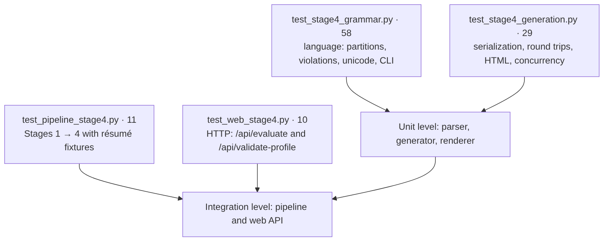
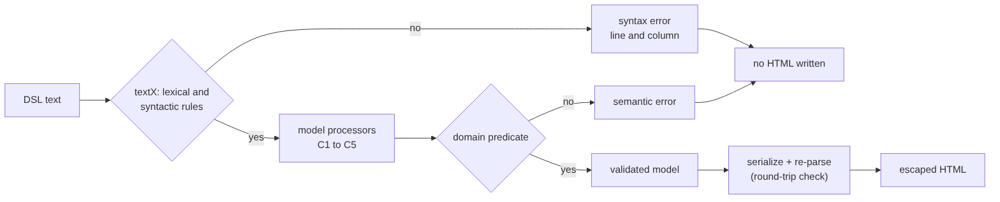
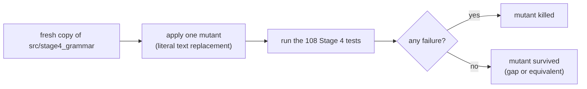

# Stage 4 — Test-Case and Scenario Design

Companion of [`stage4_grammar.md`](stage4_grammar.md) (Part I: modules and processing; Part II: grammar and theorems). This document explains **what the Stage 4 tests check, why those cases were chosen, and how we know they are good** (coverage and mutation analysis). It documents the tests that exist in the repository; it does not add new ones.

## 1. Automated evidence

The Stage 4 suites contain **108 test cases** (functions expanded by `parametrize`) in four files. The whole repository has **883**. All of them passed on 11 October 2026 with Python 3.12, textX 4.4.0, pyformlang 1.0.11 and pytest 9.1.1. The React production build also passed TypeScript checking and Vite compilation.

```bash
python -m pytest -q tests/test_stage4_grammar.py tests/test_stage4_generation.py tests/test_pipeline_stage4.py tests/test_web_stage4.py
python -m pytest -q          # whole repository
pnpm --dir frontend build
```

A passing count is a number of programmed checks, not a code-coverage percentage or an accuracy measure; coverage and mutation analysis are reported in §7 and §8.

| Suite | Cases | Technique | Contract protected |
|---|---|---|---|
| `test_stage4_grammar.py` | 58 | Equivalence partitions; boundary values; delimiter and order mutations; CLI | Whole-input recognition, required records, vocabulary, error kind and location |
| `test_stage4_generation.py` | 29 | Round trips; adversarial text; numeric boundaries; concurrency | Model preservation, escaping, valid output only, no file created or overwritten on invalid input |
| `test_pipeline_stage4.py` | 11 | Positive cases for each profile and negative controls | Real FST preparation; actual DFA acceptance copied to the DSL |
| `test_web_stage4.py` | 10 | HTTP integration; invalid-request partitions | JSON contract, 400 errors with source location, no HTML on failure |
| Stages 1–3 suites | 775 | Formal-model and regression checks | Extraction, transductions, vocabulary, automaton transitions |

## 2. Objectives and risks

Stage 4 is a grammar, a validator with two layers, a serializer and a renderer. A faulty implementation can fail in six ways; each risk drives a group of tests.

| Risk | Example of the fault | Where it is tested |
|---|---|---|
| Wrong language: textX accepts or rejects documents that the grammar does not | `;` after a field becomes optional; sections can be reordered | 29 syntax partitions; documented example |
| Wrong structure: the model does not reflect the document | escapes not decoded; absent years become 0; order of repeated records lost | documented example; Unicode/quotes test; round trips |
| Wrong domain layer | duplicated skill accepted; contact format not checked; semantic error reported as syntax | 16 semantic partitions |
| Wrong generation from Stages 1–3 | an accepted profile invented; `EXPERIENCE_PRESENT` written as a skill; unknown skills dropped | `test_pipeline_stage4.py` |
| Unsafe or misleading output | markup in the data interpreted as HTML; HTML produced for an invalid document; years shown as 0 | `test_stage4_generation.py` |
| Wrong integration | the API returns HTML on error; the CLI overwrites its input | web and CLI tests |



## 3. Test techniques

| Technique | Where | Why |
|---|---|---|
| **Equivalence-class partitioning** | `test_lexical_and_syntactic_violations_are_rejected` (29 classes of syntax error), `test_semantic_checks_report_domain_errors_separately` (16 classes of domain error), `test_dsl_endpoint_rejects_invalid_payloads` (7 classes of payload) | One representative per class of invalid input: missing, duplicated or reordered section; missing delimiter; wrong token class; trailing text |
| **Boundary-value analysis** | `total_years` 0 / 125 / 01 / −1 / 1.5 / `"3"`; empty document; `candidate {}`; unclosed `candidate {`; payload of 100,001 characters; empty and whitespace-only résumé | Errors concentrate at the edges of each lexical class and of each list |
| **Delimiter and order mutation** | cases that remove `;`, a quote or the closing brace, swap `name`/`location`, or reorder `personal` and `contact` | A grammar that is too permissive accepts them |
| **Round trip** | `test_generated_dsl_is_lossless_and_deterministic` (5 models), `test_complete_example_round_trip` | `parse(serialize(p)) = p` and `serialize(parse(d)) = d` for the models tried |
| **Adversarial / injection testing** | markup in `name`, `summary`, `location`; DSL punctuation inside a name; `skill PYTHON; skill GIT` inside one skill | Text must stay data in both the DSL and the HTML |
| **Negative controls** | invalid models, invalid sources, a résumé without skills, `python@gmail.com` | The system must also refuse, not only accept |
| **Scenario / end-to-end testing** | `test_pipeline_stage4.py`, `test_web_stage4.py`, the three CLI tests of each grammar and generation file | Real résumé text through Stages 1 → 4, the HTTP API and the command line |
| **Concurrency check** | `test_concurrent_validations_keep_profiles_separate` | Parsing must not share state between candidates |
| **Mutation analysis** | §8 | Measures whether the suites notice injected faults |

## 4. Test data

| Data | Source | Used by |
|---|---|---|
| Valid documented example | `docs/examples/wednesday.resume` (two jobs, two studies, contacts, canonical and unrecognized skills, one accepted profile) | documented-example test, CLI tests, round trip |
| Invalid documented example | `docs/examples/invalid_candidate.resume` (lower-case skill symbol) | CLI tests |
| Document builder | `document(**sections)` in `test_stage4_grammar.py`: a valid empty document in which one section is replaced | syntax and semantic partitions |
| Hand-made models | `CandidateProfile(...)` instances: empty, accented name with 0 years, quotes/backslashes/emoji, two jobs and two studies, contacts with skills and two profiles | round trips, invalid models |
| Skill lists as résumé text | `'Name: Test Candidate\nSkills: …'` with six skill lists (§5.3) | pipeline tests |
| Résumé fixture | `tests/data/resumes/rich_resume.txt` (contacts, titles, degrees, `Figma`, `Notion`) | metadata-preservation test |
| Payloads | `None`, `[]`, `{}`, `{'text': 12}`, `''`, `' '`, `'x' * 100_001` | web endpoint |

All data are fictional.

## 5. Decision tables

### 5.1 Validation order

A document passes through two layers, and the tests assert which layer reports each failure. Nothing is rendered unless both succeed.



| Condition | Layer | `kind` | Location | HTML |
|---|---|---|---|---|
| Lexical or structural rule of the grammar violated | textX | `syntax` | line and column ≥ 1 | none |
| Rule C1–C5 of the domain predicate violated | model processors | `semantic` | line and column ≥ 1 | none |
| Both layers satisfied | — | — | — | produced and escaped |

### 5.2 Syntax partitions (29 cases of one test)

| Class | Representatives |
|---|---|
| Document frame | empty text; `candidate {}`; wrong keyword `candidate_extra`; missing closing brace; trailing text after the document |
| Sections | `personal` missing; `contact` repeated; `personal` and `contact` swapped |
| Personal fields | missing `;`; unquoted or single-quoted string; `name` repeated; `location` before `name`; invalid escape `\q`; raw newline inside a string; unknown field `age` |
| Contact | unknown kind `fax` |
| Experience / education | `total_years` negative, decimal, with leading zero, quoted; `entry` without its mandatory first field (`title`, `qualification`) |
| Skills | lower-case symbol; `NODE.JS`; quoted symbol |
| Classification | unknown profile; profile with an extra suffix; upper-case profile |

### 5.3 Semantic partitions (16 cases of one test)

| Constraint | Representatives |
|---|---|
| Non-blank text | blank `name`, `summary`, `title`, `qualification`, `skills` value |
| Contact format | invalid email (two forms), phone, LinkedIn URL, GitHub URL |
| Uniqueness | duplicate contact, duplicate skill, duplicate unrecognized skill, duplicate accepted profile |
| Canonical vocabulary | `FIGMA` and `EXPERIENCE_PRESENT` are not canonical skills |

Permitted repetitions are tested too: two contacts of the same kind with different values, and any number of experience and education entries.

### 5.4 Pipeline acceptance (6 cases of one test)

| Skills in the résumé | Expected accepted profiles |
|---|---|
| Git, SQL, Node.js, JavaScript | Full Stack |
| Git, SQL, Scikit-learn, Pandas, Python | Machine Learning |
| Git, AWS, Docker, Jenkins, Bash | Cloud & DevOps |
| Git, Scikit-learn, Matplotlib, Pandas, Python | Data Scientist |
| Python, Pandas, Matplotlib, Scikit-learn, SQL, Git | Machine Learning **and** Data Scientist |
| JavaScript, SQL, Git | none |

## 6. Catalog of the Stage 4 tests

### `test_stage4_grammar.py` — 58 cases

| Test | Cases | What it asserts |
|---|---|---|
| `test_documented_example_retains_repeated_records_and_missing_values` | 1 | Every field of the example, two jobs, two studies; absent values stay `None` |
| `test_missing_information_is_not_invented_and_zero_is_not_missing` | 1 | Empty document = empty profile; `total_years 0` is 0, not missing |
| `test_all_normalized_skills_and_profile_identifiers_are_representable` | 1 | Every canonical token of Stage 2 and the four profile identifiers can be written and parsed |
| `test_repeated_contacts_of_the_same_kind_are_allowed` | 1 | Two emails are kept in order |
| `test_text_preserves_unicode_quotes_backslashes_newlines_and_dsl_punctuation` | 1 | Text containing DSL syntax is data and does not create a classification |
| `test_line_comments_do_not_consume_urls_or_strings` | 1 | `//` inside a string or URL is not a comment |
| `test_lexical_and_syntactic_violations_are_rejected` | 29 | `kind='syntax'`, line and column ≥ 1 (§5.2) |
| `test_semantic_checks_report_domain_errors_separately` | 16 | Message and `kind='semantic'` (§5.3) |
| `test_grammar_validation_does_not_claim_to_reclassify_the_candidate` | 1 | A hand-written `accepted full_stack;` is syntactically valid; Stage 4 does not certify it |
| `test_parse_results_are_immutable_and_independent` | 1 | Frozen dataclasses; two parses share nothing |
| `test_utf8_files_and_error_locations` | 1 | UTF-8 file read; error at line 6 with the file name |
| `test_parser_requires_text` | 1 | `TypeError` for non-string input |
| `test_cli_valid_file_prints_structured_data` | 1 | Exit code 0, JSON on stdout, nothing on stderr |
| `test_cli_invalid_file_has_nonzero_status_and_no_success_output` | 1 | Exit code 1, empty stdout, `syntax:` and the file name on stderr |
| `test_cli_missing_file_is_reported_without_a_traceback` | 1 | Exit code 1, no traceback |

### `test_stage4_generation.py` — 29 cases

| Test | Cases | What it asserts |
|---|---|---|
| `test_generated_dsl_is_lossless_and_deterministic` | 5 | Parsing the generated DSL returns the same profile; serializing again gives the same text; the document is flagged validated and has an HTML doctype |
| `test_complete_example_round_trip` | 1 | The documented example survives parse → serialize → parse |
| `test_html_never_interprets_candidate_markup` | 3 | `<script>`, `</style>` and an attribute-breaking location never appear as markup |
| `test_dsl_text_cannot_inject_classification` | 1 | A name that tries to close the block and declare a profile stays a name |
| `test_invalid_models_cannot_produce_documents` | 11 | `ValueError` for DSL-injection skills, unknown or `EXPERIENCE_PRESENT` skills, blank name, lone surrogate, duplicate skill, `True`, −1 and 1.2 years |
| `test_missing_years_are_not_rendered_as_zero` | 1 | No experience line when years are missing |
| `test_invalid_dsl_does_not_create_or_overwrite_html` | 1 | A broken source creates no file and leaves an existing file unchanged |
| `test_cli_exports_valid_example_and_preserves_input` | 1 | The exported HTML equals the validated one; exporting over the input is refused and the input is intact |
| `test_concurrent_validations_keep_profiles_separate` | 1 | Twelve parses on four threads return twelve distinct names in order |
| `test_invalid_source_is_rejected_before_rendering` | 4 | `candidate {}`, `candidate {`, empty text and `garbage` raise before any HTML |

### `test_pipeline_stage4.py` — 11 cases

| Test | Cases | What it asserts |
|---|---|---|
| `test_all_four_stages_preserve_actual_acceptance` | 6 | The profiles written in the DSL equal those accepted by the DFAs (§5.4) |
| `test_rich_resume_preserves_metadata_without_inventing_record_associations` | 1 | Years, contacts, titles, degrees and unrecognized skills are preserved; no employer or period is invented; `EXPERIENCE_PRESENT` is not a skill |
| `test_no_technical_skills_can_still_form_a_valid_rejected_document` | 1 | `python@gmail.com` is not a Python skill; a document with no skills and no accepted profile is valid |
| `test_empty_resume_rejected` | 3 | `''`, whitespace and `None` raise `ValueError` |

### `test_web_stage4.py` — 10 cases

| Test | Cases | What it asserts |
|---|---|---|
| `test_resume_response_contains_validated_document_matching_dfa_results` | 1 | The document returned by `/api/evaluate` lists exactly the profiles the DFAs accepted and revalidates to itself |
| `test_strict_tokens_do_not_invent_candidate_documents` | 1 | Token mode returns no document |
| `test_dsl_endpoint_rejects_invalid_payloads` | 7 | Seven malformed payloads are rejected |
| `test_http_dsl_validation_reports_location_and_never_returns_html_on_failure` | 1 | Real HTTP server: 200 with `Cache-Control: no-store` for a valid document; 400 with `kind`, line and column and no HTML for a syntax error and for a semantic error |

## 7. Meaningful scenarios

1. **Reversed skills.** `Git, SQL, Node.js, JavaScript` appears out of order in the résumé text. Stage 2 orders the Full Stack sequence and Stage 3 accepts it; the DSL says `accepted full_stack;`. The same reverse order in direct-token mode is rejected (web and Stage 3 tests).
2. **Two profiles at once.** `Python, Pandas, Matplotlib, Scikit-learn, SQL, Git` accepts Machine Learning and Data Scientist. Both identifiers survive serialization.
3. **Email is not a skill.** A résumé with `python@gmail.com` and no Python skill cannot acquire a Python qualification from the address.
4. **Rich record.** Two jobs and two studies round-trip without losing optional attributes. The text extractor produces partial records and the adapter does not invent employers or dates.
5. **Missing is not zero.** Missing years produce no numeric claim and no HTML line; an explicit `total_years 0;` remains 0.
6. **Hostile text.** Quotes, backslashes, accents, newlines and emoji remain data. HTML tags are escaped and a name that imitates DSL syntax cannot add a classification. Unquoted identifier injection is rejected before serialization.
7. **Invalid DSL does not clobber output.** A broken source leaves an existing HTML file unchanged, and exporting over the input file is refused.

## 8. Quality of the tests

### 8.1 Code coverage

Measured with coverage.py (branch coverage) running only the four Stage 4 files over `src/stage4_grammar`:

| Module | Statements | Coverage | Lines not executed |
|---|---|---|---|
| `__init__.py` | 5 | 100 % | — |
| `__main__.py` | 25 | 94 % | 33 (`if __name__ == '__main__'`) |
| `generator.py` | 57 | 93 % | 13, 27, 65 |
| `models.py` | 28 | 100 % | — |
| `parser.py` | 78 | 99 % | branch 37 → 39 |
| `renderer.py` | 54 | 99 % | 33 |
| **Total** | **247** (76 branches) | **97 %** | |

Coverage shows which code is exercised, not that the assertions are strong; that is what the next section measures.

### 8.2 Mutation analysis

Each mutant is one deliberate fault applied as a literal text replacement to a fresh copy of `src/stage4_grammar`. The four Stage 4 files run against it; if any test fails the mutant is **killed**, otherwise it **survived**.



Result: **29 of 37 mutants killed (78 %)**.

| Id | File | Injected fault | Result | First test that fails |
|---|---|---|---|---|
| M01 | `candidate.tx` | grammar: education section before experience | killed | `test_documented_example_retains_repeated_records_and_missing_values` |
| M02 | `candidate.tx` | grammar: name may be repeated | killed | `test_documented_example_retains_repeated_records_and_missing_values` |
| M03 | `candidate.tx` | grammar: location before summary | killed | `test_documented_example_retains_repeated_records_and_missing_values` |
| M04 | `candidate.tx` | grammar: contact section needs at least one entry | killed | `test_missing_information_is_not_invented_and_zero_is_not_missing` |
| M05 | `candidate.tx` | grammar: semicolon after a contact is optional | **survived** | — |
| M06 | `candidate.tx` | grammar: work entry without title accepted | killed | `test_lexical_and_syntactic_violations_are_rejected` |
| M07 | `candidate.tx` | grammar: education entry without qualification accepted | killed | `test_lexical_and_syntactic_violations_are_rejected` |
| M08 | `candidate.tx` | lexical: canonical tokens may be lowercase | killed | `test_lexical_and_syntactic_violations_are_rejected` |
| M09 | `candidate.tx` | lexical: leading zeros accepted | killed | `test_lexical_and_syntactic_violations_are_rejected` |
| M10 | `candidate.tx` | lexical: raw control characters/newlines inside text | killed | `test_lexical_and_syntactic_violations_are_rejected` |
| M11 | `candidate.tx` | grammar: extra contact kind | **survived** | — |
| M12 | `candidate.tx` | grammar: data_scientist profile id missing | killed | `test_all_normalized_skills_and_profile_identifiers_are_representable` |
| M13 | `candidate.tx` | grammar: total_years may appear twice | killed | `test_documented_example_retains_repeated_records_and_missing_values` |
| M14 | `candidate.tx` | grammar: closing brace of candidate optional | killed | `test_lexical_and_syntactic_violations_are_rejected` |
| M15 | `parser.py` | domain: whitespace-only text accepted | killed | `test_semantic_checks_report_domain_errors_separately` |
| M16 | `parser.py` | domain: contact format not checked | killed | `test_semantic_checks_report_domain_errors_separately` |
| M17 | `parser.py` | domain: duplicate contacts accepted | killed | `test_semantic_checks_report_domain_errors_separately` |
| M18 | `parser.py` | domain: two contacts of the same kind rejected | killed | `test_repeated_contacts_of_the_same_kind_are_allowed` |
| M19 | `parser.py` | domain: unknown canonical tokens accepted | killed | `test_semantic_checks_report_domain_errors_separately` |
| M20 | `parser.py` | domain: duplicate skills accepted | killed | `test_semantic_checks_report_domain_errors_separately` |
| M21 | `parser.py` | domain: duplicate accepted profiles accepted | killed | `test_semantic_checks_report_domain_errors_separately` |
| M22 | `parser.py` | model: missing years become 0 | **survived** | — |
| M23 | `parser.py` | errors: semantic errors reported as syntax | killed | `test_semantic_checks_report_domain_errors_separately` |
| M24 | `parser.py` | domain: unpaired surrogates accepted | killed | `test_invalid_models_cannot_produce_documents` |
| M25 | `parser.py` | model: escapes not decoded | killed | `test_text_preserves_unicode_quotes_backslashes_newlines_and_dsl_punctuation` |
| M27 | `generator.py` | generator: text not escaped | killed | `test_generated_dsl_is_lossless_and_deterministic` |
| M28 | `generator.py` | generator: no round-trip check | **survived** | — |
| M29 | `generator.py` | adapter: unknown skills dropped | killed | `test_rich_resume_preserves_metadata_without_inventing_record_associations` |
| M30 | `generator.py` | adapter: EXPERIENCE_PRESENT/foreign tokens emitted as skills | killed | `test_rich_resume_preserves_metadata_without_inventing_record_associations` |
| M31 | `generator.py` | adapter: every profile declared accepted | killed | `test_all_four_stages_preserve_actual_acceptance` |
| M32 | `generator.py` | generator: invalid years accepted | **survived** | — |
| M33 | `renderer.py` | renderer: no HTML escaping | killed | `test_html_never_interprets_candidate_markup` |
| M34 | `renderer.py` | renderer: zero years hidden | killed | `test_missing_years_are_not_rendered_as_zero` |
| M35 | `renderer.py` | renderer: invalid DSL still rendered | killed | `test_cli_invalid_file_has_nonzero_status_and_no_success_output` |
| M36 | `renderer.py` | renderer: contact section never shown | **survived** | — |
| M37 | `renderer.py` | renderer: permissive CSP | **survived** | — |
| M38 | `renderer.py` | renderer: unknown skills never shown | **survived** | — |

**Survivors, and what they say.**

- **M05** (`;` after a contact optional) and **M11** (an extra contact kind `website`): no syntax partition removes the `;` of a contact entry or uses a fifth contact kind (the partitions use `fax`, which is still rejected). These are gaps worth a future case.
- **M22** (`auto_init_attributes=True`): with textX 4.4.0 the parsed model is the same, because the model is built explicitly from the textX objects, so the mutant is behaviourally equivalent. It is not a gap.
- **M28** (no round-trip comparison in `serialize_profile`): the comparison only matters for lossy models, such as one built with lists instead of tuples, and no test builds one. **M32** (invalid years accepted by the generator): the invalid values tried (`True`, −1, 1.2) are still written as text that the parser rejects with a `ValueError` subclass, so the explicit guard is not isolated by any test.
- **M36** (contact section never shown in the HTML) and **M38** (unknown-skills section never shown): the HTML tests assert escaping and the absence of zero years, not that every section appears.
- **M37** (permissive Content-Security-Policy): no test inspects the CSP meta tag.

These survivors are listed as known limits of the current suites, not as verified behaviour.

## 9. Browser and Streamlit verification

The built React app was exercised against the local Python server. A fictional candidate qualified for Machine Learning and Data Scientist; the generated preview contained the same declarations and the extracted contact and years. Editing the DSL to `candidate {` immediately disabled the HTML download and removed the preview. Validation reported a syntax error at line 1, column 12. Restoring the generated result and revalidating restored the preview. These observations complement the automated tests; they are not a cross-browser certification.

Streamlit 1.65.0 was checked with `streamlit.testing.v1.AppTest`: the normal pipeline renders the structured profile, while the strict-token and skipped-Stage-2 demonstrations do not expose a generated candidate document. All three runs completed without application exceptions.

## 10. Scope limits

There is no annotated real-world dataset, performance benchmark, fairness evaluation or extraction precision/recall claim. The contact formats and the fixed vocabulary deliberately follow this project's implementation. The suites do not test that the grammar has the formal properties proved in `stage4_grammar.md` (LL(1), regular token language); those are proofs on paper. Automated tests do not prove student understanding or replace a live demonstration.

## References

- Myers, G. J., Sandler, C., & Badgett, T. (2011). *The Art of Software Testing* (3rd ed.). Wiley. — partitions, boundaries, decision tables.
- Jia, Y., & Harman, M. (2011). An analysis and survey of the development of mutation testing. *IEEE Transactions on Software Engineering, 37*(5), 649–678.
- Dejanović, I., Vaderna, R., Milosavljević, G., & Vuković, Ž. (2017). TextX: A Python tool for domain-specific languages implementation. *Knowledge-Based Systems, 115*, 1–4.
